# LLM Engineering: Study Guide & Technical Notes

## Table of Contents

- [Mac Setup: Installing Git, Cloning the Repo, and Cursor IDE](#mac-setup-installing-git-cloning-the-repo-and-cursor-ide)
- [Setting Up Your OpenAI API Key and Environment Variables](#setting-up-your-openai-api-key-and-environment-variables)
- [Running Your First OpenAI API Call and System vs User Prompts](#running-your-first-openai-api-call-and-system-vs-user-prompts)
- [Building an End-to-End Website Summarizer with the OpenAI Chat Completions API](#building-an-end-to-end-website-summarizer-with-the-openai-chat-completions-api)
- [Frontier Models: OpenAI GPT, Claude, Gemini, and Grok Compared](#frontier-models-openai-gpt-claude-gemini-and-grok-compared)
- [Open-Source LLMs: Llama, Mistral, DeepSeek, and Ollama](#open-source-llms-llama-mistral-deepseek-and-ollama)
- [Chat Completions API: HTTP Endpoints vs. the OpenAI Python Client](#chat-completions-api-http-endpoints-vs-the-openai-python-client)
- [Running Ollama Locally with OpenAI-Compatible Endpoints](#running-ollama-locally-with-openai-compatible-endpoints)
- [Base, Chat, and Reasoning Models: Understanding LLM Types](#base-chat-and-reasoning-models-understanding-llm-types)

---

# Mac Setup: Installing Git, Cloning the Repo, and Cursor IDE

## Development Environment Foundations and Apple Command Line Tools

Machine learning engineering on macOS relies on standard Unix utilities, native C/C++ compilation headers, and shell tooling. Before installing Python packages, tokenizers, or model pipelines, Git and Apple's developer tools must be installed.

### Verifying Git and Installing Command Line Tools

macOS includes a stub executable for Git at `/usr/bin/git`. Running Git in a fresh macOS setup automatically checks whether Apple's Command Line Tools are present.

Open the terminal (`Applications` > `Utilities` > `Terminal`) and check your Git version:

```bash
# Check installed Git version
git --version
```

```text
git version 2.42.0
```

If developer tools are not yet installed, macOS shows a prompt asking:
`The "git" command requires the command line developer tools. Would you like to install the tools now?`

Click **Install** to download the lightweight Command Line Tools without needing the entire 12+ GB Xcode IDE. You can also trigger this directly from the terminal:

```bash
# Trigger installation of Apple Command Line Developer Tools
xcode-select --install
```

```text
xcode-select: note: install requested for command line developer tools
```

> [!TIP]
> **Check Installation Path:** Run `xcode-select -p` to verify the path. A properly linked environment outputs `/Library/Developer/CommandLineTools` or `/Applications/Xcode.app/Contents/Developer`.

### Alternative: Installing Upstream Git via Homebrew

Apple's bundled Git works well, but it updates slowly with macOS releases. For the newest features, security updates, and performance patches, install Git via **Homebrew**:

```bash
# Install the latest upstream Git using Homebrew
brew install git

# Verify the active binary path
which git
```

```text
/opt/homebrew/bin/git
```

| Tool                           | Provider        | Primary Use                                          | Trade-off                                                              |
| :----------------------------- | :-------------- | :--------------------------------------------------- | :--------------------------------------------------------------------- |
| **Apple CLT (`xcode-select`)** | Apple           | System headers, `clang`, `make`, basic `git`         | Small footprint (~1.5 GB), zero setup; updates tied to macOS releases. |
| **Homebrew Git**               | Homebrew        | Up-to-date Git releases and security patches         | Keeps pace with upstream Git; requires Homebrew installed.             |
| **Full Xcode App**             | Apple App Store | iOS / macOS native Swift and Objective-C development | Huge disk usage (12–15+ GB); unnecessary for Python LLM development.   |

---

## Workspace Architecture and Directory Strategy

A critical trap when setting up a Mac development environment is **folder placement and cloud file synchronization**.

### The Apple iCloud Synchronization Trap

macOS automatically enables iCloud Drive sync for `Desktop` (`~/Desktop`) and `Documents` (`~/Documents`). Storing code repositories in these synced directories causes serious problems:

1. **File Locking and Git Sluggishness:** Git writes thousands of small object files into `.git/objects` during checkouts and commits. iCloud continuously tries to upload each file, causing file locks, permission errors, and lag.
2. **Virtual Environment Bloat:** Python virtual environments (`.venv` or conda prefixes) contain thousands of third-party libraries and symlinks. Syncing them consumes bandwidth and exhausts cloud storage quotas.
3. **Redundant Sync Conflicts:** Code is already tracked and backed up remotely on GitHub. Running iCloud sync on top of Git creates competing sync engines that can corrupt local repositories.

### Filesystem Isolation vs. iCloud Sync Hazards

```text
+-----------------------------------------------------------------------------------+
|                              MACOS USER HOME DIRECTORY                            |
|                                    /Users/<name>/                                 |
+-----------------------------------------------------------------------------------+
       |                                                              |
       | (AVOID FOR CODE)                                             | (RECOMMENDED WORKSPACE)
       v                                                              v
+-------------------------------+                             +-------------------------------+
|      ~/Desktop & ~/Documents  |                             |          ~/projects           |
|  (Apple iCloud Auto-Sync)     |                             |   (Pure Local Filesystem)     |
+-------------------------------+                             +-------------------------------+
       |                                                              |
       |-- Sync Conflicts                                             |-- Zero Network Overhead
       |-- File-locking during builds                                 |-- Instant Git Disk I/O
       |-- Virtualenv / cache bloat                                   |-- Total Filesystem Isolation
       v                                                              v
+-------------------------------+                             +-------------------------------+
|       Apple iCloud Drive      |                             |   Remote Git Host (GitHub)    |
| (Redundant & Unstable for Git)|                             |  (Clean Branch & Push Sync)   |
+-------------------------------+                             +-------------------------------+
```

### Creating Your Workspace Folder

Keep all code in an unsynced local directory in your home folder, such as `~/projects`:

```bash
# Navigate to home directory
cd ~

# Confirm path
pwd
```

```text
/Users/ed
```

Create the directory and switch into it:

```bash
# Create the projects folder if it does not already exist
mkdir -p ~/projects

# Move into projects and verify
cd ~/projects
pwd
```

```text
/Users/ed/projects
```

---

## Cloning the Code Repository

With a clean local `projects` folder ready, clone the repository over HTTPS.

### Git Remote to Local Synchronization

Cloning downloads a full local copy of the repository files, commit history, and branches from GitHub to your machine.

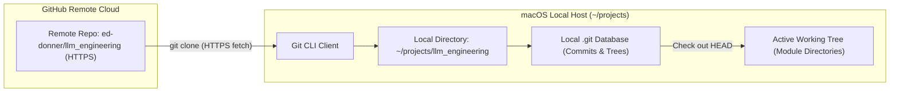

### Cloning and Inspecting Files

1. Go to `https://github.com/ed-donner/llm_engineering`.
2. Click the green **Code** button and copy the HTTPS URL: `https://github.com/ed-donner/llm_engineering.git`.
3. In your terminal, run `git clone`:

```bash
# Clone the repository locally
git clone https://github.com/ed-donner/llm_engineering.git
```

```text
Cloning into 'llm_engineering'...
remote: Enumerating objects: 6956, done.
remote: Total 6956 (delta 0), reused 0 (delta 0), pack-reused 6956 (from 1)
Receiving objects: 100% (6956/6956), 50.72 MiB | 35.45 MiB/s, done.
Resolving deltas: 100% (4270/4270), done.
```

Switch into the directory and verify the contents:

```bash
# Enter the cloned repository
cd llm_engineering

# List files and directories
ls -la
```

```text
total 128
drwxr-xr-x  32 user  staff   1024 Oct 17 12:00 .
drwxr-xr-x   3 user  staff     96 Oct 17 11:58 ..
drwxr-xr-x  12 user  staff    384 Oct 17 12:00 .git
-rw-r--r--   1 user  staff   1200 Oct 17 12:00 .gitignore
-rw-r--r--   1 user  staff   1064 Oct 17 12:00 LICENSE
-rw-r--r--   1 user  staff   4520 Oct 17 12:00 README.md
-rw-r--r--   1 user  staff  11100 Oct 17 12:00 SETUP-mac.md
-rw-r--r--   1 user  staff  10800 Oct 17 12:00 SETUP-PC.md
-rw-r--r--   1 user  staff  10500 Oct 17 12:00 SETUP-linux.md
-rw-r--r--   1 user  staff    850 Oct 17 12:00 environment.yml
-rw-r--r--   1 user  staff    420 Oct 17 12:00 requirements.txt
drwxr-xr-x   6 user  staff    192 Oct 17 12:00 week1
drwxr-xr-x   6 user  staff    192 Oct 17 12:00 week2
drwxr-xr-x   6 user  staff    192 Oct 17 12:00 week3
drwxr-xr-x   6 user  staff    192 Oct 17 12:00 week4
drwxr-xr-x   6 user  staff    192 Oct 17 12:00 week5
drwxr-xr-x   6 user  staff    192 Oct 17 12:00 week6
drwxr-xr-x   6 user  staff    192 Oct 17 12:00 week7
drwxr-xr-x   6 user  staff    192 Oct 17 12:00 week8
```

---

## Code Editor Selection and Cursor Configuration

An AI-native code editor streamlines debugging, code generation, and multi-file project indexing.

### Cursor Architecture and Features

**Cursor** is built on top of Visual Studio Code (`VSCodium` base). It preserves all VS Code settings, keybindings, and extensions while embedding AI assistance directly into the editor:

- **Local Workspace Indexing:** Indexes project files locally so the AI understands imports, types, and project structure across multiple files.
- **Model Integration:** Connects to models like Claude 3.5 Sonnet and GPT-4o for inline editing, diffs, and terminal error fixing.
- **Trial & Free Usage:** Includes a two-week free trial for premium AI completions. Afterward, you can subscribe, use your own API keys, or use Cursor as a free, high-performance VS Code editor.

### Comparing Editors

| Editor       | Base Platform        | Native AI Integration                                 | Cost Model                                                        | Recommendation                                                          |
| :----------- | :------------------- | :---------------------------------------------------- | :---------------------------------------------------------------- | :---------------------------------------------------------------------- |
| **Cursor**   | VS Code Fork         | Full workspace indexing, multi-file diffs, agent mode | Free tier (editor features); Subscription or BYOK for frontier AI | **Recommended:** Quickest setup for AI-assisted multi-file development. |
| **VS Code**  | Electron / Microsoft | Requires extensions (GitHub Copilot, Continue.dev)    | Free and open source; Copilot subscription optional               | Excellent baseline with full feature parity for standard development.   |
| **Windsurf** | VS Code Fork         | Agentic AI flows with Codeium backend                 | Free tier / Paid subscription tiers                               | Capable alternative with similar inline AI editing.                     |
| **PyCharm**  | IntelliJ / JetBrains | JetBrains AI Assistant                                | Free Community; Paid Professional                                 | Great Python refactoring, but heavier memory footprint.                 |

### Installing and Configuring Cursor

1. Download the macOS installer from `cursor.com`.
2. Open the `.dmg` file and drag `Cursor.app` into `/Applications`.
3. Open **Cursor**, complete initial preferences (VS Code defaults recommended), and sign in.
4. Go to **File** > **Open Folder...** (or click **Open Project** on the welcome screen).
5. Navigate to `~/projects/llm_engineering`, select the folder, and click **Open**.

```text
+-----------------------------------------------------------------------------------+
|  CURSOR IDE - EXPLORER VIEW                                                       |
+-----------------------------------------------------------------------------------+
|  v LLM_ENGINEERING                               <-- Project Root (Must be Capital)|
|    > community-contributions                                                      |
|    > extras                                                                       |
|    > week1                                       <-- Module Directories           |
|    > week2                                                                        |
|    > week3                                                                        |
|    > week4                                                                        |
|    > week5                                                                        |
|    > week6                                                                        |
|    > week7                                                                        |
|    > week8                                                                        |
|      .gitignore                                                                   |
|      environment.yml                             <-- Conda Environment Config     |
|      requirements.txt                            <-- Pip Package Manifest         |
|      SETUP-mac.md                                <-- Mac Hardware Guidelines      |
+-----------------------------------------------------------------------------------+
```

> [!IMPORTANT]
> **Check the Project Root:** The top header in the file explorer must show `LLM_ENGINEERING` in bold capital letters. If a subfolder (like `week1`) is opened as the root, project-wide relative imports and virtual environments will not resolve correctly.

---

## Python Environment Management Alternatives

Choosing a Python package manager determines how quickly dependencies install, how much disk space is consumed, and how easily Apple Silicon GPU acceleration (Metal Performance Shaders / MPS) is supported.

### Anaconda vs. `uv` vs. Standard `venv`

- **Anaconda / Miniconda:** Uses the `conda` solver. Ships precompiled C/C++ libraries and BLAS acceleration packages. Great for guaranteed binary consistency across platforms, but slow to resolve dependencies and takes 5+ GB of disk space.
- **`uv` (by Astral):** A blazing-fast Python package and project manager written in Rust. Replaces `pip`, `pip-tools`, and `virtualenv`. Resolves dependencies in seconds and uses global hardlinks to save disk space.
- **Python `venv` + `pip`:** Python's built-in virtual environment tool. Available out of the box with zero external installation, but lacks advanced cross-platform binary solving.

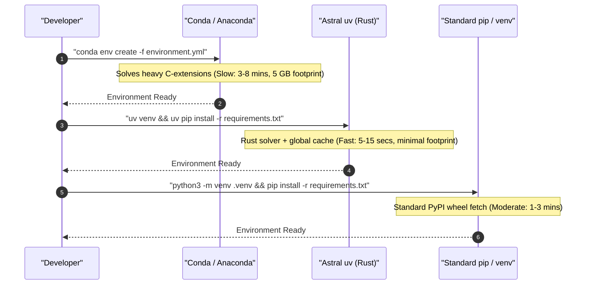

| Environment Manager      | Resolution Speed        | Disk Efficiency           | Apple Silicon (MPS) Compatibility     | Recommendation                                                           |
| :----------------------- | :---------------------- | :------------------------ | :------------------------------------ | :----------------------------------------------------------------------- |
| **Anaconda / Miniconda** | Slow (Conda SAT solver) | Low (duplicates packages) | Native `osx-arm64` channels           | Reliable cross-platform consistency for heavy C-extensions.              |
| **`uv`**                 | Blazing (Rust engine)   | High (global hardlinks)   | Native PyPI wheels with ARM64 support | **Modern Industry Favorite:** Fastest resolution and minimal disk usage. |
| **`venv` + `pip`**       | Moderate                | Medium                    | Native PyPI wheels                    | Built-in fallback requiring no external package manager.                 |

---

## Common Pitfalls and Best Practices

> [!CAUTION]
> **Never Clone into Cloud Folders:** Do not place repositories inside folders managed by iCloud, OneDrive, Dropbox, or Google Drive. Cloud syncing locks Git files, breaks local SQLite vector databases, and causes random build failures.

> [!IMPORTANT]
> **Verify Native Apple Silicon Architecture:** On Apple Silicon Macs (M1/M2/M3/M4), ensure your terminal runs native ARM64 rather than Rosetta 2 x86 emulation. Run `uname -m` in your terminal—it must return `arm64`. Running under x86 causes PyTorch MPS acceleration to fail.

> [!TIP]
> **Hide the AI Chat Panel for Extra Space:** If Cursor opens with an AI Chat sidebar covering your workspace, press `Cmd + L` to toggle it or drag the divider to collapse it.

---

## Review Quiz

<details>
<summary><b>Question 1: Why should you avoid storing code repositories in ~/Desktop or ~/Documents on macOS?</b></summary>
<br>
<b>Answer:</b> macOS syncs Desktop and Documents to iCloud Drive by default. Storing repositories there causes continuous background sync of internal <code>.git</code> files and virtual environments, leading to file-locking conflicts, slow disk performance, and potential repository corruption. Use an unsynced local folder like <code>~/projects</code> instead.
</details>

<details>
<summary><b>Question 2: What happens when you run "git --version" on a fresh Mac without developer tools?</b></summary>
<br>
<b>Answer:</b> The operating system intercepts the command using the <code>/usr/bin/git</code> stub and opens a dialog offering to install Apple's Command Line Developer Tools (which includes Git, Clang, and Make).
</details>

<details>
<summary><b>Question 3: How does Cursor maintain compatibility with Visual Studio Code extensions and settings?</b></summary>
<br>
<b>Answer:</b> Cursor is an open-source fork of Visual Studio Code (built on the VSCodium core). Because it uses the same underlying editor architecture, it supports standard VS Code settings, keybindings, and extensions while adding native AI workspace indexing.
</details>

<details>
<summary><b>Question 4: What confirms that you opened the correct project root folder in Cursor?</b></summary>
<br>
<b>Answer:</b> The top label in the Cursor file explorer sidebar must read <code>LLM_ENGINEERING</code> in capital letters, showing the repository directories directly underneath. If a specific subfolder appears as the root, project-wide relative imports and repository-level virtual environments will fail.
</details>

<details>
<summary><b>Question 5: What primary benefits does "uv" provide compared to traditional Anaconda environments?</b></summary>
<br>
<b>Answer:</b> Written in Rust, <code>uv</code> resolves and installs dependencies 10 to 100 times faster than Conda. It also uses a global content-addressable cache with hardlinks, drastically reducing disk space compared to Conda's multi-gigabyte environment copies.
</details>

---

# Setting Up Your OpenAI API Key and Environment Variables

## ChatGPT vs. OpenAI Platform API

A key distinction in AI engineering is the difference between consumer chat applications and backend developer APIs:

- **ChatGPT (Consumer Web App):** A conversational interface at `chatgpt.com`. Monthly subscriptions (such as ChatGPT Plus at $20/month) provide web UI perks and higher usage caps, but provide **zero** programmatic API access.
- **OpenAI Platform API (Developer Service):** A programmatic REST API at `platform.openai.com`. Applications connect directly via HTTP or official client libraries (`openai` package in Python). Billing is pay-as-you-go based on token usage (fractions of a cent per request), completely separate from any ChatGPT subscription.

### Free Alternatives: Gemini and Local Llama

Setting up an OpenAI account is optional. You can build LLM applications using free alternative models:

- **Google Gemini API:** Offers a developer free tier via Google AI Studio with generous request quotas, multi-turn chat, structured JSON output, and multimodal context.
- **Local Llama (via Ollama or vLLM):** Runs open-weights models (like Llama 3) locally on your own hardware at zero cost, offering complete privacy and offline operation.

| Service                  | Access Type             | Endpoint / Portal     | Billing Model                                   | Best Suited For                                          |
| :----------------------- | :---------------------- | :-------------------- | :---------------------------------------------- | :------------------------------------------------------- |
| **OpenAI Platform API**  | Programmatic REST / SDK | `platform.openai.com` | Pay-as-you-go per million tokens                | Production backends, evaluations, agentic pipelines      |
| **ChatGPT Plus**         | Web Chat UI             | `chatgpt.com`         | Flat monthly subscription ($20 / month)         | Interactive writing, personal assistance, quick research |
| **Google Gemini API**    | Programmatic REST / SDK | `aistudio.google.com` | Free tier quota + pay-as-you-go commercial tier | Zero-cost development, large multimodal context          |
| **Local Llama (Ollama)** | Local HTTP / Python     | `localhost:11434`     | 100% free (consumes local compute)              | Local testing, privacy-sensitive data, offline work      |

---

## Setting Up Billing and Credits

To make requests to the OpenAI API, you need an account with prepaid credits on the OpenAI Platform.

### Account Creation and Pre-Funding

1. Go to `platform.openai.com` and click **Sign up**. You can authenticate using Google, Microsoft, Apple, or an email address.
2. Click the **Settings** gear icon in the top right, then select **Billing**.
3. Click **Add to credit balance**. The minimum deposit is **$5** (valid for an entire year), which covers thousands of development calls.
4. Add a payment card under **Payment methods**.

> [!CAUTION]
> **Keep Auto-Recharge Turned OFF:** In the Billing dashboard, ensure **Auto recharge** is set to **Off**. Leaving auto-recharge on allows OpenAI to automatically charge your card if your balance runs out. Keeping it off guarantees your spending is strictly capped at your manual deposit.

> [!IMPORTANT]
> **Handling International Card Declines:** If your credit card is declined during top-up, your bank is likely blocking an international US transaction. Check your banking mobile app to allow international online payments or contact your card issuer.

---

## Creating an API Key

An API key is a secret token that lets your application authenticate with OpenAI's servers. Every request sent with this key bills against your account credit.

### Key Generation Steps

1. In **Settings**, select **API keys** under the **Organization** section.
2. Click **Create new secret key**.
3. Configure the key options:
   - **Owned by:** Select **You** (associates the key with your developer user).
   - **Name:** Enter a descriptive label (e.g., `llm_engineering_key`).
   - **Project:** Select **Default project** (avoids restricted sub-project scopes that block newer models).
   - **Permissions:** Select **All**.
4. Click **Create secret key**.

```text
+-----------------------------------------------------------------------------------+
|  OPENAI DEVELOPER PLATFORM - API KEY CREATION                                     |
+-----------------------------------------------------------------------------------+
|  [Create new secret key]                                                          |
|                                                                                   |
|  Owned by:   (*) You         ( ) Service account                                  |
|  Name:       llm_engineering_key                                                  |
|  Project:    Default project                     <-- Avoid restricted project scopes|
|  Permissions:(All) Read and write API resources  <-- Unrestricted developer access|
|                                                                                   |
|  [Cancel]                                             [Create secret key] (CLICK) |
+-----------------------------------------------------------------------------------+
```

### Key Security and Storage

When generated, the key displays starting with `sk-proj-...`:

- **Displayed Only Once:** OpenAI displays the raw secret key once. When you close the popup, the full key cannot be viewed again.
- Click **Copy** to place the key into your clipboard. Keep the popup open until you paste and save it into your local project.

---

## Storing Keys Safely in `.env`

Hardcoding API keys in Python files is dangerous because keys can easily be committed to GitHub. Following standard security practices, credentials should be stored in a local `.env` file and loaded into environment variables at runtime.

### Secret Loading and Protection Flow

```text
+-----------------------------------------------------------------------------------+
|                             SECURE LOCAL WORKSPACE                                |
|                           ~/projects/llm_engineering                              |
+-----------------------------------------------------------------------------------+
  |
  |-- .env (Local Plaintext File)
  |     OPENAI_API_KEY=sk-proj-7WOKk...
  |
  |-- .gitignore (Git Exclusion Rule)
  |     .env  <--------------------------------- Blocks Git Tracking (Prevents Leaks)
  |
  |-- Cursor IDE (.env Protection)
  |     Cursor-Tab Ignored <--------------------- Silences AI Telemetry on Secrets
  |
  v
+-------------------------------+
|  python-dotenv (load_dotenv)  |
+-------------------------------+
  |
  v Injects into Process Memory
+-------------------------------+
|     os.environ / Python       |
+-------------------------------+
  |
  v Automatic Client Authentication
+-------------------------------+         HTTPS POST          +---------------------+
|      openai.OpenAI()          | --------------------------> |  OpenAI API Gateway |
|  (Reads OPENAI_API_KEY)       |    Bearer sk-proj-...       | (Validates & Billed)|
+-------------------------------+                             +---------------------+
```

### Authentication Sequence

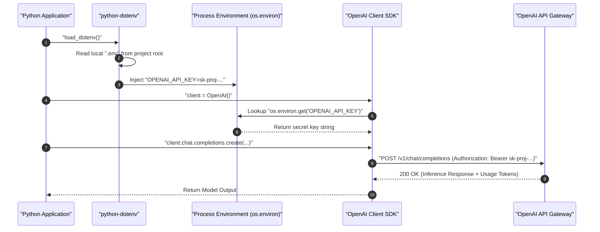

### Creating the `.env` File

In Cursor with your project open:

1. Right-click the blank area below the file list in the explorer sidebar and select **New File**.
2. Name the file **`.env`** (leading period, lowercase `env`).
   - Must **not** be named `.env.txt`, `env`, or `settings.env`.
   - Must be in the **project root folder**, not inside subfolders.
3. Add your key definition:

```ini
# OpenAI API Secret Key configuration
OPENAI_API_KEY=sk-proj-7WOKk21Ls_J_xxwH1SLQGCJog_EXAMPLE_KEY_DO_NOT_SHARE
```

### Formatting Rules

- **Exact Name:** Must be spelled `OPENAI_API_KEY` in uppercase with underscores.
- **No Extra Spaces:** Do not place spaces around the `=` sign.
- **No Quotes Needed:** Paste the raw key directly after the `=`.
- **Save the File:** If a white circle appears on the editor tab, the file is unsaved. Press **`Cmd + S`** (macOS) or **`Ctrl + S`** (Windows/Linux) to save it.

### Why Cursor Shows a Stop Sign on `.env`

When viewing `.env` in Cursor, a small stop sign icon appears next to the filename and in the status bar (`Cursor-Tab (Ignored)`).

This is a security feature: Cursor detects credentials inside `.env` and **disables AI indexing, autocompletion, and telemetry for that file**, ensuring private keys are never transmitted to external AI providers during background indexing.

---

## Verifying Your Setup

Run a quick check in your terminal and Python environment to verify that the key loads correctly.

### Check `.env` in Terminal

```bash
# Check that .env exists in project root
ls -la .env

# Verify variable name without printing the full secret
grep "OPENAI_API_KEY" .env | cut -c 1-20
```

```text
-rw-r--r--  1 user  staff  82 Oct 17 12:30 .env
OPENAI_API_KEY=sk-pr
```

### Python Verification Script

Run this test script to verify that `python-dotenv` and the OpenAI SDK authenticate successfully:

```python
import os
from dotenv import load_dotenv
from openai import OpenAI

# Load variables from .env into process memory
load_dotenv()

# Verify that the variable exists
api_key = os.environ.get("OPENAI_API_KEY")
if not api_key:
    raise ValueError("OPENAI_API_KEY not found. Check your .env file!")

# Initialize client (automatically reads OPENAI_API_KEY from environment)
client = OpenAI()

# Send a lightweight test request
response = client.chat.completions.create(
    model="gpt-4o-mini",
    messages=[
        {"role": "user", "content": "Respond with the single word 'CONNECTED' if you can read this."}
    ],
    max_tokens=5,
)

print("Status:", response.choices[0].message.content.strip())
```

```text
Status: CONNECTED
```

---

## Key Management Best Practices

| Storage Method                       | Security                 | Convenience                  | Recommendation                                                                    |
| :----------------------------------- | :----------------------- | :--------------------------- | :-------------------------------------------------------------------------------- |
| **`.env` + `python-dotenv`**         | High (with `.gitignore`) | Very High                    | **Recommended:** Simple, portable across local machines, zero cloud setup.        |
| **Shell Profile (`~/.zshrc`)**       | Medium                   | Medium                       | Convenient for global tools, but exposes keys to all terminal sessions.           |
| **Cloud Secret Manager (Vault/AWS)** | Maximum                  | Lower (requires cloud setup) | Production enterprise standard; unnecessary overhead for local machines.          |
| **Hardcoded in code files**          | Zero (Critical Risk)     | Low                          | **Anti-Pattern:** Keys will leak to GitHub; automated bots steal them in seconds. |

> [!CAUTION]
> **Prevent Git Leaks:** Ensure `.env` is listed in your `.gitignore` file. Never run `git add -f .env`. Public scrapers search GitHub continuously; exposed keys are compromised and revoked by OpenAI bots within seconds.

> [!IMPORTANT]
> **Exact Variable Name Required:** The OpenAI Python library automatically looks for `os.environ["OPENAI_API_KEY"]`. If misspelled (e.g., `OPEN_API_KEY` or `openai_key`), client initialization fails with an `openai.OpenAIError: The api_key client option must be set` error.

> [!TIP]
> **Track Token Usage:** Monitor your usage under the **Usage** dashboard (`platform.openai.com/usage`). Development queries cost fractions of a cent ($0.0001 to $0.005 each).

---

## Review Quiz

<details>
<summary><b>Question 1: Why does a paid ChatGPT Plus subscription not provide access to the OpenAI Platform API?</b></summary>
<br>
<b>Answer:</b> ChatGPT Plus is a consumer web application with a flat monthly fee for chat UI features on chatgpt.com. The OpenAI Platform API is a separate developer infrastructure billed per token processed. Subscriptions to one service do not grant credits or access to the other.
</details>

<details>
<summary><b>Question 2: Why should "Auto recharge" be turned off in the OpenAI billing dashboard during local development?</b></summary>
<br>
<b>Answer:</b> If code enters an infinite loop or unexpected recursive calls during development, auto-recharge will continuously bill your credit card. Keeping auto-recharge off ensures your maximum financial exposure is capped at your manual deposit.
</details>

<details>
<summary><b>Question 3: Why should project keys be scoped to "Default project" with "All" permissions during development?</b></summary>
<br>
<b>Answer:</b> Creating custom restricted projects can restrict model endpoints, token allowances, or service features, resulting in unexpected 403 Forbidden or model-not-found errors when trying out new model architectures.
</details>

<details>
<summary><b>Question 4: What does the stop sign icon next to the .env file in Cursor signify?</b></summary>
<br>
<b>Answer:</b> It indicates that Cursor's AI features and background code indexing are disabled for that file, protecting sensitive secrets and API keys from being sent to external AI providers during background indexing.
</details>

<details>
<summary><b>Question 5: How does client = OpenAI() find your API key without passing it explicitly?</b></summary>
<br>
<b>Answer:</b> The OpenAI SDK automatically looks up the process environment variable named <code>OPENAI_API_KEY</code> via <code>os.environ.get("OPENAI_API_KEY")</code>. When <code>load_dotenv()</code> runs, values from the local <code>.env</code> file are loaded into the process environment.
</details>

---

# Running Your First OpenAI API Call and System vs User Prompts

## Jupyter Notebook Kernel Setup and Environment Verification

Interactive Python notebooks (`.ipynb`) allow you to experiment with LLM prompts and inspect API responses cell by cell. When opening a notebook in an editor like Cursor or VS Code, the notebook must be bound to the project's local virtual environment rather than a global Python installation.

### Selecting the Dedicated Virtual Environment Kernel

1. Open the notebook (such as `week1/day1.ipynb`) in Cursor.
2. In the top-right corner of the editor window, click **Select Kernel**.
3. Choose **Python Environments...**.
4. Select the local virtual environment matching **`.venv (Python 3.12.x)`** located at `.venv/bin/python` (marked with a star or as **Recommended**).

```text
+-----------------------------------------------------------------------------------+
|  CURSOR IDE - JUPYTER KERNEL PICKER                                               |
+-----------------------------------------------------------------------------------+
|  > Select Kernel                                                                  |
|    > Python Environments...                                                       |
|      * .venv (Python 3.12.9) .venv/bin/python  <-- SELECT THIS (Recommended)     |
|        Global Python (/usr/bin/python3)        <-- AVOID (Missing installed packages)|
+-----------------------------------------------------------------------------------+
```

> [!IMPORTANT]
> **Kernel Persistence:** You must select the kernel for each new notebook you open. If a notebook defaults to global Python, running cells will raise `ModuleNotFoundError: No module named 'openai'` or `dotenv`.

---

## Defensive API Key Validation

Before invoking model endpoints, applications should defensibly validate that credentials exist and conform to expected formats.

```python
import os
from dotenv import load_dotenv

# Load variables from .env into environment memory; override ensures fresh values
load_dotenv(override=True)

api_key = os.getenv("OPENAI_API_KEY")

# Perform defensive pre-flight validation
if not api_key:
    print("Error: No API key found. Verify that your .env file exists in the project root.")
elif not api_key.startswith("sk-proj-"):
    print("Warning: API key found, but it does not start with 'sk-proj-'. Verify your project key format.")
elif api_key.strip() != api_key:
    print("Warning: API key contains leading or trailing whitespace/tab characters. Strip them out.")
else:
    print("API key found and looks good so far!")
```

```text
API key found and looks good so far!
```

---

## OpenAI Chat Completions API Architecture

The primary endpoint for conversational and instruction-following models is the **Chat Completions API**.

### Message Payload Schema

The Chat Completions API expects conversation history as a **list of message dictionaries**. Each dictionary requires two primary keys:

- **`role`:** Identifies the author of the message (`"system"`, `"user"`, or `"assistant"`).
- **`content`:** The string message text.

```python
from openai import OpenAI

# Initialize client (reads OPENAI_API_KEY from os.environ automatically)
openai = OpenAI()

# Define the user prompt
message = "Hello, GPT! This is my first ever message to you! Hi!"

# Package into the standard Chat Completions message structure
messages = [
    {"role": "user", "content": message}
]

# Send the API request to the lightweight nano model
response = openai.chat.completions.create(
    model="gpt-5-nano",
    messages=messages
)

# Extract and display the assistant response content
print(response.choices[0].message.content)
```

```text
Hi there! Nice to meet you, and welcome—thanks for saying hi. I'm here to help with questions, explanations, writing, brainstorming, coding, planning, learning, and more. What would you like to do today?
```

### Parsing the Response Object

The returned response object contains metadata and candidate completions:

- **`response.choices`:** A list of generated candidates. By default, the API generates one candidate (`n=1`).
- **`response.choices[0].message.content`:** Contains the raw text string generated by the model.
- **`response.usage`:** Contains token metrics, breaking down `prompt_tokens`, `completion_tokens`, and `total_tokens` for cost tracking.

---

## System vs. User Prompts: Persona, Framing, and Behavior Control

The modern LLM instruction format explicitly separates developer framing from end-user inputs.

### Conceptual Roles

1. **System Prompt (`role: "system"`):** Sets the global framing, persona, tone, operational boundaries, and formatting instructions. It tells the model _how_ to behave and _what rules_ to follow.
2. **User Prompt (`role: "user"`):** Represents the actual query, request, or runtime input that the model should process within the context established by the system prompt.

### Mental Model: Request Assembly and Gateway Resolution

```text
+-----------------------------------------------------------------------------------+
|                            CHAT COMPLETIONS PIPELINE                              |
+-----------------------------------------------------------------------------------+
                                        |
       +--------------------------------+--------------------------------+
       |                                                                 |
       v                                                                 v
+-------------------------------+                             +-------------------------------+
|         System Prompt         |                             |          User Prompt          |
|  role: "system"               |                             |  role: "user"                 |
|  "You are a snarky assistant" |                             |  "What is 2 + 2?"             |
+-------------------------------+                             +-------------------------------+
       |                                                                 |
       +--------------------------------+--------------------------------+
                                        v
                    +---------------------------------------+
                    |    Structured JSON Message Array      |
                    |    [ {"role":"system", ...},          |
                    |      {"role":"user", ...} ]           |
                    +---------------------------------------+
                                        |
                                        v HTTPS POST
                    +---------------------------------------+
                    |       OpenAI API Gateway              |
                    |       api.openai.com/v1/...           |
                    +---------------------------------------+
                                        |
                                        v Token Generation
                    +---------------------------------------+
                    |       ChatCompletion Response         |
                    |       choices[0].message.content      |
                    +---------------------------------------+
```

### Behavioral Impact: Helpful vs. Snarky Assistant

The system prompt drastically shapes how the model answers identical user queries:

```python
# Helpful Assistant Configuration
helpful_messages = [
    {"role": "system", "content": "You are a helpful assistant."},
    {"role": "user", "content": "What is 2 + 2?"}
]

helpful_response = openai.chat.completions.create(
    model="gpt-4.1-nano",
    messages=helpful_messages
)

print("Helpful:", helpful_response.choices[0].message.content)

# Snarky Assistant Configuration
snarky_messages = [
    {"role": "system", "content": "You are a snarky assistant."},
    {"role": "user", "content": "What is 2 + 2?"}
]

snarky_response = openai.chat.completions.create(
    model="gpt-4.1-nano",
    messages=snarky_messages
)

print("Snarky:", snarky_response.choices[0].message.content)
```

```text
Helpful: 2 + 2 equals 4.
Snarky: Oh, finally, a math question! 2 + 2 equals 4. Groundbreaking, I know.
```

| Prompt Dimension     | System Prompt (`role: "system"`)                            | User Prompt (`role: "user"`)                             |
| :------------------- | :---------------------------------------------------------- | :------------------------------------------------------- |
| **Primary Purpose**  | Defines persona, behavior rules, output schema, constraints | Provides runtime task, input data, or questions          |
| **Typical Author**   | Application developer / system engineer                     | End-user, API caller, or upstream data pipeline          |
| **Execution Impact** | High-level conditioning across the entire conversation      | Immediate focus for the next completion turn             |
| **Example Use Case** | `"Respond in valid JSON using the provided schema."`        | `"Extract the names and prices from this receipt text."` |

---

## Integrating External Data: Server-Side Web Scraping

LLMs cannot access live private web data without external retrieval. Ingesting raw external text into a user prompt enables models to analyze, summarize, or extract structured intelligence from arbitrary URLs.

### Inspecting the Server-Side Scraper (`scraper.py`)

A clean, server-side scraper uses `requests` and `BeautifulSoup` to download HTML and strip out non-text noise before sending content to an LLM:

```python
import requests
from bs4 import BeautifulSoup

# Standard browser User-Agent header prevents simple bot-blocking
headers = {
    "User-Agent": "Mozilla/5.0 (Windows NT 10.0; Win64; x64) AppleWebKit/537.36 (KHTML, like Gecko) Chrome/117.0.0.0 Safari/537.36"
}

def fetch_website_contents(url):
    """Fetch website HTML and return stripped clean text with title."""
    response = requests.get(url, headers=headers)
    soup = BeautifulSoup(response.content, "html.parser")

    title = soup.title.string if soup.title else "No title found"

    # Strip non-informational elements that consume unnecessary context tokens
    for irrelevant in soup.body(["script", "style", "img", "input"]):
        irrelevant.decompose()

    text = soup.body.get_text(separator="\n", strip=True)
    return title + "\n\n" + text
```

### Scrape-and-Summarize Architecture Flow

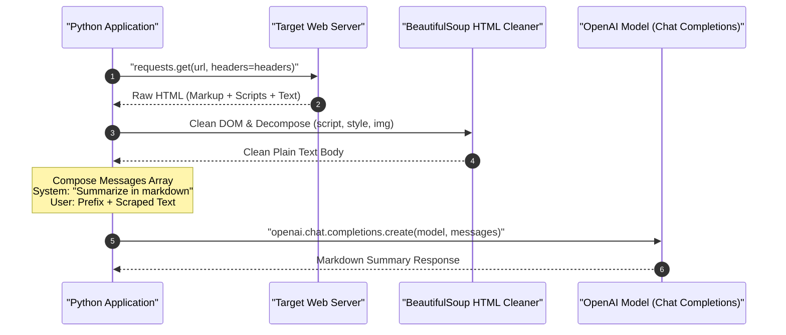

### Executing Web Summarization

```python
from scraper import fetch_website_contents

# Fetch and clean web content
scraped_text = fetch_website_contents("https://edwarddonner.com")

# Define prompt framing
system_prompt = """
You are an assistant that analyzes the contents of a website,
and provides a short summary, ignoring text that might be navigation related.
Respond in markdown.
"""

user_prompt_prefix = "Here are the contents of a website:\n\n"

messages = [
    {"role": "system", "content": system_prompt},
    {"role": "user", "content": user_prompt_prefix + scraped_text}
]

# Run summarization
summary_response = openai.chat.completions.create(
    model="gpt-5-nano",
    messages=messages
)

print(summary_response.choices[0].message.content)
```

```text
### Website Overview: Edward Donner
- **Focus:** AI and Large Language Model engineering, coding experiments, and talent platforms.
- **Background:** Co-founder and CTO of Nebula.io, building verticalized LLM solutions.
- **Projects:** Interactive AI benchmarks, coding guides, and engineering tutorials.
```

---

## Model Selection and Sizing Trade-offs

| Model Tier              | Representative Models        | Speed / Latency    | Relative Cost                     | Recommended Use Case                                                      |
| :---------------------- | :--------------------------- | :----------------- | :-------------------------------- | :------------------------------------------------------------------------ |
| **Nano / Micro**        | `gpt-5-nano`, `gpt-4.1-nano` | Ultra-fast (< 1s)  | Extremely Low ($0.05 / 1M tokens) | Rapid testing, classification, simple summaries, high-volume routing      |
| **Mini / Standard**     | `gpt-4o-mini`                | Very Fast (1–2s)   | Low ($0.15 / 1M tokens)           | Balanced daily development, extraction, code generation                   |
| **Frontier / Flagship** | `gpt-4o`, `o1`               | Moderate (2–10s+)  | Higher ($2.50 – $15 / 1M tokens)  | Complex multi-step reasoning, architectural planning, rigorous evaluation |
| **Local Open-Weights**  | `llama3:8b` (via Ollama)     | Hardware-dependent | Zero (Free)                       | Local experimentation, privacy-sensitive workloads, offline development   |

---

## Critical Gotchas and Best Practices

> [!CAUTION]
> **Context Window Flooding from Scrapers:** Raw HTML documents frequently contain megabytes of inline SVG, minified JavaScript, and CSS styles. Ingesting raw HTML directly into a prompt wastes token quotas and risks exceeding context limits. Always strip non-text elements (`script`, `style`, `noscript`) using BeautifulSoup before formatting prompt payloads.

> [!IMPORTANT]
> **System Prompt Enforcement Varies by Model:** Smaller nano models adhere to system instructions with less strict compliance than flagship frontier models. If a nano model ignores an output formatting constraint (such as "Respond in valid JSON"), reinforce the requirement in both the system prompt and the end of the user prompt.

> [!TIP]
> **Use override=True When Loading `.env`:** When developing in Jupyter notebooks, running `load_dotenv()` multiple times without `override=True` will not reload newly saved keys if the variable was already cached in process memory. Always specify `load_dotenv(override=True)`.

---

## Review Quiz

<details>
<summary><b>Question 1: What is the primary operational consequence of selecting the wrong Jupyter kernel in Cursor or VS Code?</b></summary>
<br>
<b>Answer:</b> The notebook will execute inside the system's global Python environment or an unrelated interpreter rather than your project's <code>.venv</code>. This triggers immediate <code>ModuleNotFoundError</code> exceptions for installed packages like <code>openai</code>, <code>dotenv</code>, and <code>bs4</code>.
</details>

<details>
<summary><b>Question 2: What are the two mandatory keys required in each message dictionary passed to openai.chat.completions.create()?</b></summary>
<br>
<b>Answer:</b> Each dictionary must contain <code>role</code> (specifying <code>"system"</code>, <code>"user"</code>, or <code>"assistant"</code>) and <code>content</code> (containing the text string of the message).
</details>

<details>
<summary><b>Question 3: How does the system prompt differ conceptually and operationally from the user prompt?</b></summary>
<br>
<b>Answer:</b> The system prompt sets the foundational persona, behavioral rules, tone, and output format constraints for the model. The user prompt provides the specific runtime task, input question, or dynamic data that the model must process within that system frame.
</details>

<details>
<summary><b>Question 4: Why does scraper.py call irrelevant.decompose() on tags like "script", "style", and "img" before extracting text?</b></summary>
<br>
<b>Answer:</b> Decomposing those DOM nodes permanently removes client scripts, CSS definitions, and image markup. This cleans the text and avoids wasting model context tokens on non-semantic noise.
</details>

<details>
<summary><b>Question 5: What is the purpose of passing override=True to load_dotenv() in an interactive notebook?</b></summary>
<br>
<b>Answer:</b> By default, <code>load_dotenv()</code> does not overwrite environment variables that already exist in process memory. Setting <code>override=True</code> forces the function to reload variables from the <code>.env</code> file, ensuring newly updated or corrected API keys are immediately applied without restarting the Jupyter kernel.
</details>

---

# Building an End-to-End Website Summarizer with the OpenAI Chat Completions API

Connecting scraped web content to large language model APIs enables automated summarization, tone adaptation, and structured content extraction. By structuring the prompt into dedicated system and user messages, developers can control persona, formatting, and analytical focus while feeding dynamic web data into frontier models.

```text
+-----------------------+      +-------------------------+      +-------------------------+
|      Target URL       | ---> |  fetch_website_contents | ---> | Cleaned Semantic Text   |
| (e.g., cnn.com)       |      |  (requests + bs4 parse) |      | (No scripts, styles)    |
+-----------------------+      +-------------------------+      +-------------------------+
                                                                             |
                                                                             v
+-----------------------+      +-------------------------+      +-------------------------+
|   Rich Output View    | <--- |   OpenAI Chat API       | <--- |   messages_for(text)    |
| display(Markdown(...))|      |   (gpt-4.1-mini model)  |      |   [system, user dicts]  |
+-----------------------+      +-------------------------+      +-------------------------+
```

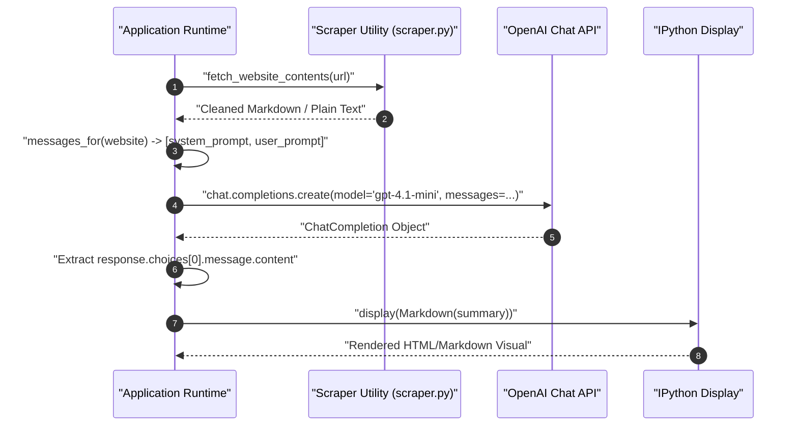

---

## Designing System and User Prompts for Document Summarization

Prompt engineering for document summarization requires separating operational constraints from dynamic input text. The system prompt defines the assistant's persona, processing rules, and formatting expectations, while the user prompt wraps the scraped content with explicit processing instructions.

### The Code Block Suppression Instruction

A frequent challenge when requesting Markdown from LLMs is that models often wrap their entire response inside a Markdown code block (triple backticks ` ```markdown `). When rendered inside a notebook or web UI, this displays the output inside a raw code box instead of styled HTML headings, bullet lists, and paragraphs.

Adding an explicit negative constraint prevents this behavior:

```python
system_prompt = """
You are an assistant that analyzes the contents of a website,
and provides a short summary, ignoring text that might be navigation related.
Respond in markdown. Do not wrap the markdown in a code block - respond just with the markdown.
"""
```

### Dynamic Message Assembly

To package user requests consistently, define a reusable message factory function that pairs the system prompt with the scraped content prefixed by task instructions:

```python
# Define user prompt template with clear task directives and trailing whitespace
user_prompt_prefix = """
Here are the contents of a website.
Provide a short summary of this website.
If it includes news or announcements, then summarize these too.

"""

def messages_for(website):
    """
    Constructs a two-turn message payload for the OpenAI Chat Completions API.

    Args:
        website (str): Cleaned text content scraped from a web page.

    Returns:
        list[dict]: System and user message dictionaries.
    """
    return [
        {"role": "system", "content": system_prompt},
        {"role": "user", "content": user_prompt_prefix + website}
    ]
```

### Verifying Payload Structure

Passing scraped content into `messages_for()` generates the structured payload ready for API ingestion:

```python
# Generate message payload from previously scraped site variable
payload = messages_for(ed)
print(payload[0]["role"])
print(payload[1]["role"])
print(f"Total user message characters: {len(payload[1]['content'])}")
```

```text
system
user
Total user message characters: 2418
```

---

## Implementing the Summarization Pipeline with OpenAI Chat Completions

The core summarization function coordinates the web scraper, API request, and response extraction into a single callable unit.

```python
import openai
from scraper import fetch_website_contents

def summarize(url):
    """
    Fetches website text, submits it to OpenAI Chat Completions, and returns the summary.

    Args:
        url (str): The target website address.

    Returns:
        str: Raw text/markdown content returned by the language model.
    """
    # Step 1: Scrape and extract text content from the target URL
    website = fetch_website_contents(url)

    # Step 2: Dispatch chat completion request to OpenAI
    response = openai.chat.completions.create(
        model="gpt-4.1-mini",
        messages=messages_for(website)
    )

    # Step 3: Extract and return the completion string
    return response.choices[0].message.content
```

### Testing the Summarizer

Running `summarize()` against a website returns the raw string generated by the model:

```python
# Execute summary against a personal portfolio page
raw_output = summarize("https://edwarddonner.com")
print(raw_output)
```

```text
# Website Summary: Edward Donner\n\nThis website belongs to Ed Donner, a coder and AI enthusiast with a passion for experimenting with large language models...
```

---

## Formatted Output Rendering with IPython Display

When returning Markdown strings inside Jupyter notebooks, raw Python string outputs display escape sequences (such as `\n` or quotes) and collapse headings and bullet lists into an unstyled text block.

To present results clearly, use IPython's native `display()` and `Markdown()` visualizers.

```python
from IPython.display import display, Markdown

def display_summary(url):
    """
    Fetches and summarizes a website, rendering formatted Markdown in notebook environments.

    Args:
        url (str): The target website address.
    """
    summary = summarize(url)
    display(Markdown(summary))
```

Running `display_summary("https://edwarddonner.com")` formats headers, lists, and links into readable visual sections:

```python
display_summary("https://edwarddonner.com")
```

```text
Website Summary: Edward Donner

This website is the personal and professional homepage of Edward Donner, a coder and AI enthusiast who enjoys experimenting with large language models, co-founder and CTO of Nebula.io, a company applying AI to talent discovery and management, leveraging proprietary LLMs and a patented platform. Ed is also an active educator and author.

Key Features:
- Projects:
  - Connect Four: an arena where LLMs compete in diplomacy and strategic games.
- About Ed:
  - Shares interests in coding, AI, DJing, amateur electronic music, and engaging with the tech community.
- Posts & Announcements:
  - AI in Production: Gen AI and Agentic AI on AWS at scale (Sep 15, 2025)
  - Connecting my courses - become an LLM expert and leader (May 18, 2025)
  - The Complete Agentic AI Engineering Course (April 21, 2025)

Contact & Follow:
- Email: ed [at] edwarddonner [dot] com
- Social Media: LinkedIn, Twitter, Facebook
- Newsletter subscription available
```

---

## Steering Persona, Tone, and Output Style via Prompt Engineering

One of the greatest advantages of frontier LLMs is that tone, style, audience adaptation, and persona can be altered exclusively through the system prompt without altering underlying application code or scraping logic.

```text
+-----------------------------------------------------------------------------------+
| System Prompt: Professional Assistant                                             |
| Output: "Edward Donner is an experienced software engineer and CTO..."            |
+-----------------------------------------------------------------------------------+
                                         vs
+-----------------------------------------------------------------------------------+
| System Prompt: Snarky Sarcastic Assistant                                         |
| Output: "Edward Donner's Nerdy Playground: friendly neighborhood code monkey..." |
+-----------------------------------------------------------------------------------+
```

### Implementing a Sarcastic Persona

By updating `system_prompt` to request humor and snark, the same summarizer produces a completely different analytical perspective on the same source text:

```python
# Redefine system prompt with an opinionated, humorous persona
system_prompt = """
You are a snarky assistant that analyzes the contents of a website and provides a short, snarky, humorous summary.
Respond in markdown. Do not wrap the markdown in a code block - respond just with the markdown.
"""
```

Re-running `display_summary("https://edwarddonner.com")` produces an irreverent summary:

```python
display_summary("https://edwarddonner.com")
```

```text
Edward Donner's Nerdy Playground

Ed is your friendly neighborhood code monkey who's obsessed with playing DJ (badly), making very amateur electronic tunes, and stalking Hacker News like it's the only social interaction he needs. He co-founded Nebula.io, where AI meets job recruitment, creating fancy patented tech that scouts talent better than you ever could. Also, he sold an AI startup once, because why not?

Fun projects to distract you:
- Connect Four (the classic game, apparently)
- Outsmart, where AI language models throw shade and play political brinkmanship against each other.

Latest News (like you're dying to know):
- Sept 2025: Talks about running generative and agentic AI at scale on AWS
- May 2025: Offers courses to turn you into an LLM guru and AI boss
- April 2025: Drops a full-fledged Agentic AI Engineering Course (because basic AI isn't enough)

Hit him up if you want to chat AI, nerd out, or subscribe to the newsletter to get your regular dose of AI goodness.
```

### Summarizing Major News Portals

Running the snarky pipeline on a complex, high-volume news portal like CNN demonstrates the model's ability to synthesize chaotic headlines into themed humor:

```python
display_summary("https://cnn.com")
```

```text
CNN: The Glorious Smorgasbord of Everything News

Welcome to CNN—where you can get your daily dose of global chaos, celebrity heartbreaks, and government shenanigans all in one place. Trying to escape world wars, hurricanes, and political drama? Too bad, it's all here, front and center.

Highlights:
- Breaking News: Government shutdown countdown (because nothing says "fun" like a political stalemate), hurricanes crashing US coasts, and ongoing coverage of Ukraine-Russia and Israel-Hamas conflicts.
- Celebrity Gossip: Nicole Kidman and Keith Urban calling it quits after 19 years—because even Hollywood marriages face the final curtain.
- Politics: Trump keeps dropping bombs, both literal and figurative, from controversial nominees to "training grounds" ideas, plus a juicy side of fact-checking his claims.
- Tech & AI: Hollywood's furious about a new AI actress—next step, robots winning Oscars?
- Weird & Wonderful: From hermit crabs hoarding trash to a blue jay-green jay scientific lovechild, plus a designer who literally burns his creations (because fashion drama isn't real without some pyrotechnics).
- CNN Underscored: Your one-stop for the best gadgets, style tips, and holiday gift guides to distract you from the dooms-scrolling.
- Games & Puzzles: Because when the world's burning, who doesn't want to do a crossword or get addicted to Sudoblock?

News in a Nutshell:
- The government shutdown is imminent—brace yourself for travel nightmares and bureaucratic bliss.
- Trump's back in the headlines with "TrumpRx" drug deals and policy headlines that keep fact-checkers busy.
- Natural disasters and violent incidents keep the "Breaking News" ticker spinning.
- And, of course, a smattering of uplifting stuff like robots hiking and polar bears taking over research stations.

In short, if it's happening anywhere—be it politics, war zones, earthquakes, celebrity splits, or surprisingly cute AI stories—CNN is on it like buzzwords on a press release. You might want to sign in... or just take a deep breath and scroll responsibly.
```

---

## Web Scraping Limitations and Modern Production Alternatives

While simple scraping using `requests` and `BeautifulSoup` works well for static HTML pages, production LLM applications face major limitations when handling real-world web properties.

```text
+-------------------------+      +-------------------------+      +-------------------------+
|     Static Scraper      |      |     Client-Side SPA     |      |       Result            |
| requests.get(url)       | ---> | React / Vue / Angular   | ---> | Empty Shell (<div id>)  |
| (No JavaScript Engine)  |      | Renders via Browser JS  |      | Missing Core Content    |
+-------------------------+      +-------------------------+      +-------------------------+
```

### Common Scraping Obstacles

1. **Client-Side Rendering (CSR):** Single-Page Applications (SPAs) built with React, Vue, or Angular return an initial HTML document containing almost no body text—only script tags and an empty mounting container like `<div id="root"></div>`. Because `requests` does not run a JavaScript runtime, the parser sees empty content.
2. **Bot Detection & Cloudflare / CloudFront 403 Errors:** Major websites implement Web Application Firewalls (WAF) that detect Python `User-Agent` headers, TLS connection fingerprints, and IP blocks, returning HTTP `403 Forbidden` responses.
3. **Dynamic Pagination & Infinite Scroll:** Content loaded asynchronously via user scroll interactions cannot be captured with single static GET requests.

### Scraping Architecture Comparison

| Feature / Metric           | Static HTTP Scraping (`requests` + `bs4`)      | Headless Browser Automation (Playwright / Selenium) | Managed AI Scrapers (e.g., Firecrawl, ScrapingBee) |
| :------------------------- | :--------------------------------------------- | :-------------------------------------------------- | :------------------------------------------------- |
| **JavaScript Execution**   | No (Static HTML only)                          | Yes (Full browser DOM engine)                       | Yes (Handled remotely in cloud)                    |
| **Speed & Resource Usage** | Very fast (milliseconds, low CPU/RAM)          | Slower (requires spawning browser processes)        | Fast API response (delegated infrastructure)       |
| **WAF / Anti-Bot Bypass**  | Poor (frequently blocked with 403s)            | Moderate (can emulate human interaction)            | High (automatic IP rotation, fingerprinting)       |
| **Output Cleanliness**     | Manual cleaning required via BeautifulSoup     | Manual cleaning required via DOM inspection         | Native Markdown extraction ready for LLMs          |
| **Cost & Overhead**        | Free and local                                 | High local compute / infrastructure costs           | Paid SaaS API tiers                                |
| **Recommended Use Case**   | Personal blogs, public articles, documentation | Complex interactive sites, single-page apps         | Enterprise-grade LLM ingestion pipelines           |

> [!CAUTION]
> **CloudFront and WAF 403 Blockades:** If `fetch_website_contents()` throws HTTP `403 Client Error: Forbidden`, the target website is rejecting automated requests. Do not attempt aggressive retry loops, which could lead to IP blacklisting. Switch to headless browser automation with Playwright or an authenticated API.

---

## Commercial Applications and Community Extensions

The combination of content extraction and frontier language models forms the foundation of modern generative AI features across multiple industries:

- **Executive & Financial Briefings:** Digesting corporate earnings transcripts, 10-K filings, or Yahoo Finance news feeds into daily risk summaries.
- **Competitor Intelligence:** Automatically monitoring competitor landing pages, pricing grids, and release notes to flag changes.
- **Legal & Compliance Review:** Scanning Terms of Service updates or privacy policy revisions for critical liability shifts.
- **Talent Acquisition:** Parsing resumes and portfolio URLs into standardized skill matrices matched against job descriptions.
- **Multilingual Localization:** Translating and culturally adapting foreign-language technical docs into plain English.

### Extending Code via Community Contributions

In shared collaborative engineering repositories, student and team contributions expand the foundational pipeline:

```bash
# Workflow for contributing extensions via Git Pull Request (PR)
git checkout -b feature/playwright-scraper-integration
git add community-contributions/playwright_summarizer.py
git commit -m "Add headless Playwright scraping utility for JavaScript SPAs"
git push origin feature/playwright-scraper-integration
```

Opening a Pull Request (PR) allows maintainers to review code additions, run continuous integration checks, and merge new integrations into the main codebase.

---

## Engineering Reasoning: Model Selection Trade-offs

| Factor                    | Lightweight Frontier Model (`gpt-4.1-mini` / `gpt-4o-mini`) | Heavy Reasoning Model (`gpt-4o` / `o1` / `Claude 3.5 Sonnet`) |
| :------------------------ | :---------------------------------------------------------- | :------------------------------------------------------------ |
| **Latency**               | Extremely low (~1–3 seconds per summary)                    | Higher latency (~5–15 seconds per summary)                    |
| **Inference Cost**        | Fractions of a cent per request                             | 10x to 30x higher cost per million tokens                     |
| **Context Window**        | 128k+ tokens (sufficient for entire web pages)              | 128k–200k tokens                                              |
| **Instruction Following** | Strong for summarization, tone shifts, and formatting       | Superior for deep synthesis, math, and code generation        |
| **Recommended Role**      | Default engine for ingestion, filtering, and summarization  | Complex multi-source analysis, legal logic, or code synthesis |

> [!TIP]
> **Use Lightweight Models for First-Stage Ingestion:** For document summarization, extraction, and tone alteration, smaller models like `gpt-4.1-mini` or `gpt-4o-mini` offer near-parity with frontier flagship models at a fraction of the token cost and latency.

---

## Review Quiz

<details>
<summary><b>Question 1: Why is the instruction "Do not wrap the markdown in a code block - respond just with the markdown" explicitly included in the system prompt?</b></summary>
<br>
<b>Answer:</b> LLMs frequently enclose Markdown responses inside triple backticks (<code>```markdown ... ```</code>). This causes frontend visualizers or Jupyter <code>display(Markdown(...))</code> utilities to render the entire output inside a literal raw code box rather than displaying rich HTML headings, bullet lists, and paragraphs.
</details>

<details>
<summary><b>Question 2: Why does calling raw summarize(url) display escaped newlines (\n) on a single line, whereas display_summary(url) shows formatted rich text?</b></summary>
<br>
<b>Answer:</b> <code>summarize(url)</code> returns a raw Python string, which cell evaluation displays via its literal representation (<code>repr()</code>), showing escape sequences like <code>\n</code>. <code>display_summary(url)</code> passes the string to <code>IPython.display.Markdown()</code>, which parses the Markdown syntax and instructs the browser to render it as styled HTML.
</details>

<details>
<summary><b>Question 3: Why does a static HTTP scraper using requests and BeautifulSoup fail when targeted at a Single-Page Application (SPA) built with React or Vue?</b></summary>
<br>
<b>Answer:</b> <code>requests.get()</code> only downloads the initial static HTML document sent by the server. SPAs typically send an empty shell containing only script tags and an empty mounting element like <code>&lt;div id="root"&gt;&lt;/div&gt;</code>, relying on the client's browser JavaScript engine to fetch and render content dynamically.
</details>

<details>
<summary><b>Question 4: What architectural property allows changing the summarizer from a professional assistant to a sarcastic satirist without modifying the scraping code or API call logic?</b></summary>
<br>
<b>Answer:</b> Separation of concerns in the Chat Completions API. The system prompt controls the persona, tone, rules, and output constraints independently from the user message, which carries the dynamic website payload. Changing only the system prompt alters the model's behavioral framing while leaving data ingestion pipelines untouched.
</details>

<details>
<summary><b>Question 5: What is the primary operational trade-off between using gpt-4.1-mini versus a reasoning model like OpenAI o1 for web page summarization?</b></summary>
<br>
<b>Answer:</b> <code>gpt-4.1-mini</code> provides near-instant response times (~1-3 seconds) and minimal token cost, making it ideal for high-volume summarization tasks. Heavy reasoning models introduce substantially higher latency and token costs that are unjustified for standard text digestion tasks that do not require complex logical deductions.
</details>

---

# Frontier Models: OpenAI GPT, Claude, Gemini, and Grok Compared

The artificial intelligence landscape is anchored by high-capability foundation models termed **Frontier Models**. Built and maintained by major research organizations known as **Frontier Labs**, these models represent the cutting edge of reasoning, coding, multimodal processing, and conversational comprehension.

```text
                               +-------------------------------------------------+
                               |           Frontier AI Ecosystem                 |
                               +-------------------------------------------------+
                                        |                               |
                 +----------------------+                               +----------------------+
                 |                                                                             |
                 v                                                                             v
+------------------------------------+                                       +------------------------------------+
|    Closed-Source Frontier APIs     |                                       |     Open-Source / Open-Weight      |
|  - Proprietary weights & training  |                                       |  - Freely downloadable weights     |
|  - Hosted on massive superclusters |                                       |  - Self-hosted on local/cloud GPUs |
|  - Billed per token (pay-as-you-go)|                                       |  - Zero per-token usage fees       |
|  - Examples: GPT, Claude, Gemini   |                                       |  - Examples: Llama, Gemma, Mistral |
+------------------------------------+                                       +------------------------------------+
```

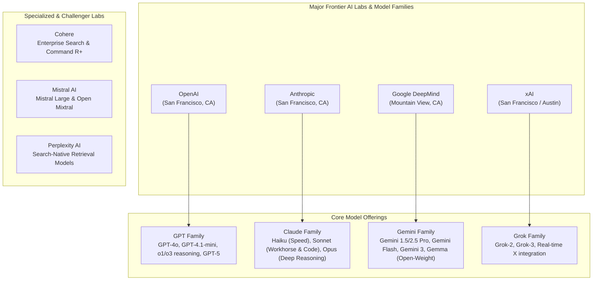

---

## Understanding Frontier Models and Frontier Labs

In machine learning engineering, the term **Frontier Model** describes the largest, most computationally complex models capable of general problem solving, complex code generation, logical reasoning, and broad domain adaptation.

### Closed-Source Frontier Models

The vast majority of leading models operate under a **closed-source (proprietary)** commercial distribution:

- **Massive Pretraining Investments:** Training a frontier model requires tens or hundreds of millions of dollars in compute infrastructure, comprising tens of thousands of high-end GPUs or TPUs running for months.
- **Continuous Serving Infrastructure:** Hosting inference for hundreds of millions of concurrent global requests requires distributed datacenters, custom silicon, and dynamic batching engines.
- **Pay-As-You-Go API Monetization:** Closed-source labs monetize their investments by exposing managed cloud endpoints, charging developers per input and output token processed.

### Open-Source vs. Open-Weight Models

Contrasting with closed APIs are freely downloadable models from organizations like Meta (Llama family) and Google (Gemma family):

- **The "Open-Weight" Technical Distinction:** Strict open-source software licenses require disclosing the full source code and build instructions. In contrast, most modern "open" models are technically **open-weight**: the lab releases the neural network parameters (the weights and biases), but withholds the raw pretraining data corpora, filtering heuristics, synthetic data pipelines, and proprietary Reinforcement Learning from Human Feedback (RLHF) recipes.
- **Self-Hosting Freedom:** Open-weight models can be inspected, fine-tuned, quantized, and hosted locally or on private cloud instances (via engines like Ollama, vLLM, or Hugging Face TGI), guaranteeing data sovereignty and immunity from external API deprecations or content filtering changes.

---

## The Big Four Frontier Labs and Model Families

Four primary technology companies lead the closed-source frontier, each maintaining distinct architectural philosophies, model tier hierarchies, and developer ecosystems.

### OpenAI (GPT Family)

OpenAI catalyzed the current generative AI era with the launch of ChatGPT (GPT-3.5) in late 2022.

- **Evolutionary Trajectory:** Evolved from GPT-3.5 to GPT-4, GPT-4o (omnimodal native processing), and efficient lightweight derivatives like `gpt-4o-mini` and `gpt-4.1-mini`.
- **Reasoning Convergence:** OpenAI pioneered specialized test-time reasoning models (`o1`, `o3`, `o4-mini`) that dynamically generate internal chains-of-thought before returning a final response. Modern iterations converge fast instruction-following models and deep reasoning capabilities into unified architectures like GPT-5.
- **Ecosystem Dominance:** OpenAI remains the de facto industry standard for developer tooling, function calling definitions, JSON mode, and structured outputs.

### Anthropic (Claude Family)

Anthropic was established by former senior OpenAI researchers with a foundational focus on AI safety, constitutional AI, and steerable behavior.

- **Three-Tier Hierarchy:**
  - **Haiku:** Lightweight, ultrafast, highly cost-effective model designed for high-throughput classification and filtering.
  - **Sonnet:** The enterprise workhorse balancing rapid inference with elite reasoning and world-class software engineering skills (e.g., Claude 3.5 Sonnet, Claude 4.5 Sonnet).
  - **Opus:** Heavyweight model built for long-form analysis, complex creative writing, and deep research tasks.
- **Developer Favor:** Widely acclaimed among software engineers for producing clean, bug-free, non-bloated code. Powers **Claude Code**, an autonomous command-line agent tool for software engineering.

### Google DeepMind (Gemini Family)

Following initial stumbling blocks during the early Google Bard rollout, Google overhauled its AI infrastructure under Google DeepMind, developing **Gemini** as a natively multimodal architecture from the ground up.

- **Multimodal Native Design:** Rather than stitching together separate computer vision, audio, and language models, Gemini was pretrained end-to-end across text, video, audio, code, and images.
- **Massive Context Windows:** Gemini leads the industry in context capacity, comfortably handling 1,000,000 to 2,000,000+ tokens in production. This allows developers to load entire code repositories, multi-hour audio files, or hour-long video lectures directly into working memory without needing complex Retrieval-Augmented Generation (RAG) chunking.
- **Developer Access & Gemma:** Google provides generous free and low-cost development tiers through Google AI Studio. Alongside closed Gemini models, Google releases the **Gemma** family of lightweight, high-performance open-weight models.

### xAI (Grok Family)

Founded by Elon Musk to pursue truth-seeking AI with real-time world awareness, **xAI** operates one of the world's most dense GPU superclusters (Colossus).

- **Core Models:** Progressed from Grok-1 (released under an open Apache 2.0 license) to closed frontier iterations Grok-2 and Grok-3.
- **Distinct Capabilities:** Deep real-time integration with X (formerly Twitter) social media data, allowing near-instantaneous indexing of breaking news, cultural trends, and tech discourse.

---

## Second-Tier Frontier and Specialized Providers

Beyond the Big Four, specialized frontier providers offer differentiated architectural strengths:

- **Perplexity AI:** Search-centric model provider focused on real-time internet retrieval, cited search generation, and automated research workflows.
- **Cohere:** Enterprise-centric platform specializing in multilingual embeddings, high-precision semantic rerankers, and the enterprise-focused **Command R+** model family designed for RAG pipelines.
- **Mistral AI:** High-velocity European AI lab based in Paris. Uniquely bridges both worlds by maintaining popular open-weight models (Mistral 7B, Mixtral 8x7B, Mixtral 8x22B) alongside proprietary cloud frontier endpoints (**Mistral Large**).

---

## Architectural Comparison: Frontier Cloud APIs vs. Self-Hosted Open Weights

Choosing between managed closed APIs and self-hosted open-weight models represents a core infrastructure trade-off for AI engineers.

```text
+---------------------------------------------------------------------------------------------------+
| APPROACH 1: Managed Cloud API (OpenAI, Anthropic, Google, xAI)                                    |
+---------------------------------------------------------------------------------------------------+
Client App  -->  HTTPS JSON API (POST /chat/completions)  -->  Managed Cloud GPU Cluster (Autoscaled)
- Pros: Zero infrastructure maintenance, instant access to frontier capabilities, scale to thousands RPS.
- Cons: Recurring per-token operational costs, vendor lock-in, data leaves private network.

+---------------------------------------------------------------------------------------------------+
| APPROACH 2: Self-Hosted Open-Weight (Llama, Gemma, Mistral on vLLM / Ollama)                      |
+---------------------------------------------------------------------------------------------------+
Client App  -->  Localhost / Private VPC  -->  Dedicated GPU Host (e.g., 8x NVIDIA A100/H100)
- Pros: 100% data privacy, zero per-token cost, immune to model deprecation, fully fine-tunable.
- Cons: High upfront hardware/leasing expense, complex DevOps (quantization, KV-cache management).
```

### Strategic Decision Matrix

| Dimension                     | Managed Frontier Cloud APIs                                  | Self-Hosted Open-Weight Models                                   |
| :---------------------------- | :----------------------------------------------------------- | :--------------------------------------------------------------- |
| **Peak Reasoning & Coding**   | Highest (GPT-4o, Claude 3.5/4.5 Sonnet, Gemini 2.5 Pro)      | High, rapidly closing gap (Llama 3.3 70B, DeepSeek, Qwen)        |
| **Data Privacy & Compliance** | Requires HIPAA / SOC2 zero-retention enterprise agreements   | Absolute (data never traverses external networks)                |
| **Pricing Structure**         | Variable operational cost (pay-as-you-go per million tokens) | Fixed capital expenditure (GPU cloud lease or hardware purchase) |
| **Operational Overhead**      | None (serverless HTTPS API calls)                            | Substantial (requires Kubernetes, vLLM, load balancing, drivers) |
| **Context Window Size**       | Up to 2,000,000 tokens (Gemini)                              | Typically 8k to 128k tokens (constrained by GPU VRAM)            |
| **Latency Consistency**       | Subject to multi-tenant internet spikes and rate limits      | Fully predictable and dedicated to your internal workload        |

---

## Interacting with Frontier Providers via Python

Modern AI engineering workflows frequently interact with multiple frontier providers. The following pattern illustrates how standard environment variables and provider SDKs are initialized in Python.

### Configuring Multi-Provider Secrets

Store credentials for each provider in a central `.env` file:

```ini
# OpenAI API credentials
OPENAI_API_KEY=sk-proj-...

# Anthropic Claude API credentials
ANTHROPIC_API_KEY=sk-ant-api03-...

# Google Gemini API credentials
GEMINI_API_KEY=AIzaSy...

# xAI Grok API credentials
XAI_API_KEY=xai-...
```

### Multi-Provider Python Client Interface

```python
import os
from dotenv import load_dotenv

# Ensure fresh environment variables are loaded
load_dotenv(override=True)

# Step 1: Verify presence of configured frontier API keys
providers = {
    "OpenAI": bool(os.getenv("OPENAI_API_KEY")),
    "Anthropic": bool(os.getenv("ANTHROPIC_API_KEY")),
    "Google Gemini": bool(os.getenv("GEMINI_API_KEY")),
    "xAI Grok": bool(os.getenv("XAI_API_KEY")),
}

print("Active Frontier Provider Credentials:")
for provider, active in providers.items():
    status = "Configured" if active else "Not Detected"
    print(f"- {provider:15}: {status}")
```

```text
Active Frontier Provider Credentials:
- OpenAI         : Configured
- Anthropic      : Configured
- Google Gemini  : Configured
- xAI Grok       : Not Detected
```

### Querying Different Frontier Providers

Different labs provide dedicated Python client libraries, but maintain similar conversational message patterns:

```python
# OpenAI Official Client Example
from openai import OpenAI

client = OpenAI()
openai_response = client.chat.completions.create(
    model="gpt-4.1-mini",
    messages=[
        {"role": "system", "content": "You are a concise AI engineering advisor."},
        {"role": "user", "content": "What is the primary strength of Claude 3.5 Sonnet?"}
    ]
)
print("OpenAI Output:")
print(openai_response.choices[0].message.content)
```

```text
OpenAI Output:
Claude 3.5 Sonnet is widely considered an industry leader in complex coding tasks, reasoning through large software refactors, and providing nuanced, instruction-following responses without code bloat.
```

---

## Comprehensive Frontier Models Comparison Table

| Lab / Organization  | Flagship Frontier Model   | Cost-Effective / High-Speed Tier | Max Context Window | Primary Specialization                                             | Native Multimodality             |
| :------------------ | :------------------------ | :------------------------------- | :----------------- | :----------------------------------------------------------------- | :------------------------------- |
| **OpenAI**          | GPT-4o / GPT-5            | `gpt-4o-mini` / `gpt-4.1-mini`   | 128,000 tokens     | General reasoning, structured outputs, broad integration           | Text, Audio, Vision              |
| **Anthropic**       | Claude 3.5 / 4.5 Sonnet   | Claude Haiku                     | 200,000 tokens     | Software engineering, complex code refactoring, human-aligned tone | Text, Vision                     |
| **Google DeepMind** | Gemini 2.5 Pro / Gemini 3 | Gemini Flash                     | 2,000,000+ tokens  | Native multimodality, massive context analysis, research           | Text, Audio, Video, Vision, Code |
| **xAI**             | Grok-2 / Grok-3           | Grok Mini                        | 128,000 tokens     | Real-time social knowledge (X data), uncensored debate             | Text, Vision                     |
| **Mistral AI**      | Mistral Large             | Mistral NeMo / Small             | 128,000 tokens     | European compliance, open-weight parity, multilingual text         | Text, Vision                     |

> [!IMPORTANT]
> **No Need for All Four Keys Simultaneously:** While courses and production systems benchmark all major models, you do not need active paid accounts for all four providers simultaneously to learn. An OpenAI or Google Gemini developer account provides full coverage for essential LLM engineering patterns.

> [!TIP]
> **Leverage Google AI Studio for Free Prototyping:** Google provides free rate-limited API access to Gemini Flash and Pro models via Google AI Studio in supported regions, making it an ideal choice for experimentation without accumulating API bills.

---

## Review Quiz

<details>
<summary><b>Question 1: What is the technical distinction between an "open-source" model and an "open-weight" model?</b></summary>
<br>
<b>Answer:</b> An open-source software release makes full source code, build scripts, and underlying recipes publicly accessible. In contrast, "open-weight" models (such as Meta's Llama or Google's Gemma) release only the trained neural network parameter tensors (weights and biases), while keeping the original pretraining datasets, data curation pipelines, and proprietary RLHF alignment recipes confidential.
</details>

<details>
<summary><b>Question 2: Which tier in Anthropic's Claude model family is generally recommended as the primary workhorse for programming and coding agent tasks?</b></summary>
<br>
<b>Answer:</b> <b>Claude Sonnet</b> (such as Claude 3.5 Sonnet or 4.5 Sonnet). It occupies the sweet spot between high-speed inference and exceptional reasoning, consistently outperforming other tiers in real-world software engineering and code generation benchmarks.
</details>

<details>
<summary><b>Question 3: What architectural differentiator gives Google's Gemini models a decisive advantage when analyzing long documents, books, or video lectures?</b></summary>
<br>
<b>Answer:</b> Gemini's industry-leading context window capacity of <b>1,000,000 to 2,000,000+ tokens</b>. This allows an entire repository, hours of video, or complete legal libraries to be fed directly into active working memory in a single prompt, eliminating the complexity and chunking artifacts inherent to traditional RAG pipelines.
</details>

<details>
<summary><b>Question 4: Why do frontier closed-source models use a pay-as-you-go per-token billing model rather than a flat monthly software subscription?</b></summary>
<br>
<b>Answer:</b> Inference compute costs are proportional to the number of tokens processed. Each token generated requires passing input states through billions or trillions of parameters across high-performance GPUs. Charging per input and output token aligns vendor costs directly with the computational resources consumed by each individual query.
</details>

<details>
<summary><b>Question 5: Which French AI lab produces both closed-source cloud frontier models and popular open-weight models like Mixtral?</b></summary>
<br>
<b>Answer:</b> <b>Mistral AI</b>. They publish open-weight models (such as Mistral 7B and Mixtral 8x7B/8x22B) for self-hosting, while offering proprietary flagship models (such as Mistral Large) via managed cloud endpoints.
</details>

---

# Open-Source LLMs: Llama, Mistral, DeepSeek, and Ollama

While proprietary cloud frontier models deliver massive scale through paid APIs, open-weight models have transformed artificial intelligence by enabling developers to download, inspect, fine-tune, and run models locally on private infrastructure. Understanding the open-source landscape, model distillation, and direct local inference is essential for building cost-effective, privacy-compliant AI systems.

```text
+-------------------------------------------------------------------------------------------------------+
|                                    THREE WAYS TO USE LANGUAGE MODELS                                  |
+-------------------------------------------------------------------------------------------------------+
|  1. CHAT INTERFACES (Products)  |  2. CLOUD APIs (Managed Endpoints)  |  3. DIRECT INFERENCE (Local)  |
|  - Consumer UI (ChatGPT, Claude)|  - Direct APIs (OpenAI, Anthropic)  |  - Hugging Face Transformers  |
|  - Integrated search & memory   |  - Cloud Gateways (Bedrock, Vertex) |  - Ollama (Quantized GGUF)    |
|  - End-to-end managed product   |  - Fast Hardware (Groq with a 'q')  |  - Complete data privacy      |
+-------------------------------------------------------------------------------------------------------+
```

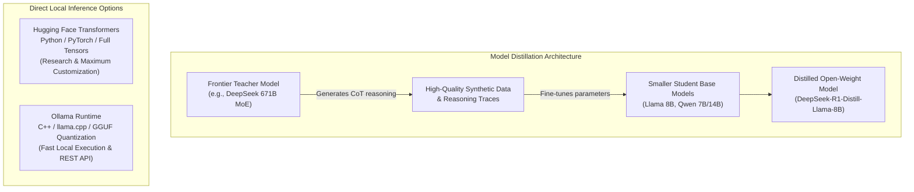

---

## The Open-Source and Open-Weight Revolution

Meta catalyzed the open-source movement by releasing the **Llama** model weights. While initially perceived as a strategy to counter proprietary leaders like OpenAI and Google, this initiative established an open ecosystem that now rivals closed models across coding, reasoning, and instruction-following benchmarks.

### Small Language Models (SLMs) vs. Large Language Models (LLMs)

Modern open architectures are categorized by parameter count, directly determining their memory footprint and hardware requirements:

- **Small Language Models (SLMs):** Models ranging from 270M to 3B parameters (e.g., `Llama 3.2 1B/3B`, `Gemma 270M`, `Phi-4 Mini`). These models fit comfortably into consumer RAM (e.g., 8 GB to 16 GB unified memory on Apple Silicon or standard laptops) and run with near-zero latency for edge tasks, local summarization, and offline classifications.
- **Large Open Models (LLMs):** Massive weights ranging from 70B up to 400B+ parameters (e.g., `Llama 3.3 70B`, `Llama 4`, `DeepSeek 671B`). These require enterprise multi-GPU nodes (such as 4x or 8x NVIDIA A100/H100 clusters) to run inference at scale.

---

## Key Open-Weight Model Families and Architectural Innovations

The open landscape features specialized architectures tailored for distinct compute and reasoning profiles.

### Meta Llama

The foundational benchmark of the open ecosystem.

- **Llama 3.2:** Introduced ultralight 1B and 3B parameter variants designed specifically for on-device and local edge execution.
- **Llama 4:** Represents Meta's frontier-scale open-weight offering, trained across tens of thousands of GPUs to rival closed proprietary models.

### Mistral AI and Mixture of Experts (MoE)

Pioneered by French AI startup Mistral AI, the **Mixture of Experts (MoE)** architecture (exemplified by **Mixtral 8x7B** and **Mixtral 8x22B**) replaces monolithic dense neural networks with dynamically routed subnetworks:

- In a traditional dense model, every parameter is activated for every token generated.
- In an MoE model, an internal routing router directs each incoming token to a small subset of "expert" feed-forward networks (e.g., activating only 2 out of 8 experts per token).
- **Engineering Advantage:** Delivers the vast knowledge capacity of a large model while consuming the active compute and memory bandwidth of a far smaller model.

### Alibaba Cloud Qwen

Developed by the cloud division of Alibaba, the **Qwen** family has emerged as one of the most capable multilingual open models:

- Exceptional performance on complex mathematical reasoning, multilingual coding, and technical problem-solving.
- Serves as a primary foundation for model distillation and agentic workflows throughout the international research community.

### Google Gemma

Google's open-weight counterpart to Gemini.

- Ranges from an ultra-compact **270M parameter micro-model** up to standard 2B, 9B, and 27B variants.
- While the 270M variant has limited reasoning depth, it serves as an extraordinary proof-of-concept for running text generation within resource-constrained embedded systems and mobile edge devices.

### Microsoft Phi

Microsoft's **Phi** family (such as Phi-3 and Phi-4) focuses on training efficiency through **high-quality synthetic data**:

- Rather than scraping uncurated web dumps, Phi models are trained on curated synthetic "textbook quality" data.
- Achieves high reasoning, mathematical deduction, and function-calling capabilities despite having small parameter counts.

---

## DeepSeek and the Efficiency Breakthrough

In early 2025, Chinese research lab **DeepSeek AI** challenged the economics of generative AI by demonstrating that frontier-grade reasoning models could be developed at a fraction of Silicon Valley's traditional capital expenditure.

### The Training Cost Paradigm Shift

- **The Capital Divide:** Where frontier labs reported pretraining investments exceeding $100 million for flagship models, DeepSeek reported pretraining its base models for approximately $6 million using hardware optimizations (such as Multi-Head Latent Attention and DualPipe parallelism).
- **The Flagship Model:** DeepSeek's primary model is a 671-billion parameter Mixture of Experts architecture. Because of its sheer size, the unquantized base model cannot run on standard consumer hardware.

### Model Distillation: How Small DeepSeek Models Work

DeepSeek's popular local models (available in 1.5B, 7B, 8B, 14B, and 32B sizes) are not miniaturized versions of the 671B model trained from scratch. Instead, they are created through **Model Distillation**:

```text
+-----------------------------------+
|  DeepSeek-R1 (671B MoE Teacher)   |
|  Generates Chain-of-Thought Data  |
+-----------------------------------+
                  |
                  v
+-----------------------------------+
| Synthetic Reasoning Dataset       |
| (Hundreds of thousands of traces) |
+-----------------------------------+
                  |
                  v
+-----------------------------------+
| Student Base Models (Llama, Qwen) |
| (Fine-tuned on reasoning traces)  |
+-----------------------------------+
                  |
                  v
+-----------------------------------+
| Distilled Reasoning Models        |
| - DeepSeek-R1-Distill-Qwen-1.5B   |
| - DeepSeek-R1-Distill-Llama-8B    |
| - DeepSeek-R1-Distill-Qwen-32B    |
+-----------------------------------+
```

1. **Teacher Generation:** The massive 671B teacher model solves complex math, coding, and logic puzzles, logging its internal chain-of-thought (CoT) reasoning traces.
2. **Synthetic Dataset Curation:** Researchers assemble these reasoning steps into a high-density synthetic dataset.
3. **Student Fine-Tuning:** Established open-weight base models (specifically Meta's **Llama** and Alibaba's **Qwen**) are fine-tuned on this synthetic reasoning corpus.
4. **Result:** The smaller models inherit the teacher's deductive habits and formatting without needing hundreds of billions of parameters.

### OpenAI's Open-Weight Move (`gpt-oss`)

Spurred by community adoption of DeepSeek and Llama, OpenAI entered the open-weight arena by publishing **`gpt-oss`** in dual configurations:

- A compact **20B parameter variant** capable of running on high-end local workstations.
- A **120B parameter variant** designed for multi-GPU server deployments.

---

## The Three Paradigms of Consuming Language Models

Every application utilizing language models operates under one of three structural paradigms.

```text
+---------------------------------------------------------------------------------------------------+
| PARADIGM 1: Chat Interfaces (Packaged Consumer Products)                                          |
+---------------------------------------------------------------------------------------------------+
User Browser  -->  Web UI (ChatGPT, Claude.ai)  -->  App Layer (Search, Memory)  -->  Proprietary LLM
- Characteristics: Built-in user experience, conversational memory, web browsing, automated tooling.
- Audience: End users and non-developer workflows.

+---------------------------------------------------------------------------------------------------+
| PARADIGM 2: Cloud APIs (Managed Endpoints)                                                        |
+---------------------------------------------------------------------------------------------------+
Custom Code  -->  HTTPS REST / SDK  -->  API Gateway (OpenAI, Bedrock, Groq)  -->  Cloud Datacenter
- Characteristics: Pay-as-you-go per token, managed scalability, zero hardware maintenance.
- Variations:
  * Direct Provider APIs: OpenAI, Anthropic, Google Gemini.
  * Hyperscaler Platforms: Amazon Bedrock, Google Vertex AI, Azure AI.
  * High-Speed LPU Inference: Groq (with a 'q') using custom Language Processing Units.
  * Unified Aggregators: OpenRouter (single API key routing to dozens of backends).

+---------------------------------------------------------------------------------------------------+
| PARADIGM 3: Direct Inference (Self-Hosted Execution)                                              |
+---------------------------------------------------------------------------------------------------+
Custom Code  -->  Localhost / Private Socket  -->  Local Engine (Ollama / Transformers)  --> Local VRAM
- Characteristics: Zero per-token fees, complete data privacy, runs completely offline.
- Variations: Hugging Face Transformers (Python native) vs. Ollama (optimized C++ GGUF binary).
```

### Direct Inference: Hugging Face Transformers vs. Ollama

When running models locally without external APIs, developers choose between raw framework execution and packaged runtimes:

1. **Hugging Face Transformers:**
   - The foundational Python data science library for deep learning.
   - Loads raw neural network definitions in PyTorch and downloads full precision or half precision tensors (`float32`, `bfloat16`).
   - Offers granular control over hidden states, attention masks, and layer activations, but requires manual memory management and significant GPU resources.

2. **Ollama:**
   - A packaged, compiled C++ application built on top of `llama.cpp`.
   - Models are converted and compressed into the **GGUF** format using 4-bit or 8-bit integer quantization.
   - Runs as a system background service, automatically managing GPU offloading across Apple Silicon Metal or NVIDIA CUDA.
   - Exposes a local REST API endpoint on port `11434` with native OpenAI API compatibility.

---

## Running Local Inference with Ollama in Python

Ollama allows developers to query local open-source models using standard terminal commands or Python client libraries.

### Managing Models via Ollama CLI

```bash
# Pull and start an interactive terminal session with Llama 3.2 (3B parameters)
ollama run llama3.2:3b

# List all models currently downloaded to local disk
ollama list

# Verify the local Ollama background server is running
curl http://localhost:11434/api/tags
```

```text
NAME               ID              SIZE      MODIFIED
llama3.2:3b        a80c4f17acd5    2.0 GB    2 hours ago
deepseek-r1:8b     0aee99314414    4.9 GB    1 day ago
```

### Querying Local Models with OpenAI Client Compatibility

Because Ollama provides an OpenAI-compatible REST route (`/v1`), existing OpenAI client code can query locally hosted models simply by pointing `base_url` to `localhost:11434/v1` and supplying an arbitrary dummy API key:

```python
from openai import OpenAI

# Initialize client pointing to local Ollama server instead of api.openai.com
local_client = OpenAI(
    base_url="http://localhost:11434/v1",
    api_key="ollama"  # Required by client SDK, but ignored by local Ollama engine
)

# Request completion from locally running Llama 3.2 model
response = local_client.chat.completions.create(
    model="llama3.2:3b",
    messages=[
        {"role": "system", "content": "You are a concise offline AI assistant."},
        {"role": "user", "content": "What is the primary architectural difference between dense models and Mixture of Experts?"}
    ],
    temperature=0.2
)

print("Local Model Response:")
print(response.choices[0].message.content)
```

```text
Local Model Response:
In a dense model, all parameters and neural network layers are activated for every processed token. In a Mixture of Experts (MoE) model, an internal gating network dynamically routes each token to a small subset of specialized sub-networks ('experts'), reducing computational cost and memory bandwidth while maintaining high capacity.
```

---

## Open-Weight Ecosystem Comparison Matrix

| Model Family    | Creator / Lab   | Key Models & Sizes                             | Primary Architectural Strengths                                   | Ideal Deployment Scenario                                       |
| :-------------- | :-------------- | :--------------------------------------------- | :---------------------------------------------------------------- | :-------------------------------------------------------------- |
| **Llama**       | Meta            | Llama 3.2 (1B, 3B), Llama 3.3 (70B), Llama 4   | Universal community benchmark, extensive fine-tuning support      | On-device SLM apps (1B/3B) and private cloud clusters (70B)     |
| **Mixtral**     | Mistral AI      | Mixtral 8x7B, Mixtral 8x22B, Mistral NeMo      | Mixture of Experts (MoE) architecture, high throughput            | High-efficiency server inference with low per-token compute     |
| **Qwen**        | Alibaba Cloud   | Qwen 2.5 (0.5B to 72B), Qwen-Coder             | State-of-the-art multilingual comprehension, math, and code       | Code generation agents and multilingual translation pipelines   |
| **Gemma**       | Google DeepMind | Gemma 2 (270M, 2B, 9B, 27B)                    | Extreme edge portability (270M), tight integration with JAX/Keras | Resource-constrained microcontrollers and edge hardware         |
| **Phi**         | Microsoft       | Phi-3, Phi-4 (3.8B to 14B)                     | High synthetic data quality, strong reasoning for small sizes     | Local enterprise copilot agents and structured function calling |
| **DeepSeek-R1** | DeepSeek AI     | 671B MoE Base; Distilled Llama/Qwen (1.5B–32B) | Frontier-grade chain-of-thought reasoning at low cost             | Complex mathematical deduction and code debugging               |

---

## Local Inference Architecture: Transformers vs. Ollama

| Dimension                  | Hugging Face Transformers                           | Ollama                                                |
| :------------------------- | :-------------------------------------------------- | :---------------------------------------------------- |
| **Core Language & Engine** | Python / PyTorch / C++                              | Compiled C++ (`llama.cpp`)                            |
| **Weight Format**          | Safetensors / PyTorch raw floats (`fp16`, `bf16`)   | Quantized GGUF files (`Q4_K_M`, `Q8_0`)               |
| **Memory Footprint**       | High (e.g., ~16 GB VRAM for 8B model in fp16)       | Low (e.g., ~4.5 GB RAM for 8B model in Q4)            |
| **Setup Complexity**       | High (requires Python env, torch, CUDA/MPS drivers) | Minimal (single binary install, one-line model pull)  |
| **Network Interface**      | Must write custom FastAPI / Flask wrapper           | Built-in REST API with OpenAI `/v1` compatibility     |
| **Best Used For**          | Model training, fine-tuning, research inspection    | Fast local inference, offline apps, local development |

> [!IMPORTANT]
> **Distilled Models Carry Base Model Licenses:** When deploying distilled DeepSeek models (such as `DeepSeek-R1-Distill-Llama-8B`), remember that the model architecture and underlying weights are derived from Meta's Llama. Consequently, usage must comply with Meta's Llama Community License alongside DeepSeek's terms.

> [!TIP]
> **Groq vs. Grok Naming Trap:** Do not confuse **Grok** (with a 'k', Elon Musk's frontier LLM from xAI) with **Groq** (with a 'q', the hardware inference cloud founded by Jonathan Ross). Groq operates proprietary LPU (Language Processing Unit) chips designed to serve open models like Llama and Mistral at extreme token speeds (>300 tokens/sec).

---

## Review Quiz

<details>
<summary><b>Question 1: What is model distillation, and how does it explain the high reasoning performance of smaller 7B and 8B DeepSeek models?</b></summary>
<br>
<b>Answer:</b> Model distillation is a technique where a smaller "student" model is trained on outputs, chain-of-thought reasoning paths, and synthetic datasets generated by a larger "teacher" model. Rather than training small models from scratch, DeepSeek took existing compact architectures (like Llama 8B and Qwen) and fine-tuned them on high-density reasoning data generated by their massive 671B frontier model.
</details>

<details>
<summary><b>Question 2: How does a Mixture of Experts (MoE) model like Mixtral achieve higher inference efficiency than a dense model with the same total parameter count?</b></summary>
<br>
<b>Answer:</b> In a dense model, 100% of the network's parameters are calculated for every token generated. In an MoE architecture, an internal routing mechanism directs each token to only a small subset of specialized sub-networks (e.g., activating only 2 out of 8 experts), reducing active memory bandwidth and compute requirements while retaining the total parameter capacity.
</details>

<details>
<summary><b>Question 3: What is the primary difference in model packaging and memory usage between Hugging Face Transformers and Ollama?</b></summary>
<br>
<b>Answer:</b> Hugging Face Transformers typically loads raw neural network weights in unquantized 16-bit floating point formats (<code>fp16</code> or <code>bfloat16</code>) within a Python runtime, requiring substantial GPU VRAM. Ollama packages models into quantized <b>GGUF</b> binary formats (compressing weights to 4-bit or 8-bit integers) and executes them via an optimized C++ engine, allowing models to run smoothly on standard consumer CPU and unified memory.
</details>

<details>
<summary><b>Question 4: What is the difference between Grok and Groq?</b></summary>
<br>
<b>Answer:</b> <b>Grok</b> (with a 'k') is the proprietary frontier LLM developed by Elon Musk's lab xAI. <b>Groq</b> (with a 'q') is a semiconductor and cloud inference company that created Language Processing Units (LPUs) using SRAM to run open-weight models like Llama and Mistral at ultra-high token generation speeds.
</details>

<details>
<summary><b>Question 5: How can a developer use the standard openai Python SDK to query a locally running Ollama model?</b></summary>
<br>
<b>Answer:</b> By instantiating <code>OpenAI(base_url="http://localhost:11434/v1", api_key="ollama")</code>. Because Ollama provides built-in endpoint compatibility with OpenAI's Chat Completions REST schema, standard OpenAI client calls seamlessly route to the local Ollama server without requiring third-party libraries.
</details>

---

# Chat Completions API: HTTP Endpoints vs. the OpenAI Python Client

Behind every artificial intelligence agent and chat interface lies a standard network transaction. Regardless of whether an application uses the official OpenAI client library or direct network calls, large language models in the cloud are accessed via standard HTTP REST endpoints. Understanding the underlying HTTP request structure demystifies how software communicates with AI models.

```text
+---------------------------------------------------------------------------------------------------+
| APPROACH 1: Raw HTTP Request (requests.post)                                                      |
+---------------------------------------------------------------------------------------------------+
Python Dicts ---> json.dumps() ---> HTTP POST https://api.openai.com/v1/chat/completions
                                    - Header: Authorization: Bearer sk-proj-...
                                    - Header: Content-Type: application/json
                                    - Body: {"model": "gpt-5-nano", "messages": [...]}
                                            |
                                            v
Python Dicts <--- response.json() <--- HTTP 200 JSON Response (choices, usage, id)

+---------------------------------------------------------------------------------------------------+
| APPROACH 2: Python Client SDK Wrapper (openai.OpenAI)                                             |
+---------------------------------------------------------------------------------------------------+
client.chat.completions.create(model="...", messages=[...])
  |
  +--> Automatically reads OPENAI_API_KEY from environment
  +--> Formats headers and serializes JSON payload
  +--> Executes HTTP POST to /v1/chat/completions with retries and connection pooling
  +--> Deserializes JSON response into typed Python objects with dot-notation attributes
```

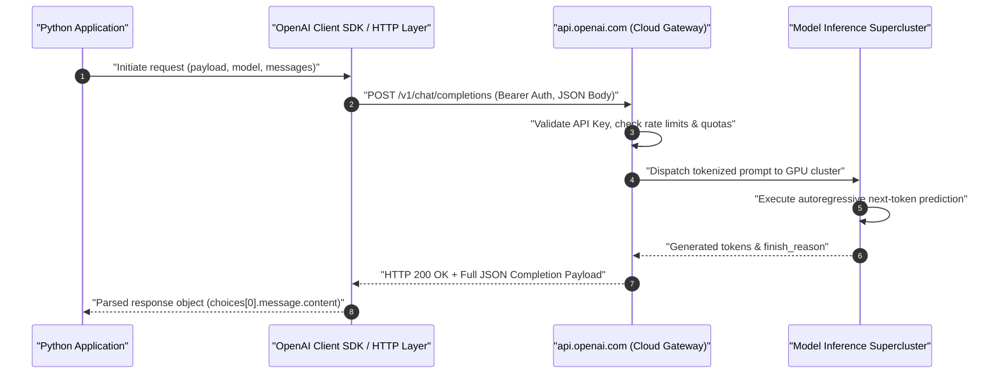

---

## The Chat Completions Paradigm and Predictive Foundations

The interface is designated as **Chat Completions** because it mirrors the fundamental mechanics of autoregressive generative models.

When querying a language model, the system provides a structured dialogue transcript representing the conversation to date. The model's computational objective is next-token prediction—identifying and generating the sequence of tokens that most plausibly completes the conversational sequence. While this mechanism appears as intelligent conversation or problem solving, the underlying engine is continually calculating conditional probabilities across a vast vocabulary.

Pioneered by OpenAI, this conversational JSON schema proved so intuitive and versatile that it was universally adopted across commercial providers and open-source inference servers.

---

## Deconstructing the Raw HTTP Request: Endpoints, Headers, and Payloads

An **API Endpoint** is a dedicated web address (URL) hosted on a remote server designed to process programmatic requests rather than render human-facing HTML pages.

### The Chat Completions Endpoint URL

All standard OpenAI conversational inference requests target a single REST endpoint:

```text
POST https://api.openai.com/v1/chat/completions
```

### Required HTTP Headers

To communicate with the endpoint, the client must transmit two mandatory HTTP headers:

1. **`Content-Type: application/json`:** Instructs the remote server that the incoming request payload is formatted as a JSON string.
2. **`Authorization: Bearer <API_KEY>`:** Transmits credentials via the standard OAuth 2.0 Bearer authentication scheme. The server validates this key against account balances, rate limits, and access permissions.

### Request Payload Structure

The body of the POST request is a JSON object containing two core parameters:

- **`model` (string):** Specifies the exact foundation model identifier (e.g., `"gpt-5-nano"`, `"gpt-4o-mini"`).
- **`messages` (list of objects):** The ordered conversational transcript where each dictionary contains:
  - `role`: The entity sending the message (`"system"`, `"user"`, or `"assistant"`).
  - `content`: The text content of the message.

### Invoking the API with Raw Python Requests

The standard Python `requests` library can query the model without importing any OpenAI-specific packages:

```python
import os
import requests
from dotenv import load_dotenv

# Load API credentials from .env into process environment
load_dotenv(override=True)
api_key = os.getenv("OPENAI_API_KEY")

# Step 1: Configure HTTP request headers
headers = {
    "Authorization": f"Bearer {api_key}",
    "Content-Type": "application/json"
}

# Step 2: Define JSON payload with model target and message history
payload = {
    "model": "gpt-5-nano",
    "messages": [
        {"role": "user", "content": "Tell me a fun fact"}
    ]
}

# Step 3: Dispatch network POST request to the API endpoint
response = requests.post(
    "https://api.openai.com/v1/chat/completions",
    headers=headers,
    json=payload
)

# Step 4: Parse response status and raw JSON
print(f"HTTP Status Code: {response.status_code}")
```

```text
HTTP Status Code: 200
```

---

## Dissecting the JSON Response Payload

When the model finishes processing, the server returns an HTTP 200 response containing a detailed JSON document detailing the completion, execution metadata, and token usage accounting:

```json
{
  "id": "chatcmpl-ClXqKdvFYJBZxbYHzGzTm4AHbr0y",
  "object": "chat.completion",
  "created": 1759350960,
  "model": "gpt-5-nano-2025-08-07",
  "choices": [
    {
      "index": 0,
      "message": {
        "role": "assistant",
        "content": "Fun fact: There are more possible unique games of chess than there are atoms in the observable universe—about 10^120 possible games vs roughly 10^80 atoms.",
        "refusal": null,
        "annotations": []
      },
      "finish_reason": "stop"
    }
  ],
  "usage": {
    "prompt_tokens": 11,
    "completion_tokens": 568,
    "total_tokens": 579,
    "prompt_tokens_details": {
      "cached_tokens": 0,
      "audio_tokens": 0
    },
    "completion_tokens_details": {
      "reasoning_tokens": 512,
      "audio_tokens": 0
    }
  },
  "service_tier": "default",
  "system_fingerprint": null
}
```

### Key Elements of the Response Schema

- **`id`:** A unique identifier assigned to the completion event, useful for debugging, audit logs, and support inquiries.
- **`model`:** Confirms the exact underlying snapshot used to fulfill the request.
- **`choices`:** An array of generated completion candidates. Because requests default to `n=1`, index `0` represents the primary output.
  - **`message.content`:** The textual answer generated by the model.
  - **`finish_reason`:** Explains why token generation concluded. Typical values include `"stop"` (the model reached a natural end-of-sequence token), `"length"` (hit maximum token limits), or `"tool_calls"` (requested an external function).
- **`usage`:** Detailed billing accounting:
  - `prompt_tokens`: Tokens consumed parsing the input message list.
  - `completion_tokens`: Output tokens generated (including hidden internal reasoning tokens).
  - `total_tokens`: Total billable token sum.

### Extracting Content from Raw JSON

To extract the generated response text from the raw dictionary:

```python
# Convert HTTP response body to a Python dictionary
response_data = response.json()

# Navigate nested dictionary hierarchy: choices -> index 0 -> message -> content
fun_fact = response_data["choices"][0]["message"]["content"]
print("Extracted Fact:")
print(fun_fact)
```

```text
Extracted Fact:
Fun fact: There are more possible unique games of chess than there are atoms in the observable universe—about 10^120 possible games vs roughly 10^80 atoms.
```

---

## Demystifying the OpenAI Python Client Library

While making direct HTTP calls using `requests` is instructive, managing raw JSON payloads and manual dictionary lookups introduces unnecessary boilerplate and brittle code into production applications.

### What the SDK Actually Is

The official `openai` Python package is **not** an artificial intelligence model engine. It does not contain weights, tensors, or local neural network algorithms.

The SDK is a lightweight, open-source HTTP client library that wraps network calls to `https://api.openai.com/v1`. It acts as an ergonomic translation layer between Python code and remote REST endpoints.

```python
from openai import OpenAI

# Client automatically reads OPENAI_API_KEY from environment variables
client = OpenAI()

# Method call constructs HTTP request, posts to endpoint, and deserializes response
completion = client.chat.completions.create(
    model="gpt-5-nano",
    messages=[
        {"role": "user", "content": "Tell me a fun fact"}
    ]
)

# Access response fields via clean dot-notation attributes
print("SDK Parsed Fact:")
print(completion.choices[0].message.content)
```

```text
SDK Parsed Fact:
Fun fact: There are more possible unique games of chess than there are atoms in the observable universe—about 10^120 possible games vs roughly 10^80 atoms.
```

---

## Universal Standardization: The Lingua Franca of Gen AI

The standardization of the `/v1/chat/completions` REST payload is one of the most significant architectural milestones in modern AI engineering.

Because OpenAI established this schema early, competitor labs and open-source infrastructure tools replicated the exact same JSON schema:

- **Open-Source Local Inference:** **Ollama**, **vLLM**, and **LocalAI** expose local endpoints matching `/v1/chat/completions`.
- **Specialized Cloud Providers:** **Groq**, **Mistral AI**, **Together AI**, and **DeepSeek** implement the identical HTTP interface.

Because the underlying schema is identical, switching between a local open-weight model and a cloud frontier model requires altering only the `base_url` parameter and model string.

---

## Technical Comparison: Raw HTTP vs. Official Python SDK

| Dimension                 | Raw HTTP (`requests.post`)                              | Official Python Client (`openai.OpenAI`)                            |
| :------------------------ | :------------------------------------------------------ | :------------------------------------------------------------------ |
| **Dependencies**          | Standard `requests` library only                        | Requires installing `openai` package                                |
| **Authentication**        | Manual header construction (`Bearer <key>`)             | Automatically resolved from `OPENAI_API_KEY`                        |
| **Data Access**           | Nested dictionary indexing (`dict["choices"][0]...`)    | Typed dot-notation attributes (`obj.choices[0]...`)                 |
| **Error Handling**        | Manual HTTP status code checks (`401`, `429`, `500`)    | Specific typed exceptions (`AuthenticationError`, `RateLimitError`) |
| **Retry Logic**           | None (must write custom loops with exponential backoff) | Built-in automatic retries with configurable limits                 |
| **Streaming Support**     | Requires manual Server-Sent Events (SSE) parsing        | Native Python generator yielding streamed chunks                    |
| **Typing & Autocomplete** | None (raw string keys, prone to typos)                  | Full IDE autocomplete via Pydantic model schemas                    |

> [!IMPORTANT]
> **Understanding the Abstraction Layer:** Always remember that the OpenAI client library is executing standard HTTPS POST requests under the hood. When debugging connection issues, proxy errors, or corporate firewalls, treat the SDK as standard web traffic directed at port 443 of `api.openai.com`.

> [!TIP]
> **Use Raw HTTP for Embedded or Minimal Environments:** If you are deploying an LLM integration to a lightweight container, AWS Lambda function, or non-Python environment (like bash `curl` scripts or embedded C/Rust microservices) where installing heavy SDK dependencies is undesirable, making a direct POST request with a raw JSON payload provides the exact same inference capability.

---

## Review Quiz

<details>
<summary><b>Question 1: What is the primary underlying reason the API is designated as "Chat Completions"?</b></summary>
<br>
<b>Answer:</b> Generative language models operate autoregressively by predicting the most probable sequence of future tokens. When given a conversation history (system, user, and assistant messages), the model generates the tokens that most likely "complete" that dialogue sequence.
</details>

<details>
<summary><b>Question 2: What are the two mandatory HTTP headers that must accompany every POST request to https://api.openai.com/v1/chat/completions?</b></summary>
<br>
<b>Answer:</b> <code>Content-Type: application/json</code> (to signal that the body payload is JSON-formatted) and <code>Authorization: Bearer &lt;API_KEY&gt;</code> (to authenticate the caller using OAuth 2.0 Bearer token standards).
</details>

<details>
<summary><b>Question 3: Does installing the openai Python package download or execute neural network weights locally on your machine?</b></summary>
<br>
<b>Answer:</b> No. The <code>openai</code> Python package is purely an HTTP client SDK. It contains no neural network weights or local model code; it simply constructs standard HTTP REST requests, transmits them over the internet to OpenAI's cloud servers, and parses the returned JSON responses into convenient Python objects.
</details>

<details>
<summary><b>Question 4: What is the purpose of the finish_reason field inside choices[0] in the JSON response?</b></summary>
<br>
<b>Answer:</b> It specifies the technical reason token generation stopped. Common values include <code>"stop"</code> (the model naturally completed its answer), <code>"length"</code> (the output reached the maximum token limit), or <code>"tool_calls"</code> (the model paused text generation to request an external function or tool execution).
</details>

<details>
<summary><b>Question 5: Why can the standard openai Python SDK be used without modification to query local inference servers like Ollama or third-party providers like Groq?</b></summary>
<br>
<b>Answer:</b> Because the Chat Completions REST API schema (<code>/v1/chat/completions</code>) was adopted as an open industry standard. Local engines like Ollama and external clouds like Groq implement the exact same HTTP endpoint, request parameters, and JSON response structure, allowing developers to switch backends simply by configuring the SDK's <code>base_url</code>.
</details>

---

# Running Ollama Locally with OpenAI-Compatible Endpoints

## Local Model Inference and the OpenAI Protocol Standard

Running open-source Large Language Models locally on personal hardware provides significant engineering advantages: total data privacy, zero recurring API expenses, and full operational capability without an active internet connection. Historically, adopting open-source models required developers to navigate incompatible model formats, complex C++ compilation steps, GPU driver configurations, and custom inference APIs.

Ollama abstracts this infrastructure complexity into a single self-contained daemon. It handles downloading model weights, quantizing and caching parameters, managing memory allocation across CPU and Apple Silicon unified memory (via Metal), and hosting an HTTP inference server.

Crucially, Ollama implements the **OpenAI Chat Completions API protocol**. Rather than forcing developers to learn proprietary SDKs or write unique payloads for local models, Ollama exposes an HTTP endpoint at `/v1/chat/completions` that accepts the exact same JSON schema and returns the exact same response structures as OpenAI's cloud servers.

This architectural standard allows developers to achieve **client polymorphism**: you can develop and test applications against a local model running on your laptop, and subsequently switch production traffic to frontier models in the cloud—or vice versa—simply by changing an environment variable or base URL parameter, without altering a single line of business logic.

```text
+-------------------------------------------------------------------------------+
|                             CLIENT POLYMORPHISM                               |
|                                                                               |
|       +---------------------------------------------------------------+       |
|       |                   OpenAI Python Client SDK                    |       |
|       |               client.chat.completions.create(...)             |       |
|       +-------------------------------+-------------------------------+       |
|                                       |                                       |
|                  base_url routing     |                                       |
|            +--------------------------+--------------------------+            |
|            |                                                     |            |
|            v                                                     v            |
|  [ api.openai.com/v1 ]                               [ localhost:11434/v1 ]   |
|            |                                                     |            |
|     (Cloud Frontier)                                      (Local Engine)      |
|            v                                                     v            |
|   +-----------------+                                   +-----------------+   |
|   | OpenAI Cloud    |                                   |  Ollama Server  |   |
|   |  - GPT-4o       |                                   |  - Llama 3.2    |   |
|   |  - o1 / o3-mini |                                   |  - DeepSeek-R1  |   |
|   +-----------------+                                   +-----------------+   |
+-------------------------------------------------------------------------------+
```

---

## Verifying the Local Ollama Server Lifecycle

Before initiating API requests, the background Ollama daemon must be active and listening for incoming TCP connections. By default, Ollama binds to port `11434` on localhost.

### Checking Daemon Connectivity via Python

You can verify that the Ollama service is reachable by sending an HTTP GET request to the root server URL (`http://localhost:11434`) using the standard Python `requests` library.

```python
import requests

# Send an HTTP GET request to Ollama's local port
ollama_url = "http://localhost:11434"

try:
    response = requests.get(ollama_url, timeout=3)
    # The server responds with plain text verifying active status
    print(f"Status Code: {response.status_code}")
    print(f"Response Body: {response.content}")
except requests.exceptions.ConnectionError:
    print("Ollama daemon is not running or unreachable on port 11434.")
```

```text
Status Code: 200
Response Body: b'Ollama is running'
```

When Ollama is operational, the root endpoint returns HTTP status `200` with the byte string `b'Ollama is running'`.

### Starting the Server and Handling Port Collisions

If the connection fails, the Ollama service must be initiated:

1. **GUI Application (macOS/Windows):** Launch the **Ollama** application from your Applications folder. The application sits in the macOS menu bar or Windows system tray and runs the background daemon automatically.
2. **Terminal Command:** In your terminal, execute the `serve` command:

```bash
# Start the Ollama background inference daemon
ollama serve
```

```text
Error: listen tcp 127.0.0.1:11434: bind: address already in use
```

> [!TIP]
> **Understanding the "Address Already in Use" Message:** If running `ollama serve` outputs `bind: address already in use`, the Ollama daemon is already running in the background (typically started automatically on macOS system startup or launched via the menu bar app). You do not need to restart it; the server is ready to accept requests.

---

## Downloading and Managing Local Model Weights

Unlike cloud APIs where weights reside remotely, local inference requires downloading model parameters to your hard drive prior to execution. Ollama manages model versions and parameter counts using tags.

### Selecting Model Sizes

Meta's Llama 3.2 family provides optimized Small Language Models (SLMs) designed for edge and developer machines:

- **`llama3.2` (Default 3B):** The standard 3.2 release defaults to the 3-billion-parameter model (~2.0 GB download). It delivers an effective balance of reasoning capability, instruction-following fidelity, and local execution speed on machines with 8 GB to 16 GB of RAM.
- **`llama3.2:1b` (1B Lightweight):** A 1.3-billion-parameter variant (~1.3 GB download) tailored for constrained hardware environments, low-memory devices, or ultra-low-latency local pipelines.

### Pulling Weights via Terminal

Download the model weights using the `ollama pull` command in your terminal:

```bash
# Pull the default 3-billion-parameter Llama 3.2 model
ollama pull llama3.2
```

```text
pulling manifest
pulling dde5aa3fc5ff... 100% ▕█████████████████████████████████████████████████████████████████████▏ 2.0 GB
pulling 966de95ca8a6... 100% ▕█████████████████████████████████████████████████████████████████████▏ 1.4 KB
pulling fcc5a60aae62... 100% ▕█████████████████████████████████████████████████████████████████████▏  11 KB
pulling a70ff7e570d9... 100% ▕█████████████████████████████████████████████████████████████████████▏ 6.0 KB
pulling 56bb8bec9363... 100% ▕█████████████████████████████████████████████████████████████████████▏   96 B
pulling e71199bc45ce... 100% ▕█████████████████████████████████████████████████████████████████████▏  485 B
verifying sha256 digest
writing manifest
success
```

For hardware setups with tighter RAM constraints, pull the 1-billion-parameter variant:

```bash
# Pull the 1.3-billion-parameter lightweight variant
ollama pull llama3.2:1b
```

```text
pulling manifest
pulling baf6a78e59d6... 100% ▕█████████████████████████████████████████████████████████████████████▏ 1.3 GB
verifying sha256 digest
writing manifest
success
```

> [!NOTE]
> **Deterministic Local Caching:** If a model has already been pulled, re-running `ollama pull <model-name>` completes in milliseconds. Ollama inspects local layer digests and verifies that the model manifests match without re-downloading existing weight layers.

---

## Local Inference Architecture

When using Ollama as an OpenAI drop-in replacement, your Python script communicates with a local HTTP port rather than an external cloud server. The request flow mirrors cloud operations precisely:

```text
+---------------+            HTTP POST /v1/chat/completions             +---------------+
|               |  --------------------------------------------------->  |               |
| Python Client |          JSON: {"model": "llama3.2", "messages": ...} | Ollama Server |
|  (OpenAI SDK) |                                                       | (Port 11434)  |
|               |  <---------------------------------------------------  |               |
+---------------+              HTTP 200 OK: {"choices": [...]}           +-------+-------+
                                                                                 |
                                                              Load Weights & KV  |
                                                              Cache into Memory  |
                                                                                 v
                                                                        +-----------------+
                                                                        |   Local Model   |
                                                                        |  Inference Core |
                                                                        | (RAM / Metal GPU|
                                                                        |   Unified Mem)  |
                                                                        +-----------------+
```

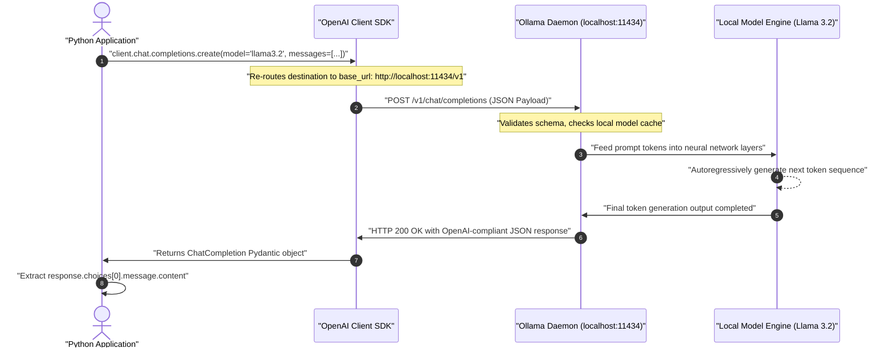

---

## Re-Routing the OpenAI Python SDK to Ollama

To execute requests against your local model, instantiate the standard `OpenAI` client class while overriding two key constructor parameters: `base_url` and `api_key`.

### The Mechanics of the Base URL and API Key

1. **`base_url` (`http://localhost:11434/v1`):** Overrides the default `https://api.openai.com/v1`. The trailing `/v1` reflects the OpenAI REST API routing convention where chat completions reside under `/v1/chat/completions`. Ollama handles the `/v1` path prefix and routes incoming traffic directly to its local completion engine.
2. **`api_key` (`"ollama"`):** Because Ollama runs entirely on your local machine, authentication and billing do not apply—no payment tokens, credits, or secret keys are checked. However, the official `openai` Python SDK requires a non-empty string during client instantiation to pass internal validation. Providing any non-empty string (e.g., `"ollama"` or `"dummy"`) satisfies the client check, while Ollama simply ignores the incoming `Authorization` header.

### Querying Llama 3.2 Locally

The following script connects to the local Ollama instance, passes a user message asking for a fun fact, and extracts the response from the local `llama3.2` model:

```python
from openai import OpenAI

# Define the local Ollama API endpoint
OLLAMA_BASE_URL = "http://localhost:11434/v1"

# Initialize the OpenAI client pointing to the local Ollama server
# A dummy api_key is supplied to satisfy the SDK's internal client validation
ollama_client = OpenAI(
    base_url=OLLAMA_BASE_URL,
    api_key="ollama"
)

# Execute the completion using the local llama3.2 weights
response = ollama_client.chat.completions.create(
    model="llama3.2",
    messages=[
        {"role": "user", "content": "Tell me a fun fact"}
    ]
)

# Extract and print the generated message content
message_content = response.choices[0].message.content
print(message_content)
```

```text
Did you know that there's a type of jellyfish that is biologically immortal?

The Turritopsis dohrnii, also known as the immortal jellyfish, can revert back to its juvenile polyp stage after reaching maturity. When faced with physical damage, disease, or starvation, its cells undergo a process called transdifferentiation, essentially allowing it to reset its biological clock and start life all over again.
```

> [!IMPORTANT]
> **Exact Model Name Match:** The `model` parameter passed to `chat.completions.create` must strictly match the name of the model installed in Ollama. If you downloaded `llama3.2:1b`, you must pass `model="llama3.2:1b"`. Passing a model tag that has not been pulled locally will cause Ollama to return a `404 Not Found` model error.

---

## Distilled Reasoning Models: Testing DeepSeek-R1 1.5B Locally

In addition to general-purpose conversational models, Ollama provides access to modern **reasoning models** that have undergone **knowledge distillation**.

### Understanding Model Distillation

Model distillation is a machine learning training technique where a compact, resource-efficient model (the student) is trained on reasoning traces, problem solutions, and chain-of-thought demonstrations generated by a significantly larger frontier model (the teacher).

The model designated as `deepseek-r1:1.5b` uses Alibaba Cloud's lightweight **Qwen 2.5 1.5B** open-source base architecture, which was then fine-tuned on extensive synthetic reasoning trajectories generated by the full 671-billion-parameter **DeepSeek-R1** model. This allows a 1.5-billion-parameter model running on a consumer laptop to emulate the structured reasoning style of massive frontier architectures.

```text
+-------------------------------------------------------------------------------+
|                             MODEL DISTILLATION                                |
|                                                                               |
|   +------------------------------------+                                      |
|   |          DeepSeek-R1               |  (Massive Frontier Teacher Model)     |
|   |         (671B Parameters)          |                                      |
|   +-----------------+------------------+                                      |
|                     |                                                         |
|                     | Generates detailed chain-of-thought solutions           |
|                     | and synthetic reasoning step data                       |
|                     v                                                         |
|   +------------------------------------+                                      |
|   |    High-Quality Reasoning Data     |                                      |
|   +-----------------+------------------+                                      |
|                     |                                                         |
|                     | Supervised Fine-Tuning (SFT) & Preference Optimization  |
|                     v                                                         |
|   +------------------------------------+                                      |
|   |       Qwen 2.5 1.5B Base           |  (Lightweight Student Architecture)  |
|   +-----------------+------------------+                                      |
|                     |                                                         |
|                     v                                                         |
|   +------------------------------------+                                      |
|   |      deepseek-r1:1.5b              |  (Compact Reasoning Model for Local  |
|   |  (Distilled Local Model)           |   Consumer Hardware)                 |
|   +------------------------------------+                                      |
+-------------------------------------------------------------------------------+
```

### Pulling and Executing DeepSeek-R1 1.5B

Download the distilled 1.5B model using `ollama pull`:

```bash
# Pull the distilled 1.5-billion parameter DeepSeek-R1 model
ollama pull deepseek-r1:1.5b
```

```text
pulling manifest
pulling aabd4de60c8f... 100% ▕█████████████████████████████████████████████████████████████████████▏ 1.1 GB
pulling 369ca49a34b3... 100% ▕█████████████████████████████████████████████████████████████████████▏  387 B
pulling 6e4c38e1172f... 100% ▕█████████████████████████████████████████████████████████████████████▏ 1.1 KB
verifying sha256 digest
writing manifest
success
```

Execute inference using the exact same OpenAI client instance, swapping only the `model` identifier:

```python
from openai import OpenAI

# Reuse the existing local Ollama client configuration
ollama_client = OpenAI(
    base_url="http://localhost:11434/v1",
    api_key="ollama"
)

# Call the distilled DeepSeek model
response = ollama_client.chat.completions.create(
    model="deepseek-r1:1.5b",
    messages=[
        {"role": "user", "content": "Tell me a fun fact"}
    ]
)

print(response.choices[0].message.content)
```

```text
Here's a fun fact for you: Did you know that the sun looks like a golden crown during sunset, with its gold-colored reflection on the horizon? The rest of the sky shows a pale yellow tint. This coloration changes as atmospheric conditions shift: when the sun is higher in the sky, Rayleigh scattering scatters blue light, making the direct light appear clearer, but when it sets near the horizon, sunlight travels through far more atmosphere, filtering out shorter wavelengths and leaving richer red and yellow tones.
```

### Observations on Model Capacity and Size Disparity

While `deepseek-r1:1.5b` successfully answers prompts, its prose and depth reflect its compact parameter budget:

- At 1.5 billion parameters, the model is roughly **1,000 times smaller** than flagship frontier models (which often exceed 1 to 2 trillion mixture-of-experts parameters).
- For straightforward prompts, summarization, and lightweight classification, distilled models offer impressive efficiency and zero operational cost.
- For complex multi-step logical deduction, long-context document synthesis, or advanced code generation, small local models are prone to hallucination or simplified logic.

---

## Engineering Trade-Offs: Local Inference vs. Cloud Frontier APIs

Choosing between local deployment via Ollama and managed cloud APIs involves fundamental engineering trade-offs across cost, privacy, operational overhead, and raw model capability.

| Engineering Dimension          | Local Deployment via Ollama (e.g., Llama 3.2 3B)                                                                             | Cloud Frontier APIs (e.g., OpenAI GPT-4o, Claude 3.5 Sonnet)                                                                              |
| :----------------------------- | :--------------------------------------------------------------------------------------------------------------------------- | :---------------------------------------------------------------------------------------------------------------------------------------- |
| **Data Privacy & Security**    | **Complete isolation:** Prompts and outputs never leave the local machine or internal subnet. Zero third-party data logging. | **Shared responsibility:** Data is transmitted over HTTPS to external vendor servers subject to cloud data-processing agreements.         |
| **Operational & Token Cost**   | **\$0 per token:** No recurring billing, credit card requirements, or monthly subscriptions.                                 | **Pay-as-you-go:** Charged strictly per 1,000 or 1,000,000 input/output tokens consumed.                                                  |
| **Network & Connectivity**     | **Fully offline capable:** Operates without internet connectivity once model weights are stored locally.                     | **Internet required:** Cannot function during ISP outages or inside air-gapped corporate environments without specialized endpoints.      |
| **Model Intelligence & Scale** | **Constrained:** Typically 1B to 8B parameters on consumer laptops. Suitable for basic tasks and targeted SLM workloads.     | **State-of-the-art:** Trillion-scale frontier architectures capable of nuanced multi-step reasoning, coding, and large-context synthesis. |
| **Hardware Constraints**       | **Local dependency:** Consumes host system RAM, GPU/Metal VRAM, and storage disk space. Performance scales with host chip.   | **Zero local overhead:** All compute happens in enterprise cloud data centers. Runs on any lightweight client device.                     |
| **Context Window Size**        | **Typically 4K to 128K tokens** (heavily constrained by available local RAM/Unified Memory for the KV cache).                | **128K to 2M+ tokens** with cloud infrastructure capable of caching massive documents efficiently.                                        |

### Comparison of Local Small Language Models

| Model Tag          | Base Architecture            | Parameter Count | Disk & RAM Footprint | Best Suited For                                                                          |
| :----------------- | :--------------------------- | :-------------- | :------------------- | :--------------------------------------------------------------------------------------- |
| `llama3.2:1b`      | Meta Llama 3.2               | 1.3 Billion     | ~1.3 GB              | Ultra-low memory systems, rapid local unit tests, lightweight text filtering.            |
| `llama3.2`         | Meta Llama 3.2               | 3.2 Billion     | ~2.0 GB              | General local chat, basic code assistance, webpage summarization, structured extraction. |
| `deepseek-r1:1.5b` | Alibaba Qwen 2.5 (Distilled) | 1.5 Billion     | ~1.1 GB              | Local reasoning exploration, math/logic prompts, evaluating chain-of-thought behavior.   |

> [!CAUTION]
> **Unified Memory and the KV Cache:** When running local models on Apple Silicon or standard PCs, memory usage is not limited to the static size of the model weights on disk. As the context window expands during long conversations or large document processing, the **KV (Key-Value) cache** allocates additional RAM dynamically. Running large context windows on 8 GB or 16 GB machines can cause memory swapping or sudden process termination if memory thresholds are exceeded.

---

## Hands-On Implementation: Building an Offline Website Summarizer

To demonstrate how the OpenAI client library interacts seamlessly with local models, we can adapt the end-to-end website summarizer built for OpenAI cloud endpoints to run entirely on your local machine using Ollama and `llama3.2`.

### Architecture of the Offline Pipeline

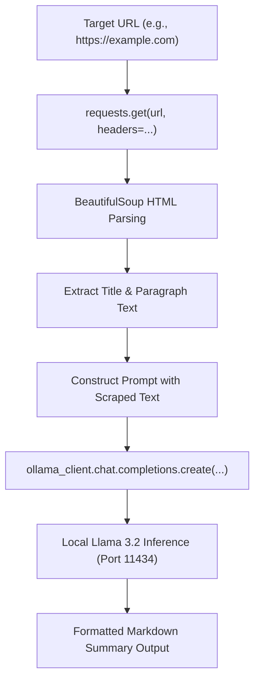

### Complete Implementation Code

This implementation uses `BeautifulSoup` to scrape website contents and passes the cleaned text to the local Ollama instance using the standard OpenAI client interface:

```python
import requests
from bs4 import BeautifulSoup
from openai import OpenAI

# Initialize the OpenAI client pointing to the local Ollama daemon
OLLAMA_BASE_URL = "http://localhost:11434/v1"
ollama_client = OpenAI(
    base_url=OLLAMA_BASE_URL,
    api_key="ollama"  # Required placeholder for SDK validation
)

def fetch_website_contents(url: str) -> str:
    """
    Downloads webpage HTML and extracts human-readable text.
    Filters out scripts, styles, and navigational elements.
    """
    headers = {
        "User-Agent": "Mozilla/5.0 (Macintosh; Intel Mac OS X 10_15_7) AppleWebKit/537.36"
    }
    response = requests.get(url, headers=headers, timeout=10)
    response.raise_for_status()

    soup = BeautifulSoup(response.text, "html.parser")

    # Remove non-content elements
    for element in soup(["script", "style", "nav", "footer", "header", "noscript"]):
        element.extract()

    # Extract page title and clean body text
    title = soup.title.string.strip() if soup.title and soup.title.string else "Untitled Page"
    paragraphs = [p.get_text().strip() for p in soup.find_all("p") if p.get_text().strip()]
    body_text = "\n\n".join(paragraphs)

    return f"Website Title: {title}\n\nContent:\n{body_text}"

def summarize_website_locally(url: str, model: str = "llama3.2") -> str:
    """
    Fetches website text and prompts the local Ollama model to generate
    an executive markdown summary.
    """
    raw_content = fetch_website_contents(url)

    # Cap context length to accommodate small model context windows
    truncated_content = raw_content[:4000]

    system_prompt = (
        "You are an expert technical editor. Summarize the provided webpage content "
        "into clear, professional GitHub-flavored Markdown. Include a one-paragraph overview "
        "followed by 3-5 key takeaways as bullet points."
    )

    user_prompt = f"Please summarize the following website contents:\n\n{truncated_content}"

    # Query the local Ollama model via OpenAI Chat Completions endpoint
    response = ollama_client.chat.completions.create(
        model=model,
        messages=[
            {"role": "system", "content": system_prompt},
            {"role": "user", "content": user_prompt}
        ],
        temperature=0.3
    )

    return response.choices[0].message.content

# Run the summarizer on an example domain
if __name__ == "__main__":
    test_url = "https://example.com"
    print(f"Scraping and summarizing {test_url} using local Ollama model...\n")
    summary = summarize_website_locally(test_url)
    print(summary)
```

```text
Scraping and summarizing https://example.com using local Ollama model...

# Example Domain Summary

This webpage serves as an illustrative example domain established by the Internet Assigned Numbers Authority (IANA) and the Internet Engineering Task Force (IETF). It is reserved for documentation, technical examples, and software testing without requiring prior coordination or permission.

### Key Takeaways
- **Reserved Status:** The domain is permanently maintained for illustrative examples in technical RFCs and documentation.
- **No Prior Registration Required:** Developers and authors may use this domain freely in code samples without registering ownership.
- **Informational Management:** Managed under the auspices of IANA to prevent domain squatting and ensure stable demonstration URLs.
```

### Prompt Customization and Community Contributions

When adapting this pipeline for specific workflows, experimenting with the system prompt allows you to alter the model's behavior dramatically:

- **Tone & Style:** Instruct the model to adopt the persona of an executive analyst, an investigative journalist, or a simplified teacher.
- **Translation:** Add explicit system constraints to output the summary in a target foreign language (e.g., Spanish, French, or Japanese).
- **Structured Schema:** Request strict JSON formatting for automated ingestion into relational databases or downstream agent workflows.

Once implemented and validated locally, community solutions and custom prompt variations can be submitted to project repositories under the `community-contributions` directory via standard GitHub Pull Requests (PRs).

---

## Review Quiz

<details>
<summary><b>Question 1: What does setting base_url="http://localhost:11434/v1" in the OpenAI client accomplish?</b></summary>
<br>
<b>Answer:</b> It redirects all HTTP REST requests generated by the OpenAI SDK away from OpenAI's cloud servers (<code>https://api.openai.com/v1</code>) and targets the local Ollama inference daemon listening on port <code>11434</code>. Because Ollama adheres to the standard OpenAI <code>/v1/chat/completions</code> schema, the client functions seamlessly without code modifications.
</details>

<details>
<summary><b>Question 2: Why must a non-empty api_key string be passed to the OpenAI constructor when connecting to Ollama?</b></summary>
<br>
<b>Answer:</b> The official <code>openai</code> Python library performs client-side validation on instantiation and raises an error if the <code>api_key</code> parameter is empty or <code>None</code>. While Ollama operates locally with no authentication and ignores the <code>Authorization: Bearer</code> header, a placeholder string (such as <code>"ollama"</code> or <code>"dummy"</code>) is required to satisfy the SDK's internal parameter check.
</details>

<details>
<summary><b>Question 3: If running ollama serve returns "listen tcp 127.0.0.1:11434: bind: address already in use", what does this signify and how should you respond?</b></summary>
<br>
<b>Answer:</b> It indicates that the Ollama background daemon is already running and actively listening on port <code>11434</code> (typically started as a background system service or launched through the macOS/Windows desktop application). No corrective action is required; the server is ready to accept incoming inference requests immediately.
</details>

<details>
<summary><b>Question 4: What is the technical distinction between a native frontier model and a distilled local model like deepseek-r1:1.5b?</b></summary>
<br>
<b>Answer:</b> A native frontier model (such as DeepSeek-R1 or GPT-4o) possesses hundreds of billions or trillions of parameters trained from scratch across enormous compute clusters. A distilled model like <code>deepseek-r1:1.5b</code> takes a compact base architecture (Alibaba's Qwen 2.5 1.5B) and fine-tunes it on high-quality synthetic reasoning chains generated by the massive teacher model, allowing it to mimic complex reasoning patterns within a footprint small enough for consumer hardware.
</details>

<details>
<summary><b>Question 5: What primary technical trade-off must an engineer accept when substituting a cloud frontier API with an offline 3B model like Llama 3.2?</b></summary>
<br>
<b>Answer:</b> The engineer trades superior reasoning capability, nuanced instruction-following, and massive context windows (frontier scale) for complete data privacy, offline autonomy, zero marginal token costs, and local hardware execution (small language model scale).
</details>

---

# Base, Chat, and Reasoning Models: Understanding LLM Types

## The Evolution of LLM Paradigms

Large Language Models are not monolithic engines; they exist in distinct architectural breeds shaped by their training objectives and intended deployment roles. Understanding these model categories is fundamental to LLM engineering, as choosing the incorrect breed can lead to degraded output quality, excessive token billing, or latency bottlenecks.

Modern generative AI has evolved through three foundational paradigms, culminating in today's adaptive hybrid systems:

```text
+-------------------------------------------------------------------------------+
|                           THE GENERATIVE LLM EVOLUTION                        |
|                                                                               |
|  1. BASE MODELS (Pre-Trained Predictors)                                      |
|     [ Unstructured Text Corpus ] ---> [ Next-Token Autoregression ]           |
|     * Function: Complete raw statistical sequence                             |
|     * Example: GPT-3, LLaMA-1 Base                                            |
|                                     |                                         |
|                                     v Supervised Fine-Tuning (SFT) & RLHF     |
|  2. CHAT & INSTRUCT MODELS (Conversational Agents)                            |
|     [ Structured Dialogue Roles: System | User | Assistant ]                  |
|     * Function: Follow direct instructions and engage in dialogue             |
|     * Example: ChatGPT (GPT-3.5/GPT-4), Claude 3.5 Sonnet, Llama 3.2 Instruct|
|                                     |                                         |
|                                     v Reinforcement Learning on Thought Chains|
|  3. REASONING MODELS (Thinking Systems)                                       |
|     [ Prompt ] ---> [ Intermediate Thinking Trace ] ---> [ Final Answer ]     |
|     * Function: Generate deliberate internal logic before answering           |
|     * Example: OpenAI o1 / o3-mini, DeepSeek-R1                               |
|                                     |                                         |
|                                     v Dynamic Test-Time Compute Routing       |
|  4. HYBRID MODELS (Adaptive Compute)                                          |
|     * Function: Dynamically scale reasoning budget based on query complexity  |
|     * Example: Gemini 2.5 Pro, GPT-4.5 / GPT-5                                |
+-------------------------------------------------------------------------------+
```

---

## Base Models: Pure Autoregressive Sequence Predictors

A **base model** (or foundation model) is an LLM that has undergone large-scale pre-training across vast, uncurated text and code corpora. Its solitary mathematical function is **autoregressive next-token prediction**: given an input sequence of tokens, it calculates probability distributions across its vocabulary to predict the most likely subsequent token.

### The Mental Model: Smartphone Predictive Text

The most intuitive analog to a base model is the predictive text feature on a modern smartphone keyboard:

```text
User Types:    "Hello there"
Keyboard Suggests: [ my | friend | hope ]
User Taps:     "friend"
Updated State: "Hello there friend"
Next Suggests: [ I | how | hope ]
```

When you repeatedly tap suggested words, the phone completes the sentence using local frequency statistics. A base model performs this exact operation, but utilizes deep multi-head self-attention mechanisms trained across trillions of web tokens.

### Historical Context: Prompting Early Foundation Models

Before OpenAI released ChatGPT in late 2022, developers interacted directly with base models such as raw **GPT-3** (`davinci`). Base models do not understand the conversational convention of "answering" a user. If given an instruction such as:

```text
Write a poem about distributed systems.
```

A pure base model might not write a poem. Instead, it might simply continue the text as if completing an exam paper or web forum thread:

```text
Also explain the CAP theorem.
Due date: October 24th.
Professor Smith's Office Hours: 2:00 PM - 4:00 PM.
```

To force a base model into answering questions, developers had to use **few-shot in-context learning** with artificial question-and-answer prefixes (`Q:` and `A:`):

```python
from openai import OpenAI

client = OpenAI()

# Simulating base model few-shot completion syntax
few_shot_prompt = """Q: What is the capital of France?
A: Paris.

Q: What is the capital of Japan?
A: Tokyo.

Q: What is the capital of Australia?
A:"""

# In legacy base models, the engine completes the pattern directly
print("Prompt fed to model:\n", few_shot_prompt)
```

```text
Prompt fed to model:
 Q: What is the capital of France?
A: Paris.

Q: What is the capital of Japan?
A: Tokyo.

Q: What is the capital of Australia?
A:
```

The model identifies the structural pattern in the sequence and predicts ` Canberra.` as the most probable continuation.

### When to Use Base Models

In modern engineering pipelines, end-user applications rarely interact with raw base models. However, base models remain indispensable in specific scenarios:
1. **Domain-Specific Pre-Training & Fine-Tuning:** When training a model from scratch on proprietary corporate records, legal statutes, or medical diagnoses, starting with an instruction-tuned model can bias the output. A base model provides an unconstrained substrate.
2. **Non-Conversational Syntax Engines:** Tasks like code autocomplete (e.g., Tab-completion in IDEs), molecular structure generation, or raw log completion operate more effectively as sequence continuations rather than chat dialogues.

---

## Chat and Instruct Models: Multi-Turn Dialogue via RLHF

To bridge the gap between raw statistical text continuation and practical human utility, researchers developed **Instruct** and **Chat** variants.

### The Alignment Process: SFT and RLHF

Transforming a base model into a chat model requires two primary post-training phases:

1. **Supervised Fine-Tuning (SFT):** The base model is trained on curated datasets of instruction-response pairs formatted as structured conversations.
2. **Reinforcement Learning from Human Feedback (RLHF):** Human evaluators rank model responses, and a reward model is trained to score candidate outputs. Proximal Policy Optimization (PPO) or Direct Preference Optimization (DPO) aligns the model to prioritize helpfulness, conciseness, and safety while suppressing toxicity.

### The Standardized Role Hierarchy

Chat models introduced the standardized three-role conversation schema that underpins modern generative APIs:

```text
+-------------------------------------------------------------------------------+
|                       CHAT COMPLETIONS ROLE HIERARCHY                         |
|                                                                               |
|  +-------------------------------------------------------------------------+  |
|  | System Message: Defines persona, boundaries, tone, and operational rules|  |
|  +-------------------------------------------------------------------------+  |
|                                      |                                        |
|                                      v                                        |
|  +-------------------------------------------------------------------------+  |
|  | User Message: Expresses intent, queries, or task data from the human    |  |
|  +-------------------------------------------------------------------------+  |
|                                      |                                        |
|                                      v                                        |
|  +-------------------------------------------------------------------------+  |
|  | Assistant Message: Output generated by the aligned LLM                  |  |
|  +-------------------------------------------------------------------------+  |
|                                      |                                        |
|                                      v                                        |
|  +-------------------------------------------------------------------------+  |
|  | User Message (Turn 2): Follow-up inquiry maintaining context history    |  |
|  +-------------------------------------------------------------------------+  |
+-------------------------------------------------------------------------------+
```

### Implementing Chat Completions in Python

```python
from openai import OpenAI

client = OpenAI()

# Standard Chat Completions API multi-turn dialogue
response = client.chat.completions.create(
    model="gpt-4o-mini",
    messages=[
        {
            "role": "system",
            "content": "You are a concise engineering mentor. Explain concepts in one sentence."
        },
        {
            "role": "user",
            "content": "What is the primary difference between a base model and an instruct model?"
        }
    ],
    temperature=0.2
)

print(response.choices[0].message.content)
```

```text
A base model simply predicts the next word in an uncurated sequence of text, whereas an instruct model has been fine-tuned with human feedback to follow direct tasks and engage in conversational dialogue.
```

---

## Reasoning Models: Chain-of-Thought and Test-Time Compute

While chat models excel at conversational fluency and text generation, they struggle with complex, multi-step logical deduction, competitive mathematics, and intricate software architecture.

### The Chain-of-Thought Discovery

Early prompt engineers discovered a simple yet profound technique known as **Chain-of-Thought (CoT)** prompting: appending the phrase `"Please think step by step"` to a complex question drastically improved the model's accuracy.

Because autoregressive models predict one token at a time, forcing the model to generate intermediate mathematical or logical steps expands its **working memory** on the context window. When the model eventually generates the final answer token, it attends to its own previously generated reasoning tokens.

```text
Without CoT:
Prompt: "If John has 3 apples and eats 1, then buys 2 bags of 6 apples, how many does he have?"
Model jumps straight to final token: "15" (High probability of arithmetic error).

With CoT ("Think step by step"):
Model writes: "John starts with 3. Eats 1: 3 - 1 = 2. Buys 2 bags of 6: 2 * 6 = 12. Adds them: 2 + 12 = 14."
Final Answer: "14" (Correct, because it attends to verified prior tokens).
```

### Purpose-Built Reasoning Models

Rather than relying on users to prompt for step-by-step thinking, **Reasoning Models** (such as OpenAI's **o1**, **o3-mini**, and **DeepSeek-R1**) are trained to allocate internal **test-time compute**. Before emitting any user-facing tokens, the model autoregressively generates an extensive internal reasoning trace (often wrapped in `<think>` tags or stored in dedicated reasoning token fields).

```python
from openai import OpenAI

client = OpenAI()

# Executing a query against a purpose-built reasoning model
response = client.chat.completions.create(
    model="o3-mini",
    messages=[
        {
            "role": "user",
            "content": "How many 'r' letters are in the word 'strawberry'?"
        }
    ]
)

# Reasoning models natively deliberate internally before returning the answer
print(response.choices[0].message.content)
```

```text
There are 3 'r's in the word "strawberry".

Breakdown:
s - t - r (1) - a - w - b - e - r (2) - r (3) - y
```

---

## Hybrid Models and Dynamic Reasoning Allocation

Early reasoning models suffered from an operational limitation: they applied heavy reasoning chains to *every* query, resulting in unnecessary delays for trivial greetings or simple lookups.

To resolve this, modern frontier architectures have adopted **hybrid reasoning models** (e.g., **Gemini 2.5 Pro**, **GPT-4.5 / GPT-5**). A hybrid model dynamically analyzes query complexity and adjusts its **reasoning budget** (or reasoning effort) on the fly:

- **Trivial Queries ("Hello"):** Bypasses reasoning traces, responding instantaneously like a standard chat model.
- **Moderate Complexity ("Draft a professional invoice template"):** Conducts brief structural planning before generating the document.
- **High Complexity ("Refactor this lock-free concurrent queue in C++"):** Expands its internal token budget to thousands of reasoning steps, stress-testing race conditions before writing code.

Developers can also control this allocation programmatically via the `reasoning_effort` parameter:

```python
from openai import OpenAI

client = OpenAI()

# Configuring explicit reasoning budget allocation
response = client.chat.completions.create(
    model="o3-mini",
    reasoning_effort="high",  # Options: 'low', 'medium', 'high'
    messages=[
        {
            "role": "user",
            "content": "Analyze the time complexity of balancing an AVL tree during deletion."
        }
    ]
)

print(response.choices[0].message.content)
```

```text
The time complexity of deleting a node from an AVL tree and rebalancing is strictly O(log n).

Detailed breakdown:
1. Standard BST Deletion: Locating the node and replacing it with its inorder predecessor/successor takes O(h) time, where h is tree height.
2. Height Maintenance: Since an AVL tree strictly enforces that the balance factor (|height(left) - height(right)|) <= 1, the tree height h is mathematically bounded by ~1.44 log2(n), which is O(log n).
3. Rebalancing Operations: Retracing the path upward from the deletion point requires at most O(log n) height adjustments and tree rotations. Unlike insertion (which terminates after at most two rotations), deletion may require up to O(log n) rotations in the worst-case scenario. However, each rotation executes in O(1) constant time, keeping total worst-case time complexity at O(log n).
```

---

## Budget Forcing and the "Wait" Discovery (The s1 Paper)

One of the most consequential breakthroughs in modern test-time scaling occurred in January 2025 with the publication of the **`s1` research paper** (*s1: Simple test-time scaling* by Muennighoff et al.).

### The Problem of Premature Termination

Reasoning models frequently encounter "premature convergence": while formulating an internal chain of thought, the model predicts the token indicating that thinking is finished (such as `</think>`) before thoroughly exploring alternative hypotheses or checking edge cases.

### The "Wait" Token Injection Mechanism

Researchers sought a method to force the model to continue reasoning—a process known as **Budget Forcing**. Rather than altering neural network weights or designing complex loss functions, the researchers discovered an astonishingly simple inference-time heuristic:

> **The "Wait" Discovery:** If you programmatically append the single word `"Wait"` into the model's generated thinking stream during decoding, the autoregressive probability distribution shifts. The model interprets `"Wait"` as a signal of internal hesitation, prompting it to re-evaluate its previous logic.

```text
+-------------------------------------------------------------------------------+
|                       BUDGET FORCING VIA "WAIT" INJECTION                     |
|                                                                               |
|  Step 1: Normal Reasoning Trace                                               |
|  "The integral evaluates to 4*pi. Therefore the final answer is..."           |
|                                                                               |
|  Step 2: External Controller Injects Token: "Wait,"                           |
|                                                                               |
|  Step 3: Autoregressive Continuation Shifts to Self-Reflection                |
|  "Wait, let me double check the boundary conditions on the cylindrical surface.|
|   Did I account for the z = 0 floor? Let me recalculate that term..."         |
|                                                                               |
|  Step 4: Model Self-Corrects and Arrives at Validated Answer                  |
+-------------------------------------------------------------------------------+
```

By periodically inserting `"Wait"` or suppressing stop tokens until a target token budget is reached, models demonstrated dramatic performance improvements across competitive mathematics (MATH benchmarks) and complex coding tasks without any additional parameter fine-tuning.

```python
def simulate_budget_forcing_trace(thinking_trace: str, force_reflection: bool = True) -> str:
    """
    Illustrates how budget forcing alters the continuation trajectory of a reasoning model.
    """
    if not force_reflection:
        return thinking_trace + "\nConclusion: The statement is verified."
    
    # Injected token triggers self-critical verification
    injected_token = "Wait, "
    simulated_continuation = (
        "let me reconsider the edge cases. What if the input array contains negative integers? "
        "In that case, the two-pointer approach needs to handle absolute values first. "
        "Let me re-verify before outputting the final algorithm."
    )
    
    return f"{thinking_trace} {injected_token}{simulated_continuation}\nConclusion: Algorithm refined with negative value guards."

trace = "Initial analysis indicates an O(N) two-pointer pass is sufficient."
print(simulate_budget_forcing_trace(trace, force_reflection=True))
```

```text
Initial analysis indicates an O(N) two-pointer pass is sufficient. Wait, let me reconsider the edge cases. What if the input array contains negative integers? In that case, the two-pointer approach needs to handle absolute values first. Let me re-verify before outputting the final algorithm.
Conclusion: Algorithm refined with negative value guards.
```

---

## Architectural Decision Framework: Selecting the Right LLM Type

Selecting the optimal model breed requires evaluating trade-offs between computational overhead, response latency, operational cost, and cognitive complexity.

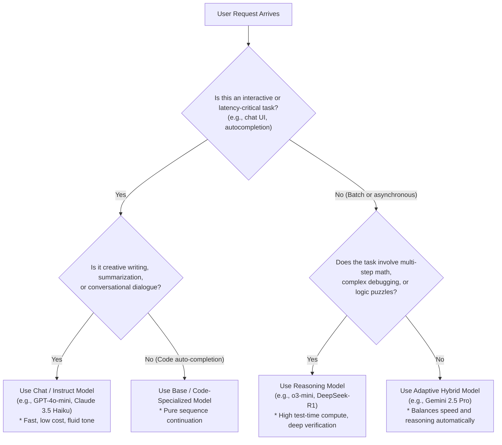

### Engineering Comparison: LLM Breeds

| Dimension | Base Models | Chat / Instruct Models | Reasoning Models | Hybrid Models |
| :--- | :--- | :--- | :--- | :--- |
| **Primary Objective** | Statistical next-token text prediction. | Multi-turn instruction following & conversational dialogue. | Deliberate multi-step logic & problem solving. | Dynamic scaling between speed and deep reasoning. |
| **Alignment Method** | Unsupervised pre-training only. | SFT + RLHF / DPO alignment. | Reinforcement learning over verifiable thinking traces. | Multi-tiered routers & adaptive compute controllers. |
| **Prompt Construct** | Raw text or few-shot `Q: ... A:` prefixes. | Structured roles: `system`, `user`, `assistant`. | User directives; system prompts often restricted. | Full role schema + `reasoning_effort` knobs. |
| **Inference Latency** | **Lowest:** Emits answer tokens immediately. | **Low:** Minimal generation delay before streaming. | **High:** Extended latency while generating internal reasoning traces. | **Variable:** Instant for basic queries; delayed for complex tasks. |
| **Token Cost Profile** | Billed strictly for prompt and output tokens. | Billed strictly for prompt and visible output tokens. | Billed for prompt, **hidden thinking tokens**, and visible output. | Dynamically adapts token consumption to query difficulty. |
| **Creative / Fluid Writing** | Moderate (prone to rambling or repeating). | **Optimal:** Warm, engaging, fluid, and natural prose. | Sub-optimal: Can produce overly analytical, "cold", or rigid answers. | Strong: Adjusts tone based on instructions and task mode. |
| **Mathematical / Logic Accuracy** | Low (frequently hallucinates arithmetic). | Moderate (struggles with multi-step edge cases). | **State-of-the-art:** Capable of self-correction and formal proofs. | **Near State-of-the-art:** Deep verification on complex problems. |

> [!IMPORTANT]
> **Thinking Tokens Incur Financial Cost:** In commercial reasoning models (such as OpenAI's `o1` and `o3-mini`), internal reasoning tokens generated during the thinking phase are counted and billed as output tokens, even though they are frequently hidden from the end user in the final API response. Always monitor total token consumption metrics (`usage.completion_tokens_details.reasoning_tokens`) when budgeting production workloads.

> [!TIP]
> **Beware of Overthinking on Creative Tasks:** Deploying a high-budget reasoning model for tasks such as drafting sales emails, marketing copy, or casual dialogue often produces overly pedantic, stiff, or cold responses. For creative tasks where there is no single mathematically verifiable answer, high-speed chat models (like Claude 3.5 Sonnet or GPT-4o) consistently outperform reasoning models in tone and fluidity.

---

## Review Quiz

<details>
<summary><b>Question 1: Why did early developers use explicit "Q:" and "A:" prefixes when prompting base models like GPT-3?</b></summary>
<br>
<b>Answer:</b> Base models are purely autoregressive sequence completers that do not inherently recognize conversational turn-taking. Structuring the prompt with repeated <code>Q: ... A:</code> examples establishes an in-context statistical pattern, compelling the model to predict the desired answer text as the most probable sequence continuation.
</details>

<details>
<summary><b>Question 2: What are the three core role abstractions introduced by the Chat Completions standard, and what purpose does each serve?</b></summary>
<br>
<b>Answer:</b> 
1. <b>System:</b> Sets the overarching behavioral boundary, tone, constraints, and instructions for the entire interaction.
2. <b>User:</b> Encapsulates inputs, queries, or task data supplied by the human.
3. <b>Assistant:</b> Stores responses generated by the model, maintaining conversation history across multi-turn exchanges.
</details>

<details>
<summary><b>Question 3: How does Chain-of-Thought (CoT) prompting improve an LLM's performance on multi-step reasoning problems?</b></summary>
<br>
<b>Answer:</b> Because LLMs generate text token by token, forcing the model to articulate intermediate steps adds those reasoning tokens directly into its context window. When the model ultimately predicts the final answer token, its self-attention heads can attend directly to its own validated intermediate deductions rather than attempting to jump across multiple logical leaps in a single step.
</details>

<details>
<summary><b>Question 4: What is "Budget Forcing", and what simple mechanism was uncovered in the January 2025 "s1" research paper?</b></summary>
<br>
<b>Answer:</b> Budget forcing is the practice of artificially compelling a reasoning model to expand its test-time compute and think longer. The <code>s1</code> paper demonstrated that inserting the single token <code>"Wait"</code> into the model's generated thinking trace reliably triggers self-reflection and re-examination (e.g., <i>"Wait, let me double-check this assumption..."</i>), significantly improving accuracy on complex benchmarks without modifying model weights.
</details>

<details>
<summary><b>Question 5: Under what operational circumstances should an engineer prefer a standard Chat model over a specialized Reasoning model?</b></summary>
<br>
<b>Answer:</b> Chat models are preferred when low latency and rapid time-to-first-token are essential (real-time chat interfaces), when minimizing token costs is critical (avoiding billed thinking tokens), and for creative or conversational writing tasks where reasoning models tend to sound rigid, overthought, or pedantic.
</details>
