# LLM Engineering: Study Guide & Technical Notes

## Table of Contents

- [Mac Setup: Installing Git, Cloning the Repo, and Cursor IDE](#mac-setup-installing-git-cloning-the-repo-and-cursor-ide)
- [Setting Up Your OpenAI API Key and Environment Variables](#setting-up-your-openai-api-key-and-environment-variables)
- [Running Your First OpenAI API Call and System vs User Prompts](#running-your-first-openai-api-call-and-system-vs-user-prompts)
- [Building an End-to-End Website Summarizer with the OpenAI Chat Completions API](#building-an-end-to-end-website-summarizer-with-the-openai-chat-completions-api)
- [Frontier Models: OpenAI GPT, Claude, Gemini, and Grok Compared](#frontier-models-openai-gpt-claude-gemini-and-grok-compared)
- [Open-Source LLMs: Llama, Mistral, DeepSeek, and Ollama](#open-source-llms-llama-mistral-deepseek-and-ollama)
- [Chat Completions API: HTTP Endpoints vs. the OpenAI Python Client](#chat-completions-api-http-endpoints-vs-the-openai-python-client)
- [Running Ollama Locally with OpenAI-Compatible Endpoints](#running-ollama-locally-with-openai-compatible-endpoints)
- [Base, Chat, and Reasoning Models: Understanding LLM Types](#base-chat-and-reasoning-models-understanding-llm-types)
- [Frontier Models: Capabilities, Hallucination Risks, and Engineering Supervision](#frontier-models-capabilities-hallucination-risks-and-engineering-supervision)
- [Understanding Transformers: Architecture, Self-Attention, and LLM Evolution](#understanding-transformers-architecture-self-attention-and-llm-evolution)
- [From LSTMs to Transformers: Attention, Emergent Intelligence, and Agentic AI](#from-lstms-to-transformers-attention-emergent-intelligence-and-agentic-ai)
- [Parameter Scaling: From Millions to Trillions in GPT, Llama, and DeepSeek](#parameter-scaling-from-millions-to-trillions-in-gpt-llama-and-deepseek)
- [What Are Tokens: From Characters to GPT's Subword Tokenizer](#what-are-tokens-from-characters-to-gpts-subword-tokenizer)
- [Tokenizing with tiktoken and Understanding the Illusion of Memory](#tokenizing-with-tiktoken-and-understanding-the-illusion-of-memory)
- [Context Windows, API Costs, and Token Limits in LLMs](#context-windows-api-costs-and-token-limits-in-llms)
- [Building a Sales Brochure Generator: Architecture and Web Scraping Foundations](#building-a-sales-brochure-generator-architecture-and-web-scraping-foundations)
- [Extracting Structured Links with JSON Prompts and the Chat Completions API](#extracting-structured-links-with-json-prompts-and-the-chat-completions-api)
- [Chaining LLM Calls: Multi-Page Web Crawling and Context Aggregation](#chaining-llm-calls-multi-page-web-crawling-and-context-aggregation)
- [Generating Company Brochures with Streaming Output and Markdown UI](#generating-company-brochures-with-streaming-output-and-markdown-ui)
- [Connecting to Multiple Frontier Models: OpenAI, Anthropic, Gemini, Groq, and OpenRouter](#connecting-to-multiple-frontier-models-openai-anthropic-gemini-groq-and-openrouter)
- [Testing Reasoning Models: Inference-Time Scaling and Spatial Logic Puzzles](#testing-reasoning-models-inference-time-scaling-and-spatial-logic-puzzles)
- [LangChain vs LiteLLM: Choosing the Right LLM Framework and Mastering Prompt Caching](#langchain-vs-litellm-choosing-the-right-llm-framework-and-mastering-prompt-caching)
- [Multi-Model LLM Conversations: Orchestrating Adversarial Dialogue and Multi-Party Architectures](#multi-model-llm-conversations-orchestrating-adversarial-dialogue-and-multi-party-architectures)
- [Building Data Science UIs with Gradio](#building-data-science-uis-with-gradio)
- [Building Your First Gradio Interface with Callbacks and Sharing](#building-your-first-gradio-interface-with-callbacks-and-sharing)
- [Gradio Interfaces: Authentication, Custom Styling, and Model Integration](#gradio-interfaces-authentication-custom-styling-and-model-integration)
- [Markdown Responses and Real-Time Streaming with Gradio and OpenAI](#markdown-responses-and-real-time-streaming-with-gradio-and-openai)
- [Building Multi-Model Gradio Interfaces with Streaming and Model Routing](#building-multi-model-gradio-interfaces-with-streaming-and-model-routing)
- [Building Conversational Interfaces with Gradio ChatInterface and Message History](#building-conversational-interfaces-with-gradio-chatinterface-and-message-history)

---

# Mac Setup: Installing Git, Cloning the Repo, and Cursor IDE

## Development Environment Foundations and Apple Command Line Tools

Machine learning engineering on macOS relies on standard Unix utilities, native C/C++ compilation headers, and shell tooling. Before installing Python packages, tokenizers, or model pipelines, Git and Apple's developer tools must be installed.

### Verifying Git and Installing Command Line Tools

macOS includes a stub executable for Git at `/usr/bin/git`. Running Git in a fresh macOS setup automatically checks whether Apple's Command Line Tools are present.

Open the terminal (`Applications` > `Utilities` > `Terminal`) and check your Git version:

```bash
# Check installed Git version
git --version
```

```text
git version 2.42.0
```

If developer tools are not yet installed, macOS shows a prompt asking:
`The "git" command requires the command line developer tools. Would you like to install the tools now?`

Click **Install** to download the lightweight Command Line Tools without needing the entire 12+ GB Xcode IDE. You can also trigger this directly from the terminal:

```bash
# Trigger installation of Apple Command Line Developer Tools
xcode-select --install
```

```text
xcode-select: note: install requested for command line developer tools
```

> [!TIP]
> **Check Installation Path:** Run `xcode-select -p` to verify the path. A properly linked environment outputs `/Library/Developer/CommandLineTools` or `/Applications/Xcode.app/Contents/Developer`.

### Alternative: Installing Upstream Git via Homebrew

Apple's bundled Git works well, but it updates slowly with macOS releases. For the newest features, security updates, and performance patches, install Git via **Homebrew**:

```bash
# Install the latest upstream Git using Homebrew
brew install git

# Verify the active binary path
which git
```

```text
/opt/homebrew/bin/git
```

| Tool                           | Provider        | Primary Use                                          | Trade-off                                                              |
| :----------------------------- | :-------------- | :--------------------------------------------------- | :--------------------------------------------------------------------- |
| **Apple CLT (`xcode-select`)** | Apple           | System headers, `clang`, `make`, basic `git`         | Small footprint (~1.5 GB), zero setup; updates tied to macOS releases. |
| **Homebrew Git**               | Homebrew        | Up-to-date Git releases and security patches         | Keeps pace with upstream Git; requires Homebrew installed.             |
| **Full Xcode App**             | Apple App Store | iOS / macOS native Swift and Objective-C development | Huge disk usage (12–15+ GB); unnecessary for Python LLM development.   |

---

## Workspace Architecture and Directory Strategy

A critical trap when setting up a Mac development environment is **folder placement and cloud file synchronization**.

### The Apple iCloud Synchronization Trap

macOS automatically enables iCloud Drive sync for `Desktop` (`~/Desktop`) and `Documents` (`~/Documents`). Storing code repositories in these synced directories causes serious problems:

1. **File Locking and Git Sluggishness:** Git writes thousands of small object files into `.git/objects` during checkouts and commits. iCloud continuously tries to upload each file, causing file locks, permission errors, and lag.
2. **Virtual Environment Bloat:** Python virtual environments (`.venv` or conda prefixes) contain thousands of third-party libraries and symlinks. Syncing them consumes bandwidth and exhausts cloud storage quotas.
3. **Redundant Sync Conflicts:** Code is already tracked and backed up remotely on GitHub. Running iCloud sync on top of Git creates competing sync engines that can corrupt local repositories.

### Filesystem Isolation vs. iCloud Sync Hazards

```text
+-----------------------------------------------------------------------------------+
|                              MACOS USER HOME DIRECTORY                            |
|                                    /Users/<name>/                                 |
+-----------------------------------------------------------------------------------+
       |                                                              |
       | (AVOID FOR CODE)                                             | (RECOMMENDED WORKSPACE)
       v                                                              v
+-------------------------------+                             +-------------------------------+
|      ~/Desktop & ~/Documents  |                             |          ~/projects           |
|  (Apple iCloud Auto-Sync)     |                             |   (Pure Local Filesystem)     |
+-------------------------------+                             +-------------------------------+
       |                                                              |
       |-- Sync Conflicts                                             |-- Zero Network Overhead
       |-- File-locking during builds                                 |-- Instant Git Disk I/O
       |-- Virtualenv / cache bloat                                   |-- Total Filesystem Isolation
       v                                                              v
+-------------------------------+                             +-------------------------------+
|       Apple iCloud Drive      |                             |   Remote Git Host (GitHub)    |
| (Redundant & Unstable for Git)|                             |  (Clean Branch & Push Sync)   |
+-------------------------------+                             +-------------------------------+
```

### Creating Your Workspace Folder

Keep all code in an unsynced local directory in your home folder, such as `~/projects`:

```bash
# Navigate to home directory
cd ~

# Confirm path
pwd
```

```text
/Users/ed
```

Create the directory and switch into it:

```bash
# Create the projects folder if it does not already exist
mkdir -p ~/projects

# Move into projects and verify
cd ~/projects
pwd
```

```text
/Users/ed/projects
```

---

## Cloning the Code Repository

With a clean local `projects` folder ready, clone the repository over HTTPS.

### Git Remote to Local Synchronization

Cloning downloads a full local copy of the repository files, commit history, and branches from GitHub to your machine.

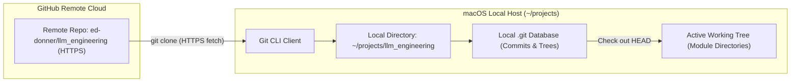

### Cloning and Inspecting Files

1. Go to `https://github.com/ed-donner/llm_engineering`.
2. Click the green **Code** button and copy the HTTPS URL: `https://github.com/ed-donner/llm_engineering.git`.
3. In your terminal, run `git clone`:

```bash
# Clone the repository locally
git clone https://github.com/ed-donner/llm_engineering.git
```

```text
Cloning into 'llm_engineering'...
remote: Enumerating objects: 6956, done.
remote: Total 6956 (delta 0), reused 0 (delta 0), pack-reused 6956 (from 1)
Receiving objects: 100% (6956/6956), 50.72 MiB | 35.45 MiB/s, done.
Resolving deltas: 100% (4270/4270), done.
```

Switch into the directory and verify the contents:

```bash
# Enter the cloned repository
cd llm_engineering

# List files and directories
ls -la
```

```text
total 128
drwxr-xr-x  32 user  staff   1024 Oct 17 12:00 .
drwxr-xr-x   3 user  staff     96 Oct 17 11:58 ..
drwxr-xr-x  12 user  staff    384 Oct 17 12:00 .git
-rw-r--r--   1 user  staff   1200 Oct 17 12:00 .gitignore
-rw-r--r--   1 user  staff   1064 Oct 17 12:00 LICENSE
-rw-r--r--   1 user  staff   4520 Oct 17 12:00 README.md
-rw-r--r--   1 user  staff  11100 Oct 17 12:00 SETUP-mac.md
-rw-r--r--   1 user  staff  10800 Oct 17 12:00 SETUP-PC.md
-rw-r--r--   1 user  staff  10500 Oct 17 12:00 SETUP-linux.md
-rw-r--r--   1 user  staff    850 Oct 17 12:00 environment.yml
-rw-r--r--   1 user  staff    420 Oct 17 12:00 requirements.txt
drwxr-xr-x   6 user  staff    192 Oct 17 12:00 week1
drwxr-xr-x   6 user  staff    192 Oct 17 12:00 week2
drwxr-xr-x   6 user  staff    192 Oct 17 12:00 week3
drwxr-xr-x   6 user  staff    192 Oct 17 12:00 week4
drwxr-xr-x   6 user  staff    192 Oct 17 12:00 week5
drwxr-xr-x   6 user  staff    192 Oct 17 12:00 week6
drwxr-xr-x   6 user  staff    192 Oct 17 12:00 week7
drwxr-xr-x   6 user  staff    192 Oct 17 12:00 week8
```

---

## Code Editor Selection and Cursor Configuration

An AI-native code editor streamlines debugging, code generation, and multi-file project indexing.

### Cursor Architecture and Features

**Cursor** is built on top of Visual Studio Code (`VSCodium` base). It preserves all VS Code settings, keybindings, and extensions while embedding AI assistance directly into the editor:

- **Local Workspace Indexing:** Indexes project files locally so the AI understands imports, types, and project structure across multiple files.
- **Model Integration:** Connects to models like Claude 3.5 Sonnet and GPT-4o for inline editing, diffs, and terminal error fixing.
- **Trial & Free Usage:** Includes a two-week free trial for premium AI completions. Afterward, you can subscribe, use your own API keys, or use Cursor as a free, high-performance VS Code editor.

### Comparing Editors

| Editor       | Base Platform        | Native AI Integration                                 | Cost Model                                                        | Recommendation                                                          |
| :----------- | :------------------- | :---------------------------------------------------- | :---------------------------------------------------------------- | :---------------------------------------------------------------------- |
| **Cursor**   | VS Code Fork         | Full workspace indexing, multi-file diffs, agent mode | Free tier (editor features); Subscription or BYOK for frontier AI | **Recommended:** Quickest setup for AI-assisted multi-file development. |
| **VS Code**  | Electron / Microsoft | Requires extensions (GitHub Copilot, Continue.dev)    | Free and open source; Copilot subscription optional               | Excellent baseline with full feature parity for standard development.   |
| **Windsurf** | VS Code Fork         | Agentic AI flows with Codeium backend                 | Free tier / Paid subscription tiers                               | Capable alternative with similar inline AI editing.                     |
| **PyCharm**  | IntelliJ / JetBrains | JetBrains AI Assistant                                | Free Community; Paid Professional                                 | Great Python refactoring, but heavier memory footprint.                 |

### Installing and Configuring Cursor

1. Download the macOS installer from `cursor.com`.
2. Open the `.dmg` file and drag `Cursor.app` into `/Applications`.
3. Open **Cursor**, complete initial preferences (VS Code defaults recommended), and sign in.
4. Go to **File** > **Open Folder...** (or click **Open Project** on the welcome screen).
5. Navigate to `~/projects/llm_engineering`, select the folder, and click **Open**.

```text
+-----------------------------------------------------------------------------------+
|  CURSOR IDE - EXPLORER VIEW                                                       |
+-----------------------------------------------------------------------------------+
|  v LLM_ENGINEERING                               <-- Project Root (Must be Capital)|
|    > community-contributions                                                      |
|    > extras                                                                       |
|    > week1                                       <-- Module Directories           |
|    > week2                                                                        |
|    > week3                                                                        |
|    > week4                                                                        |
|    > week5                                                                        |
|    > week6                                                                        |
|    > week7                                                                        |
|    > week8                                                                        |
|      .gitignore                                                                   |
|      environment.yml                             <-- Conda Environment Config     |
|      requirements.txt                            <-- Pip Package Manifest         |
|      SETUP-mac.md                                <-- Mac Hardware Guidelines      |
+-----------------------------------------------------------------------------------+
```

> [!IMPORTANT]
> **Check the Project Root:** The top header in the file explorer must show `LLM_ENGINEERING` in bold capital letters. If a subfolder (like `week1`) is opened as the root, project-wide relative imports and virtual environments will not resolve correctly.

---

## Python Environment Management Alternatives

Choosing a Python package manager determines how quickly dependencies install, how much disk space is consumed, and how easily Apple Silicon GPU acceleration (Metal Performance Shaders / MPS) is supported.

### Anaconda vs. `uv` vs. Standard `venv`

- **Anaconda / Miniconda:** Uses the `conda` solver. Ships precompiled C/C++ libraries and BLAS acceleration packages. Great for guaranteed binary consistency across platforms, but slow to resolve dependencies and takes 5+ GB of disk space.
- **`uv` (by Astral):** A blazing-fast Python package and project manager written in Rust. Replaces `pip`, `pip-tools`, and `virtualenv`. Resolves dependencies in seconds and uses global hardlinks to save disk space.
- **Python `venv` + `pip`:** Python's built-in virtual environment tool. Available out of the box with zero external installation, but lacks advanced cross-platform binary solving.

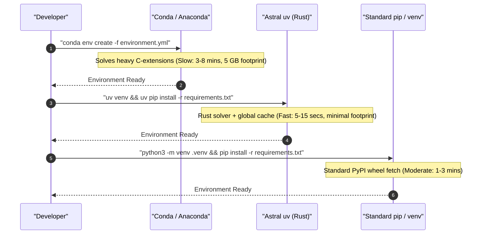

| Environment Manager      | Resolution Speed        | Disk Efficiency           | Apple Silicon (MPS) Compatibility     | Recommendation                                                           |
| :----------------------- | :---------------------- | :------------------------ | :------------------------------------ | :----------------------------------------------------------------------- |
| **Anaconda / Miniconda** | Slow (Conda SAT solver) | Low (duplicates packages) | Native `osx-arm64` channels           | Reliable cross-platform consistency for heavy C-extensions.              |
| **`uv`**                 | Blazing (Rust engine)   | High (global hardlinks)   | Native PyPI wheels with ARM64 support | **Modern Industry Favorite:** Fastest resolution and minimal disk usage. |
| **`venv` + `pip`**       | Moderate                | Medium                    | Native PyPI wheels                    | Built-in fallback requiring no external package manager.                 |

---

## Common Pitfalls and Best Practices

> [!CAUTION]
> **Never Clone into Cloud Folders:** Do not place repositories inside folders managed by iCloud, OneDrive, Dropbox, or Google Drive. Cloud syncing locks Git files, breaks local SQLite vector databases, and causes random build failures.

> [!IMPORTANT]
> **Verify Native Apple Silicon Architecture:** On Apple Silicon Macs (M1/M2/M3/M4), ensure your terminal runs native ARM64 rather than Rosetta 2 x86 emulation. Run `uname -m` in your terminal—it must return `arm64`. Running under x86 causes PyTorch MPS acceleration to fail.

> [!TIP]
> **Hide the AI Chat Panel for Extra Space:** If Cursor opens with an AI Chat sidebar covering your workspace, press `Cmd + L` to toggle it or drag the divider to collapse it.

---

## Review Quiz

<details>
<summary><b>Question 1: Why should you avoid storing code repositories in ~/Desktop or ~/Documents on macOS?</b></summary>
<br>
<b>Answer:</b> macOS syncs Desktop and Documents to iCloud Drive by default. Storing repositories there causes continuous background sync of internal <code>.git</code> files and virtual environments, leading to file-locking conflicts, slow disk performance, and potential repository corruption. Use an unsynced local folder like <code>~/projects</code> instead.
</details>

<details>
<summary><b>Question 2: What happens when you run "git --version" on a fresh Mac without developer tools?</b></summary>
<br>
<b>Answer:</b> The operating system intercepts the command using the <code>/usr/bin/git</code> stub and opens a dialog offering to install Apple's Command Line Developer Tools (which includes Git, Clang, and Make).
</details>

<details>
<summary><b>Question 3: How does Cursor maintain compatibility with Visual Studio Code extensions and settings?</b></summary>
<br>
<b>Answer:</b> Cursor is an open-source fork of Visual Studio Code (built on the VSCodium core). Because it uses the same underlying editor architecture, it supports standard VS Code settings, keybindings, and extensions while adding native AI workspace indexing.
</details>

<details>
<summary><b>Question 4: What confirms that you opened the correct project root folder in Cursor?</b></summary>
<br>
<b>Answer:</b> The top label in the Cursor file explorer sidebar must read <code>LLM_ENGINEERING</code> in capital letters, showing the repository directories directly underneath. If a specific subfolder appears as the root, project-wide relative imports and repository-level virtual environments will fail.
</details>

<details>
<summary><b>Question 5: What primary benefits does "uv" provide compared to traditional Anaconda environments?</b></summary>
<br>
<b>Answer:</b> Written in Rust, <code>uv</code> resolves and installs dependencies 10 to 100 times faster than Conda. It also uses a global content-addressable cache with hardlinks, drastically reducing disk space compared to Conda's multi-gigabyte environment copies.
</details>

---

# Setting Up Your OpenAI API Key and Environment Variables

## ChatGPT vs. OpenAI Platform API

A key distinction in AI engineering is the difference between consumer chat applications and backend developer APIs:

- **ChatGPT (Consumer Web App):** A conversational interface at `chatgpt.com`. Monthly subscriptions (such as ChatGPT Plus at $20/month) provide web UI perks and higher usage caps, but provide **zero** programmatic API access.
- **OpenAI Platform API (Developer Service):** A programmatic REST API at `platform.openai.com`. Applications connect directly via HTTP or official client libraries (`openai` package in Python). Billing is pay-as-you-go based on token usage (fractions of a cent per request), completely separate from any ChatGPT subscription.

### Free Alternatives: Gemini and Local Llama

Setting up an OpenAI account is optional. You can build LLM applications using free alternative models:

- **Google Gemini API:** Offers a developer free tier via Google AI Studio with generous request quotas, multi-turn chat, structured JSON output, and multimodal context.
- **Local Llama (via Ollama or vLLM):** Runs open-weights models (like Llama 3) locally on your own hardware at zero cost, offering complete privacy and offline operation.

| Service                  | Access Type             | Endpoint / Portal     | Billing Model                                   | Best Suited For                                          |
| :----------------------- | :---------------------- | :-------------------- | :---------------------------------------------- | :------------------------------------------------------- |
| **OpenAI Platform API**  | Programmatic REST / SDK | `platform.openai.com` | Pay-as-you-go per million tokens                | Production backends, evaluations, agentic pipelines      |
| **ChatGPT Plus**         | Web Chat UI             | `chatgpt.com`         | Flat monthly subscription ($20 / month)         | Interactive writing, personal assistance, quick research |
| **Google Gemini API**    | Programmatic REST / SDK | `aistudio.google.com` | Free tier quota + pay-as-you-go commercial tier | Zero-cost development, large multimodal context          |
| **Local Llama (Ollama)** | Local HTTP / Python     | `localhost:11434`     | 100% free (consumes local compute)              | Local testing, privacy-sensitive data, offline work      |

---

## Setting Up Billing and Credits

To make requests to the OpenAI API, you need an account with prepaid credits on the OpenAI Platform.

### Account Creation and Pre-Funding

1. Go to `platform.openai.com` and click **Sign up**. You can authenticate using Google, Microsoft, Apple, or an email address.
2. Click the **Settings** gear icon in the top right, then select **Billing**.
3. Click **Add to credit balance**. The minimum deposit is **$5** (valid for an entire year), which covers thousands of development calls.
4. Add a payment card under **Payment methods**.

> [!CAUTION]
> **Keep Auto-Recharge Turned OFF:** In the Billing dashboard, ensure **Auto recharge** is set to **Off**. Leaving auto-recharge on allows OpenAI to automatically charge your card if your balance runs out. Keeping it off guarantees your spending is strictly capped at your manual deposit.

> [!IMPORTANT]
> **Handling International Card Declines:** If your credit card is declined during top-up, your bank is likely blocking an international US transaction. Check your banking mobile app to allow international online payments or contact your card issuer.

---

## Creating an API Key

An API key is a secret token that lets your application authenticate with OpenAI's servers. Every request sent with this key bills against your account credit.

### Key Generation Steps

1. In **Settings**, select **API keys** under the **Organization** section.
2. Click **Create new secret key**.
3. Configure the key options:
   - **Owned by:** Select **You** (associates the key with your developer user).
   - **Name:** Enter a descriptive label (e.g., `llm_engineering_key`).
   - **Project:** Select **Default project** (avoids restricted sub-project scopes that block newer models).
   - **Permissions:** Select **All**.
4. Click **Create secret key**.

```text
+-----------------------------------------------------------------------------------+
|  OPENAI DEVELOPER PLATFORM - API KEY CREATION                                     |
+-----------------------------------------------------------------------------------+
|  [Create new secret key]                                                          |
|                                                                                   |
|  Owned by:   (*) You         ( ) Service account                                  |
|  Name:       llm_engineering_key                                                  |
|  Project:    Default project                     <-- Avoid restricted project scopes|
|  Permissions:(All) Read and write API resources  <-- Unrestricted developer access|
|                                                                                   |
|  [Cancel]                                             [Create secret key] (CLICK) |
+-----------------------------------------------------------------------------------+
```

### Key Security and Storage

When generated, the key displays starting with `sk-proj-...`:

- **Displayed Only Once:** OpenAI displays the raw secret key once. When you close the popup, the full key cannot be viewed again.
- Click **Copy** to place the key into your clipboard. Keep the popup open until you paste and save it into your local project.

---

## Storing Keys Safely in `.env`

Hardcoding API keys in Python files is dangerous because keys can easily be committed to GitHub. Following standard security practices, credentials should be stored in a local `.env` file and loaded into environment variables at runtime.

### Secret Loading and Protection Flow

```text
+-----------------------------------------------------------------------------------+
|                             SECURE LOCAL WORKSPACE                                |
|                           ~/projects/llm_engineering                              |
+-----------------------------------------------------------------------------------+
  |
  |-- .env (Local Plaintext File)
  |     OPENAI_API_KEY=sk-proj-7WOKk...
  |
  |-- .gitignore (Git Exclusion Rule)
  |     .env  <--------------------------------- Blocks Git Tracking (Prevents Leaks)
  |
  |-- Cursor IDE (.env Protection)
  |     Cursor-Tab Ignored <--------------------- Silences AI Telemetry on Secrets
  |
  v
+-------------------------------+
|  python-dotenv (load_dotenv)  |
+-------------------------------+
  |
  v Injects into Process Memory
+-------------------------------+
|     os.environ / Python       |
+-------------------------------+
  |
  v Automatic Client Authentication
+-------------------------------+         HTTPS POST          +---------------------+
|      openai.OpenAI()          | --------------------------> |  OpenAI API Gateway |
|  (Reads OPENAI_API_KEY)       |    Bearer sk-proj-...       | (Validates & Billed)|
+-------------------------------+                             +---------------------+
```

### Authentication Sequence

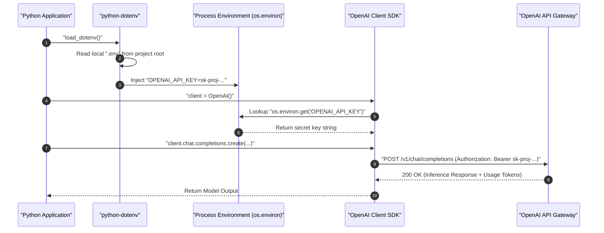

### Layman's Mental Model: What is "Inference" and How Does Reasoning Happen?

When working with Large Language Models, you will frequently encounter the terms **inference** and **reasoning**. In simple, everyday terms, here is what is actually happening under the hood:

#### 1. Training vs. Inference (Studying vs. Taking the Exam)

Think of an AI model like a student preparing for a professional career:
- **Training (The Schooling Phase):** The AI research lab gathers trillions of words from books, codebases, websites, and encyclopedias. Over several months—and using thousands of high-powered supercomputers costing millions of dollars—the model reads this material and gradually tunes billions of internal mathematical connections (called **weights**). This is a massive, one-off learning phase.
- **Inference (The Working / Exam Phase):** Once training finishes, the model's neural network is "frozen." It stops learning and no longer updates its weights. When you send a prompt and the model calculates and returns an answer, that active answering process is called **inference**. The model is literally *inferring* (deducing and predicting) what words logically follow your question based on what it learned in school. Every single time you call an API, chat with ChatGPT, or run a local model, you are running **inference**.

#### 2. How "Reasoning" Takes Place Inside Inference

Not all questions can be answered well by blurting out the first word that comes to mind:
- **Direct Inference (Immediate Next-Word Prediction):** In standard chat models, inference is a straight line. You give the model a prompt, and it immediately calculates the mathematical probability of the very next word, then the next, and the next. For basic questions like *"What is the capital of France?"*, direct inference works well because the answer ("Paris") requires straightforward memory recall.
- **Reasoning within Inference (Scratchpad Thinking):** If someone asks you a tricky logic puzzle or a multi-step calculus problem, blurting out the first word almost always results in a mistake. To solve it, you grab a piece of scratch paper, write down intermediate steps, test different assumptions, check for trick conditions, and correct yourself before writing your final answer. **Reasoning models** do the exact same thing *inside the inference process*. Before sending back the first visible word, the model generates internal, hidden **"thinking tokens"** (a private chain-of-thought scratchpad). It evaluates different paths, double-checks its arithmetic, catches contradictions, and only outputs the verified final answer to you once it is confident.

```text
+-------------------------------------------------------------------------------+
|                      INFERENCE: DIRECT VS. REASONING                          |
+-------------------------------------------------------------------------------+

  A. DIRECT INFERENCE (Standard Fast Models e.g., gpt-4.1-mini)
  
     User Prompt ---> [ Frozen Neural Network ] ---> Immediate Visible Output
                      (Single forward pass per token;
                       fast ~1s, but prone to errors on tricky logic)


  B. REASONING WITHIN INFERENCE (Reasoning Models e.g., o1, gpt-5 with reasoning)
  
     User Prompt ---> [ Frozen Neural Network ]
                             |
                             v
                      +---------------------------------------------+
                      |         INTERNAL "SCRATCHPAD" TOKENS        |
                      |  1. Break complex problem into sub-steps    |
                      |  2. Brainstorm: "Could the answer be X?"    |
                      |  3. Check logic: "Wait, condition Y fails!" |
                      |  4. Backtrack and recalculate               |
                      +---------------------------------------------+
                             |
                             v
                      Final Verified Answer Returned to User
                      (Takes 5-30s longer, but solves deep logic)
```

### Creating the `.env` File

In Cursor with your project open:

1. Right-click the blank area below the file list in the explorer sidebar and select **New File**.
2. Name the file **`.env`** (leading period, lowercase `env`).
   - Must **not** be named `.env.txt`, `env`, or `settings.env`.
   - Must be in the **project root folder**, not inside subfolders.
3. Add your key definition:

```ini
# OpenAI API Secret Key configuration
OPENAI_API_KEY=sk-proj-7WOKk21Ls_J_xxwH1SLQGCJog_EXAMPLE_KEY_DO_NOT_SHARE
```

### Formatting Rules

- **Exact Name:** Must be spelled `OPENAI_API_KEY` in uppercase with underscores.
- **No Extra Spaces:** Do not place spaces around the `=` sign.
- **No Quotes Needed:** Paste the raw key directly after the `=`.
- **Save the File:** If a white circle appears on the editor tab, the file is unsaved. Press **`Cmd + S`** (macOS) or **`Ctrl + S`** (Windows/Linux) to save it.

### Why Cursor Shows a Stop Sign on `.env`

When viewing `.env` in Cursor, a small stop sign icon appears next to the filename and in the status bar (`Cursor-Tab (Ignored)`).

This is a security feature: Cursor detects credentials inside `.env` and **disables AI indexing, autocompletion, and telemetry for that file**, ensuring private keys are never transmitted to external AI providers during background indexing.

---

## Verifying Your Setup

Run a quick check in your terminal and Python environment to verify that the key loads correctly.

### Check `.env` in Terminal

```bash
# Check that .env exists in project root
ls -la .env

# Verify variable name without printing the full secret
grep "OPENAI_API_KEY" .env | cut -c 1-20
```

```text
-rw-r--r--  1 user  staff  82 Oct 17 12:30 .env
OPENAI_API_KEY=sk-pr
```

### Python Verification Script

Run this test script to verify that `python-dotenv` and the OpenAI SDK authenticate successfully:

```python
import os
from dotenv import load_dotenv
from openai import OpenAI

# Load variables from .env into process memory
load_dotenv()

# Verify that the variable exists
api_key = os.environ.get("OPENAI_API_KEY")
if not api_key:
    raise ValueError("OPENAI_API_KEY not found. Check your .env file!")

# Initialize client (automatically reads OPENAI_API_KEY from environment)
client = OpenAI()

# Send a lightweight test request
response = client.chat.completions.create(
    model="gpt-4o-mini",
    messages=[
        {"role": "user", "content": "Respond with the single word 'CONNECTED' if you can read this."}
    ],
    max_tokens=5,
)

print("Status:", response.choices[0].message.content.strip())
```

```text
Status: CONNECTED
```

---

## Key Management Best Practices

| Storage Method                       | Security                 | Convenience                  | Recommendation                                                                    |
| :----------------------------------- | :----------------------- | :--------------------------- | :-------------------------------------------------------------------------------- |
| **`.env` + `python-dotenv`**         | High (with `.gitignore`) | Very High                    | **Recommended:** Simple, portable across local machines, zero cloud setup.        |
| **Shell Profile (`~/.zshrc`)**       | Medium                   | Medium                       | Convenient for global tools, but exposes keys to all terminal sessions.           |
| **Cloud Secret Manager (Vault/AWS)** | Maximum                  | Lower (requires cloud setup) | Production enterprise standard; unnecessary overhead for local machines.          |
| **Hardcoded in code files**          | Zero (Critical Risk)     | Low                          | **Anti-Pattern:** Keys will leak to GitHub; automated bots steal them in seconds. |

> [!CAUTION]
> **Prevent Git Leaks:** Ensure `.env` is listed in your `.gitignore` file. Never run `git add -f .env`. Public scrapers search GitHub continuously; exposed keys are compromised and revoked by OpenAI bots within seconds.

> [!IMPORTANT]
> **Exact Variable Name Required:** The OpenAI Python library automatically looks for `os.environ["OPENAI_API_KEY"]`. If misspelled (e.g., `OPEN_API_KEY` or `openai_key`), client initialization fails with an `openai.OpenAIError: The api_key client option must be set` error.

> [!TIP]
> **Track Token Usage:** Monitor your usage under the **Usage** dashboard (`platform.openai.com/usage`). Development queries cost fractions of a cent ($0.0001 to $0.005 each).

---

## Review Quiz

<details>
<summary><b>Question 1: Why does a paid ChatGPT Plus subscription not provide access to the OpenAI Platform API?</b></summary>
<br>
<b>Answer:</b> ChatGPT Plus is a consumer web application with a flat monthly fee for chat UI features on chatgpt.com. The OpenAI Platform API is a separate developer infrastructure billed per token processed. Subscriptions to one service do not grant credits or access to the other.
</details>

<details>
<summary><b>Question 2: Why should "Auto recharge" be turned off in the OpenAI billing dashboard during local development?</b></summary>
<br>
<b>Answer:</b> If code enters an infinite loop or unexpected recursive calls during development, auto-recharge will continuously bill your credit card. Keeping auto-recharge off ensures your maximum financial exposure is capped at your manual deposit.
</details>

<details>
<summary><b>Question 3: Why should project keys be scoped to "Default project" with "All" permissions during development?</b></summary>
<br>
<b>Answer:</b> Creating custom restricted projects can restrict model endpoints, token allowances, or service features, resulting in unexpected 403 Forbidden or model-not-found errors when trying out new model architectures.
</details>

<details>
<summary><b>Question 4: What does the stop sign icon next to the .env file in Cursor signify?</b></summary>
<br>
<b>Answer:</b> It indicates that Cursor's AI features and background code indexing are disabled for that file, protecting sensitive secrets and API keys from being sent to external AI providers during background indexing.
</details>

<details>
<summary><b>Question 5: How does client = OpenAI() find your API key without passing it explicitly?</b></summary>
<br>
<b>Answer:</b> The OpenAI SDK automatically looks up the process environment variable named <code>OPENAI_API_KEY</code> via <code>os.environ.get("OPENAI_API_KEY")</code>. When <code>load_dotenv()</code> runs, values from the local <code>.env</code> file are loaded into the process environment.
</details>

---

# Running Your First OpenAI API Call and System vs User Prompts

## Jupyter Notebook Kernel Setup and Environment Verification

Interactive Python notebooks (`.ipynb`) allow you to experiment with LLM prompts and inspect API responses cell by cell. When opening a notebook in an editor like Cursor or VS Code, the notebook must be bound to the project's local virtual environment rather than a global Python installation.

### Selecting the Dedicated Virtual Environment Kernel

1. Open the notebook (such as `week1/day1.ipynb`) in Cursor.
2. In the top-right corner of the editor window, click **Select Kernel**.
3. Choose **Python Environments...**.
4. Select the local virtual environment matching **`.venv (Python 3.12.x)`** located at `.venv/bin/python` (marked with a star or as **Recommended**).

```text
+-----------------------------------------------------------------------------------+
|  CURSOR IDE - JUPYTER KERNEL PICKER                                               |
+-----------------------------------------------------------------------------------+
|  > Select Kernel                                                                  |
|    > Python Environments...                                                       |
|      * .venv (Python 3.12.9) .venv/bin/python  <-- SELECT THIS (Recommended)     |
|        Global Python (/usr/bin/python3)        <-- AVOID (Missing installed packages)|
+-----------------------------------------------------------------------------------+
```

> [!IMPORTANT]
> **Kernel Persistence:** You must select the kernel for each new notebook you open. If a notebook defaults to global Python, running cells will raise `ModuleNotFoundError: No module named 'openai'` or `dotenv`.

---

## Defensive API Key Validation

Before invoking model endpoints, applications should defensibly validate that credentials exist and conform to expected formats.

```python
import os
from dotenv import load_dotenv

# Load variables from .env into environment memory; override ensures fresh values
load_dotenv(override=True)

api_key = os.getenv("OPENAI_API_KEY")

# Perform defensive pre-flight validation
if not api_key:
    print("Error: No API key found. Verify that your .env file exists in the project root.")
elif not api_key.startswith("sk-proj-"):
    print("Warning: API key found, but it does not start with 'sk-proj-'. Verify your project key format.")
elif api_key.strip() != api_key:
    print("Warning: API key contains leading or trailing whitespace/tab characters. Strip them out.")
else:
    print("API key found and looks good so far!")
```

```text
API key found and looks good so far!
```

---

## OpenAI Chat Completions API Architecture

The primary endpoint for conversational and instruction-following models is the **Chat Completions API**.

### Message Payload Schema

The Chat Completions API expects conversation history as a **list of message dictionaries**. Each dictionary requires two primary keys:

- **`role`:** Identifies the author of the message (`"system"`, `"user"`, or `"assistant"`).
- **`content`:** The string message text.

```python
from openai import OpenAI

# Initialize client (reads OPENAI_API_KEY from os.environ automatically)
openai = OpenAI()

# Define the user prompt
message = "Hello, GPT! This is my first ever message to you! Hi!"

# Package into the standard Chat Completions message structure
messages = [
    {"role": "user", "content": message}
]

# Send the API request to the lightweight nano model
response = openai.chat.completions.create(
    model="gpt-5-nano",
    messages=messages
)

# Extract and display the assistant response content
print(response.choices[0].message.content)
```

```text
Hi there! Nice to meet you, and welcome—thanks for saying hi. I'm here to help with questions, explanations, writing, brainstorming, coding, planning, learning, and more. What would you like to do today?
```

### Parsing the Response Object

The returned response object contains metadata and candidate completions:

- **`response.choices`:** A list of generated candidates. By default, the API generates one candidate (`n=1`).
- **`response.choices[0].message.content`:** Contains the raw text string generated by the model.
- **`response.usage`:** Contains token metrics, breaking down `prompt_tokens`, `completion_tokens`, and `total_tokens` for cost tracking.

### The Mechanics of Inference and Reasoning at Runtime

When you call `openai.chat.completions.create()`, you are triggering an **inference request** across the network:
1. **The Ingestion:** The API gateway receives your message array and feeds your prompt tokens into the server's GPU memory.
2. **The Inference Cycle:** Because the model's weights are completely frozen, it does not learn anything new from your message. Instead, it runs **inference**: passing your prompt tokens through billions of mathematical calculations to predict which token has the highest probability of appearing next.
3. **Reasoning during Generation:**
   - In standard utility models (such as `gpt-4.1-nano` or `gpt-4o-mini`), inference generates the visible reply directly, token by token.
   - In reasoning-capable models (such as `o1` or models configured with `reasoning_effort`), the inference engine pauses visible output to first generate an internal sequence of "reasoning tokens". These internal tokens act like a private scratchpad where the model analyzes edge cases, verifies logic, and double-checks its work before releasing the first character of the final answer to your application.

---

## System vs. User Prompts: Persona, Framing, and Behavior Control

The modern LLM instruction format explicitly separates developer framing from end-user inputs.

### Conceptual Roles

1. **System Prompt (`role: "system"`):** Sets the global framing, persona, tone, operational boundaries, and formatting instructions. It tells the model _how_ to behave and _what rules_ to follow.
2. **User Prompt (`role: "user"`):** Represents the actual query, request, or runtime input that the model should process within the context established by the system prompt.

### Mental Model: Request Assembly and Gateway Resolution

```text
+-----------------------------------------------------------------------------------+
|                            CHAT COMPLETIONS PIPELINE                              |
+-----------------------------------------------------------------------------------+
                                        |
       +--------------------------------+--------------------------------+
       |                                                                 |
       v                                                                 v
+-------------------------------+                             +-------------------------------+
|         System Prompt         |                             |          User Prompt          |
|  role: "system"               |                             |  role: "user"                 |
|  "You are a snarky assistant" |                             |  "What is 2 + 2?"             |
+-------------------------------+                             +-------------------------------+
       |                                                                 |
       +--------------------------------+--------------------------------+
                                        v
                    +---------------------------------------+
                    |    Structured JSON Message Array      |
                    |    [ {"role":"system", ...},          |
                    |      {"role":"user", ...} ]           |
                    +---------------------------------------+
                                        |
                                        v HTTPS POST
                    +---------------------------------------+
                    |       OpenAI API Gateway              |
                    |       api.openai.com/v1/...           |
                    +---------------------------------------+
                                        |
                                        v Token Generation
                    +---------------------------------------+
                    |       ChatCompletion Response         |
                    |       choices[0].message.content      |
                    +---------------------------------------+
```

### Behavioral Impact: Helpful vs. Snarky Assistant

The system prompt drastically shapes how the model answers identical user queries:

```python
# Helpful Assistant Configuration
helpful_messages = [
    {"role": "system", "content": "You are a helpful assistant."},
    {"role": "user", "content": "What is 2 + 2?"}
]

helpful_response = openai.chat.completions.create(
    model="gpt-4.1-nano",
    messages=helpful_messages
)

print("Helpful:", helpful_response.choices[0].message.content)

# Snarky Assistant Configuration
snarky_messages = [
    {"role": "system", "content": "You are a snarky assistant."},
    {"role": "user", "content": "What is 2 + 2?"}
]

snarky_response = openai.chat.completions.create(
    model="gpt-4.1-nano",
    messages=snarky_messages
)

print("Snarky:", snarky_response.choices[0].message.content)
```

```text
Helpful: 2 + 2 equals 4.
Snarky: Oh, finally, a math question! 2 + 2 equals 4. Groundbreaking, I know.
```

| Prompt Dimension     | System Prompt (`role: "system"`)                            | User Prompt (`role: "user"`)                             |
| :------------------- | :---------------------------------------------------------- | :------------------------------------------------------- |
| **Primary Purpose**  | Defines persona, behavior rules, output schema, constraints | Provides runtime task, input data, or questions          |
| **Typical Author**   | Application developer / system engineer                     | End-user, API caller, or upstream data pipeline          |
| **Execution Impact** | High-level conditioning across the entire conversation      | Immediate focus for the next completion turn             |
| **Example Use Case** | `"Respond in valid JSON using the provided schema."`        | `"Extract the names and prices from this receipt text."` |

---

## Integrating External Data: Server-Side Web Scraping

LLMs cannot access live private web data without external retrieval. Ingesting raw external text into a user prompt enables models to analyze, summarize, or extract structured intelligence from arbitrary URLs.

### Inspecting the Server-Side Scraper (`scraper.py`)

A clean, server-side scraper uses `requests` and `BeautifulSoup` to download HTML and strip out non-text noise before sending content to an LLM:

```python
import requests
from bs4 import BeautifulSoup

# Standard browser User-Agent header prevents simple bot-blocking
headers = {
    "User-Agent": "Mozilla/5.0 (Windows NT 10.0; Win64; x64) AppleWebKit/537.36 (KHTML, like Gecko) Chrome/117.0.0.0 Safari/537.36"
}

def fetch_website_contents(url):
    """Fetch website HTML and return stripped clean text with title."""
    response = requests.get(url, headers=headers)
    soup = BeautifulSoup(response.content, "html.parser")

    title = soup.title.string if soup.title else "No title found"

    # Strip non-informational elements that consume unnecessary context tokens
    for irrelevant in soup.body(["script", "style", "img", "input"]):
        irrelevant.decompose()

    text = soup.body.get_text(separator="\n", strip=True)
    return title + "\n\n" + text
```

### Scrape-and-Summarize Architecture Flow

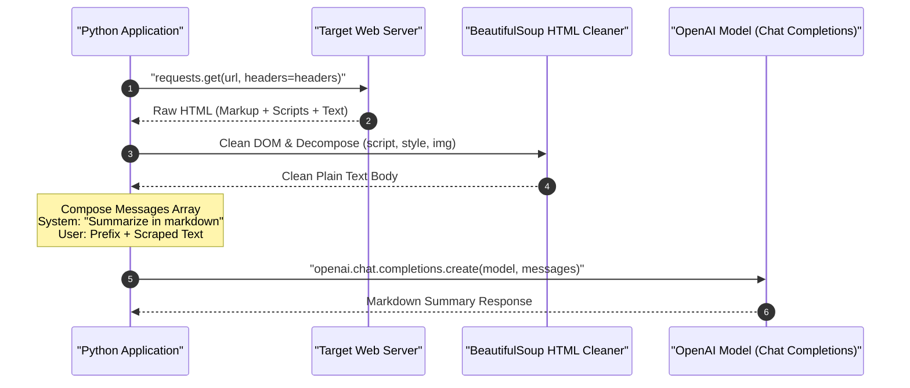

### Executing Web Summarization

```python
from scraper import fetch_website_contents

# Fetch and clean web content
scraped_text = fetch_website_contents("https://edwarddonner.com")

# Define prompt framing
system_prompt = """
You are an assistant that analyzes the contents of a website,
and provides a short summary, ignoring text that might be navigation related.
Respond in markdown.
"""

user_prompt_prefix = "Here are the contents of a website:\n\n"

messages = [
    {"role": "system", "content": system_prompt},
    {"role": "user", "content": user_prompt_prefix + scraped_text}
]

# Run summarization
summary_response = openai.chat.completions.create(
    model="gpt-5-nano",
    messages=messages
)

print(summary_response.choices[0].message.content)
```

```text
### Website Overview: Edward Donner
- **Focus:** AI and Large Language Model engineering, coding experiments, and talent platforms.
- **Background:** Co-founder and CTO of Nebula.io, building verticalized LLM solutions.
- **Projects:** Interactive AI benchmarks, coding guides, and engineering tutorials.
```

---

## Model Selection and Sizing Trade-offs

| Model Tier              | Representative Models        | Speed / Latency    | Relative Cost                     | Recommended Use Case                                                      |
| :---------------------- | :--------------------------- | :----------------- | :-------------------------------- | :------------------------------------------------------------------------ |
| **Nano / Micro**        | `gpt-5-nano`, `gpt-4.1-nano` | Ultra-fast (< 1s)  | Extremely Low ($0.05 / 1M tokens) | Rapid testing, classification, simple summaries, high-volume routing      |
| **Mini / Standard**     | `gpt-4o-mini`                | Very Fast (1–2s)   | Low ($0.15 / 1M tokens)           | Balanced daily development, extraction, code generation                   |
| **Frontier / Flagship** | `gpt-4o`, `o1`               | Moderate (2–10s+)  | Higher ($2.50 – $15 / 1M tokens)  | Complex multi-step reasoning, architectural planning, rigorous evaluation |
| **Local Open-Weights**  | `llama3:8b` (via Ollama)     | Hardware-dependent | Zero (Free)                       | Local experimentation, privacy-sensitive workloads, offline development   |

> [!NOTE]
> **What is "Inference Cost" and Why Do Reasoning Models Cost More?**
> In traditional software (like a Python sorting function), running the code costs virtually zero extra money once written. With AI, however, every single question requires passing your prompt through billions of numbers on power-hungry data center GPUs. That ongoing computing expense incurred every time the model answers is called **inference cost**.
> 
> When you use a **Reasoning Model** (such as `o1`), the inference cost is significantly higher because the model doesn't just generate your 50-word answer. During inference, it secretly generates hundreds or thousands of internal "thinking tokens" on its scratchpad to verify facts and eliminate logic errors. Because cloud providers bill for all GPU compute used during generation, both the hidden reasoning tokens and the visible output tokens count toward your total bill.

---

## Critical Gotchas and Best Practices

> [!CAUTION]
> **Context Window Flooding from Scrapers:** Raw HTML documents frequently contain megabytes of inline SVG, minified JavaScript, and CSS styles. Ingesting raw HTML directly into a prompt wastes token quotas and risks exceeding context limits. Always strip non-text elements (`script`, `style`, `noscript`) using BeautifulSoup before formatting prompt payloads.

> [!IMPORTANT]
> **System Prompt Enforcement Varies by Model:** Smaller nano models adhere to system instructions with less strict compliance than flagship frontier models. If a nano model ignores an output formatting constraint (such as "Respond in valid JSON"), reinforce the requirement in both the system prompt and the end of the user prompt.

> [!TIP]
> **Use override=True When Loading `.env`:** When developing in Jupyter notebooks, running `load_dotenv()` multiple times without `override=True` will not reload newly saved keys if the variable was already cached in process memory. Always specify `load_dotenv(override=True)`.

---

## Review Quiz

<details>
<summary><b>Question 1: What is the primary operational consequence of selecting the wrong Jupyter kernel in Cursor or VS Code?</b></summary>
<br>
<b>Answer:</b> The notebook will execute inside the system's global Python environment or an unrelated interpreter rather than your project's <code>.venv</code>. This triggers immediate <code>ModuleNotFoundError</code> exceptions for installed packages like <code>openai</code>, <code>dotenv</code>, and <code>bs4</code>.
</details>

<details>
<summary><b>Question 2: What are the two mandatory keys required in each message dictionary passed to openai.chat.completions.create()?</b></summary>
<br>
<b>Answer:</b> Each dictionary must contain <code>role</code> (specifying <code>"system"</code>, <code>"user"</code>, or <code>"assistant"</code>) and <code>content</code> (containing the text string of the message).
</details>

<details>
<summary><b>Question 3: How does the system prompt differ conceptually and operationally from the user prompt?</b></summary>
<br>
<b>Answer:</b> The system prompt sets the foundational persona, behavioral rules, tone, and output format constraints for the model. The user prompt provides the specific runtime task, input question, or dynamic data that the model must process within that system frame.
</details>

<details>
<summary><b>Question 4: Why does scraper.py call irrelevant.decompose() on tags like "script", "style", and "img" before extracting text?</b></summary>
<br>
<b>Answer:</b> Decomposing those DOM nodes permanently removes client scripts, CSS definitions, and image markup. This cleans the text and avoids wasting model context tokens on non-semantic noise.
</details>

<details>
<summary><b>Question 5: What is the purpose of passing override=True to load_dotenv() in an interactive notebook?</b></summary>
<br>
<b>Answer:</b> By default, <code>load_dotenv()</code> does not overwrite environment variables that already exist in process memory. Setting <code>override=True</code> forces the function to reload variables from the <code>.env</code> file, ensuring newly updated or corrected API keys are immediately applied without restarting the Jupyter kernel.
</details>

---

# Building an End-to-End Website Summarizer with the OpenAI Chat Completions API

Connecting scraped web content to large language model APIs enables automated summarization, tone adaptation, and structured content extraction. By structuring the prompt into dedicated system and user messages, developers can control persona, formatting, and analytical focus while feeding dynamic web data into frontier models.

```text
+-----------------------+      +-------------------------+      +-------------------------+
|      Target URL       | ---> |  fetch_website_contents | ---> | Cleaned Semantic Text   |
| (e.g., cnn.com)       |      |  (requests + bs4 parse) |      | (No scripts, styles)    |
+-----------------------+      +-------------------------+      +-------------------------+
                                                                             |
                                                                             v
+-----------------------+      +-------------------------+      +-------------------------+
|   Rich Output View    | <--- |   OpenAI Chat API       | <--- |   messages_for(text)    |
| display(Markdown(...))|      |   (gpt-4.1-mini model)  |      |   [system, user dicts]  |
+-----------------------+      +-------------------------+      +-------------------------+
```

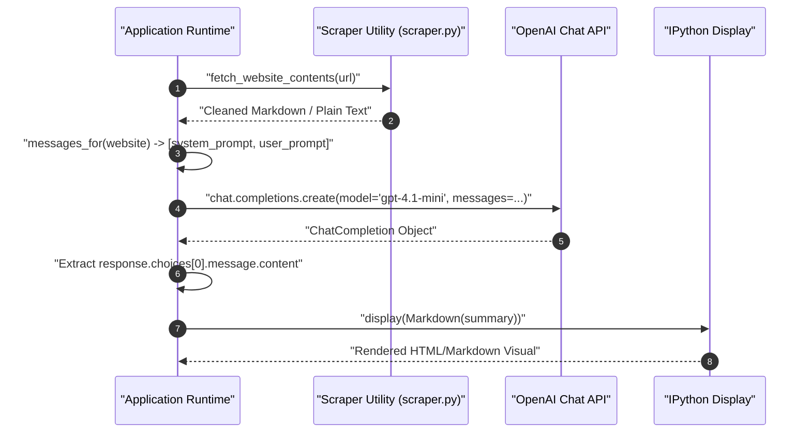

---

## Designing System and User Prompts for Document Summarization

Prompt engineering for document summarization requires separating operational constraints from dynamic input text. The system prompt defines the assistant's persona, processing rules, and formatting expectations, while the user prompt wraps the scraped content with explicit processing instructions.

### The Code Block Suppression Instruction

A frequent challenge when requesting Markdown from LLMs is that models often wrap their entire response inside a Markdown code block (triple backticks ` ```markdown `). When rendered inside a notebook or web UI, this displays the output inside a raw code box instead of styled HTML headings, bullet lists, and paragraphs.

Adding an explicit negative constraint prevents this behavior:

```python
system_prompt = """
You are an assistant that analyzes the contents of a website,
and provides a short summary, ignoring text that might be navigation related.
Respond in markdown. Do not wrap the markdown in a code block - respond just with the markdown.
"""
```

### Dynamic Message Assembly

To package user requests consistently, define a reusable message factory function that pairs the system prompt with the scraped content prefixed by task instructions:

```python
# Define user prompt template with clear task directives and trailing whitespace
user_prompt_prefix = """
Here are the contents of a website.
Provide a short summary of this website.
If it includes news or announcements, then summarize these too.

"""

def messages_for(website):
    """
    Constructs a two-turn message payload for the OpenAI Chat Completions API.

    Args:
        website (str): Cleaned text content scraped from a web page.

    Returns:
        list[dict]: System and user message dictionaries.
    """
    return [
        {"role": "system", "content": system_prompt},
        {"role": "user", "content": user_prompt_prefix + website}
    ]
```

### Verifying Payload Structure

Passing scraped content into `messages_for()` generates the structured payload ready for API ingestion:

```python
# Generate message payload from previously scraped site variable
payload = messages_for(ed)
print(payload[0]["role"])
print(payload[1]["role"])
print(f"Total user message characters: {len(payload[1]['content'])}")
```

```text
system
user
Total user message characters: 2418
```

---

## Implementing the Summarization Pipeline with OpenAI Chat Completions

The core summarization function coordinates the web scraper, API request, and response extraction into a single callable unit.

```python
import openai
from scraper import fetch_website_contents

def summarize(url):
    """
    Fetches website text, submits it to OpenAI Chat Completions, and returns the summary.

    Args:
        url (str): The target website address.

    Returns:
        str: Raw text/markdown content returned by the language model.
    """
    # Step 1: Scrape and extract text content from the target URL
    website = fetch_website_contents(url)

    # Step 2: Dispatch chat completion request to OpenAI
    response = openai.chat.completions.create(
        model="gpt-4.1-mini",
        messages=messages_for(website)
    )

    # Step 3: Extract and return the completion string
    return response.choices[0].message.content
```

### Testing the Summarizer

Running `summarize()` against a website returns the raw string generated by the model:

```python
# Execute summary against a personal portfolio page
raw_output = summarize("https://edwarddonner.com")
print(raw_output)
```

```text
# Website Summary: Edward Donner\n\nThis website belongs to Ed Donner, a coder and AI enthusiast with a passion for experimenting with large language models...
```

---

## Formatted Output Rendering with IPython Display

When returning Markdown strings inside Jupyter notebooks, raw Python string outputs display escape sequences (such as `\n` or quotes) and collapse headings and bullet lists into an unstyled text block.

To present results clearly, use IPython's native `display()` and `Markdown()` visualizers.

```python
from IPython.display import display, Markdown

def display_summary(url):
    """
    Fetches and summarizes a website, rendering formatted Markdown in notebook environments.

    Args:
        url (str): The target website address.
    """
    summary = summarize(url)
    display(Markdown(summary))
```

Running `display_summary("https://edwarddonner.com")` formats headers, lists, and links into readable visual sections:

```python
display_summary("https://edwarddonner.com")
```

```text
Website Summary: Edward Donner

This website is the personal and professional homepage of Edward Donner, a coder and AI enthusiast who enjoys experimenting with large language models, co-founder and CTO of Nebula.io, a company applying AI to talent discovery and management, leveraging proprietary LLMs and a patented platform. Ed is also an active educator and author.

Key Features:
- Projects:
  - Connect Four: an arena where LLMs compete in diplomacy and strategic games.
- About Ed:
  - Shares interests in coding, AI, DJing, amateur electronic music, and engaging with the tech community.
- Posts & Announcements:
  - AI in Production: Gen AI and Agentic AI on AWS at scale (Sep 15, 2025)
  - Connecting my courses - become an LLM expert and leader (May 18, 2025)
  - The Complete Agentic AI Engineering Course (April 21, 2025)

Contact & Follow:
- Email: ed [at] edwarddonner [dot] com
- Social Media: LinkedIn, Twitter, Facebook
- Newsletter subscription available
```

---

## Steering Persona, Tone, and Output Style via Prompt Engineering

One of the greatest advantages of frontier LLMs is that tone, style, audience adaptation, and persona can be altered exclusively through the system prompt without altering underlying application code or scraping logic.

```text
+-----------------------------------------------------------------------------------+
| System Prompt: Professional Assistant                                             |
| Output: "Edward Donner is an experienced software engineer and CTO..."            |
+-----------------------------------------------------------------------------------+
                                         vs
+-----------------------------------------------------------------------------------+
| System Prompt: Snarky Sarcastic Assistant                                         |
| Output: "Edward Donner's Nerdy Playground: friendly neighborhood code monkey..." |
+-----------------------------------------------------------------------------------+
```

### Implementing a Sarcastic Persona

By updating `system_prompt` to request humor and snark, the same summarizer produces a completely different analytical perspective on the same source text:

```python
# Redefine system prompt with an opinionated, humorous persona
system_prompt = """
You are a snarky assistant that analyzes the contents of a website and provides a short, snarky, humorous summary.
Respond in markdown. Do not wrap the markdown in a code block - respond just with the markdown.
"""
```

Re-running `display_summary("https://edwarddonner.com")` produces an irreverent summary:

```python
display_summary("https://edwarddonner.com")
```

```text
Edward Donner's Nerdy Playground

Ed is your friendly neighborhood code monkey who's obsessed with playing DJ (badly), making very amateur electronic tunes, and stalking Hacker News like it's the only social interaction he needs. He co-founded Nebula.io, where AI meets job recruitment, creating fancy patented tech that scouts talent better than you ever could. Also, he sold an AI startup once, because why not?

Fun projects to distract you:
- Connect Four (the classic game, apparently)
- Outsmart, where AI language models throw shade and play political brinkmanship against each other.

Latest News (like you're dying to know):
- Sept 2025: Talks about running generative and agentic AI at scale on AWS
- May 2025: Offers courses to turn you into an LLM guru and AI boss
- April 2025: Drops a full-fledged Agentic AI Engineering Course (because basic AI isn't enough)

Hit him up if you want to chat AI, nerd out, or subscribe to the newsletter to get your regular dose of AI goodness.
```

### Summarizing Major News Portals

Running the snarky pipeline on a complex, high-volume news portal like CNN demonstrates the model's ability to synthesize chaotic headlines into themed humor:

```python
display_summary("https://cnn.com")
```

```text
CNN: The Glorious Smorgasbord of Everything News

Welcome to CNN—where you can get your daily dose of global chaos, celebrity heartbreaks, and government shenanigans all in one place. Trying to escape world wars, hurricanes, and political drama? Too bad, it's all here, front and center.

Highlights:
- Breaking News: Government shutdown countdown (because nothing says "fun" like a political stalemate), hurricanes crashing US coasts, and ongoing coverage of Ukraine-Russia and Israel-Hamas conflicts.
- Celebrity Gossip: Nicole Kidman and Keith Urban calling it quits after 19 years—because even Hollywood marriages face the final curtain.
- Politics: Trump keeps dropping bombs, both literal and figurative, from controversial nominees to "training grounds" ideas, plus a juicy side of fact-checking his claims.
- Tech & AI: Hollywood's furious about a new AI actress—next step, robots winning Oscars?
- Weird & Wonderful: From hermit crabs hoarding trash to a blue jay-green jay scientific lovechild, plus a designer who literally burns his creations (because fashion drama isn't real without some pyrotechnics).
- CNN Underscored: Your one-stop for the best gadgets, style tips, and holiday gift guides to distract you from the dooms-scrolling.
- Games & Puzzles: Because when the world's burning, who doesn't want to do a crossword or get addicted to Sudoblock?

News in a Nutshell:
- The government shutdown is imminent—brace yourself for travel nightmares and bureaucratic bliss.
- Trump's back in the headlines with "TrumpRx" drug deals and policy headlines that keep fact-checkers busy.
- Natural disasters and violent incidents keep the "Breaking News" ticker spinning.
- And, of course, a smattering of uplifting stuff like robots hiking and polar bears taking over research stations.

In short, if it's happening anywhere—be it politics, war zones, earthquakes, celebrity splits, or surprisingly cute AI stories—CNN is on it like buzzwords on a press release. You might want to sign in... or just take a deep breath and scroll responsibly.
```

---

## Web Scraping Limitations and Modern Production Alternatives

While simple scraping using `requests` and `BeautifulSoup` works well for static HTML pages, production LLM applications face major limitations when handling real-world web properties.

```text
+-------------------------+      +-------------------------+      +-------------------------+
|     Static Scraper      |      |     Client-Side SPA     |      |       Result            |
| requests.get(url)       | ---> | React / Vue / Angular   | ---> | Empty Shell (<div id>)  |
| (No JavaScript Engine)  |      | Renders via Browser JS  |      | Missing Core Content    |
+-------------------------+      +-------------------------+      +-------------------------+
```

### Common Scraping Obstacles

1. **Client-Side Rendering (CSR):** Single-Page Applications (SPAs) built with React, Vue, or Angular return an initial HTML document containing almost no body text—only script tags and an empty mounting container like `<div id="root"></div>`. Because `requests` does not run a JavaScript runtime, the parser sees empty content.
2. **Bot Detection & Cloudflare / CloudFront 403 Errors:** Major websites implement Web Application Firewalls (WAF) that detect Python `User-Agent` headers, TLS connection fingerprints, and IP blocks, returning HTTP `403 Forbidden` responses.
3. **Dynamic Pagination & Infinite Scroll:** Content loaded asynchronously via user scroll interactions cannot be captured with single static GET requests.

### Scraping Architecture Comparison

| Feature / Metric           | Static HTTP Scraping (`requests` + `bs4`)      | Headless Browser Automation (Playwright / Selenium) | Managed AI Scrapers (e.g., Firecrawl, ScrapingBee) |
| :------------------------- | :--------------------------------------------- | :-------------------------------------------------- | :------------------------------------------------- |
| **JavaScript Execution**   | No (Static HTML only)                          | Yes (Full browser DOM engine)                       | Yes (Handled remotely in cloud)                    |
| **Speed & Resource Usage** | Very fast (milliseconds, low CPU/RAM)          | Slower (requires spawning browser processes)        | Fast API response (delegated infrastructure)       |
| **WAF / Anti-Bot Bypass**  | Poor (frequently blocked with 403s)            | Moderate (can emulate human interaction)            | High (automatic IP rotation, fingerprinting)       |
| **Output Cleanliness**     | Manual cleaning required via BeautifulSoup     | Manual cleaning required via DOM inspection         | Native Markdown extraction ready for LLMs          |
| **Cost & Overhead**        | Free and local                                 | High local compute / infrastructure costs           | Paid SaaS API tiers                                |
| **Recommended Use Case**   | Personal blogs, public articles, documentation | Complex interactive sites, single-page apps         | Enterprise-grade LLM ingestion pipelines           |

> [!CAUTION]
> **CloudFront and WAF 403 Blockades:** If `fetch_website_contents()` throws HTTP `403 Client Error: Forbidden`, the target website is rejecting automated requests. Do not attempt aggressive retry loops, which could lead to IP blacklisting. Switch to headless browser automation with Playwright or an authenticated API.

---

## Commercial Applications and Community Extensions

The combination of content extraction and frontier language models forms the foundation of modern generative AI features across multiple industries:

- **Executive & Financial Briefings:** Digesting corporate earnings transcripts, 10-K filings, or Yahoo Finance news feeds into daily risk summaries.
- **Competitor Intelligence:** Automatically monitoring competitor landing pages, pricing grids, and release notes to flag changes.
- **Legal & Compliance Review:** Scanning Terms of Service updates or privacy policy revisions for critical liability shifts.
- **Talent Acquisition:** Parsing resumes and portfolio URLs into standardized skill matrices matched against job descriptions.
- **Multilingual Localization:** Translating and culturally adapting foreign-language technical docs into plain English.

### Extending Code via Community Contributions

In shared collaborative engineering repositories, student and team contributions expand the foundational pipeline:

```bash
# Workflow for contributing extensions via Git Pull Request (PR)
git checkout -b feature/playwright-scraper-integration
git add community-contributions/playwright_summarizer.py
git commit -m "Add headless Playwright scraping utility for JavaScript SPAs"
git push origin feature/playwright-scraper-integration
```

Opening a Pull Request (PR) allows maintainers to review code additions, run continuous integration checks, and merge new integrations into the main codebase.

---

## Engineering Reasoning: Model Selection Trade-offs

| Factor                    | Lightweight Frontier Model (`gpt-4.1-mini` / `gpt-4o-mini`) | Heavy Reasoning Model (`gpt-4o` / `o1` / `Claude 3.5 Sonnet`) |
| :------------------------ | :---------------------------------------------------------- | :------------------------------------------------------------ |
| **Latency**               | Extremely low (~1–3 seconds per summary)                    | Higher latency (~5–15 seconds per summary)                    |
| **Inference Cost**        | Fractions of a cent per request                             | 10x to 30x higher cost per million tokens                     |
| **Context Window**        | 128k+ tokens (sufficient for entire web pages)              | 128k–200k tokens                                              |
| **Instruction Following** | Strong for summarization, tone shifts, and formatting       | Superior for deep synthesis, math, and code generation        |
| **Recommended Role**      | Default engine for ingestion, filtering, and summarization  | Complex multi-source analysis, legal logic, or code synthesis |

> [!NOTE]
> **Matching Task Complexity to Inference Type:** Web page summarization and text digestion require straightforward language translation and condensation—tasks where standard direct inference shines. You do not need a heavy reasoning model that spends thousands of reasoning tokens to summarize a landing page; lightweight models deliver near-identical summary quality in a fraction of the time and at 90% lower inference cost.

> [!TIP]
> **Use Lightweight Models for First-Stage Ingestion:** For document summarization, extraction, and tone alteration, smaller models like `gpt-4.1-mini` or `gpt-4o-mini` offer near-parity with frontier flagship models at a fraction of the token cost and latency.

---

## Review Quiz

<details>
<summary><b>Question 1: Why is the instruction "Do not wrap the markdown in a code block - respond just with the markdown" explicitly included in the system prompt?</b></summary>
<br>
<b>Answer:</b> LLMs frequently enclose Markdown responses inside triple backticks (<code>```markdown ... ```</code>). This causes frontend visualizers or Jupyter <code>display(Markdown(...))</code> utilities to render the entire output inside a literal raw code box rather than displaying rich HTML headings, bullet lists, and paragraphs.
</details>

<details>
<summary><b>Question 2: Why does calling raw summarize(url) display escaped newlines (\n) on a single line, whereas display_summary(url) shows formatted rich text?</b></summary>
<br>
<b>Answer:</b> <code>summarize(url)</code> returns a raw Python string, which cell evaluation displays via its literal representation (<code>repr()</code>), showing escape sequences like <code>\n</code>. <code>display_summary(url)</code> passes the string to <code>IPython.display.Markdown()</code>, which parses the Markdown syntax and instructs the browser to render it as styled HTML.
</details>

<details>
<summary><b>Question 3: Why does a static HTTP scraper using requests and BeautifulSoup fail when targeted at a Single-Page Application (SPA) built with React or Vue?</b></summary>
<br>
<b>Answer:</b> <code>requests.get()</code> only downloads the initial static HTML document sent by the server. SPAs typically send an empty shell containing only script tags and an empty mounting element like <code>&lt;div id="root"&gt;&lt;/div&gt;</code>, relying on the client's browser JavaScript engine to fetch and render content dynamically.
</details>

<details>
<summary><b>Question 4: What architectural property allows changing the summarizer from a professional assistant to a sarcastic satirist without modifying the scraping code or API call logic?</b></summary>
<br>
<b>Answer:</b> Separation of concerns in the Chat Completions API. The system prompt controls the persona, tone, rules, and output constraints independently from the user message, which carries the dynamic website payload. Changing only the system prompt alters the model's behavioral framing while leaving data ingestion pipelines untouched.
</details>

<details>
<summary><b>Question 5: What is the primary operational trade-off between using gpt-4.1-mini versus a reasoning model like OpenAI o1 for web page summarization?</b></summary>
<br>
<b>Answer:</b> <code>gpt-4.1-mini</code> provides near-instant response times (~1-3 seconds) and minimal token cost, making it ideal for high-volume summarization tasks. Heavy reasoning models introduce substantially higher latency and token costs that are unjustified for standard text digestion tasks that do not require complex logical deductions.
</details>

---

# Frontier Models: OpenAI GPT, Claude, Gemini, and Grok Compared

The artificial intelligence landscape is anchored by high-capability foundation models termed **Frontier Models**. Built and maintained by major research organizations known as **Frontier Labs**, these models represent the cutting edge of reasoning, coding, multimodal processing, and conversational comprehension.

```text
                               +-------------------------------------------------+
                               |           Frontier AI Ecosystem                 |
                               +-------------------------------------------------+
                                        |                               |
                 +----------------------+                               +----------------------+
                 |                                                                             |
                 v                                                                             v
+------------------------------------+                                       +------------------------------------+
|    Closed-Source Frontier APIs     |                                       |     Open-Source / Open-Weight      |
|  - Proprietary weights & training  |                                       |  - Freely downloadable weights     |
|  - Hosted on massive superclusters |                                       |  - Self-hosted on local/cloud GPUs |
|  - Billed per token (pay-as-you-go)|                                       |  - Zero per-token usage fees       |
|  - Examples: GPT, Claude, Gemini   |                                       |  - Examples: Llama, Gemma, Mistral |
+------------------------------------+                                       +------------------------------------+
```

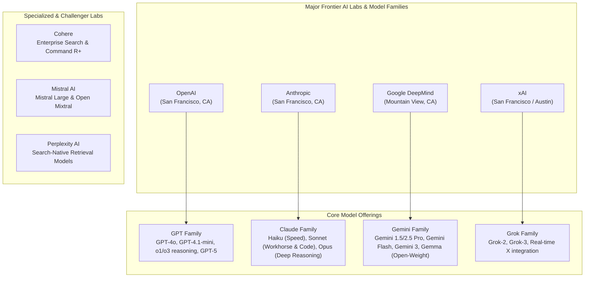

---

## Understanding Frontier Models and Frontier Labs

In machine learning engineering, the term **Frontier Model** describes the largest, most computationally complex models capable of general problem solving, complex code generation, logical reasoning, and broad domain adaptation.

### Closed-Source Frontier Models

The vast majority of leading models operate under a **closed-source (proprietary)** commercial distribution:

- **Massive Pretraining Investments:** Training a frontier model requires tens or hundreds of millions of dollars in compute infrastructure, comprising tens of thousands of high-end GPUs or TPUs running for months to learn language and world knowledge.
- **Continuous Serving Infrastructure (Hosting Inference):** "Hosting inference" means running the finished, frozen model on active servers so millions of users can send prompts and receive real-time answers 24/7. This requires massive distributed data centers, specialized AI chips, and dynamic batching engines.
- **Pay-As-You-Go API Monetization:** Closed-source labs monetize their investments by exposing managed cloud endpoints, charging developers per input and output token processed during inference.

### Open-Source vs. Open-Weight Models

Contrasting with closed APIs are freely downloadable models from organizations like Meta (Llama family) and Google (Gemma family):

- **The "Open-Weight" Technical Distinction:** Strict open-source software licenses require disclosing the full source code and build instructions. In contrast, most modern "open" models are technically **open-weight**: the lab releases the neural network parameters (the weights and biases), but withholds the raw pretraining data corpora, filtering heuristics, synthetic data pipelines, and proprietary Reinforcement Learning from Human Feedback (RLHF) recipes.
- **Self-Hosting Freedom:** Open-weight models can be inspected, fine-tuned, quantized, and hosted locally or on private cloud instances (via engines like Ollama, vLLM, or Hugging Face TGI), guaranteeing data sovereignty and immunity from external API deprecations or content filtering changes.

---

## The Big Four Frontier Labs and Model Families

Four primary technology companies lead the closed-source frontier, each maintaining distinct architectural philosophies, model tier hierarchies, and developer ecosystems.

### OpenAI (GPT Family)

OpenAI catalyzed the current generative AI era with the launch of ChatGPT (GPT-3.5) in late 2022.

- **Evolutionary Trajectory:** Evolved from GPT-3.5 to GPT-4, GPT-4o (omnimodal native processing), and efficient lightweight derivatives like `gpt-4o-mini` and `gpt-4.1-mini`.
- **Reasoning Convergence:** OpenAI pioneered specialized test-time reasoning models (`o1`, `o3`, `o4-mini`) that dynamically generate internal chains-of-thought (reasoning tokens) during the inference step before returning a final response. This allows the model to "think before it speaks", trading a few seconds of runtime deliberation for dramatic accuracy gains on hard technical problems.
- **Ecosystem Dominance:** OpenAI remains the de facto industry standard for developer tooling, function calling definitions, JSON mode, and structured outputs.

### Anthropic (Claude Family)

Anthropic was established by former senior OpenAI researchers with a foundational focus on AI safety, constitutional AI, and steerable behavior.

- **Three-Tier Hierarchy:**
  - **Haiku:** Lightweight, ultrafast, highly cost-effective model designed for high-throughput classification and filtering.
  - **Sonnet:** The enterprise workhorse balancing rapid inference with elite reasoning and world-class software engineering skills (e.g., Claude 3.5 Sonnet, Claude 4.5 Sonnet).
  - **Opus:** Heavyweight model built for long-form analysis, complex creative writing, and deep research tasks.
- **Developer Favor:** Widely acclaimed among software engineers for producing clean, bug-free, non-bloated code. Powers **Claude Code**, an autonomous command-line agent tool for software engineering.

### Google DeepMind (Gemini Family)

Following initial stumbling blocks during the early Google Bard rollout, Google overhauled its AI infrastructure under Google DeepMind, developing **Gemini** as a natively multimodal architecture from the ground up.

- **Multimodal Native Design:** Rather than stitching together separate computer vision, audio, and language models, Gemini was pretrained end-to-end across text, video, audio, code, and images.
- **Massive Context Windows:** Gemini leads the industry in context capacity, comfortably handling 1,000,000 to 2,000,000+ tokens in production. This allows developers to load entire code repositories, multi-hour audio files, or hour-long video lectures directly into working memory without needing complex Retrieval-Augmented Generation (RAG) chunking.
- **Developer Access & Gemma:** Google provides generous free and low-cost development tiers through Google AI Studio. Alongside closed Gemini models, Google releases the **Gemma** family of lightweight, high-performance open-weight models.

### xAI (Grok Family)

Founded by Elon Musk to pursue truth-seeking AI with real-time world awareness, **xAI** operates one of the world's most dense GPU superclusters (Colossus).

- **Core Models:** Progressed from Grok-1 (released under an open Apache 2.0 license) to closed frontier iterations Grok-2 and Grok-3.
- **Distinct Capabilities:** Deep real-time integration with X (formerly Twitter) social media data, allowing near-instantaneous indexing of breaking news, cultural trends, and tech discourse.

---

## Second-Tier Frontier and Specialized Providers

Beyond the Big Four, specialized frontier providers offer differentiated architectural strengths:

- **Perplexity AI:** Search-centric model provider focused on real-time internet retrieval, cited search generation, and automated research workflows.
- **Cohere:** Enterprise-centric platform specializing in multilingual embeddings, high-precision semantic rerankers, and the enterprise-focused **Command R+** model family designed for RAG pipelines.
- **Mistral AI:** High-velocity European AI lab based in Paris. Uniquely bridges both worlds by maintaining popular open-weight models (Mistral 7B, Mixtral 8x7B, Mixtral 8x22B) alongside proprietary cloud frontier endpoints (**Mistral Large**).

---

## Architectural Comparison: Frontier Cloud APIs vs. Self-Hosted Open Weights

Choosing between managed closed APIs and self-hosted open-weight models represents a core infrastructure trade-off for AI engineers.

```text
+---------------------------------------------------------------------------------------------------+
| APPROACH 1: Managed Cloud API (OpenAI, Anthropic, Google, xAI)                                    |
+---------------------------------------------------------------------------------------------------+
Client App  -->  HTTPS JSON API (POST /chat/completions)  -->  Managed Cloud GPU Cluster (Autoscaled)
- Pros: Zero infrastructure maintenance, instant access to frontier capabilities, scale to thousands RPS.
- Cons: Recurring per-token operational costs, vendor lock-in, data leaves private network.

+---------------------------------------------------------------------------------------------------+
| APPROACH 2: Self-Hosted Open-Weight (Llama, Gemma, Mistral on vLLM / Ollama)                      |
+---------------------------------------------------------------------------------------------------+
Client App  -->  Localhost / Private VPC  -->  Dedicated GPU Host (e.g., 8x NVIDIA A100/H100)
- Pros: 100% data privacy, zero per-token cost, immune to model deprecation, fully fine-tunable.
- Cons: High upfront hardware/leasing expense, complex DevOps (quantization, KV-cache management).
```

### Strategic Decision Matrix

| Dimension                     | Managed Frontier Cloud APIs                                  | Self-Hosted Open-Weight Models                                   |
| :---------------------------- | :----------------------------------------------------------- | :--------------------------------------------------------------- |
| **Peak Reasoning & Coding**   | Highest (GPT-4o, Claude 3.5/4.5 Sonnet, Gemini 2.5 Pro)      | High, rapidly closing gap (Llama 3.3 70B, DeepSeek, Qwen)        |
| **Data Privacy & Compliance** | Requires HIPAA / SOC2 zero-retention enterprise agreements   | Absolute (data never traverses external networks)                |
| **Pricing Structure**         | Variable operational cost (pay-as-you-go per million tokens) | Fixed capital expenditure (GPU cloud lease or hardware purchase) |
| **Operational Overhead**      | None (serverless HTTPS API calls)                            | Substantial (requires Kubernetes, vLLM, load balancing, drivers) |
| **Context Window Size**       | Up to 2,000,000 tokens (Gemini)                              | Typically 8k to 128k tokens (constrained by GPU VRAM)            |
| **Latency Consistency**       | Subject to multi-tenant internet spikes and rate limits      | Fully predictable and dedicated to your internal workload        |

---

## Interacting with Frontier Providers via Python

Modern AI engineering workflows frequently interact with multiple frontier providers. The following pattern illustrates how standard environment variables and provider SDKs are initialized in Python.

### Configuring Multi-Provider Secrets

Store credentials for each provider in a central `.env` file:

```ini
# OpenAI API credentials
OPENAI_API_KEY=sk-proj-...

# Anthropic Claude API credentials
ANTHROPIC_API_KEY=sk-ant-api03-...

# Google Gemini API credentials
GEMINI_API_KEY=AIzaSy...

# xAI Grok API credentials
XAI_API_KEY=xai-...
```

### Multi-Provider Python Client Interface

```python
import os
from dotenv import load_dotenv

# Ensure fresh environment variables are loaded
load_dotenv(override=True)

# Step 1: Verify presence of configured frontier API keys
providers = {
    "OpenAI": bool(os.getenv("OPENAI_API_KEY")),
    "Anthropic": bool(os.getenv("ANTHROPIC_API_KEY")),
    "Google Gemini": bool(os.getenv("GEMINI_API_KEY")),
    "xAI Grok": bool(os.getenv("XAI_API_KEY")),
}

print("Active Frontier Provider Credentials:")
for provider, active in providers.items():
    status = "Configured" if active else "Not Detected"
    print(f"- {provider:15}: {status}")
```

```text
Active Frontier Provider Credentials:
- OpenAI         : Configured
- Anthropic      : Configured
- Google Gemini  : Configured
- xAI Grok       : Not Detected
```

### Querying Different Frontier Providers

Different labs provide dedicated Python client libraries, but maintain similar conversational message patterns:

```python
# OpenAI Official Client Example
from openai import OpenAI

client = OpenAI()
openai_response = client.chat.completions.create(
    model="gpt-4.1-mini",
    messages=[
        {"role": "system", "content": "You are a concise AI engineering advisor."},
        {"role": "user", "content": "What is the primary strength of Claude 3.5 Sonnet?"}
    ]
)
print("OpenAI Output:")
print(openai_response.choices[0].message.content)
```

```text
OpenAI Output:
Claude 3.5 Sonnet is widely considered an industry leader in complex coding tasks, reasoning through large software refactors, and providing nuanced, instruction-following responses without code bloat.
```

---

## Comprehensive Frontier Models Comparison Table

| Lab / Organization  | Flagship Frontier Model   | Cost-Effective / High-Speed Tier | Max Context Window | Primary Specialization                                             | Native Multimodality             |
| :------------------ | :------------------------ | :------------------------------- | :----------------- | :----------------------------------------------------------------- | :------------------------------- |
| **OpenAI**          | GPT-4o / GPT-5            | `gpt-4o-mini` / `gpt-4.1-mini`   | 128,000 tokens     | General reasoning, structured outputs, broad integration           | Text, Audio, Vision              |
| **Anthropic**       | Claude 3.5 / 4.5 Sonnet   | Claude Haiku                     | 200,000 tokens     | Software engineering, complex code refactoring, human-aligned tone | Text, Vision                     |
| **Google DeepMind** | Gemini 2.5 Pro / Gemini 3 | Gemini Flash                     | 2,000,000+ tokens  | Native multimodality, massive context analysis, research           | Text, Audio, Video, Vision, Code |
| **xAI**             | Grok-2 / Grok-3           | Grok Mini                        | 128,000 tokens     | Real-time social knowledge (X data), uncensored debate             | Text, Vision                     |
| **Mistral AI**      | Mistral Large             | Mistral NeMo / Small             | 128,000 tokens     | European compliance, open-weight parity, multilingual text         | Text, Vision                     |

> [!IMPORTANT]
> **No Need for All Four Keys Simultaneously:** While courses and production systems benchmark all major models, you do not need active paid accounts for all four providers simultaneously to learn. An OpenAI or Google Gemini developer account provides full coverage for essential LLM engineering patterns.

> [!TIP]
> **Leverage Google AI Studio for Free Prototyping:** Google provides free rate-limited API access to Gemini Flash and Pro models via Google AI Studio in supported regions, making it an ideal choice for experimentation without accumulating API bills.

---

## Review Quiz

<details>
<summary><b>Question 1: What is the technical distinction between an "open-source" model and an "open-weight" model?</b></summary>
<br>
<b>Answer:</b> An open-source software release makes full source code, build scripts, and underlying recipes publicly accessible. In contrast, "open-weight" models (such as Meta's Llama or Google's Gemma) release only the trained neural network parameter tensors (weights and biases), while keeping the original pretraining datasets, data curation pipelines, and proprietary RLHF alignment recipes confidential.
</details>

<details>
<summary><b>Question 2: Which tier in Anthropic's Claude model family is generally recommended as the primary workhorse for programming and coding agent tasks?</b></summary>
<br>
<b>Answer:</b> <b>Claude Sonnet</b> (such as Claude 3.5 Sonnet or 4.5 Sonnet). It occupies the sweet spot between high-speed inference and exceptional reasoning, consistently outperforming other tiers in real-world software engineering and code generation benchmarks.
</details>

<details>
<summary><b>Question 3: What architectural differentiator gives Google's Gemini models a decisive advantage when analyzing long documents, books, or video lectures?</b></summary>
<br>
<b>Answer:</b> Gemini's industry-leading context window capacity of <b>1,000,000 to 2,000,000+ tokens</b>. This allows an entire repository, hours of video, or complete legal libraries to be fed directly into active working memory in a single prompt, eliminating the complexity and chunking artifacts inherent to traditional RAG pipelines.
</details>

<details>
<summary><b>Question 4: Why do frontier closed-source models use a pay-as-you-go per-token billing model rather than a flat monthly software subscription?</b></summary>
<br>
<b>Answer:</b> Inference compute costs are proportional to the number of tokens processed. Each token generated requires passing input states through billions or trillions of parameters across high-performance GPUs. Charging per input and output token aligns vendor costs directly with the computational resources consumed by each individual query.
</details>

<details>
<summary><b>Question 5: Which French AI lab produces both closed-source cloud frontier models and popular open-weight models like Mixtral?</b></summary>
<br>
<b>Answer:</b> <b>Mistral AI</b>. They publish open-weight models (such as Mistral 7B and Mixtral 8x7B/8x22B) for self-hosting, while offering proprietary flagship models (such as Mistral Large) via managed cloud endpoints.
</details>

---

# Open-Source LLMs: Llama, Mistral, DeepSeek, and Ollama

While proprietary cloud frontier models deliver massive scale through paid APIs, open-weight models have transformed artificial intelligence by enabling developers to download, inspect, fine-tune, and run models locally on private infrastructure. Understanding the open-source landscape, model distillation, and direct local inference is essential for building cost-effective, privacy-compliant AI systems.

```text
+-------------------------------------------------------------------------------------------------------+
|                                    THREE WAYS TO USE LANGUAGE MODELS                                  |
+-------------------------------------------------------------------------------------------------------+
|  1. CHAT INTERFACES (Products)  |  2. CLOUD APIs (Managed Endpoints)  |  3. DIRECT INFERENCE (Local)  |
|  - Consumer UI (ChatGPT, Claude)|  - Direct APIs (OpenAI, Anthropic)  |  - Hugging Face Transformers  |
|  - Integrated search & memory   |  - Cloud Gateways (Bedrock, Vertex) |  - Ollama (Quantized GGUF)    |
|  - End-to-end managed product   |  - Fast Hardware (Groq with a 'q')  |  - Complete data privacy      |
+-------------------------------------------------------------------------------------------------------+
```

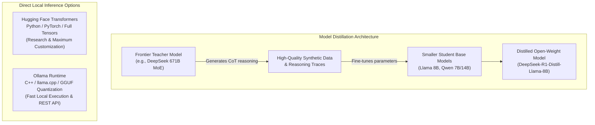

---

## The Open-Source and Open-Weight Revolution

Meta catalyzed the open-source movement by releasing the **Llama** model weights. While initially perceived as a strategy to counter proprietary leaders like OpenAI and Google, this initiative established an open ecosystem that now rivals closed models across coding, reasoning, and instruction-following benchmarks.

### Small Language Models (SLMs) vs. Large Language Models (LLMs)

Modern open architectures are categorized by parameter count, directly determining their memory footprint and hardware requirements:

- **Small Language Models (SLMs):** Models ranging from 270M to 3B parameters (e.g., `Llama 3.2 1B/3B`, `Gemma 270M`, `Phi-4 Mini`). These models fit comfortably into consumer RAM (e.g., 8 GB to 16 GB unified memory on Apple Silicon or standard laptops) and run with near-zero latency for edge tasks, local summarization, and offline classifications.
- **Large Open Models (LLMs):** Massive weights ranging from 70B up to 400B+ parameters (e.g., `Llama 3.3 70B`, `Llama 4`, `DeepSeek 671B`). These require enterprise multi-GPU nodes (such as 4x or 8x NVIDIA A100/H100 clusters) to run inference at scale.

---

## Key Open-Weight Model Families and Architectural Innovations

The open landscape features specialized architectures tailored for distinct compute and reasoning profiles.

### Meta Llama

The foundational benchmark of the open ecosystem.

- **Llama 3.2:** Introduced ultralight 1B and 3B parameter variants designed specifically for on-device and local edge execution.
- **Llama 4:** Represents Meta's frontier-scale open-weight offering, trained across tens of thousands of GPUs to rival closed proprietary models.

### Mistral AI and Mixture of Experts (MoE)

Pioneered by French AI startup Mistral AI, the **Mixture of Experts (MoE)** architecture (exemplified by **Mixtral 8x7B** and **Mixtral 8x22B**) replaces monolithic dense neural networks with dynamically routed subnetworks:

- In a traditional dense model, every parameter is activated for every token generated.
- In an MoE model, an internal routing router directs each incoming token to a small subset of "expert" feed-forward networks (e.g., activating only 2 out of 8 experts per token).
- **Engineering Advantage:** Delivers the vast knowledge capacity of a large model while consuming the active compute and memory bandwidth of a far smaller model.

### Alibaba Cloud Qwen

Developed by the cloud division of Alibaba, the **Qwen** family has emerged as one of the most capable multilingual open models:

- Exceptional performance on complex mathematical reasoning, multilingual coding, and technical problem-solving.
- Serves as a primary foundation for model distillation and agentic workflows throughout the international research community.

### Google Gemma

Google's open-weight counterpart to Gemini.

- Ranges from an ultra-compact **270M parameter micro-model** up to standard 2B, 9B, and 27B variants.
- While the 270M variant has limited reasoning depth, it serves as an extraordinary proof-of-concept for running text generation within resource-constrained embedded systems and mobile edge devices.

### Microsoft Phi

Microsoft's **Phi** family (such as Phi-3 and Phi-4) focuses on training efficiency through **high-quality synthetic data**:

- Rather than scraping uncurated web dumps, Phi models are trained on curated synthetic "textbook quality" data.
- Achieves high reasoning, mathematical deduction, and function-calling capabilities despite having small parameter counts.

---

## DeepSeek and the Efficiency Breakthrough

In early 2025, Chinese research lab **DeepSeek AI** challenged the economics of generative AI by demonstrating that frontier-grade reasoning models could be developed at a fraction of Silicon Valley's traditional capital expenditure.

### The Training Cost Paradigm Shift

- **The Capital Divide:** Where frontier labs reported pretraining investments exceeding $100 million for flagship models, DeepSeek reported pretraining its base models for approximately $6 million using hardware optimizations (such as Multi-Head Latent Attention and DualPipe parallelism).
- **The Flagship Model:** DeepSeek's primary model is a 671-billion parameter Mixture of Experts architecture. Because of its sheer size, the unquantized base model cannot run on standard consumer hardware.

### Model Distillation: How Small DeepSeek Models Work

DeepSeek's popular local models (available in 1.5B, 7B, 8B, 14B, and 32B sizes) are not miniaturized versions of the 671B model trained from scratch. Instead, they are created through **Model Distillation**:

```text
+-----------------------------------+
|  DeepSeek-R1 (671B MoE Teacher)   |
|  Generates Chain-of-Thought Data  |
+-----------------------------------+
                  |
                  v
+-----------------------------------+
| Synthetic Reasoning Dataset       |
| (Hundreds of thousands of traces) |
+-----------------------------------+
                  |
                  v
+-----------------------------------+
| Student Base Models (Llama, Qwen) |
| (Fine-tuned on reasoning traces)  |
+-----------------------------------+
                  |
                  v
+-----------------------------------+
| Distilled Reasoning Models        |
| - DeepSeek-R1-Distill-Qwen-1.5B   |
| - DeepSeek-R1-Distill-Llama-8B    |
| - DeepSeek-R1-Distill-Qwen-32B    |
+-----------------------------------+
```

1. **Teacher Generation:** The massive 671B teacher model solves complex math, coding, and logic puzzles, logging its internal chain-of-thought (CoT) reasoning traces.
2. **Synthetic Dataset Curation:** Researchers assemble these reasoning steps into a high-density synthetic dataset.
3. **Student Fine-Tuning:** Established open-weight base models (specifically Meta's **Llama** and Alibaba's **Qwen**) are fine-tuned on this synthetic reasoning corpus.
4. **Result:** The smaller models inherit the teacher's deductive habits and formatting without needing hundreds of billions of parameters.

### OpenAI's Open-Weight Move (`gpt-oss`)

Spurred by community adoption of DeepSeek and Llama, OpenAI entered the open-weight arena by publishing **`gpt-oss`** in dual configurations:

- A compact **20B parameter variant** capable of running on high-end local workstations.
- A **120B parameter variant** designed for multi-GPU server deployments.

---

## The Three Paradigms of Consuming Language Models

Every application utilizing language models operates under one of three structural paradigms.

```text
+---------------------------------------------------------------------------------------------------+
| PARADIGM 1: Chat Interfaces (Packaged Consumer Products)                                          |
+---------------------------------------------------------------------------------------------------+
User Browser  -->  Web UI (ChatGPT, Claude.ai)  -->  App Layer (Search, Memory)  -->  Proprietary LLM
- Characteristics: Built-in user experience, conversational memory, web browsing, automated tooling.
- Audience: End users and non-developer workflows.

+---------------------------------------------------------------------------------------------------+
| PARADIGM 2: Cloud APIs (Managed Endpoints)                                                        |
+---------------------------------------------------------------------------------------------------+
Custom Code  -->  HTTPS REST / SDK  -->  API Gateway (OpenAI, Bedrock, Groq)  -->  Cloud Datacenter
- Characteristics: Pay-as-you-go per token, managed scalability, zero hardware maintenance.
- Variations:
  * Direct Provider APIs: OpenAI, Anthropic, Google Gemini.
  * Hyperscaler Platforms: Amazon Bedrock, Google Vertex AI, Azure AI.
  * High-Speed LPU Inference: Groq (with a 'q') using custom Language Processing Units.
  * Unified Aggregators: OpenRouter (single API key routing to dozens of backends).

+---------------------------------------------------------------------------------------------------+
| PARADIGM 3: Direct Inference (Self-Hosted Execution)                                              |
+---------------------------------------------------------------------------------------------------+
Custom Code  -->  Localhost / Private Socket  -->  Local Engine (Ollama / Transformers)  --> Local VRAM
- Characteristics: Zero per-token fees, complete data privacy, runs completely offline.
- Variations: Hugging Face Transformers (Python native) vs. Ollama (optimized C++ GGUF binary).
```

### Direct Inference: Hugging Face Transformers vs. Ollama

When running models locally without external APIs, developers choose between raw framework execution and packaged runtimes:

1. **Hugging Face Transformers:**
   - The foundational Python data science library for deep learning.
   - Loads raw neural network definitions in PyTorch and downloads full precision or half precision tensors (`float32`, `bfloat16`).
   - Offers granular control over hidden states, attention masks, and layer activations, but requires manual memory management and significant GPU resources.

2. **Ollama:**
   - A packaged, compiled C++ application built on top of `llama.cpp`.
   - Models are converted and compressed into the **GGUF** format using 4-bit or 8-bit integer quantization.
   - Runs as a system background service, automatically managing GPU offloading across Apple Silicon Metal or NVIDIA CUDA.
   - Exposes a local REST API endpoint on port `11434` with native OpenAI API compatibility.

---

## Running Local Inference with Ollama in Python

Ollama allows developers to query local open-source models using standard terminal commands or Python client libraries.

### Managing Models via Ollama CLI

```bash
# Pull and start an interactive terminal session with Llama 3.2 (3B parameters)
ollama run llama3.2:3b

# List all models currently downloaded to local disk
ollama list

# Verify the local Ollama background server is running
curl http://localhost:11434/api/tags
```

```text
NAME               ID              SIZE      MODIFIED
llama3.2:3b        a80c4f17acd5    2.0 GB    2 hours ago
deepseek-r1:8b     0aee99314414    4.9 GB    1 day ago
```

### Querying Local Models with OpenAI Client Compatibility

Because Ollama provides an OpenAI-compatible REST route (`/v1`), existing OpenAI client code can query locally hosted models simply by pointing `base_url` to `localhost:11434/v1` and supplying an arbitrary dummy API key:

```python
from openai import OpenAI

# Initialize client pointing to local Ollama server instead of api.openai.com
local_client = OpenAI(
    base_url="http://localhost:11434/v1",
    api_key="ollama"  # Required by client SDK, but ignored by local Ollama engine
)

# Request completion from locally running Llama 3.2 model
response = local_client.chat.completions.create(
    model="llama3.2:3b",
    messages=[
        {"role": "system", "content": "You are a concise offline AI assistant."},
        {"role": "user", "content": "What is the primary architectural difference between dense models and Mixture of Experts?"}
    ],
    temperature=0.2
)

print("Local Model Response:")
print(response.choices[0].message.content)
```

```text
Local Model Response:
In a dense model, all parameters and neural network layers are activated for every processed token. In a Mixture of Experts (MoE) model, an internal gating network dynamically routes each token to a small subset of specialized sub-networks ('experts'), reducing computational cost and memory bandwidth while maintaining high capacity.
```

---

## Open-Weight Ecosystem Comparison Matrix

| Model Family    | Creator / Lab   | Key Models & Sizes                             | Primary Architectural Strengths                                   | Ideal Deployment Scenario                                       |
| :-------------- | :-------------- | :--------------------------------------------- | :---------------------------------------------------------------- | :-------------------------------------------------------------- |
| **Llama**       | Meta            | Llama 3.2 (1B, 3B), Llama 3.3 (70B), Llama 4   | Universal community benchmark, extensive fine-tuning support      | On-device SLM apps (1B/3B) and private cloud clusters (70B)     |
| **Mixtral**     | Mistral AI      | Mixtral 8x7B, Mixtral 8x22B, Mistral NeMo      | Mixture of Experts (MoE) architecture, high throughput            | High-efficiency server inference with low per-token compute     |
| **Qwen**        | Alibaba Cloud   | Qwen 2.5 (0.5B to 72B), Qwen-Coder             | State-of-the-art multilingual comprehension, math, and code       | Code generation agents and multilingual translation pipelines   |
| **Gemma**       | Google DeepMind | Gemma 2 (270M, 2B, 9B, 27B)                    | Extreme edge portability (270M), tight integration with JAX/Keras | Resource-constrained microcontrollers and edge hardware         |
| **Phi**         | Microsoft       | Phi-3, Phi-4 (3.8B to 14B)                     | High synthetic data quality, strong reasoning for small sizes     | Local enterprise copilot agents and structured function calling |
| **DeepSeek-R1** | DeepSeek AI     | 671B MoE Base; Distilled Llama/Qwen (1.5B–32B) | Frontier-grade chain-of-thought reasoning at low cost             | Complex mathematical deduction and code debugging               |

---

## Local Inference Architecture: Transformers vs. Ollama

| Dimension                  | Hugging Face Transformers                           | Ollama                                                |
| :------------------------- | :-------------------------------------------------- | :---------------------------------------------------- |
| **Core Language & Engine** | Python / PyTorch / C++                              | Compiled C++ (`llama.cpp`)                            |
| **Weight Format**          | Safetensors / PyTorch raw floats (`fp16`, `bf16`)   | Quantized GGUF files (`Q4_K_M`, `Q8_0`)               |
| **Memory Footprint**       | High (e.g., ~16 GB VRAM for 8B model in fp16)       | Low (e.g., ~4.5 GB RAM for 8B model in Q4)            |
| **Setup Complexity**       | High (requires Python env, torch, CUDA/MPS drivers) | Minimal (single binary install, one-line model pull)  |
| **Network Interface**      | Must write custom FastAPI / Flask wrapper           | Built-in REST API with OpenAI `/v1` compatibility     |
| **Best Used For**          | Model training, fine-tuning, research inspection    | Fast local inference, offline apps, local development |

> [!IMPORTANT]
> **Distilled Models Carry Base Model Licenses:** When deploying distilled DeepSeek models (such as `DeepSeek-R1-Distill-Llama-8B`), remember that the model architecture and underlying weights are derived from Meta's Llama. Consequently, usage must comply with Meta's Llama Community License alongside DeepSeek's terms.

> [!TIP]
> **Groq vs. Grok Naming Trap:** Do not confuse **Grok** (with a 'k', Elon Musk's frontier LLM from xAI) with **Groq** (with a 'q', the hardware inference cloud founded by Jonathan Ross). Groq operates proprietary LPU (Language Processing Unit) chips designed to serve open models like Llama and Mistral at extreme token speeds (>300 tokens/sec).

---

## Review Quiz

<details>
<summary><b>Question 1: What is model distillation, and how does it explain the high reasoning performance of smaller 7B and 8B DeepSeek models?</b></summary>
<br>
<b>Answer:</b> Model distillation is a technique where a smaller "student" model is trained on outputs, chain-of-thought reasoning paths, and synthetic datasets generated by a larger "teacher" model. Rather than training small models from scratch, DeepSeek took existing compact architectures (like Llama 8B and Qwen) and fine-tuned them on high-density reasoning data generated by their massive 671B frontier model.
</details>

<details>
<summary><b>Question 2: How does a Mixture of Experts (MoE) model like Mixtral achieve higher inference efficiency than a dense model with the same total parameter count?</b></summary>
<br>
<b>Answer:</b> In a dense model, 100% of the network's parameters are calculated for every token generated. In an MoE architecture, an internal routing mechanism directs each token to only a small subset of specialized sub-networks (e.g., activating only 2 out of 8 experts), reducing active memory bandwidth and compute requirements while retaining the total parameter capacity.
</details>

<details>
<summary><b>Question 3: What is the primary difference in model packaging and memory usage between Hugging Face Transformers and Ollama?</b></summary>
<br>
<b>Answer:</b> Hugging Face Transformers typically loads raw neural network weights in unquantized 16-bit floating point formats (<code>fp16</code> or <code>bfloat16</code>) within a Python runtime, requiring substantial GPU VRAM. Ollama packages models into quantized <b>GGUF</b> binary formats (compressing weights to 4-bit or 8-bit integers) and executes them via an optimized C++ engine, allowing models to run smoothly on standard consumer CPU and unified memory.
</details>

<details>
<summary><b>Question 4: What is the difference between Grok and Groq?</b></summary>
<br>
<b>Answer:</b> <b>Grok</b> (with a 'k') is the proprietary frontier LLM developed by Elon Musk's lab xAI. <b>Groq</b> (with a 'q') is a semiconductor and cloud inference company that created Language Processing Units (LPUs) using SRAM to run open-weight models like Llama and Mistral at ultra-high token generation speeds.
</details>

<details>
<summary><b>Question 5: How can a developer use the standard openai Python SDK to query a locally running Ollama model?</b></summary>
<br>
<b>Answer:</b> By instantiating <code>OpenAI(base_url="http://localhost:11434/v1", api_key="ollama")</code>. Because Ollama provides built-in endpoint compatibility with OpenAI's Chat Completions REST schema, standard OpenAI client calls seamlessly route to the local Ollama server without requiring third-party libraries.
</details>

---

# Chat Completions API: HTTP Endpoints vs. the OpenAI Python Client

Behind every artificial intelligence agent and chat interface lies a standard network transaction. Regardless of whether an application uses the official OpenAI client library or direct network calls, large language models in the cloud are accessed via standard HTTP REST endpoints. Understanding the underlying HTTP request structure demystifies how software communicates with AI models.

```text
+---------------------------------------------------------------------------------------------------+
| APPROACH 1: Raw HTTP Request (requests.post)                                                      |
+---------------------------------------------------------------------------------------------------+
Python Dicts ---> json.dumps() ---> HTTP POST https://api.openai.com/v1/chat/completions
                                    - Header: Authorization: Bearer sk-proj-...
                                    - Header: Content-Type: application/json
                                    - Body: {"model": "gpt-5-nano", "messages": [...]}
                                            |
                                            v
Python Dicts <--- response.json() <--- HTTP 200 JSON Response (choices, usage, id)

+---------------------------------------------------------------------------------------------------+
| APPROACH 2: Python Client SDK Wrapper (openai.OpenAI)                                             |
+---------------------------------------------------------------------------------------------------+
client.chat.completions.create(model="...", messages=[...])
  |
  +--> Automatically reads OPENAI_API_KEY from environment
  +--> Formats headers and serializes JSON payload
  +--> Executes HTTP POST to /v1/chat/completions with retries and connection pooling
  +--> Deserializes JSON response into typed Python objects with dot-notation attributes
```

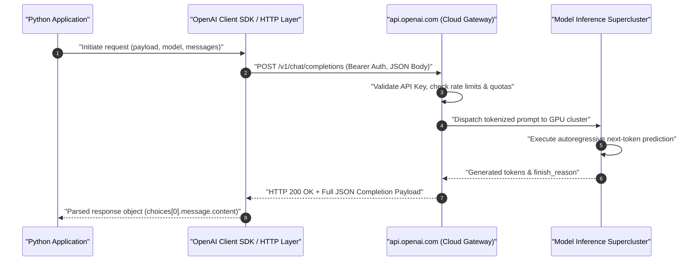

---

## The Chat Completions Paradigm and Predictive Foundations

The interface is designated as **Chat Completions** because it mirrors the fundamental mechanics of autoregressive generative models.

When querying a language model, the system provides a structured dialogue transcript representing the conversation to date. The model's computational objective is next-token prediction—identifying and generating the sequence of tokens that most plausibly completes the conversational sequence. While this mechanism appears as intelligent conversation or problem solving, the underlying engine is continually calculating conditional probabilities across a vast vocabulary.

Pioneered by OpenAI, this conversational JSON schema proved so intuitive and versatile that it was universally adopted across commercial providers and open-source inference servers.

---

## Deconstructing the Raw HTTP Request: Endpoints, Headers, and Payloads

An **API Endpoint** is a dedicated web address (URL) hosted on a remote server designed to process programmatic requests rather than render human-facing HTML pages.

### The Chat Completions Endpoint URL

All standard OpenAI conversational inference requests target a single REST endpoint:

```text
POST https://api.openai.com/v1/chat/completions
```

### Required HTTP Headers

To communicate with the endpoint, the client must transmit two mandatory HTTP headers:

1. **`Content-Type: application/json`:** Instructs the remote server that the incoming request payload is formatted as a JSON string.
2. **`Authorization: Bearer <API_KEY>`:** Transmits credentials via the standard OAuth 2.0 Bearer authentication scheme. The server validates this key against account balances, rate limits, and access permissions.

### Request Payload Structure

The body of the POST request is a JSON object containing two core parameters:

- **`model` (string):** Specifies the exact foundation model identifier (e.g., `"gpt-5-nano"`, `"gpt-4o-mini"`).
- **`messages` (list of objects):** The ordered conversational transcript where each dictionary contains:
  - `role`: The entity sending the message (`"system"`, `"user"`, or `"assistant"`).
  - `content`: The text content of the message.

### Invoking the API with Raw Python Requests

The standard Python `requests` library can query the model without importing any OpenAI-specific packages:

```python
import os
import requests
from dotenv import load_dotenv

# Load API credentials from .env into process environment
load_dotenv(override=True)
api_key = os.getenv("OPENAI_API_KEY")

# Step 1: Configure HTTP request headers
headers = {
    "Authorization": f"Bearer {api_key}",
    "Content-Type": "application/json"
}

# Step 2: Define JSON payload with model target and message history
payload = {
    "model": "gpt-5-nano",
    "messages": [
        {"role": "user", "content": "Tell me a fun fact"}
    ]
}

# Step 3: Dispatch network POST request to the API endpoint
response = requests.post(
    "https://api.openai.com/v1/chat/completions",
    headers=headers,
    json=payload
)

# Step 4: Parse response status and raw JSON
print(f"HTTP Status Code: {response.status_code}")
```

```text
HTTP Status Code: 200
```

---

## Dissecting the JSON Response Payload

When the model finishes processing, the server returns an HTTP 200 response containing a detailed JSON document detailing the completion, execution metadata, and token usage accounting:

```json
{
  "id": "chatcmpl-ClXqKdvFYJBZxbYHzGzTm4AHbr0y",
  "object": "chat.completion",
  "created": 1759350960,
  "model": "gpt-5-nano-2025-08-07",
  "choices": [
    {
      "index": 0,
      "message": {
        "role": "assistant",
        "content": "Fun fact: There are more possible unique games of chess than there are atoms in the observable universe—about 10^120 possible games vs roughly 10^80 atoms.",
        "refusal": null,
        "annotations": []
      },
      "finish_reason": "stop"
    }
  ],
  "usage": {
    "prompt_tokens": 11,
    "completion_tokens": 568,
    "total_tokens": 579,
    "prompt_tokens_details": {
      "cached_tokens": 0,
      "audio_tokens": 0
    },
    "completion_tokens_details": {
      "reasoning_tokens": 512,
      "audio_tokens": 0
    }
  },
  "service_tier": "default",
  "system_fingerprint": null
}
```

### Key Elements of the Response Schema

- **`id`:** A unique identifier assigned to the completion event, useful for debugging, audit logs, and support inquiries.
- **`model`:** Confirms the exact underlying snapshot used to fulfill the request.
- **`choices`:** An array of generated completion candidates. Because requests default to `n=1`, index `0` represents the primary output.
  - **`message.content`:** The textual answer generated by the model.
  - **`finish_reason`:** Explains why token generation concluded. Typical values include `"stop"` (the model reached a natural end-of-sequence token), `"length"` (hit maximum token limits), or `"tool_calls"` (requested an external function).
- **`usage`:** Detailed billing accounting:
  - `prompt_tokens`: Tokens consumed parsing the input message list.
  - `completion_tokens`: Output tokens generated (including hidden internal reasoning tokens).
  - `total_tokens`: Total billable token sum.

### Extracting Content from Raw JSON

To extract the generated response text from the raw dictionary:

```python
# Convert HTTP response body to a Python dictionary
response_data = response.json()

# Navigate nested dictionary hierarchy: choices -> index 0 -> message -> content
fun_fact = response_data["choices"][0]["message"]["content"]
print("Extracted Fact:")
print(fun_fact)
```

```text
Extracted Fact:
Fun fact: There are more possible unique games of chess than there are atoms in the observable universe—about 10^120 possible games vs roughly 10^80 atoms.
```

---

## Demystifying the OpenAI Python Client Library

While making direct HTTP calls using `requests` is instructive, managing raw JSON payloads and manual dictionary lookups introduces unnecessary boilerplate and brittle code into production applications.

### What the SDK Actually Is

The official `openai` Python package is **not** an artificial intelligence model engine. It does not contain weights, tensors, or local neural network algorithms.

The SDK is a lightweight, open-source HTTP client library that wraps network calls to `https://api.openai.com/v1`. It acts as an ergonomic translation layer between Python code and remote REST endpoints.

```python
from openai import OpenAI

# Client automatically reads OPENAI_API_KEY from environment variables
client = OpenAI()

# Method call constructs HTTP request, posts to endpoint, and deserializes response
completion = client.chat.completions.create(
    model="gpt-5-nano",
    messages=[
        {"role": "user", "content": "Tell me a fun fact"}
    ]
)

# Access response fields via clean dot-notation attributes
print("SDK Parsed Fact:")
print(completion.choices[0].message.content)
```

```text
SDK Parsed Fact:
Fun fact: There are more possible unique games of chess than there are atoms in the observable universe—about 10^120 possible games vs roughly 10^80 atoms.
```

---

## Universal Standardization: The Lingua Franca of Gen AI

The standardization of the `/v1/chat/completions` REST payload is one of the most significant architectural milestones in modern AI engineering.

Because OpenAI established this schema early, competitor labs and open-source infrastructure tools replicated the exact same JSON schema:

- **Open-Source Local Inference:** **Ollama**, **vLLM**, and **LocalAI** expose local endpoints matching `/v1/chat/completions`.
- **Specialized Cloud Providers:** **Groq**, **Mistral AI**, **Together AI**, and **DeepSeek** implement the identical HTTP interface.

Because the underlying schema is identical, switching between a local open-weight model and a cloud frontier model requires altering only the `base_url` parameter and model string.

---

## Technical Comparison: Raw HTTP vs. Official Python SDK

| Dimension                 | Raw HTTP (`requests.post`)                              | Official Python Client (`openai.OpenAI`)                            |
| :------------------------ | :------------------------------------------------------ | :------------------------------------------------------------------ |
| **Dependencies**          | Standard `requests` library only                        | Requires installing `openai` package                                |
| **Authentication**        | Manual header construction (`Bearer <key>`)             | Automatically resolved from `OPENAI_API_KEY`                        |
| **Data Access**           | Nested dictionary indexing (`dict["choices"][0]...`)    | Typed dot-notation attributes (`obj.choices[0]...`)                 |
| **Error Handling**        | Manual HTTP status code checks (`401`, `429`, `500`)    | Specific typed exceptions (`AuthenticationError`, `RateLimitError`) |
| **Retry Logic**           | None (must write custom loops with exponential backoff) | Built-in automatic retries with configurable limits                 |
| **Streaming Support**     | Requires manual Server-Sent Events (SSE) parsing        | Native Python generator yielding streamed chunks                    |
| **Typing & Autocomplete** | None (raw string keys, prone to typos)                  | Full IDE autocomplete via Pydantic model schemas                    |

> [!IMPORTANT]
> **Understanding the Abstraction Layer:** Always remember that the OpenAI client library is executing standard HTTPS POST requests under the hood. When debugging connection issues, proxy errors, or corporate firewalls, treat the SDK as standard web traffic directed at port 443 of `api.openai.com`.

> [!TIP]
> **Use Raw HTTP for Embedded or Minimal Environments:** If you are deploying an LLM integration to a lightweight container, AWS Lambda function, or non-Python environment (like bash `curl` scripts or embedded C/Rust microservices) where installing heavy SDK dependencies is undesirable, making a direct POST request with a raw JSON payload provides the exact same inference capability.

---

## Review Quiz

<details>
<summary><b>Question 1: What is the primary underlying reason the API is designated as "Chat Completions"?</b></summary>
<br>
<b>Answer:</b> Generative language models operate autoregressively by predicting the most probable sequence of future tokens. When given a conversation history (system, user, and assistant messages), the model generates the tokens that most likely "complete" that dialogue sequence.
</details>

<details>
<summary><b>Question 2: What are the two mandatory HTTP headers that must accompany every POST request to https://api.openai.com/v1/chat/completions?</b></summary>
<br>
<b>Answer:</b> <code>Content-Type: application/json</code> (to signal that the body payload is JSON-formatted) and <code>Authorization: Bearer &lt;API_KEY&gt;</code> (to authenticate the caller using OAuth 2.0 Bearer token standards).
</details>

<details>
<summary><b>Question 3: Does installing the openai Python package download or execute neural network weights locally on your machine?</b></summary>
<br>
<b>Answer:</b> No. The <code>openai</code> Python package is purely an HTTP client SDK. It contains no neural network weights or local model code; it simply constructs standard HTTP REST requests, transmits them over the internet to OpenAI's cloud servers, and parses the returned JSON responses into convenient Python objects.
</details>

<details>
<summary><b>Question 4: What is the purpose of the finish_reason field inside choices[0] in the JSON response?</b></summary>
<br>
<b>Answer:</b> It specifies the technical reason token generation stopped. Common values include <code>"stop"</code> (the model naturally completed its answer), <code>"length"</code> (the output reached the maximum token limit), or <code>"tool_calls"</code> (the model paused text generation to request an external function or tool execution).
</details>

<details>
<summary><b>Question 5: Why can the standard openai Python SDK be used without modification to query local inference servers like Ollama or third-party providers like Groq?</b></summary>
<br>
<b>Answer:</b> Because the Chat Completions REST API schema (<code>/v1/chat/completions</code>) was adopted as an open industry standard. Local engines like Ollama and external clouds like Groq implement the exact same HTTP endpoint, request parameters, and JSON response structure, allowing developers to switch backends simply by configuring the SDK's <code>base_url</code>.
</details>

---

# Running Ollama Locally with OpenAI-Compatible Endpoints

## Local Model Inference and the OpenAI Protocol Standard

Running open-source Large Language Models locally on personal hardware provides significant engineering advantages: total data privacy, zero recurring API expenses, and full operational capability without an active internet connection. Historically, adopting open-source models required developers to navigate incompatible model formats, complex C++ compilation steps, GPU driver configurations, and custom inference APIs.

Ollama abstracts this infrastructure complexity into a single self-contained daemon. It handles downloading model weights, quantizing and caching parameters, managing memory allocation across CPU and Apple Silicon unified memory (via Metal), and hosting an HTTP inference server.

Crucially, Ollama implements the **OpenAI Chat Completions API protocol**. Rather than forcing developers to learn proprietary SDKs or write unique payloads for local models, Ollama exposes an HTTP endpoint at `/v1/chat/completions` that accepts the exact same JSON schema and returns the exact same response structures as OpenAI's cloud servers.

This architectural standard allows developers to achieve **client polymorphism**: you can develop and test applications against a local model running on your laptop, and subsequently switch production traffic to frontier models in the cloud—or vice versa—simply by changing an environment variable or base URL parameter, without altering a single line of business logic.

```text
+-------------------------------------------------------------------------------+
|                             CLIENT POLYMORPHISM                               |
|                                                                               |
|       +---------------------------------------------------------------+       |
|       |                   OpenAI Python Client SDK                    |       |
|       |               client.chat.completions.create(...)             |       |
|       +-------------------------------+-------------------------------+       |
|                                       |                                       |
|                  base_url routing     |                                       |
|            +--------------------------+--------------------------+            |
|            |                                                     |            |
|            v                                                     v            |
|  [ api.openai.com/v1 ]                               [ localhost:11434/v1 ]   |
|            |                                                     |            |
|     (Cloud Frontier)                                      (Local Engine)      |
|            v                                                     v            |
|   +-----------------+                                   +-----------------+   |
|   | OpenAI Cloud    |                                   |  Ollama Server  |   |
|   |  - GPT-4o       |                                   |  - Llama 3.2    |   |
|   |  - o1 / o3-mini |                                   |  - DeepSeek-R1  |   |
|   +-----------------+                                   +-----------------+   |
+-------------------------------------------------------------------------------+
```

---

## Verifying the Local Ollama Server Lifecycle

Before initiating API requests, the background Ollama daemon must be active and listening for incoming TCP connections. By default, Ollama binds to port `11434` on localhost.

### Checking Daemon Connectivity via Python

You can verify that the Ollama service is reachable by sending an HTTP GET request to the root server URL (`http://localhost:11434`) using the standard Python `requests` library.

```python
import requests

# Send an HTTP GET request to Ollama's local port
ollama_url = "http://localhost:11434"

try:
    response = requests.get(ollama_url, timeout=3)
    # The server responds with plain text verifying active status
    print(f"Status Code: {response.status_code}")
    print(f"Response Body: {response.content}")
except requests.exceptions.ConnectionError:
    print("Ollama daemon is not running or unreachable on port 11434.")
```

```text
Status Code: 200
Response Body: b'Ollama is running'
```

When Ollama is operational, the root endpoint returns HTTP status `200` with the byte string `b'Ollama is running'`.

### Starting the Server and Handling Port Collisions

If the connection fails, the Ollama service must be initiated:

1. **GUI Application (macOS/Windows):** Launch the **Ollama** application from your Applications folder. The application sits in the macOS menu bar or Windows system tray and runs the background daemon automatically.
2. **Terminal Command:** In your terminal, execute the `serve` command:

```bash
# Start the Ollama background inference daemon
ollama serve
```

```text
Error: listen tcp 127.0.0.1:11434: bind: address already in use
```

> [!TIP]
> **Understanding the "Address Already in Use" Message:** If running `ollama serve` outputs `bind: address already in use`, the Ollama daemon is already running in the background (typically started automatically on macOS system startup or launched via the menu bar app). You do not need to restart it; the server is ready to accept requests.

---

## Downloading and Managing Local Model Weights

Unlike cloud APIs where weights reside remotely, local inference requires downloading model parameters to your hard drive prior to execution. Ollama manages model versions and parameter counts using tags.

### Selecting Model Sizes

Meta's Llama 3.2 family provides optimized Small Language Models (SLMs) designed for edge and developer machines:

- **`llama3.2` (Default 3B):** The standard 3.2 release defaults to the 3-billion-parameter model (~2.0 GB download). It delivers an effective balance of reasoning capability, instruction-following fidelity, and local execution speed on machines with 8 GB to 16 GB of RAM.
- **`llama3.2:1b` (1B Lightweight):** A 1.3-billion-parameter variant (~1.3 GB download) tailored for constrained hardware environments, low-memory devices, or ultra-low-latency local pipelines.

### Pulling Weights via Terminal

Download the model weights using the `ollama pull` command in your terminal:

```bash
# Pull the default 3-billion-parameter Llama 3.2 model
ollama pull llama3.2
```

```text
pulling manifest
pulling dde5aa3fc5ff... 100% ▕█████████████████████████████████████████████████████████████████████▏ 2.0 GB
pulling 966de95ca8a6... 100% ▕█████████████████████████████████████████████████████████████████████▏ 1.4 KB
pulling fcc5a60aae62... 100% ▕█████████████████████████████████████████████████████████████████████▏  11 KB
pulling a70ff7e570d9... 100% ▕█████████████████████████████████████████████████████████████████████▏ 6.0 KB
pulling 56bb8bec9363... 100% ▕█████████████████████████████████████████████████████████████████████▏   96 B
pulling e71199bc45ce... 100% ▕█████████████████████████████████████████████████████████████████████▏  485 B
verifying sha256 digest
writing manifest
success
```

For hardware setups with tighter RAM constraints, pull the 1-billion-parameter variant:

```bash
# Pull the 1.3-billion-parameter lightweight variant
ollama pull llama3.2:1b
```

```text
pulling manifest
pulling baf6a78e59d6... 100% ▕█████████████████████████████████████████████████████████████████████▏ 1.3 GB
verifying sha256 digest
writing manifest
success
```

> [!NOTE]
> **Deterministic Local Caching:** If a model has already been pulled, re-running `ollama pull <model-name>` completes in milliseconds. Ollama inspects local layer digests and verifies that the model manifests match without re-downloading existing weight layers.

---

## Local Inference Architecture

When using Ollama as an OpenAI drop-in replacement, your Python script communicates with a local HTTP port rather than an external cloud server. The request flow mirrors cloud operations precisely:

```text
+---------------+            HTTP POST /v1/chat/completions             +---------------+
|               |  --------------------------------------------------->  |               |
| Python Client |          JSON: {"model": "llama3.2", "messages": ...} | Ollama Server |
|  (OpenAI SDK) |                                                       | (Port 11434)  |
|               |  <---------------------------------------------------  |               |
+---------------+              HTTP 200 OK: {"choices": [...]}           +-------+-------+
                                                                                 |
                                                              Load Weights & KV  |
                                                              Cache into Memory  |
                                                                                 v
                                                                        +-----------------+
                                                                        |   Local Model   |
                                                                        |  Inference Core |
                                                                        | (RAM / Metal GPU|
                                                                        |   Unified Mem)  |
                                                                        +-----------------+
```

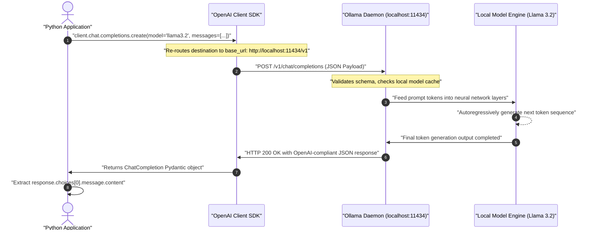

---

## Re-Routing the OpenAI Python SDK to Ollama

To execute requests against your local model, instantiate the standard `OpenAI` client class while overriding two key constructor parameters: `base_url` and `api_key`.

### The Mechanics of the Base URL and API Key

1. **`base_url` (`http://localhost:11434/v1`):** Overrides the default `https://api.openai.com/v1`. The trailing `/v1` reflects the OpenAI REST API routing convention where chat completions reside under `/v1/chat/completions`. Ollama handles the `/v1` path prefix and routes incoming traffic directly to its local completion engine.
2. **`api_key` (`"ollama"`):** Because Ollama runs entirely on your local machine, authentication and billing do not apply—no payment tokens, credits, or secret keys are checked. However, the official `openai` Python SDK requires a non-empty string during client instantiation to pass internal validation. Providing any non-empty string (e.g., `"ollama"` or `"dummy"`) satisfies the client check, while Ollama simply ignores the incoming `Authorization` header.

### Querying Llama 3.2 Locally

The following script connects to the local Ollama instance, passes a user message asking for a fun fact, and extracts the response from the local `llama3.2` model:

```python
from openai import OpenAI

# Define the local Ollama API endpoint
OLLAMA_BASE_URL = "http://localhost:11434/v1"

# Initialize the OpenAI client pointing to the local Ollama server
# A dummy api_key is supplied to satisfy the SDK's internal client validation
ollama_client = OpenAI(
    base_url=OLLAMA_BASE_URL,
    api_key="ollama"
)

# Execute the completion using the local llama3.2 weights
response = ollama_client.chat.completions.create(
    model="llama3.2",
    messages=[
        {"role": "user", "content": "Tell me a fun fact"}
    ]
)

# Extract and print the generated message content
message_content = response.choices[0].message.content
print(message_content)
```

```text
Did you know that there's a type of jellyfish that is biologically immortal?

The Turritopsis dohrnii, also known as the immortal jellyfish, can revert back to its juvenile polyp stage after reaching maturity. When faced with physical damage, disease, or starvation, its cells undergo a process called transdifferentiation, essentially allowing it to reset its biological clock and start life all over again.
```

> [!IMPORTANT]
> **Exact Model Name Match:** The `model` parameter passed to `chat.completions.create` must strictly match the name of the model installed in Ollama. If you downloaded `llama3.2:1b`, you must pass `model="llama3.2:1b"`. Passing a model tag that has not been pulled locally will cause Ollama to return a `404 Not Found` model error.

---

## Distilled Reasoning Models: Testing DeepSeek-R1 1.5B Locally

In addition to general-purpose conversational models, Ollama provides access to modern **reasoning models** that have undergone **knowledge distillation**.

### Understanding Model Distillation

Model distillation is a machine learning training technique where a compact, resource-efficient model (the student) is trained on reasoning traces, problem solutions, and chain-of-thought demonstrations generated by a significantly larger frontier model (the teacher).

The model designated as `deepseek-r1:1.5b` uses Alibaba Cloud's lightweight **Qwen 2.5 1.5B** open-source base architecture, which was then fine-tuned on extensive synthetic reasoning trajectories generated by the full 671-billion-parameter **DeepSeek-R1** model. This allows a 1.5-billion-parameter model running on a consumer laptop to emulate the structured reasoning style of massive frontier architectures.

```text
+-------------------------------------------------------------------------------+
|                             MODEL DISTILLATION                                |
|                                                                               |
|   +------------------------------------+                                      |
|   |          DeepSeek-R1               |  (Massive Frontier Teacher Model)     |
|   |         (671B Parameters)          |                                      |
|   +-----------------+------------------+                                      |
|                     |                                                         |
|                     | Generates detailed chain-of-thought solutions           |
|                     | and synthetic reasoning step data                       |
|                     v                                                         |
|   +------------------------------------+                                      |
|   |    High-Quality Reasoning Data     |                                      |
|   +-----------------+------------------+                                      |
|                     |                                                         |
|                     | Supervised Fine-Tuning (SFT) & Preference Optimization  |
|                     v                                                         |
|   +------------------------------------+                                      |
|   |       Qwen 2.5 1.5B Base           |  (Lightweight Student Architecture)  |
|   +-----------------+------------------+                                      |
|                     |                                                         |
|                     v                                                         |
|   +------------------------------------+                                      |
|   |      deepseek-r1:1.5b              |  (Compact Reasoning Model for Local  |
|   |  (Distilled Local Model)           |   Consumer Hardware)                 |
|   +------------------------------------+                                      |
+-------------------------------------------------------------------------------+
```

### Pulling and Executing DeepSeek-R1 1.5B

Download the distilled 1.5B model using `ollama pull`:

```bash
# Pull the distilled 1.5-billion parameter DeepSeek-R1 model
ollama pull deepseek-r1:1.5b
```

```text
pulling manifest
pulling aabd4de60c8f... 100% ▕█████████████████████████████████████████████████████████████████████▏ 1.1 GB
pulling 369ca49a34b3... 100% ▕█████████████████████████████████████████████████████████████████████▏  387 B
pulling 6e4c38e1172f... 100% ▕█████████████████████████████████████████████████████████████████████▏ 1.1 KB
verifying sha256 digest
writing manifest
success
```

Execute inference using the exact same OpenAI client instance, swapping only the `model` identifier:

```python
from openai import OpenAI

# Reuse the existing local Ollama client configuration
ollama_client = OpenAI(
    base_url="http://localhost:11434/v1",
    api_key="ollama"
)

# Call the distilled DeepSeek model
response = ollama_client.chat.completions.create(
    model="deepseek-r1:1.5b",
    messages=[
        {"role": "user", "content": "Tell me a fun fact"}
    ]
)

print(response.choices[0].message.content)
```

```text
Here's a fun fact for you: Did you know that the sun looks like a golden crown during sunset, with its gold-colored reflection on the horizon? The rest of the sky shows a pale yellow tint. This coloration changes as atmospheric conditions shift: when the sun is higher in the sky, Rayleigh scattering scatters blue light, making the direct light appear clearer, but when it sets near the horizon, sunlight travels through far more atmosphere, filtering out shorter wavelengths and leaving richer red and yellow tones.
```

### Observations on Model Capacity and Size Disparity

While `deepseek-r1:1.5b` successfully answers prompts, its prose and depth reflect its compact parameter budget:

- At 1.5 billion parameters, the model is roughly **1,000 times smaller** than flagship frontier models (which often exceed 1 to 2 trillion mixture-of-experts parameters).
- For straightforward prompts, summarization, and lightweight classification, distilled models offer impressive efficiency and zero operational cost.
- For complex multi-step logical deduction, long-context document synthesis, or advanced code generation, small local models are prone to hallucination or simplified logic.

---

## Engineering Trade-Offs: Local Inference vs. Cloud Frontier APIs

Choosing between local deployment via Ollama and managed cloud APIs involves fundamental engineering trade-offs across cost, privacy, operational overhead, and raw model capability.

| Engineering Dimension          | Local Deployment via Ollama (e.g., Llama 3.2 3B)                                                                             | Cloud Frontier APIs (e.g., OpenAI GPT-4o, Claude 3.5 Sonnet)                                                                              |
| :----------------------------- | :--------------------------------------------------------------------------------------------------------------------------- | :---------------------------------------------------------------------------------------------------------------------------------------- |
| **Data Privacy & Security**    | **Complete isolation:** Prompts and outputs never leave the local machine or internal subnet. Zero third-party data logging. | **Shared responsibility:** Data is transmitted over HTTPS to external vendor servers subject to cloud data-processing agreements.         |
| **Operational & Token Cost**   | **\$0 per token:** No recurring billing, credit card requirements, or monthly subscriptions.                                 | **Pay-as-you-go:** Charged strictly per 1,000 or 1,000,000 input/output tokens consumed.                                                  |
| **Network & Connectivity**     | **Fully offline capable:** Operates without internet connectivity once model weights are stored locally.                     | **Internet required:** Cannot function during ISP outages or inside air-gapped corporate environments without specialized endpoints.      |
| **Model Intelligence & Scale** | **Constrained:** Typically 1B to 8B parameters on consumer laptops. Suitable for basic tasks and targeted SLM workloads.     | **State-of-the-art:** Trillion-scale frontier architectures capable of nuanced multi-step reasoning, coding, and large-context synthesis. |
| **Hardware Constraints**       | **Local dependency:** Consumes host system RAM, GPU/Metal VRAM, and storage disk space. Performance scales with host chip.   | **Zero local overhead:** All compute happens in enterprise cloud data centers. Runs on any lightweight client device.                     |
| **Context Window Size**        | **Typically 4K to 128K tokens** (heavily constrained by available local RAM/Unified Memory for the KV cache).                | **128K to 2M+ tokens** with cloud infrastructure capable of caching massive documents efficiently.                                        |

### Comparison of Local Small Language Models

| Model Tag          | Base Architecture            | Parameter Count | Disk & RAM Footprint | Best Suited For                                                                          |
| :----------------- | :--------------------------- | :-------------- | :------------------- | :--------------------------------------------------------------------------------------- |
| `llama3.2:1b`      | Meta Llama 3.2               | 1.3 Billion     | ~1.3 GB              | Ultra-low memory systems, rapid local unit tests, lightweight text filtering.            |
| `llama3.2`         | Meta Llama 3.2               | 3.2 Billion     | ~2.0 GB              | General local chat, basic code assistance, webpage summarization, structured extraction. |
| `deepseek-r1:1.5b` | Alibaba Qwen 2.5 (Distilled) | 1.5 Billion     | ~1.1 GB              | Local reasoning exploration, math/logic prompts, evaluating chain-of-thought behavior.   |

> [!CAUTION]
> **Unified Memory and the KV Cache:** When running local models on Apple Silicon or standard PCs, memory usage is not limited to the static size of the model weights on disk. As the context window expands during long conversations or large document processing, the **KV (Key-Value) cache** allocates additional RAM dynamically. Running large context windows on 8 GB or 16 GB machines can cause memory swapping or sudden process termination if memory thresholds are exceeded.

---

## Hands-On Implementation: Building an Offline Website Summarizer

To demonstrate how the OpenAI client library interacts seamlessly with local models, we can adapt the end-to-end website summarizer built for OpenAI cloud endpoints to run entirely on your local machine using Ollama and `llama3.2`.

### Architecture of the Offline Pipeline

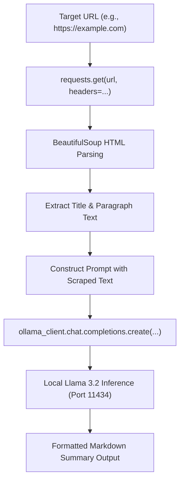

### Complete Implementation Code

This implementation uses `BeautifulSoup` to scrape website contents and passes the cleaned text to the local Ollama instance using the standard OpenAI client interface:

```python
import requests
from bs4 import BeautifulSoup
from openai import OpenAI

# Initialize the OpenAI client pointing to the local Ollama daemon
OLLAMA_BASE_URL = "http://localhost:11434/v1"
ollama_client = OpenAI(
    base_url=OLLAMA_BASE_URL,
    api_key="ollama"  # Required placeholder for SDK validation
)

def fetch_website_contents(url: str) -> str:
    """
    Downloads webpage HTML and extracts human-readable text.
    Filters out scripts, styles, and navigational elements.
    """
    headers = {
        "User-Agent": "Mozilla/5.0 (Macintosh; Intel Mac OS X 10_15_7) AppleWebKit/537.36"
    }
    response = requests.get(url, headers=headers, timeout=10)
    response.raise_for_status()

    soup = BeautifulSoup(response.text, "html.parser")

    # Remove non-content elements
    for element in soup(["script", "style", "nav", "footer", "header", "noscript"]):
        element.extract()

    # Extract page title and clean body text
    title = soup.title.string.strip() if soup.title and soup.title.string else "Untitled Page"
    paragraphs = [p.get_text().strip() for p in soup.find_all("p") if p.get_text().strip()]
    body_text = "\n\n".join(paragraphs)

    return f"Website Title: {title}\n\nContent:\n{body_text}"

def summarize_website_locally(url: str, model: str = "llama3.2") -> str:
    """
    Fetches website text and prompts the local Ollama model to generate
    an executive markdown summary.
    """
    raw_content = fetch_website_contents(url)

    # Cap context length to accommodate small model context windows
    truncated_content = raw_content[:4000]

    system_prompt = (
        "You are an expert technical editor. Summarize the provided webpage content "
        "into clear, professional GitHub-flavored Markdown. Include a one-paragraph overview "
        "followed by 3-5 key takeaways as bullet points."
    )

    user_prompt = f"Please summarize the following website contents:\n\n{truncated_content}"

    # Query the local Ollama model via OpenAI Chat Completions endpoint
    response = ollama_client.chat.completions.create(
        model=model,
        messages=[
            {"role": "system", "content": system_prompt},
            {"role": "user", "content": user_prompt}
        ],
        temperature=0.3
    )

    return response.choices[0].message.content

# Run the summarizer on an example domain
if __name__ == "__main__":
    test_url = "https://example.com"
    print(f"Scraping and summarizing {test_url} using local Ollama model...\n")
    summary = summarize_website_locally(test_url)
    print(summary)
```

```text
Scraping and summarizing https://example.com using local Ollama model...

# Example Domain Summary

This webpage serves as an illustrative example domain established by the Internet Assigned Numbers Authority (IANA) and the Internet Engineering Task Force (IETF). It is reserved for documentation, technical examples, and software testing without requiring prior coordination or permission.

### Key Takeaways
- **Reserved Status:** The domain is permanently maintained for illustrative examples in technical RFCs and documentation.
- **No Prior Registration Required:** Developers and authors may use this domain freely in code samples without registering ownership.
- **Informational Management:** Managed under the auspices of IANA to prevent domain squatting and ensure stable demonstration URLs.
```

### Prompt Customization and Community Contributions

When adapting this pipeline for specific workflows, experimenting with the system prompt allows you to alter the model's behavior dramatically:

- **Tone & Style:** Instruct the model to adopt the persona of an executive analyst, an investigative journalist, or a simplified teacher.
- **Translation:** Add explicit system constraints to output the summary in a target foreign language (e.g., Spanish, French, or Japanese).
- **Structured Schema:** Request strict JSON formatting for automated ingestion into relational databases or downstream agent workflows.

Once implemented and validated locally, community solutions and custom prompt variations can be submitted to project repositories under the `community-contributions` directory via standard GitHub Pull Requests (PRs).

---

## Review Quiz

<details>
<summary><b>Question 1: What does setting base_url="http://localhost:11434/v1" in the OpenAI client accomplish?</b></summary>
<br>
<b>Answer:</b> It redirects all HTTP REST requests generated by the OpenAI SDK away from OpenAI's cloud servers (<code>https://api.openai.com/v1</code>) and targets the local Ollama inference daemon listening on port <code>11434</code>. Because Ollama adheres to the standard OpenAI <code>/v1/chat/completions</code> schema, the client functions seamlessly without code modifications.
</details>

<details>
<summary><b>Question 2: Why must a non-empty api_key string be passed to the OpenAI constructor when connecting to Ollama?</b></summary>
<br>
<b>Answer:</b> The official <code>openai</code> Python library performs client-side validation on instantiation and raises an error if the <code>api_key</code> parameter is empty or <code>None</code>. While Ollama operates locally with no authentication and ignores the <code>Authorization: Bearer</code> header, a placeholder string (such as <code>"ollama"</code> or <code>"dummy"</code>) is required to satisfy the SDK's internal parameter check.
</details>

<details>
<summary><b>Question 3: If running ollama serve returns "listen tcp 127.0.0.1:11434: bind: address already in use", what does this signify and how should you respond?</b></summary>
<br>
<b>Answer:</b> It indicates that the Ollama background daemon is already running and actively listening on port <code>11434</code> (typically started as a background system service or launched through the macOS/Windows desktop application). No corrective action is required; the server is ready to accept incoming inference requests immediately.
</details>

<details>
<summary><b>Question 4: What is the technical distinction between a native frontier model and a distilled local model like deepseek-r1:1.5b?</b></summary>
<br>
<b>Answer:</b> A native frontier model (such as DeepSeek-R1 or GPT-4o) possesses hundreds of billions or trillions of parameters trained from scratch across enormous compute clusters. A distilled model like <code>deepseek-r1:1.5b</code> takes a compact base architecture (Alibaba's Qwen 2.5 1.5B) and fine-tunes it on high-quality synthetic reasoning chains generated by the massive teacher model, allowing it to mimic complex reasoning patterns within a footprint small enough for consumer hardware.
</details>

<details>
<summary><b>Question 5: What primary technical trade-off must an engineer accept when substituting a cloud frontier API with an offline 3B model like Llama 3.2?</b></summary>
<br>
<b>Answer:</b> The engineer trades superior reasoning capability, nuanced instruction-following, and massive context windows (frontier scale) for complete data privacy, offline autonomy, zero marginal token costs, and local hardware execution (small language model scale).
</details>

---

# Base, Chat, and Reasoning Models: Understanding LLM Types

## The Evolution of LLM Paradigms

Large Language Models are not monolithic engines; they exist in distinct architectural breeds shaped by their training objectives and intended deployment roles. Understanding these model categories is fundamental to LLM engineering, as choosing the incorrect breed can lead to degraded output quality, excessive token billing, or latency bottlenecks.

Modern generative AI has evolved through three foundational paradigms, culminating in today's adaptive hybrid systems:

```text
+-------------------------------------------------------------------------------+
|                           THE GENERATIVE LLM EVOLUTION                        |
|                                                                               |
|  1. BASE MODELS (Pre-Trained Predictors)                                      |
|     [ Unstructured Text Corpus ] ---> [ Next-Token Autoregression ]           |
|     * Function: Complete raw statistical sequence                             |
|     * Example: GPT-3, LLaMA-1 Base                                            |
|                                     |                                         |
|                                     v Supervised Fine-Tuning (SFT) & RLHF     |
|  2. CHAT & INSTRUCT MODELS (Conversational Agents)                            |
|     [ Structured Dialogue Roles: System | User | Assistant ]                  |
|     * Function: Follow direct instructions and engage in dialogue             |
|     * Example: ChatGPT (GPT-3.5/GPT-4), Claude 3.5 Sonnet, Llama 3.2 Instruct|
|                                     |                                         |
|                                     v Reinforcement Learning on Thought Chains|
|  3. REASONING MODELS (Thinking Systems)                                       |
|     [ Prompt ] ---> [ Intermediate Thinking Trace ] ---> [ Final Answer ]     |
|     * Function: Generate deliberate internal logic before answering           |
|     * Example: OpenAI o1 / o3-mini, DeepSeek-R1                               |
|                                     |                                         |
|                                     v Dynamic Test-Time Compute Routing       |
|  4. HYBRID MODELS (Adaptive Compute)                                          |
|     * Function: Dynamically scale reasoning budget based on query complexity  |
|     * Example: Gemini 2.5 Pro, GPT-4.5 / GPT-5                                |
+-------------------------------------------------------------------------------+
```

---

## Base Models: Pure Autoregressive Sequence Predictors

A **base model** (or foundation model) is an LLM that has undergone large-scale pre-training across vast, uncurated text and code corpora. Its solitary mathematical function is **autoregressive next-token prediction**: given an input sequence of tokens, it calculates probability distributions across its vocabulary to predict the most likely subsequent token.

### The Mental Model: Smartphone Predictive Text

The most intuitive analog to a base model is the predictive text feature on a modern smartphone keyboard:

```text
User Types:    "Hello there"
Keyboard Suggests: [ my | friend | hope ]
User Taps:     "friend"
Updated State: "Hello there friend"
Next Suggests: [ I | how | hope ]
```

When you repeatedly tap suggested words, the phone completes the sentence using local frequency statistics. A base model performs this exact operation, but utilizes deep multi-head self-attention mechanisms trained across trillions of web tokens.

### Historical Context: Prompting Early Foundation Models

Before OpenAI released ChatGPT in late 2022, developers interacted directly with base models such as raw **GPT-3** (`davinci`). Base models do not understand the conversational convention of "answering" a user. If given an instruction such as:

```text
Write a poem about distributed systems.
```

A pure base model might not write a poem. Instead, it might simply continue the text as if completing an exam paper or web forum thread:

```text
Also explain the CAP theorem.
Due date: October 24th.
Professor Smith's Office Hours: 2:00 PM - 4:00 PM.
```

To force a base model into answering questions, developers had to use **few-shot in-context learning** with artificial question-and-answer prefixes (`Q:` and `A:`):

```python
from openai import OpenAI

client = OpenAI()

# Simulating base model few-shot completion syntax
few_shot_prompt = """Q: What is the capital of France?
A: Paris.

Q: What is the capital of Japan?
A: Tokyo.

Q: What is the capital of Australia?
A:"""

# In legacy base models, the engine completes the pattern directly
print("Prompt fed to model:\n", few_shot_prompt)
```

```text
Prompt fed to model:
 Q: What is the capital of France?
A: Paris.

Q: What is the capital of Japan?
A: Tokyo.

Q: What is the capital of Australia?
A:
```

The model identifies the structural pattern in the sequence and predicts ` Canberra.` as the most probable continuation.

### When to Use Base Models

In modern engineering pipelines, end-user applications rarely interact with raw base models. However, base models remain indispensable in specific scenarios:

1. **Domain-Specific Pre-Training & Fine-Tuning:** When training a model from scratch on proprietary corporate records, legal statutes, or medical diagnoses, starting with an instruction-tuned model can bias the output. A base model provides an unconstrained substrate.
2. **Non-Conversational Syntax Engines:** Tasks like code autocomplete (e.g., Tab-completion in IDEs), molecular structure generation, or raw log completion operate more effectively as sequence continuations rather than chat dialogues.

---

## Chat and Instruct Models: Multi-Turn Dialogue via RLHF

To bridge the gap between raw statistical text continuation and practical human utility, researchers developed **Instruct** and **Chat** variants.

### The Alignment Process: SFT and RLHF

Transforming a base model into a chat model requires two primary post-training phases:

1. **Supervised Fine-Tuning (SFT):** The base model is trained on curated datasets of instruction-response pairs formatted as structured conversations.
2. **Reinforcement Learning from Human Feedback (RLHF):** Human evaluators score and rank model replies, training the model to follow instructions politely, accurately, and safely rather than rambling.

### The Standardized Role Hierarchy

Chat models introduced the standardized three-role conversation schema that underpins modern generative APIs:

```text
+-------------------------------------------------------------------------------+
|                       CHAT COMPLETIONS ROLE HIERARCHY                         |
|                                                                               |
|  +-------------------------------------------------------------------------+  |
|  | System Message: Defines persona, boundaries, tone, and operational rules|  |
|  +-------------------------------------------------------------------------+  |
|                                      |                                        |
|                                      v                                        |
|  +-------------------------------------------------------------------------+  |
|  | User Message: Expresses intent, queries, or task data from the human    |  |
|  +-------------------------------------------------------------------------+  |
|                                      |                                        |
|                                      v                                        |
|  +-------------------------------------------------------------------------+  |
|  | Assistant Message: Output generated by the aligned LLM                  |  |
|  +-------------------------------------------------------------------------+  |
|                                      |                                        |
|                                      v                                        |
|  +-------------------------------------------------------------------------+  |
|  | User Message (Turn 2): Follow-up inquiry maintaining context history    |  |
|  +-------------------------------------------------------------------------+  |
+-------------------------------------------------------------------------------+
```

### Implementing Chat Completions in Python

```python
from openai import OpenAI

client = OpenAI()

# Standard Chat Completions API multi-turn dialogue
response = client.chat.completions.create(
    model="gpt-4o-mini",
    messages=[
        {
            "role": "system",
            "content": "You are a concise engineering mentor. Explain concepts in one sentence."
        },
        {
            "role": "user",
            "content": "What is the primary difference between a base model and an instruct model?"
        }
    ],
    temperature=0.2
)

print(response.choices[0].message.content)
```

```text
A base model simply predicts the next word in an uncurated sequence of text, whereas an instruct model has been fine-tuned with human feedback to follow direct tasks and engage in conversational dialogue.
```

---

## Reasoning Models: Chain-of-Thought and Test-Time Compute

While chat models excel at conversational fluency and text generation, they struggle with complex, multi-step logical deduction, competitive mathematics, and intricate software architecture.

### The Chain-of-Thought Discovery

Early prompt engineers discovered a simple yet profound technique known as **Chain-of-Thought (CoT)** prompting: appending the phrase `"Please think step by step"` to a complex question drastically improved the model's accuracy.

Because autoregressive models predict one token at a time, forcing the model to generate intermediate mathematical or logical steps expands its **working memory** on the context window. When the model eventually generates the final answer token, it attends to its own previously generated reasoning tokens.

```text
Without CoT:
Prompt: "If John has 3 apples and eats 1, then buys 2 bags of 6 apples, how many does he have?"
Model jumps straight to final token: "15" (High probability of arithmetic error).

With CoT ("Think step by step"):
Model writes: "John starts with 3. Eats 1: 3 - 1 = 2. Buys 2 bags of 6: 2 * 6 = 12. Adds them: 2 + 12 = 14."
Final Answer: "14" (Correct, because it attends to verified prior tokens).
```

### Purpose-Built Reasoning Models

Rather than relying on users to prompt for step-by-step thinking, **Reasoning Models** (such as OpenAI's **o1**, **o3-mini**, and **DeepSeek-R1**) are trained to allocate internal **test-time compute**. Before emitting any user-facing tokens, the model autoregressively generates an extensive internal reasoning trace (often wrapped in `<think>` tags or stored in dedicated reasoning token fields).

```python
from openai import OpenAI

client = OpenAI()

# Executing a query against a purpose-built reasoning model
response = client.chat.completions.create(
    model="o3-mini",
    messages=[
        {
            "role": "user",
            "content": "How many 'r' letters are in the word 'strawberry'?"
        }
    ]
)

# Reasoning models natively deliberate internally before returning the answer
print(response.choices[0].message.content)
```

```text
There are 3 'r's in the word "strawberry".

Breakdown:
s - t - r (1) - a - w - b - e - r (2) - r (3) - y
```

---

## Hybrid Models and Dynamic Reasoning Allocation

Early reasoning models suffered from an operational limitation: they applied heavy reasoning chains to _every_ query, resulting in unnecessary delays for trivial greetings or simple lookups.

To resolve this, modern frontier architectures have adopted **hybrid reasoning models** (e.g., **Gemini 2.5 Pro**, **GPT-4.5 / GPT-5**). A hybrid model dynamically analyzes query complexity and adjusts its **reasoning budget** (or reasoning effort) on the fly:

- **Trivial Queries ("Hello"):** Bypasses reasoning traces, responding instantaneously like a standard chat model.
- **Moderate Complexity ("Draft a professional invoice template"):** Conducts brief structural planning before generating the document.
- **High Complexity ("Solve this multi-step logic and scheduling puzzle"):** Expands its internal token budget to thousands of reasoning steps, stress-testing edge cases before writing code or answering.

Developers can also control this allocation programmatically via the `reasoning_effort` parameter:

```python
from openai import OpenAI

client = OpenAI()

# Configuring explicit reasoning budget allocation
response = client.chat.completions.create(
    model="o3-mini",
    reasoning_effort="high",  # Options: 'low', 'medium', 'high'
    messages=[
        {
            "role": "user",
            "content": "A farmer needs to cross a river with a wolf, a goat, and a cabbage. How can he cross safely?"
        }
    ]
)

print(response.choices[0].message.content)
```

```text
Here is the step-by-step solution to get everyone across without leaving the wolf alone with the goat, or the goat alone with the cabbage:

1. Take the goat across and leave it on the other side. (Wolf and cabbage remain safely together).
2. Return alone to the starting side.
3. Take the wolf across to the other side.
4. Bring the goat back with you to the starting side.
5. Leave the goat, and take the cabbage across to the other side.
6. Return alone to the starting side.
7. Take the goat across for the final crossing.

Everyone and everything is safely across.
```

---

## Budget Forcing and the "Wait" Discovery (The s1 Paper)

One of the most consequential breakthroughs in modern test-time scaling occurred in January 2025 with the publication of the **`s1` research paper** (_s1: Simple test-time scaling_ by Muennighoff et al.).

### The Problem of Premature Termination

Reasoning models frequently encounter "premature convergence": while formulating an internal chain of thought, the model predicts the token indicating that thinking is finished (such as `</think>`) before thoroughly exploring alternative hypotheses or checking edge cases.

### The "Wait" Token Injection Mechanism

Researchers sought a method to force the model to continue reasoning—a process known as **Budget Forcing**. Rather than altering neural network weights or designing complex loss functions, the researchers discovered an astonishingly simple inference-time heuristic:

> **The "Wait" Discovery:** If you programmatically append the single word `"Wait"` into the model's generated thinking stream during decoding, the autoregressive probability distribution shifts. The model interprets `"Wait"` as a signal of internal hesitation, prompting it to re-evaluate its previous logic.

```text
+-------------------------------------------------------------------------------+
|                       BUDGET FORCING VIA "WAIT" INJECTION                     |
|                                                                               |
|  Step 1: Normal Reasoning Trace                                               |
|  "The integral evaluates to 4*pi. Therefore the final answer is..."           |
|                                                                               |
|  Step 2: External Controller Injects Token: "Wait,"                           |
|                                                                               |
|  Step 3: Autoregressive Continuation Shifts to Self-Reflection                |
|  "Wait, let me double check the boundary conditions on the cylindrical surface.|
|   Did I account for the z = 0 floor? Let me recalculate that term..."         |
|                                                                               |
|  Step 4: Model Self-Corrects and Arrives at Validated Answer                  |
+-------------------------------------------------------------------------------+
```

By periodically inserting `"Wait"` or suppressing stop tokens until a target token budget is reached, models demonstrated dramatic performance improvements across competitive mathematics (MATH benchmarks) and complex coding tasks without any additional parameter fine-tuning.

```python
def simulate_budget_forcing_trace(thinking_trace: str, force_reflection: bool = True) -> str:
    """
    Illustrates how budget forcing alters the continuation trajectory of a reasoning model.
    """
    if not force_reflection:
        return thinking_trace + "\nConclusion: The statement is verified."

    # Injected token triggers self-critical verification
    injected_token = "Wait, "
    simulated_continuation = (
        "let me reconsider the edge cases. What if the input array contains negative integers? "
        "In that case, the two-pointer approach needs to handle absolute values first. "
        "Let me re-verify before outputting the final algorithm."
    )

    return f"{thinking_trace} {injected_token}{simulated_continuation}\nConclusion: Algorithm refined with negative value guards."

trace = "Initial analysis indicates an O(N) two-pointer pass is sufficient."
print(simulate_budget_forcing_trace(trace, force_reflection=True))
```

```text
Initial analysis indicates an O(N) two-pointer pass is sufficient. Wait, let me reconsider the edge cases. What if the input array contains negative integers? In that case, the two-pointer approach needs to handle absolute values first. Let me re-verify before outputting the final algorithm.
Conclusion: Algorithm refined with negative value guards.
```

---

## Architectural Decision Framework: Selecting the Right LLM Type

Selecting the optimal model breed requires evaluating trade-offs between computational overhead, response latency, operational cost, and cognitive complexity.

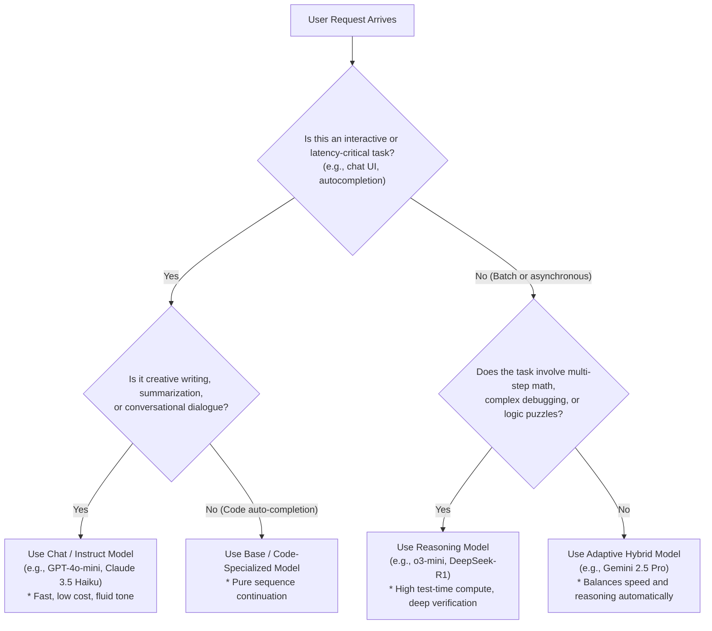

### Engineering Comparison: LLM Breeds

| Dimension                         | Base Models                                   | Chat / Instruct Models                                      | Reasoning Models                                                       | Hybrid Models                                                       |
| :-------------------------------- | :-------------------------------------------- | :---------------------------------------------------------- | :--------------------------------------------------------------------- | :------------------------------------------------------------------ |
| **Primary Objective**             | Statistical next-token text prediction.       | Multi-turn instruction following & conversational dialogue. | Deliberate multi-step logic & problem solving.                         | Dynamic scaling between speed and deep reasoning.                   |
| **Alignment Method**              | Unsupervised pre-training only.               | Supervised Fine-Tuning (SFT) + RLHF.                        | Reinforcement learning on step-by-step thinking traces.                | Dynamic internal routing based on query difficulty.                 |
| **Prompt Construct**              | Raw text or few-shot `Q: ... A:` prefixes.    | Structured roles: `system`, `user`, `assistant`.            | User directives; system prompts often restricted.                      | Full role schema + `reasoning_effort` knobs.                        |
| **Inference Latency**             | **Lowest:** Emits answer tokens immediately.  | **Low:** Minimal generation delay before streaming.         | **High:** Extended latency while generating internal reasoning traces. | **Variable:** Instant for basic queries; delayed for complex tasks. |
| **Token Cost Profile**            | Billed strictly for prompt and output tokens. | Billed strictly for prompt and visible output tokens.       | Billed for prompt, **hidden thinking tokens**, and visible output.     | Dynamically adapts token consumption to query difficulty.           |
| **Creative / Fluid Writing**      | Moderate (prone to rambling or repeating).    | **Optimal:** Warm, engaging, fluid, and natural prose.      | Sub-optimal: Can produce overly analytical, "cold", or rigid answers.  | Strong: Adjusts tone based on instructions and task mode.           |
| **Mathematical / Logic Accuracy** | Low (frequently hallucinates arithmetic).     | Moderate (struggles with multi-step edge cases).            | **State-of-the-art:** Capable of self-correction and formal proofs.    | **Near State-of-the-art:** Deep verification on complex problems.   |

> [!IMPORTANT]
> **Thinking Tokens Incur Financial Cost:** In commercial reasoning models (such as OpenAI's `o1` and `o3-mini`), internal reasoning tokens generated during the thinking phase are counted and billed as output tokens, even though they are frequently hidden from the end user in the final API response. Always monitor total token consumption metrics (`usage.completion_tokens_details.reasoning_tokens`) when budgeting production workloads.

> [!TIP]
> **Beware of Overthinking on Creative Tasks:** Deploying a high-budget reasoning model for tasks such as drafting sales emails, marketing copy, or casual dialogue often produces overly pedantic, stiff, or cold responses. For creative tasks where there is no single mathematically verifiable answer, high-speed chat models (like Claude 3.5 Sonnet or GPT-4o) consistently outperform reasoning models in tone and fluidity.

---

## Review Quiz

<details>
<summary><b>Question 1: Why did early developers use explicit "Q:" and "A:" prefixes when prompting base models like GPT-3?</b></summary>
<br>
<b>Answer:</b> Base models are purely autoregressive sequence completers that do not inherently recognize conversational turn-taking. Structuring the prompt with repeated <code>Q: ... A:</code> examples establishes an in-context statistical pattern, compelling the model to predict the desired answer text as the most probable sequence continuation.
</details>

<details>
<summary><b>Question 2: What are the three core role abstractions introduced by the Chat Completions standard, and what purpose does each serve?</b></summary>
<br>
<b>Answer:</b> 
1. <b>System:</b> Sets the overarching behavioral boundary, tone, constraints, and instructions for the entire interaction.
2. <b>User:</b> Encapsulates inputs, queries, or task data supplied by the human.
3. <b>Assistant:</b> Stores responses generated by the model, maintaining conversation history across multi-turn exchanges.
</details>

<details>
<summary><b>Question 3: How does Chain-of-Thought (CoT) prompting improve an LLM's performance on multi-step reasoning problems?</b></summary>
<br>
<b>Answer:</b> Because LLMs generate text token by token, forcing the model to articulate intermediate steps adds those reasoning tokens directly into its context window. When the model ultimately predicts the final answer token, its self-attention heads can attend directly to its own validated intermediate deductions rather than attempting to jump across multiple logical leaps in a single step.
</details>

<details>
<summary><b>Question 4: What is "Budget Forcing", and what simple mechanism was uncovered in the January 2025 "s1" research paper?</b></summary>
<br>
<b>Answer:</b> Budget forcing is the practice of artificially compelling a reasoning model to expand its test-time compute and think longer. The <code>s1</code> paper demonstrated that inserting the single token <code>"Wait"</code> into the model's generated thinking trace reliably triggers self-reflection and re-examination (e.g., <i>"Wait, let me double-check this assumption..."</i>), significantly improving accuracy on complex benchmarks without modifying model weights.
</details>

<details>
<summary><b>Question 5: Under what operational circumstances should an engineer prefer a standard Chat model over a specialized Reasoning model?</b></summary>
<br>
<b>Answer:</b> Chat models are preferred when low latency and rapid time-to-first-token are essential (real-time chat interfaces), when minimizing token costs is critical (avoiding billed thinking tokens), and for creative or conversational writing tasks where reasoning models tend to sound rigid, overthought, or pedantic.
</details>

---

# Frontier Models: Capabilities, Hallucination Risks, and Engineering Supervision

## The Frontier Landscape and Product Ecosystem

Frontier (or foundation) models represent the cutting edge of artificial intelligence. Developed by a small group of well-capitalized research labs, these flagship models drive both conversational web products and developer APIs:

- **OpenAI:** Operates **ChatGPT**. Features **GPT-5** (hybrid chat/reasoning), **GPT-4.1** (fast pure chat optimized for low-latency interactive tasks), the **o-series** (`o1`, `o3-mini` pure reasoning), and open-weight models (**OpenAI OSS**).
- **Anthropic:** Operates **Claude.ai**. Offers tiered model sizes: **Haiku** (high speed, low cost), **Sonnet** (balanced engineering and coding benchmark leader), and **Opus** (complex multi-step reasoning).
- **Google:** Operates **Gemini** (formerly Gemini Advanced). Models span **Gemini 2.5** and **Gemini 3**, featuring native multimodality and massive context windows.
- **xAI:** Operates **Grok** integrated into the X platform (_spelled with a 'k'_, distinct from the inference hardware provider Groq spelled with a 'q').
- **DeepSeek:** The open-source frontier exception. Releases open weights for its flagship models (**DeepSeek-V3**, **DeepSeek-R1**) accessible via local runtimes or web chat.

---

## Core Strengths of Frontier Models

1. **Information Synthesis:** Compressing unstructured documents into structured, multi-perspective technical summaries.
2. **Drafting and Ideation:** Scaffolding project architectures, email briefs, and technical proposals in seconds.
3. **Coding and Autonomous Iteration:** Writing, debugging, and testing code inside automated loops—largely supplanting traditional developer forums like Stack Overflow.

---

## Critical Pitfalls: Cutoffs, Plausibility, and the "Rabbit Hole"

Despite their capabilities, frontier models present distinct engineering failure modes:

- **Knowledge Cutoffs:** Models have static training horizons. When asked about recent libraries or APIs, they may hallucinate obsolete patterns (e.g., reverting modern client code to outdated legacy endpoints) unless augmented by external retrieval or web search tools.
- **Plausibility vs. Factuality:** Autoregressive models are trained to output _statistically plausible_ text, not verified truth. Consequently, hallucinations are delivered with absolute, authoritative confidence.
- **The "Rabbit Hole" Phenomenon:** LLMs tend to apply myopic local band-aids to compiler or runtime errors instead of identifying high-level root causes.

```text
+-------------------------------------------------------------------------------+
|                       THE "RABBIT HOLE" FAILURE PATTERN                       |
|                                                                               |
|  [ User Mistake ]: Passes Chat roles to a Base model (e.g., llama-base)       |
|                                                                               |
|  [ Unsupervised LLM Response ]:                                               |
|  - Fails to diagnose: "Wrong model identifier!"                               |
|  - Instead hallucinates 4 pages of hacky token-formatting boilerplate to       |
|    force a base model to behave like a chat engine.                           |
|  - Result: Fragile, unmaintainable code and wasted engineering cycles.         |
|                                                                               |
|  [ Senior Supervised Correction ]:                                            |
|  - Steps back, catches the error, updates model tag to "llama-instruct".      |
+-------------------------------------------------------------------------------+
```

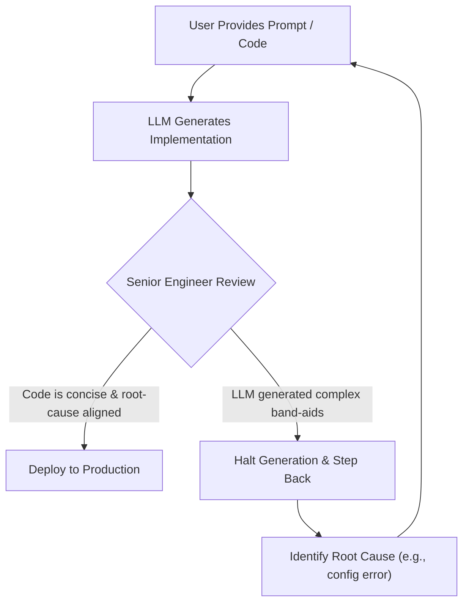

---

## The "Tireless Junior Analyst" Mental Model

The most effective engineering paradigm is to treat frontier LLMs as **tireless junior analysts**:

- **Unsupervised Junior Developers:** Risk getting trapped in hallucinated tangents, misinterpreting multi-page boilerplate as legitimate technical progress.
- **Supervised Senior Engineers:** Use LLMs for rapid first drafts and mechanical implementations, while actively challenging assumptions, auditing edge cases, and steering architecture.

---

## Defensive Implementation: Model Verification Guardrails

To prevent LLMs from generating complex workarounds for simple configuration mistakes, implement defensive pre-flight validation before dispatching prompts:

```python
from openai import OpenAI

client = OpenAI()

# Verified catalog of active chat-compatible model targets
SUPPORTED_CHAT_MODELS = {
    "gpt-4o",
    "gpt-4o-mini",
    "o3-mini",
    "llama3.2",
    "deepseek-r1:1.5b"
}

def execute_chat_safely(model_tag: str, prompt: str) -> str:
    """
    Validates model compatibility before invoking API to avoid
    costly runtime failure loops and hallucinated workarounds.
    """
    # Defensive pre-flight check
    if model_tag not in SUPPORTED_CHAT_MODELS:
        raise ValueError(
            f"Invalid target: '{model_tag}'. Chat completion requires an "
            f"instruct/chat model. Supported targets: {sorted(SUPPORTED_CHAT_MODELS)}"
        )

    response = client.chat.completions.create(
        model=model_tag,
        messages=[{"role": "user", "content": prompt}],
        temperature=0.2
    )
    return response.choices[0].message.content

# Example test run
if __name__ == "__main__":
    test_model = "gpt-4o-mini"
    print(f"Querying validated model: {test_model}...\n")
    output = execute_chat_safely(test_model, "State the primary role of a software architect in one sentence.")
    print(f"Output:\n{output}")
```

```text
Querying validated model: gpt-4o-mini...

Output:
A software architect defines the high-level technical vision, system structure, and core standards to ensure software is scalable, reliable, and aligned with business goals.
```

---

## Frontier Labs Comparison

| Lab / Provider | Flagship Model            | Primary Chat UI | Core Differentiator                                                   | Common Engineering Pitfall                                                 |
| :------------- | :------------------------ | :-------------- | :-------------------------------------------------------------------- | :------------------------------------------------------------------------- |
| **OpenAI**     | GPT-5 / GPT-4.1 / o3-mini | ChatGPT         | Industry benchmark, rich multimodal tool support.                     | Reasoning models introduce latency; GPT-4.1 preferred for quick chats.     |
| **Anthropic**  | Claude 3.5 / 4.5 Sonnet   | Claude.ai       | Leading software engineering and coding benchmark scores.             | Strict safety filters may occasionally refuse ambiguous prompts.           |
| **Google**     | Gemini 2.5 / 3.0 Pro      | Gemini          | Massive context windows (1M+ tokens), native multimodal audio/video.  | Knowledge cutoff lapses can lead to suggesting deprecated SDK methods.     |
| **xAI**        | Grok 2 / 3                | Grok            | Real-time X (Twitter) social data access, unconstrained tone.         | High bias toward current social media sentiment over static documentation. |
| **DeepSeek**   | DeepSeek-V3 / R1          | DeepSeek        | Open-weight frontier intelligence with competitive math/logic scores. | High traffic spikes on public API; local self-hosting requires high VRAM.  |

> [!IMPORTANT]
> **Static Cutoff vs. Live Search:** Built-in web browsing in chat products (ChatGPT, Gemini) is external scaffolding added by application engineers, not a property of the underlying neural network. API calls directly to the model cannot browse the web unless external tool-use is configured.

> [!TIP]
> **Optimize for Interactivity with Pure Chat Models:** While hybrid models dynamically allocate reasoning, pure chat models (like GPT-4.1 or Claude 3.5 Haiku) remain superior for low-latency interactive tasks where time-to-first-token is critical.

> [!CAUTION]
> **Beware Hallucinated Dependencies:** LLMs frequently invent non-existent Python packages or combine methods from incompatible library versions. Always verify third-party package names against PyPI before executing generated shell commands.

---

## Review Quiz

<details>
<summary><b>Question 1: What is the primary difference between a pure chat model (such as GPT-4.1) and a hybrid model (such as GPT-5)?</b></summary>
<br>
<b>Answer:</b> A pure chat model emits answer tokens immediately without generating internal thinking steps, minimizing latency. A hybrid model dynamically assesses query difficulty and generates intermediate reasoning tokens when dealing with complex tasks before producing the final response.
</details>

<details>
<summary><b>Question 2: Why are LLMs prone to hallucinating answers with high confidence rather than expressing uncertainty?</b></summary>
<br>
<b>Answer:</b> LLMs are trained to maximize token plausibility—predicting the most statistically probable continuation of a text sequence. They lack an intrinsic epistemological model of absolute truth, so plausible falsehoods are generated with the exact same fluent, authoritative tone as verified facts.
</details>

<details>
<summary><b>Question 3: In the "Rabbit Hole" failure case study, what caused the LLM to generate pages of unnecessary code?</b></summary>
<br>
<b>Answer:</b> The developer accidentally targeted a base model instead of a chat/instruct variant. Instead of diagnosing the misconfigured model name, the LLM attempted to fix the surface-level symptom by writing complex boilerplate to manufacture chat tokens for a base model.
</details>

<details>
<summary><b>Question 4: Why do frontier models perform more reliably when paired with senior developers compared to junior developers?</b></summary>
<br>
<b>Answer:</b> Senior developers possess the domain knowledge to recognize architectural tangents, catch subtle hallucinations, and verify outputs, using the LLM as a fast assistant. Inexperienced developers risk assuming generated boilerplate is valid progress and can be led astray.
</details>

<details>
<summary><b>Question 5: Does a native frontier model API call have real-time access to the live internet by default?</b></summary>
<br>
<b>Answer:</b> No. The underlying weights are bounded by their training cutoff date. Web search capabilities in consumer products like ChatGPT or Gemini are external tools orchestrating search queries and injecting snippets into the prompt context.
</details>

---

# Understanding Transformers: Architecture, Self-Attention, and LLM Evolution

## The Core Foundations: Deconstructing GPT

Modern generative artificial intelligence is anchored on the **GPT** architectural paradigm. Deconstructing the acronym reveals the three core engineering pillars of modern language modeling:

- **G (Generative):** The model operates autoregressively, predicting the next token in a sequence given the preceding context. It generates text, code, or structured data token-by-token.
- **P (Pre-trained):** The neural network is trained on massive, internet-scale datasets (terabytes of unstructured text, documentation, books, and code) via unsupervised objective functions before any fine-tuning occurs.
- **T (Transformer):** The underlying deep learning architecture that makes training on billions of parameters computationally tractable.

```text
+-------------------------------------------------------------------------------+
|                            THE GPT ARCHITECTURE TRIAD                         |
|                                                                               |
|   [ G ] GENERATIVE             [ P ] PRE-TRAINED         [ T ] TRANSFORMER    |
|   Autoregressive token         Petabyte-scale uncurated  Self-attention       |
|   prediction:                  web & code corpus:        architecture:        |
|   P(token_t | tokens_<t)       Unsupervised objectives   Parallelized compute |
+-------------------------------------------------------------------------------+
```

---

## Evolution: From Classical Statistics to Deep Neural Networks

To appreciate why the Transformer revolutionized artificial intelligence, consider the computational lineage that preceded it:

### Traditional Statistical Models

Classical data science relied on explicit statistical algorithms (such as linear regression, logistic regression, decision trees, and random forests). These models evaluated hand-engineered tabular features—such as estimating credit risk based on income, debt ratio, and credit history. While effective for structured tabular data, they struggled to handle unstructured human language, code, or images.

### Artificial Neural Networks and Deep Learning

First conceptualized in the 1950s, artificial neural networks connect layers of simple computational units ("artificial neurons") parameterized by adjustable weights and biases. By stacking multiple layers of these connected algorithms on top of each other, researchers created **Deep Neural Networks** (Deep Learning). Stacking more layers enabled networks to automatically learn deeper and more nuanced patterns in data.

### The Sequential Bottleneck: RNNs and LSTMs

Before 2017, the predominant models for language were **Recurrent Neural Networks (RNNs)** and **Long Short-Term Memory (LSTM)** networks. These models processed text sequentially, word by word:

`Token 1 -> Hidden State 1 -> Token 2 -> Hidden State 2 -> Token 3 -> ...`

This sequential processing introduced two major limitations:

- **Difficulty with Long Sequences:** As sentences and paragraphs grew longer, information from early words tended to wash out or get lost before reaching the end.
- **Inability to Parallelize:** To process the second word, the computer strictly had to wait for the first word's calculation to finish. Because steps could not be calculated concurrently in parallel, training models on massive web-scale datasets was impossibly slow.

---

## The 2017 Breakthrough: "Attention Is All You Need"

In 2017, a team of researchers at Google published the landmark paper _Attention Is All You Need_ (Vaswani et al.).

```text
+-------------------------------------------------------------------------------+
|                      RECURRENCE (RNN) VS. ATTENTION (TRANSFORMER)             |
|                                                                               |
|  Sequential RNN Pipeline (Slow, Step-by-Step Dependency):                     |
|  [ Token 1 ] ---> [ Token 2 ] ---> [ Token 3 ] ---> [ Token 4 ]               |
|                                                                               |
|  Parallel Transformer Self-Attention (All-at-Once Processing):                |
|  +---------------------------------------------------------------------------+|
|  | [ Token 1 ]          [ Token 2 ]          [ Token 3 ]          [ Token 4 ]||
|  +-------+-------------------+-------------------+-------------------+-------+|
|          |                   |                   |                   |        |
|          +===================+===================+===================+        |
|                                      |                                        |
|                          ALL-TO-ALL SELF-ATTENTION                            |
|             (Evaluates word relationships simultaneously in parallel)         |
+-------------------------------------------------------------------------------+
```

The authors did not initially realize that their architectural proposal would redefine the entire computing industry; they viewed it primarily as a clever optimization for machine translation (such as translating English to German).

### The Intuition of Self-Attention

Instead of passing information forward step-by-step through a chain, the Transformer uses an **Attention Layer** (Self-Attention).

This layer allows the model to look across all the words in the input sequence at the same time and calculate which words should "pay attention" to which other words:

- When reading the sentence _"The animal didn't cross the street because it was too tired"_, the attention mechanism enables the model to connect the word _"it"_ directly back to _"animal"_.
- If the sentence ends with _"because it was too wide"_, the attention layer shifts focus so that _"it"_ connects to _"street"_.

Because every word can look at every other word directly, and all calculations can happen simultaneously as matrix multiplications, computers and GPUs can process huge volumes of text in parallel.

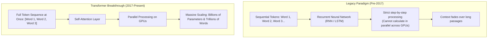

---

## The OpenAI GPT Scaling Timeline

Following Google's architectural discovery, OpenAI focused on scaling the Transformer decoder through generative pre-training:

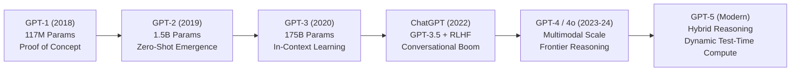

- **GPT-1 (2018, 117M Parameters):** Proved that pre-training a transformer on raw, uncurated web text and then fine-tuning it on specific tasks worked dramatically better than custom task-specific algorithms.
- **GPT-2 (2019, 1.5B Parameters):** Showed that as the model grew, it could perform translation, summarization, and question answering directly without task-specific fine-tuning (zero-shot learning).
- **GPT-3 (2020, 175B Parameters):** Proved empirical scaling laws—scaling parameters, datasets, and compute produced predictable leaps in capability and enabled few-shot learning directly from prompts.
- **ChatGPT / GPT-3.5 (2022):** Combined pre-trained transformers with **Reinforcement Learning from Human Feedback (RLHF)**, transforming raw text predictors into intuitive conversational assistants.
- **GPT-4 & GPT-4o (2023–2024):** Expanded into multimodal capabilities, natively understanding text, vision, and real-time audio.
- **GPT-5 & Hybrid Architectures:** Combines high-speed conversational responses with deliberate test-time reasoning.

---

## Is the Transformer Fundamental or an Efficiency Optimization?

A key insight in AI engineering is that the Transformer is **an efficiency optimization**, not a unique biological truth:

- **An Efficiency Play:** The Transformer succeeded because attention can be calculated in parallel across computer hardware. It removed the bottleneck of learning step-by-step, making it possible to train models on vastly more data at much lower cost.
- **Alternative Approaches Exist:** Researchers continue to explore alternative architectures (such as State Space Models like Mamba, and hybrid recurrent-attention models) that try to make inference even faster over very long documents.
- **Current Industry Dominance:** While alternatives exist, the Transformer remains the reigning architecture across virtually all major frontier LLMs because of its proven reliability and hardware efficiency.

---

## Hands-On Python Implementation: Simulating an Attention Map

To build intuition for how attention connects words in a sentence, the following Python program simulates an attention relationship map showing how a model links pronouns to their antecedent nouns:

```python
def display_attention_weights(sentence: str, focus_word: str, affinities: dict[str, float]):
    """
    Visualizes how a focus word in a sequence pays attention to surrounding words.
    """
    words = sentence.split()
    print(f"Sentence: \"{sentence}\"")
    print(f"Analyzing Attention for Word: '{focus_word}'\n" + "-" * 50)

    for word in words:
        clean_word = word.strip(".,!?").lower()
        weight = affinities.get(clean_word, 0.05)
        bar = "█" * int(weight * 30)
        print(f"  {word:<10} | {weight:4.2f} | {bar}")
    print("-" * 50)

if __name__ == "__main__":
    test_sentence = "The animal did not cross the street because it was too tired."

    # In this sentence, 'it' refers to 'animal' because of 'tired'
    simulated_attention_for_it = {
        "the": 0.02,
        "animal": 0.68,   # Highest attention weight
        "did": 0.01,
        "not": 0.01,
        "cross": 0.05,
        "street": 0.08,
        "because": 0.03,
        "it": 0.02,
        "was": 0.01,
        "too": 0.01,
        "tired": 0.08
    }

    display_attention_weights(test_sentence, focus_word="it", affinities=simulated_attention_for_it)
```

```text
Sentence: "The animal did not cross the street because it was too tired."
Analyzing Attention for Word: 'it'
--------------------------------------------------
  The        | 0.02 |
  animal     | 0.68 | ████████████████████
  did        | 0.01 |
  not        | 0.01 |
  cross      | 0.05 | █
  the        | 0.02 |
  street     | 0.08 | ██
  because    | 0.03 |
  it         | 0.02 |
  was        | 0.01 |
  too        | 0.01 |
  tired      | 0.08 | ██
--------------------------------------------------
```

By calculating these attention links across all words in parallel, the model understands the context and relationships across the whole sentence simultaneously.

---

## Architectural Comparison Matrix

| Architecture Dimension       | Traditional Statistics              | Recurrent Models (RNN / LSTM)                | Transformer Architecture                         | Emerging State Space Models (e.g., Mamba)      |
| :--------------------------- | :---------------------------------- | :------------------------------------------- | :----------------------------------------------- | :--------------------------------------------- |
| **Sequence Processing**      | Non-sequential (Tabular features)   | Sequential (Word by word)                    | **All-at-once parallel attention**               | Compressed continuous state tracking           |
| **Hardware Parallelization** | Simple (Tabular CPU/GPU batches)    | **Poor** (Each word waits for previous word) | **Optimal** (Matrix multiplications in parallel) | High (Parallel scans across hardware)          |
| **Context Retention**        | N/A (Hand-crafted tabular factors)  | Tends to degrade over long passages          | **Direct links between all words**               | Retains long context via compressed memory     |
| **Primary Industry Role**    | Structured analytics & tabular data | Largely replaced for modern LLMs             | **Predominant frontier standard**                | Active research for edge & long-document tasks |

> [!IMPORTANT]
> **Attention as an Efficiency Breakthrough:** The Transformer was revolutionary not because it discovered a biological secret of intelligence, but because it made training on massive datasets computationally efficient by running in parallel on hardware.

> [!TIP]
> **Why RLHF Changed Everything:** Scaling model weights alone produced powerful base models that were prone to rambling or uncooperative responses. Reinforcement Learning from Human Feedback (RLHF) was the critical alignment bridge that turned raw sequence completion engines into helpful, conversational assistants.

> [!CAUTION]
> **Long Context Memory Demands:** While parallel attention is fast, evaluating every word against every other word requires significant computer memory as documents get very long. Modern systems manage this using optimized memory caching techniques.

---

## Review Quiz

<details>
<summary><b>Question 1: What do the letters G, P, and T stand for, and what engineering role does each represent?</b></summary>
<br>
<b>Answer:</b> 
1. <b>Generative:</b> Predicts the next token to generate natural text, code, or structured responses.
2. <b>Pre-trained:</b> Trained on massive amounts of uncurated text and code from the internet before any fine-tuning.
3. <b>Transformer:</b> The underlying neural network architecture that uses self-attention to process words in parallel.
</details>

<details>
<summary><b>Question 2: What was the primary computational limitation of Recurrent Neural Networks (RNNs) that the Transformer solved?</b></summary>
<br>
<b>Answer:</b> RNNs process sequences one word at a time, where computing the state for the current word requires waiting for the previous word to finish. This sequential dependency prevented parallel execution across computer hardware and made training on large datasets too slow. The Transformer replaced sequential processing with self-attention, allowing all words to be processed concurrently in parallel.
</details>

<details>
<summary><b>Question 3: What does the self-attention layer do in a Transformer?</b></summary>
<br>
<b>Answer:</b> The self-attention layer allows the model to look across all words in an input sequence simultaneously and determine which words are most relevant to each other (such as linking a pronoun like <i>"it"</i> to the correct noun in a sentence), regardless of how far apart they are.
</details>

<details>
<summary><b>Question 4: Why do AI engineers describe the Transformer as an "efficiency optimization" rather than a fundamental biological truth?</b></summary>
<br>
<b>Answer:</b> The Transformer does not mimic unique biological cognitive functions; rather, it was a clever architectural design that mapped efficiently to computer hardware. By allowing calculations to run in parallel rather than step-by-step, it allowed models to be trained on vastly more data and parameters much faster and cheaper.
</details>

<details>
<summary><b>Question 5: What critical post-training technique was introduced with ChatGPT to align GPT-3 into a conversational assistant?</b></summary>
<br>
<b>Answer:</b> Reinforcement Learning from Human Feedback (RLHF). While GPT-3 was a raw base predictor trained simply to complete text sequences, RLHF aligned model behavior with human intent by scoring candidate responses and training the model to follow multi-turn conversational instructions.
</details>

---

# From LSTMs to Transformers: Attention, Emergent Intelligence, and Agentic AI

## The Architectural Pivot: Why the Simpler Model Won

Before the Transformer revolution, the most common model used for language was the **Long Short-Term Memory (LSTM)** network, a specialized type of Recurrent Neural Network (RNN).

### The Power and Fatal Bottleneck of LSTMs

LSTMs were sophisticated architectures designed with internal memory cells to remember relationships across a sequence of words. Many practitioners considered LSTMs conceptually deeper and more capable of tracking nuanced grammar than simple feed-forward networks.

However, LSTMs had one fatal bottleneck: **they had to process text strictly step-by-step**.

```text
+-------------------------------------------------------------------------------+
|                      THE SEQUENTIAL LSTM BOTTLENECK                           |
|                                                                               |
|  Token 1 --------> Token 2 --------> Token 3 --------> Token 4                |
|     |                 |                 |                 |                   |
|     v                 v                 v                 v                   |
|  [LSTM Step 1] --> [LSTM Step 2] --> [LSTM Step 3] --> [LSTM Step 4]          |
|  (Output 1)       (Needs Step 1!)   (Needs Step 2!)   (Needs Step 3!)         |
|                                                                               |
|  * Fatal Engineering Limitation: Cannot calculate steps in parallel.          |
|  * Training on billions of words would take decades of compute time.          |
+-------------------------------------------------------------------------------+
```

Because the output from one word had to be fed into the next word before the next calculation could begin, calculations could not be run in parallel. This made training large models on vast internet datasets virtually impossible.

### The Meaning Behind "Attention Is All You Need"

The Transformer was not an increase in clever complexity—**it was an intentional simplification**.

The Google researchers realized that they could drop the complex step-by-step recurrent machinery entirely. A simpler mechanism—**Attention**—was good enough to capture relationships across a sequence.

Because attention evaluates all words simultaneously, it could be parallelized across computer hardware. The title _Attention Is All You Need_ essentially argued: _We don't need all this clever sequential machinery; simple attention is enough, and because it runs in parallel, we can scale it to massive sizes._

---

## The "Stochastic Parrots" Debate and Emergent Intelligence

As Transformers scaled, the public and research communities engaged in intense debate over the nature of generative AI:

### The "Stochastic Parrots" Critique

In 2021, an influential research paper (_On the Dangers of Stochastic Parrots_) warned that language models are essentially:

- Statistical echo chambers that repeat patterns from internet training text without real comprehension.
- "Predictive text on steroids" that string together plausible-sounding words based purely on probabilities.

```text
+-------------------------------------------------------------------------------+
|                      PLAUSIBILITY VERSUS EMERGENT TRUTH                       |
|                                                                               |
|  Small Model Scale (Millions of Parameters):                                  |
|  Prompt: "Solve 48 * 27 - 15"                                                 |
|  Output: "The calculated total equals 1,420."                                 |
|  Result: Plausible-sounding words that mimic math, but mathematically WRONG.  |
|                                                                               |
|  Frontier Scale (Hundreds of Billions of Parameters):                         |
|  Prompt: "Solve 48 * 27 - 15"                                                 |
|  Output: "48 * 27 = 1296. 1296 - 15 = 1281."                                  |
|  Result: Accurately calculates the true arithmetic result.                    |
+-------------------------------------------------------------------------------+
```

### The Mystery of Emergent Intelligence

While the critique accurately pointed out that models are trained simply to predict likely next words, it did not predict what actually happens when you scale a model up:

- **From Plausibility to Truth:** With smaller models, you get plausible-sounding text (words that look like an answer). With massive models trained on billions of parameters, the model unexpectedly starts generating the **correct, accurate answer** to math, logic, and coding problems.
- **Emergent Intelligence:** When an artificial neural network becomes large enough, it develops the ability to simulate genuine problem-solving. Why predicting the next most likely token so frequently produces genuine, accurate reasoning remains one of the most fascinating phenomena in modern AI.

---

## The Evolution of Human-AI Engineering Paradigms

As the capabilities of foundation models accelerated, the engineering interfaces through which humans interact with LLMs evolved through four distinct epochs:

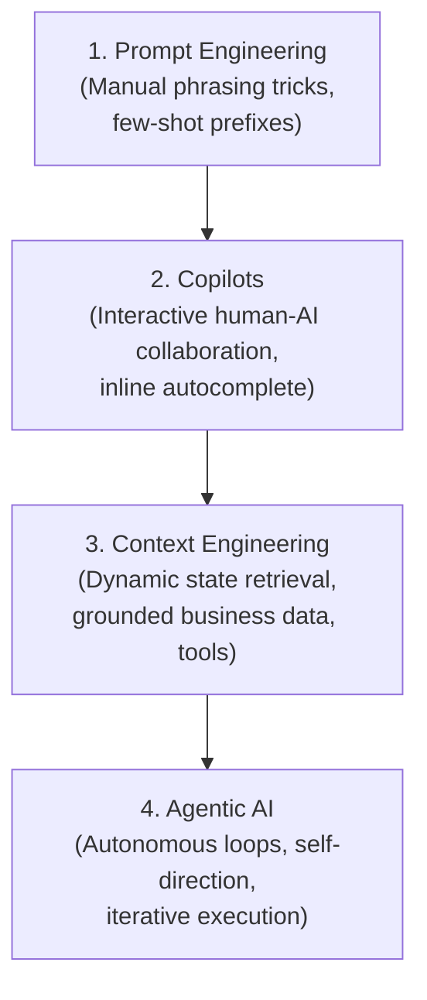

### Epoch 1: Prompt Engineering

In the early days of LLM adoption, "Prompt Engineer" emerged briefly as a six-figure job title. Practitioners discovered heuristic phrasing hacks (e.g., _"Act as a world-class expert"_, _"Take a deep breath"_, _"Think step by step"_). Today, prompt engineering is no longer an isolated profession; it is a foundational baseline skill practiced by all software engineers.

### Epoch 2: Copilots

Pioneered by GitHub Copilot and Microsoft Copilot, this paradigm embedded LLMs directly into developer workflows. The model acts as an interactive assistant: the human maintains cognitive control, while the AI accelerates boilerplate generation, suggests syntax, and drafts documentation.

### Epoch 3: Context Engineering

The modern successor to prompt engineering is **Context Engineering**. Instead of tweaking superficial words in a prompt, engineers design robust software pipelines that dynamically assemble the precise context an LLM needs to make accurate predictions:

- Querying vector stores and relational databases for live operational data.
- Injecting real-time parameters (e.g., current account balances, actual flight ticket pricing) so the LLM does not hallucinate outdated values.
- Exposing structured API schemas that the LLM can invoke.

### Epoch 4: Agentic AI

The current frontier of artificial intelligence centers on **Agentic AI**. There are two widely accepted engineering definitions of an agent:

1. **Workflow Controller:** An architecture where an LLM is responsible for routing logic, deciding conditional branching, and delegating sub-tasks across multiple models or microservices.
2. **LLM in an Autonomous Loop:** An LLM deployed inside an iterative execution loop equipped with external tools. The agent formulates a plan, executes actions, observes environment feedback, reflects on errors, and iterates until the objective is completed.

Modern tools like **Claude Code**, **Devin**, and automated software assistants operate on this exact loop: planning a to-do list, inspecting files, running terminal commands, and verifying test results autonomously.

---

## Deconstructing the Autonomous Agent Loop

```text
+-------------------------------------------------------------------------------+
|                          THE AUTONOMOUS AGENT LOOP                            |
|                                                                               |
|                +--------------------------------------------+                 |
|                |            Human Objective / Goal          |                 |
|                +---------------------+----------------------+                 |
|                                      |                                        |
|                                      v                                        |
|  +-------------------------> [ Agent Context ] <---------------------------+  |
|  |                           - Conversation History                        |  |
|  |                           - Available Tool Definitions                  |  |
|  |                           - Environmental Observations                  |  |
|  |                                   |                                     |  |
|  |                                   v                                     |  |
|  |                           [ LLM Inference ]                             |  |
|  |                   "What is the next logical step?"                      |  |
|  |                                   |                                     |  |
|  |                  +----------------+----------------+                    |  |
|  |                  |                                 |                    |  |
|  |                  v                                 v                    |  |
|  |         [ Emits Tool Call ]             [ Emits Final Answer ]          |  |
|  |                  |                                 |                    |  |
|  |                  v                                 v                    |  |
|  |        [ Tool Execution Core ]                 [ Complete ]             |  |
|  |        - Query Database                                                 |  |
|  |        - Run Shell Command                                              |  |
|  |        - Execute HTTP Request                                           |  |
|  |                  |                                                      |  |
|  +------------------+                                                      |  |
|       Returns Output / Error Trace                                         |  |
+-------------------------------------------------------------------------------+
```

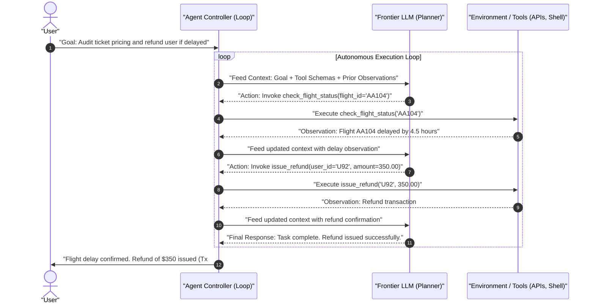

---

## Hands-On Implementation: Building an Autonomous Agent Loop

The following complete Python program demonstrates an autonomous agent loop from scratch. The agent receives a high-level user request, dynamically selects and invokes tools, processes observations, and iterates until the task is solved:

```python
import json
from openai import OpenAI

client = OpenAI()

# 1. Define external business tools available to the agent
def get_flight_ticket_price(destination: str) -> str:
    """Simulates querying a live flight pricing database."""
    prices = {
        "paris": "$450 USD (Economy), $1,200 USD (Business)",
        "tokyo": "$850 USD (Economy), $2,400 USD (Business)",
        "london": "$520 USD (Economy), $1,400 USD (Business)"
    }
    dest_key = destination.lower().strip()
    return prices.get(dest_key, f"No active flights found for '{destination}'.")

def convert_currency(amount_usd: float, target_currency: str) -> str:
    """Simulates a live foreign currency conversion service."""
    rates = {"EUR": 0.92, "GBP": 0.78, "JPY": 152.50}
    currency = target_currency.upper().strip()
    if currency in rates:
        converted = amount_usd * rates[currency]
        return f"{amount_usd} USD = {converted:.2f} {currency}"
    return f"Unsupported currency '{target_currency}'."

# Map tool names to callable Python functions
TOOL_REGISTRY = {
    "get_flight_ticket_price": get_flight_ticket_price,
    "convert_currency": convert_currency
}

# 2. Define standard OpenAI Tool Schemas (Context Engineering)
tools_schema = [
    {
        "type": "function",
        "function": {
            "name": "get_flight_ticket_price",
            "description": "Look up live flight ticket prices for a target destination city.",
            "parameters": {
                "type": "object",
                "properties": {
                    "destination": {
                        "type": "string",
                        "description": "The destination city name (e.g., Paris, Tokyo, London)"
                    }
                },
                "required": ["destination"]
            }
        }
    },
    {
        "type": "function",
        "function": {
            "name": "convert_currency",
            "description": "Convert an amount in USD to a foreign target currency (EUR, GBP, JPY).",
            "parameters": {
                "type": "object",
                "properties": {
                    "amount_usd": {
                        "type": "number",
                        "description": "The dollar amount in USD to convert"
                    },
                    "target_currency": {
                        "type": "string",
                        "description": "The 3-letter currency code (e.g., EUR, GBP, JPY)"
                    }
                },
                "required": ["amount_usd", "target_currency"]
            }
        }
    }
]

# 3. The Autonomous Agent Execution Loop
def run_agent_loop(user_goal: str, max_iterations: int = 5) -> str:
    """
    Executes an autonomous agent loop: calls the model, executes requested tools,
    feeds results back into context, and repeats until completion.
    """
    messages = [
        {
            "role": "system",
            "content": (
                "You are an autonomous travel coordinator agent. "
                "Use the provided tools to gather required live data before answering. "
                "Execute as many steps as necessary to fulfill the user's request."
            )
        },
        {"role": "user", "content": user_goal}
    ]

    print(f"[User Goal]: {user_goal}\n" + "=" * 60)

    for step in range(1, max_iterations + 1):
        print(f"\n[Loop Turn {step}]: Querying LLM...")

        response = client.chat.completions.create(
            model="gpt-4o-mini",
            messages=messages,
            tools=tools_schema,
            tool_choice="auto"
        )

        response_message = response.choices[0].message
        messages.append(response_message)

        # Check if the model concluded execution with a text answer
        if not response_message.tool_calls:
            print("[Loop Concluded]: Model generated final response.")
            return response_message.content

        # Handle tool execution requests autonomously
        for tool_call in response_message.tool_calls:
            func_name = tool_call.function.name
            raw_args = tool_call.function.arguments
            args = json.loads(raw_args)
            call_id = tool_call.id

            print(f"  -> Agent requests tool: {func_name}({args})")

            # Execute tool from local registry
            tool_func = TOOL_REGISTRY.get(func_name)
            if tool_func:
                observation = tool_func(**args)
            else:
                observation = f"Error: Tool '{func_name}' is not recognized."

            print(f"  <- Tool Output: {observation}")

            # Feed observation back into context history
            messages.append({
                "role": "tool",
                "tool_call_id": call_id,
                "content": str(observation)
            })

    return "Agent reached maximum execution turns without concluding."

# Execute the agent loop on a multi-step objective
if __name__ == "__main__":
    goal = "How much does an Economy flight to Tokyo cost in Japanese Yen (JPY)?"
    final_result = run_agent_loop(goal)
    print("\n" + "=" * 60)
    print(f"[Final Result]:\n{final_result}")
```

```text
[User Goal]: How much does an Economy flight to Tokyo cost in Japanese Yen (JPY)?
============================================================

[Loop Turn 1]: Querying LLM...
  -> Agent requests tool: get_flight_ticket_price({'destination': 'Tokyo'})
  <- Tool Output: $850 USD (Economy), $2,400 USD (Business)

[Loop Turn 2]: Querying LLM...
  -> Agent requests tool: convert_currency({'amount_usd': 850, 'target_currency': 'JPY'})
  <- Tool Output: 850 USD = 129625.00 JPY

[Loop Turn 3]: Querying LLM...
[Loop Concluded]: Model generated final response.

============================================================
[Final Result]:
An Economy flight to Tokyo costs $850 USD, which is approximately 129,625 Japanese Yen (JPY).
```

---

## Paradigm Comparison Matrix

| Engineering Paradigm    | Human Involvement                                               | Core Developer Responsibility                                                           | Autonomy Level                                | Primary Failure Mode                                                     |
| :---------------------- | :-------------------------------------------------------------- | :-------------------------------------------------------------------------------------- | :-------------------------------------------- | :----------------------------------------------------------------------- |
| **Prompt Engineering**  | Continuous (Every query manually phrased)                       | Crafting prompt templates, role descriptions, and output formatting instructions.       | **None** (Static single-turn call)            | Format drift, instruction neglect on long prompts.                       |
| **Copilots**            | Active & Interactive (Human-in-the-loop pair programming)       | Accepting, rejecting, or editing inline suggestions generated by the model.             | **Low** (Assists within active user session)  | Suggesting syntactically valid but insecure/outdated code.               |
| **Context Engineering** | Architectural & Pipeline Design                                 | Building dynamic retrieval pipelines (RAG, database lookups, tool definitions).         | **Medium** (Grounded inference per turn)      | Retrieval noise, stale context, token budget exhaustion.                 |
| **Agentic AI**          | Supervisory / Goal-Oriented (Defines objective and constraints) | Designing robust tool APIs, state managers, validation guardrails, and exit conditions. | **High** (Iterative self-direction in a loop) | Infinite loops, compounding execution errors, unauthorized tool actions. |

> [!IMPORTANT]
> **Grounding Prevents Hallucination:** The most effective defense against hallucination is not clever prompt wording, but **Context Engineering**. By programmatically fetching verified real-world facts (e.g., ticket prices, inventory levels) and inserting them into the message context before inference, the model merely summarizes grounded truth rather than inventing data.

> [!TIP]
> **Always Implement Max-Iteration Guardrails:** In any agentic loop, always enforce a strict upper bound on iterations (e.g., `max_iterations = 5` or `10`). Without loop bounds, an agent that encounters a confusing tool error can easily loop indefinitely, depleting API credits.

> [!CAUTION]
> **Tool Execution Privileges:** Granting an autonomous agent write access to databases or shell environments introduces real-world risk. Always apply the principle of least privilege: isolate agent tools to read-only endpoints unless explicit human confirmation guardrails are configured for destructive actions.

---

## Review Quiz

<details>
<summary><b>Question 1: What was the primary reason the simpler Transformer architecture replaced the mathematically sophisticated LSTM?</b></summary>
<br>
<b>Answer:</b> LSTMs suffered from a strict sequential bottleneck: processing each word required waiting for the output of the preceding word, making parallel training across GPU clusters impossible. The Transformer replaced recurrence with self-attention, which computes relationships between all words simultaneously. This allowed massive parallelization, enabling models to scale to billions of parameters and terabytes of training data.
</details>

<details>
<summary><b>Question 2: What was the core premise of the "Stochastic Parrots" critique, and where did it fail in its prediction?</b></summary>
<br>
<b>Answer:</b> The critique argued that LLMs are merely statistical regurgitators of web data, combining high-probability words without true comprehension or semantic grounding. It failed because it did not anticipate <i>Emergent Intelligence</i>: at massive scale, predicting next words accurately over vast amounts of text forces the model to construct internal representations of logic, arithmetic, and world knowledge, allowing it to generate accurate, verified solutions to complex problems rather than just superficial syntax.
</details>

<details>
<summary><b>Question 3: How does "Context Engineering" differ fundamentally from legacy "Prompt Engineering"?</b></summary>
<br>
<b>Answer:</b> Prompt engineering focuses primarily on the stylistic wording and phrasing of questions (e.g., persona prompts, step-by-step instructions). Context engineering is a software engineering discipline focused on dynamically assembling the full informational payload required for accurate inference: integrating live database records, API tool definitions, vector embeddings, and operational constraints into the prompt context at runtime.
</details>

<details>
<summary><b>Question 4: What are the two predominant engineering definitions of Agentic AI?</b></summary>
<br>
<b>Answer:</b> 
1. <b>Workflow Controller:</b> An architecture where an LLM dynamically controls system execution flow, routing tasks, and delegating sub-problems to external tools or models.
2. <b>LLM in an Autonomous Loop:</b> A system where an LLM is placed inside an iterative loop with access to external tools, allowing it to plan actions, execute tool calls, observe outcomes, self-correct, and iterate autonomously until completing a goal.
</details>

<details>
<summary><b>Question 5: Why is enforcing an explicit max_iterations limit essential in autonomous agent loops?</b></summary>
<br>
<b>Answer:</b> Because autonomous agents determine their own stopping condition based on environment observations. If a tool fails repeatedly or returns ambiguous outputs, the agent can become trapped in an infinite execution cycle, continually querying the LLM and depleting API budgets or overwhelming downstream services.
</details>

---

# Parameter Scaling: From Millions to Trillions in GPT, Llama, and DeepSeek

## Deconstructing Parameters: The Controls of Neural Networks

In machine learning and large language models, a **parameter** refers to an internal numerical control (weights and biases) stored inside the neural network. During training, the computer adjusts these numbers millions or billions of times so the model gets better at predicting the next word.

### Contrast with Traditional Machine Learning

The jump from traditional data science to modern large language models represents an astonishing leap in scale:

- **Traditional Machine Learning:** Typically used **20 to 200 parameters**. For example, a model estimating someone's credit score might look at 20 or 30 factors (income, debt ratio, payment history).
- **Modern Large Language Models:** Span from **hundreds of millions to tens of trillions of parameters**. Rather than a handful of rules, these parameters form massive interconnected networks that capture language, facts, code, and reasoning patterns.

```text
+-------------------------------------------------------------------------------+
|                       THE PARAMETER SCALE TRANSITION                          |
|                                                                               |
|  [ Traditional Machine Learning ]        [ Modern Large Language Models ]     |
|  - 20 to 200 parameters                  - Hundreds of millions to trillions  |
|  - Explicit tabular factors (e.g., loan) - Massive neural network weights     |
|  - Runs instantly on standard CPUs       - Requires dedicated GPU memory      |
+-------------------------------------------------------------------------------+
```

---

## The Exponential Parameter Explosion

Since the introduction of the Transformer in 2017, the size of language models has grown at an exponential rate:

```text
10^13 +-----------------------------------------------------------------------+
      |                                                      * Frontier Labs  |
10^12 |                                              * GPT-4  (1.76T MoE)     |
      |                                                                       |
10^11 |                                      * GPT-3 (175B)                   |
      |                                                                       |
10^10 |                              * Llama-3.1 (8B)                         |
      |                      * GPT-2 (1.5B)                                   |
10^9  |              * Llama-3.2 (3B)                                         |
      |      * GPT-1 (117M)                                                   |
10^8  |  * Gemma (270M)                                                       |
      +-----------------------------------------------------------------------+
        2018       2019       2020     2021     2022     2023     2024   2025
```

- **GPT-1 (2018):** 117 Million parameters. Considered huge at the time.
- **GPT-2 (2019):** 1.5 Billion parameters (over 10 times larger).
- **GPT-3 (2020):** 175 Billion parameters (over 100 times larger than GPT-2).
- **GPT-4 (2023):** ~1.76 Trillion parameters, organized as a Mixture of Experts.
- **Modern Frontier Models (2025–Present):** Estimated to reach into the tens of trillions of parameters.

### Doing More with Less: Parameter Efficiency

While more parameters generally mean a more capable model, newer models have become vastly more efficient at packing knowledge into fewer parameters:

- **Google Gemma 270M:** At only 270 million parameters, it is less than one-fifth the size of GPT-2 (1.5 billion), yet it is far more capable than GPT-2 ever was.
- **Meta Llama 3.2 3B:** Delivers performance that rivals older models that were twenty times its size.

Because pre-training datasets are cleaner, tokenizers are better, and training techniques have matured, modern models achieve much higher intelligence with fewer parameters.

---

## The Two Orthogonal Axes of AI Scaling

Getting more intelligence out of an AI model does not just mean training a bigger model. Modern AI engineering scales along two independent (orthogonal) tracks:

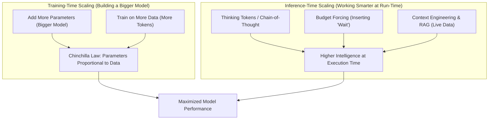

### Training-Time Scaling

Training-time scaling happens _before_ the model is released:

- **Parameter Scale:** Giving the model more parameters allows it to absorb more training information.
- **Chinchilla Scaling Laws (DeepMind, 2022):** Research showed that the number of parameters should scale roughly in proportion to the amount of training data. In other words, to get the best performance, a bigger model needs proportionally more training text.

### Inference-Time Scaling

Inference-time scaling happens _when you run the model_:

- **Reasoning Traces:** Allowing the model to output intermediate thinking steps before answering.
- **Budget Forcing:** Prompting or compelling the model to deliberate longer (such as inserting the word `"Wait"` into the thought trace to trigger self-reflection).
- **Context Engineering & RAG:** Supplying relevant external facts (such as real-time ticket prices or database records) in the prompt so the model bases its answers on verified data.

Both tracks can be used together: you can run inference-time reasoning on a model that was already scaled at training time.

---

## The Logarithmic Model Landscape

Because model parameters span from millions to trillions, they are best understood on a **logarithmic scale**, where every major tick mark represents a 10x increase in size:

```text
+-------------------------------------------------------------------------------+
|                      THE LOGARITHMIC PARAMETER SPECTRUM                       |
|                                                                               |
|  Scale Range      Representative Models             Where It Typically Runs   |
|  ---------------------------------------------------------------------------  |
|  100M - 1B        Gemma 270M, Llama 3.2 1B          Phones, edge devices      |
|  1B - 10B         Llama 3.2 3B, Llama 3.1 8B        Laptops, local Ollama     |
|  10B - 100B       GPT-OSS 20B, Llama 3.3 70B        Dedicated GPU workstations|
|  100B - 1T        GPT-OSS 120B, DeepSeek-R1 (671B)  Multi-GPU servers         |
|  1T - 10T+        GPT-4, Claude Opus, Gemini 2.5    Massive cloud data centers|
+-------------------------------------------------------------------------------+
```

### Mixture of Experts (MoE) Architecture

When a model grows to hundreds of billions of parameters, calculating every single parameter for every single word becomes extremely slow and expensive.

To solve this, modern frontier models (like **DeepSeek-R1** and **GPT-4**) use a **Mixture of Experts (MoE)** architecture:

```text
+-------------------------------------------------------------------------------+
|                      DENSE VS. MIXTURE OF EXPERTS (MoE)                       |
|                                                                               |
|  Dense Architecture:                                                          |
|  Input ---> [ All 671 Billion Parameters Active for Every Word ] ---> Output  |
|             * Very slow and compute-heavy at run-time.                        |
|                                                                               |
|  Mixture of Experts (MoE) Architecture:                                       |
|             +---------> [ Expert 1 (Math) ]                                   |
|  Input ---> | Router -> [ Expert 2 (Code) ] ------------------------> Output  |
|             +---------> [ Expert 3 (Language) ]                               |
|  * Only ~37 Billion parameters activated per word out of 671B total.          |
|  * Combines the knowledge of a huge model with the speed of a smaller one.   |
+-------------------------------------------------------------------------------+
```

Inside an MoE model, there are many smaller sub-models ("experts"). A router inspects the incoming text and activates only the experts relevant to the question. For example, DeepSeek-R1 has **671 billion total parameters**, but only activates around **37 billion parameters** for any given token, making it run significantly faster.

---

## Hands-On Python Implementation: Comparing Model Parameter Scales

The following Python script models the logarithmic parameter scale of modern open-source and frontier models, illustrating how orders of magnitude compare:

```python
import math

def compare_models(models: list[dict]):
    """
    Compares LLM parameter sizes across logarithmic orders of magnitude.
    """
    print(f"{'Model Name':<20} | {'Total Params':<14} | {'Active Params':<14} | {'Log10 Scale'}")
    print("-" * 65)

    for m in models:
        total_b = m["total_b"]
        active_b = m.get("active_b", total_b)

        # Calculate log10 magnitude (e.g. 1B = 9.0, 10B = 10.0, 100B = 11.0)
        log_val = math.log10(total_b * 1e9)
        bar = "█" * int((log_val - 8) * 5)

        total_str = f"{total_b:g} Billion" if total_b >= 1 else f"{int(total_b * 1000)} Million"
        active_str = f"{active_b:g} Billion" if active_b >= 1 else f"{int(active_b * 1000)} Million"

        print(f"{m['name']:<20} | {total_str:<14} | {active_str:<14} | {bar}")

if __name__ == "__main__":
    model_catalog = [
        {"name": "Gemma 270M",      "total_b": 0.27},
        {"name": "Llama 3.2 3B",    "total_b": 3.0},
        {"name": "Llama 3.1 8B",    "total_b": 8.0},
        {"name": "GPT-OSS 20B",     "total_b": 20.0},
        {"name": "Llama 3.3 70B",   "total_b": 70.0},
        {"name": "GPT-OSS 120B",    "total_b": 120.0},
        {"name": "DeepSeek-R1",     "total_b": 671.0, "active_b": 37.0},
        {"name": "GPT-4 (MoE)",     "total_b": 1760.0, "active_b": 220.0}
    ]

    compare_models(model_catalog)
```

```text
Model Name           | Total Params   | Active Params  | Log10 Scale
-----------------------------------------------------------------
Gemma 270M           | 270 Million    | 270 Million    | ██
Llama 3.2 3B         | 3 Billion      | 3 Billion      | ███████
Llama 3.1 8B         | 8 Billion      | 8 Billion      | █████████
GPT-OSS 20B          | 20 Billion     | 20 Billion     | ███████████
Llama 3.3 70B        | 70 Billion     | 70 Billion     | ██████████████
GPT-OSS 120B         | 120 Billion    | 120 Billion    | ███████████████
DeepSeek-R1          | 671 Billion    | 37 Billion     | ███████████████████
GPT-4 (MoE)          | 1760 Billion   | 220 Billion    | █████████████████████
```

---

## Architectural Comparison Matrix

| Model Tier               | Representative Models              | Parameter Range               | Typical Execution Environment       | Primary Use Case                                                |
| :----------------------- | :--------------------------------- | :---------------------------- | :---------------------------------- | :-------------------------------------------------------------- |
| **Edge & Lightweight**   | Google Gemma 270M, Llama 3.2 1B    | 200M – 1.5B                   | Mobile phones, edge devices         | Fast text filtering, embedded tasks, quick unit tests.          |
| **Local Desktop Models** | Llama 3.2 3B, Llama 3.1 8B         | 3B – 8B                       | Laptops, local Ollama               | Local chat, summarization, offline private assistance.          |
| **Mid-Size Workhorse**   | Llama 3.3 70B, GPT-OSS 120B        | 70B – 120B                    | Single GPU workstation / cloud node | Enterprise customer service, high-accuracy document processing. |
| **Open Flagship MoE**    | DeepSeek-V3 / R1                   | 671B (37B active)             | Multi-GPU server clusters           | High-level reasoning, code generation, complex math.            |
| **Frontier Cloud**       | GPT-5, Claude 3.5 Opus, Gemini 2.5 | Tens of Trillions (Estimated) | Hyperscale data centers             | Frontier multi-step reasoning, multimodal tasks.                |

> [!IMPORTANT]
> **Parameters Require Memory:** The parameter count directly dictates how much memory is required to hold the model. While an 8B model fits comfortably in a modern laptop's RAM, running a 70B or 671B model requires specialized server hardware.

> [!TIP]
> **Bigger Isn't Always Necessary:** A modern, compact model trained on clean data (like Llama 3.1 8B) will often outperform a much older, larger model while running significantly faster and costing far less.

> [!CAUTION]
> **MoE Memory Footprint:** While Mixture of Experts models only activate a subset of parameters during generation, the entire parameter set must still be loaded into memory. Running DeepSeek-R1 requires enough memory to store all 671 billion parameters, even though only 37 billion compute each word.

---

## Review Quiz

<details>
<summary><b>Question 1: What is a parameter in an LLM, and how does the scale compare to traditional machine learning?</b></summary>
<br>
<b>Answer:</b> A parameter is an internal adjustable numerical weight inside the neural network that controls how it processes text. While traditional machine learning models used 20 to 200 parameters (such as factors determining a credit score), modern LLMs use millions, billions, or trillions of parameters.
</details>

<details>
<summary><b>Question 2: Why can a modern 270M parameter model (like Google Gemma) outperform a 1.5B parameter model from 2019 (like GPT-2)?</b></summary>
<br>
<b>Answer:</b> Modern models have much higher parameter efficiency. Due to cleaner training datasets, better data curation, and improved architectures, today's models pack far more capability and knowledge into a smaller number of parameters.
</details>

<details>
<summary><b>Question 3: What is the core principle established by the Chinchilla scaling laws?</b></summary>
<br>
<b>Answer:</b> Compute-optimal training requires scaling model parameters and training data in roughly equal proportions. Simply making a model larger without feeding it proportionally more training data is inefficient; smaller models trained on more data often perform better.
</details>

<details>
<summary><b>Question 4: What is the difference between Training-Time Scaling and Inference-Time Scaling?</b></summary>
<br>
<b>Answer:</b> Training-time scaling improves a model before it is released by increasing parameter size and training data. Inference-time scaling improves performance dynamically when running the model, using techniques like thinking traces (Chain of Thought), budget forcing (such as adding "Wait"), and supplying live context (RAG).
</details>

<details>
<summary><b>Question 5: How does a Mixture of Experts (MoE) architecture allow DeepSeek-R1 to run faster than a standard 671B parameter model?</b></summary>
<br>
<b>Answer:</b> Instead of computing every parameter for every word, an MoE model activates only a small subset of specialized sub-models ("experts") based on the input. In DeepSeek-R1, only about 37 billion parameters are active per token out of 671 billion total, giving the knowledge breadth of a massive model with the speed of a smaller one.
</details>

---

# What Are Tokens: From Characters to GPT's Subword Tokenizer

## The Fundamental Need for Tokenization

Large Language Models do not read, process, or generate text as human-readable strings. Deep neural networks consist strictly of mathematical operations—matrix multiplications, non-linear activations, and tensor dot products. Consequently, any input text must first be converted into a discrete numerical representation before it can enter the neural network.

The process of segmenting a continuous stream of text into discrete atomic chunks and mapping each chunk to a unique integer identifier is called **tokenization**. The resulting integers are known as **Token IDs**.

```text
+-------------------------------------------------------------------------------+
|                       THE TEXT-TO-VECTOR TRANSFORMATION                       |
|                                                                               |
|  Raw String:     "Hello, world!"                                              |
|                         |                                                     |
|                         v   [ Tokenizer (Vocabulary Lookup) ]                 |
|  Token Chunks:   ["Hello", ",", " world", "!"]                                |
|                         |                                                     |
|                         v                                                     |
|  Token IDs:      [9906, 11, 1917, 0]    (Discrete Integers)                   |
|                         |                                                     |
|                         v   [ Embedding Layer ]                               |
|  Dense Vectors:  [[0.12, -0.94, ...], ...] (High-Dimensional Number Vectors)  |
+-------------------------------------------------------------------------------+
```

---

## The Evolution of Text Encoding Paradigms

Throughout the history of Natural Language Processing (NLP), researchers explored three primary paradigms to convert text into numerical inputs:

### Character-Level Tokenization

In early recurrent neural networks, text was fed into models letter-by-letter, digit-by-digit.

- **Advantages:** Exceptionally compact vocabulary table (only ~100 to 256 tokens covering ASCII lowercase, uppercase, digits, and punctuation). Zero **Out-Of-Vocabulary (OOV)** words, as any word can be spelled out.
- **The Bottleneck:** Placed an immense learning burden on the network. The model had to learn spelling (how characters combine into words), grammar, and high-level reasoning all at once. Furthermore, sequence lengths exploded: a 500-word essay required ~2,500 sequential tokens, quickly consuming computer memory and filling up context windows.

### Word-Level Tokenization

The opposite approach mapped every unique whole word in a dictionary to a distinct integer ID.

- **Advantages:** Compact sequence lengths; every token represents an intuitive semantic concept.
- **The Bottleneck:** Severe vocabulary explosion. Human languages contain hundreds of thousands of base words, compounded by verb tenses, plurals, slang, proper nouns, and typos. Dictionaries could easily exceed 1,000,000 entries. To keep memory tractable, rare words were truncated and replaced with an Out-Of-Vocabulary placeholder token (`<UNK>`), permanently erasing critical semantic information.

### Subword Tokenization: The Modern Standard

Modern LLMs adopt **Subword Tokenization**, a data-driven middle ground between individual characters and whole words.

- High-frequency words (e.g., `"the"`, `"apple"`, `"developer"`) are assigned their own single token.
- Less common words are automatically decomposed into frequent prefixes, stems, and suffixes (e.g., `"unbelievable"` → `["un", "believ", "able"]`).
- Rare proper nouns or technical jargon fall back to smaller fragments or individual bytes.
- **Why It Won:** Provides a bounded, manageable vocabulary size (typically 32,000 to 200,000 tokens), produces manageable sequence lengths, and completely eliminates `<UNK>` errors.

---

## Critical Disambiguation: Tokens vs. Vectors

A frequent point of confusion among engineers is conflating **tokens** with **vectors (embeddings)**. They represent two entirely separate stages in the model's forward pass:

```text
+-------------------------------------------------------------------------------+
|                            TOKENS VERSUS VECTORS                              |
|                                                                               |
|  Dimension            Token (Token ID)            Vector (Embedding)          |
|  ---------------------------------------------------------------------------  |
|  Data Type            Integer (e.g., 9906)        Float Array (e.g., 1536-dim)|
|  Location             Outside / Input to Model    Inside Neural Network       |
|  Function             Dictionary lookup index     Dense semantic coordinates  |
|  Semantic Geometry    No distance metrics         Cosine similarity / math    |
+-------------------------------------------------------------------------------+
```

A **token** is merely a static scalar integer that acts as a row index in the model's embedding matrix. A **vector** is a continuous, high-dimensional coordinate generated by looking up that token ID, capturing geometric relationships where semantically similar concepts (like `"king"` and `"queen"`) cluster together in vector space.

---

## Inside GPT's Tokenizer: Byte Pair Encoding (BPE)

OpenAI models (including GPT-3.5, GPT-4, GPT-4o, and modern reasoning variants) utilize a variant of the **Byte Pair Encoding (BPE)** algorithm:

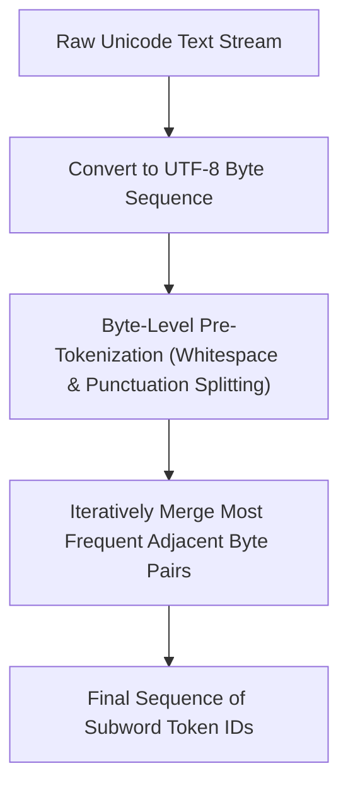

### Key Behavioral Characteristics of BPE

1. **Byte-Level Fallback:** Instead of operating on raw Unicode characters, GPT tokenizers operate on **UTF-8 bytes**. Because there are only 256 possible bytes in computer memory, any arbitrary Unicode character, code snippet, or emoji can always be decomposed into constituent bytes without ever encountering an Out-Of-Vocabulary error.
2. **Whitespace Integration:** In BPE, leading spaces are merged directly into the subsequent word token. For example, `" world"` (with a leading space) is an entirely different token ID than `"world"` (without a leading space).
3. **Word Roots and Stems:** BPE naturally splits words into recognizable roots, prefixes, and suffixes, enabling the neural network to share learned meaning across related words (`"compute"`, `"computer"`, `"computing"`).
4. **Vocabulary Evolution:**
   - **`r50k_base`:** Used by GPT-2 and legacy GPT-3 (~50,000 token vocabulary).
   - **`cl100k_base`:** Used by GPT-3.5-turbo and GPT-4 (~100,000 token vocabulary).
   - **`o200k_base`:** Used by GPT-4o and modern frontier models (~200,000 token vocabulary). The larger vocabulary dramatically improves tokenization efficiency for non-English languages (e.g., Arabic, Chinese, Hindi) and source code, reducing the token count required to represent the same text by up to 50%.

### The Standard Rule of Thumb

In standard English prose:

- **1 token ≈ 0.75 words**
- **100 tokens ≈ 75 words**
- **1 token ≈ 4 characters**

---

## Hands-On Python Implementation: Inspecting Tokens with `tiktoken`

OpenAI provides the open-source **`tiktoken`** library, an extremely fast BPE tokenizer written in Rust with Python bindings. You can install it via:

```bash
pip install tiktoken
```

The following script inspects how different strings decompose into subwords, analyzes byte representations, and counts tokens for context window management:

```python
import tiktoken

def inspect_tokenization(text: str, encoding_name: str = "o200k_base"):
    """
    Encodes text into subword token IDs, decodes individual token bytes,
    and displays token segmentation metrics.
    """
    # Load the target tokenizer encoding
    enc = tiktoken.get_encoding(encoding_name)

    # Encode text string to integer token IDs
    token_ids = enc.encode(text)

    print(f"==================================================")
    print(f"Input Text:    '{text}'")
    print(f"Encoding:      {encoding_name}")
    print(f"Total Tokens:  {len(token_ids)}")
    print(f"Token IDs:     {token_ids}")
    print(f"--- Subword Token Breakdown ---")

    for idx, token_id in enumerate(token_ids):
        # Decode the individual token back to bytes and string representation
        token_bytes = enc.decode_single_token_bytes(token_id)
        token_str = token_bytes.decode("utf-8", errors="replace")
        print(f"  Token {idx+1:>2}: ID {token_id:<6} -> {repr(token_str):<15} (Bytes: {token_bytes})")

    print(f"==================================================\n")

if __name__ == "__main__":
    # Test 1: Common English words with leading space sensitivity
    inspect_tokenization("Hello world")
    inspect_tokenization("Helloworld")

    # Test 2: Morphological decomposition on complex / rare words
    inspect_tokenization("bioinformatics")

    # Test 3: Code snippets and symbols
    inspect_tokenization("def calculate_sum(a, b): return a + b")
```

```text
==================================================
Input Text:    'Hello world'
Encoding:      o200k_base
Total Tokens:  2
Token IDs:     [9906, 1917]
--- Subword Token Breakdown ---
  Token  1: ID 9906   -> 'Hello'         (Bytes: b'Hello')
  Token  2: ID 1917   -> ' world'        (Bytes: b' world')
==================================================

==================================================
Input Text:    'Helloworld'
Encoding:      o200k_base
Total Tokens:  2
Token IDs:     [9906, 17926]
--- Subword Token Breakdown ---
  Token  1: ID 9906   -> 'Hello'         (Bytes: b'Hello')
  Token  2: ID 17926  -> 'world'         (Bytes: b'world')
==================================================

==================================================
Input Text:    'bioinformatics'
Encoding:      o200k_base
Total Tokens:  2
Token IDs:     [112678, 92945]
--- Subword Token Breakdown ---
  Token  1: ID 112678 -> 'bio'           (Bytes: b'bio')
  Token  2: ID 92945  -> 'informatics'   (Bytes: b'informatics')
==================================================

==================================================
Input Text:    'def calculate_sum(a, b): return a + b'
Encoding:      o200k_base
Total Tokens:  13
Token IDs:     [797, 30456, 1024, 1515, 64, 11, 309, 3968, 1018, 257, 10, 489, 309]
--- Subword Token Breakdown ---
  Token  1: ID 797    -> 'def'           (Bytes: b'def')
  Token  2: ID 30456  -> ' calculate'    (Bytes: b' calculate')
  Token  3: ID 1024   -> '_'             (Bytes: b'_')
  Token  4: ID 1515   -> 'sum'           (Bytes: b'sum')
  Token  5: ID 64     -> '('             (Bytes: b'(')
  Token  6: ID 11     -> ','             (Bytes: b',')
  Token  7: ID 309    -> ' b'            (Bytes: b' b')
  Token  8: ID 3968   -> '):'            (Bytes: b'):')
  Token  9: ID 1018   -> ' return'       (Bytes: b' return')
  Token 10: ID 257    -> ' a'            (Bytes: b' a')
  Token 11: ID 10     -> ' +'            (Bytes: b' +')
  Token 12: ID 489    -> ' '             (Bytes: b' ')
  Token 13: ID 309    -> ' b'            (Bytes: b' b')
==================================================
```

---

## Architectural Comparison Matrix

| Tokenization Scheme           | Typical Vocab Size   | Sequence Length (Tokens per Sentence)  | Out-Of-Vocabulary (OOV) Risk             | Morphological Awareness                         | Primary Bottleneck                                      |
| :---------------------------- | :------------------- | :------------------------------------- | :--------------------------------------- | :---------------------------------------------- | :------------------------------------------------------ |
| **Character-Level**           | ~100 – 256           | **Extremely Long** (~5x–6x word count) | **None** (Can spell any word)            | None (Network must learn spelling)              | Memory strain and compute overhead from long sequences. |
| **Word-Level**                | 100,000 – 1,000,000+ | **Short** (1 token per word)           | **High** (Unseen words map to `<UNK>`)   | None (Treats "walk" and "walking" as unrelated) | Memory explosion in vocabulary lookup tables.           |
| **Subword (BPE / WordPiece)** | 32,000 – 200,000     | **Optimal** (~1.3x word count)         | **None** (Decomposes to bytes if needed) | **High** (Extracts stems, prefixes, suffixes)   | Slight tokenizer pre-processing overhead.               |

### OpenAI Tokenizer Family Comparison

| Encoding Name | Associated Models                            | Vocabulary Size | Compression Efficiency                                                                 |
| :------------ | :------------------------------------------- | :-------------- | :------------------------------------------------------------------------------------- |
| `r50k_base`   | GPT-2, legacy GPT-3 (`davinci`)              | 50,257 tokens   | Baseline English; inefficient on code and non-Latin scripts.                           |
| `cl100k_base` | GPT-3.5-turbo, GPT-4, GPT-4-turbo            | 100,277 tokens  | ~15% more compact on English; substantially improved code tokenization.                |
| `o200k_base`  | GPT-4o, GPT-4o-mini, modern reasoning models | 200,019 tokens  | State-of-the-art multilingual compression; up to 50% fewer tokens on non-English text. |

> [!IMPORTANT]
> **Token Counts Dictate Costs and Context Limits:** Commercial LLMs charge strictly per input and output token, not per character or word. Furthermore, context window limits (e.g., 128k tokens) apply to the total token count after tokenization. Always use `tiktoken` to measure actual token consumption before sending large payloads.

> [!TIP]
> **Leading Spaces Matter:** In BPE tokenization, `"apple"` and `" apple"` are encoded as distinct token IDs. When building prompt templates or few-shot examples, maintain consistent whitespace formatting to prevent artificial token fragmentation.

> [!CAUTION]
> **Tokenizer Mismatch In Multi-Model Systems:** Never pass token IDs generated by one tokenizer (e.g., Llama's SentencePiece) into an embedding layer trained on a different tokenizer (e.g., OpenAI's `tiktoken`). Token IDs are arbitrary integer mappings specific to a model's proprietary vocabulary matrix.

---

## Review Quiz

<details>
<summary><b>Question 1: Why did character-level tokenization prove suboptimal for Transformer-based LLMs despite having a tiny vocabulary?</b></summary>
<br>
<b>Answer:</b> Character-level tokenization causes sequences to become extremely long (typically 5 to 6 times longer than word counts). Because Transformer self-attention compares all tokens against each other, longer token sequences require vastly more memory and compute. Additionally, the model is forced to expend capacity learning spelling and basic character combinations rather than higher-level semantic concepts.
</details>

<details>
<summary><b>Question 2: How does Subword Tokenization (BPE) solve the Out-Of-Vocabulary (OOV) dilemma?</b></summary>
<br>
<b>Answer:</b> Subword tokenization represents frequent words as single tokens, while less common words are decomposed into familiar subword pieces (stems, prefixes, suffixes). If an entirely novel word, misspelling, or rare character is encountered, the tokenizer breaks it down further until it reaches individual characters or raw UTF-8 bytes, ensuring that any arbitrary text string can be encoded without needing an unknown (<code>&lt;UNK&gt;</code>) placeholder.
</details>

<details>
<summary><b>Question 3: What is the technical difference between a token and an embedding vector?</b></summary>
<br>
<b>Answer:</b> A token is a discrete integer ID (such as <code>9906</code>) acting as a row index in a static vocabulary lookup table. An embedding vector is a continuous, high-dimensional floating-point array (such as a 1536-dimensional vector) looked up from that index, located inside the neural network to represent semantic meaning geometrically.
</details>

<details>
<summary><b>Question 4: Why do the strings "world" and " world" produce different token IDs in GPT's tokenizer?</b></summary>
<br>
<b>Answer:</b> Byte Pair Encoding (BPE) merges leading whitespace directly into the word token to improve sequence compression. Because the leading space is treated as an active character in the byte sequence, the space-prefixed version is a distinct entry in the tokenizer's vocabulary table with its own unique token ID.
</details>

<details>
<summary><b>Question 5: What is the primary operational advantage of expanding the tokenizer vocabulary from 100k (cl100k_base) to 200k (o200k_base) in modern models like GPT-4o?</b></summary>
<br>
<b>Answer:</b> A larger vocabulary enables the tokenizer to store dedicated multi-character tokens for non-Latin scripts (such as Arabic, Chinese, Devanagari, and Cyrillic) and source code. This allows non-English languages to be encoded in significantly fewer tokens (up to 50% token reduction), directly lowering API billing costs and allowing more text to fit within the context window.
</details>
---

# Tokenizing with tiktoken and Understanding the Illusion of Memory

Tokenization translates human text into numeric indices that language models can compute, and the behavior of tokenizers directly influences model accuracy, context limits, and API billing. However, understanding tokenization is only half of effective LLM engineering: engineers must also master the runtime behavior of large language models. A foundational property of modern LLM APIs is that every single request is completely stateless. Large language models possess no persistent internal memory of previous interactions. Conversational memory in applications like ChatGPT is an intentional engineering illusion achieved by accumulating and resubmitting the entire conversation history with every prompt.

```text
+-------------------------------------------------------------------------------+
|                       THE ILLUSION OF CONVERSATIONAL MEMORY                   |
|                                                                               |
|  NAIVE MULTI-TURN INTERACTION (STATELESS AMNESIA):                            |
|                                                                               |
|  Turn 1:  [ User: "Hi, I'\''m Ed!" ]  ────────> [ LLM ] ───> "Hi Ed! Nice     |
|                                                            to meet you."      |
|                                                                               |
|  Turn 2:  [ User: "What'\''s my name?" ] ─────> [ LLM ] ───> "I don't have    |
|           (Previous state vanished!)                 access to your personal  |
|                                                            information."      |
|                                                                               |
|  ===========================================================================  |
|                                                                               |
|  ENGINEERED CONVERSATION (ACCUMULATED CONTEXT RESUBMISSION):                  |
|                                                                               |
|  Turn 2:  [ System:    "You are a helpful assistant" ]                        |
|           [ User:      "Hi, I'\''m Ed!"              ]                        |
|           [ Assistant: "Hi Ed! Nice to meet you."    ] ──> [ LLM ] ──> "Your  |
|           [ User:      "What'\''s my name?"          ]              name is   |
|                                                                       Ed!"    |
|           (Model predicts next token given full prior context)                |
+-------------------------------------------------------------------------------+
```

---

## Hands-On Tokenization with `tiktoken` in Python

OpenAI provides **`tiktoken`**, a fast, open-source Byte Pair Encoding (BPE) tokenizer implemented in Rust with native Python bindings. Tokenization with `tiktoken` runs entirely locally on your machine—it performs a local vocabulary lookup and does not make cloud network calls or consume API credits.

### Environment Kernel Configuration

When running tokenization notebooks in Cursor or VS Code:

1. Open your notebook interface.
2. Click **Select Kernel** in the top-right corner.
3. Choose **Python Environments...** and select your project's local virtual environment (`.venv (Python 3.12.x)`).

### Selecting the Model Tokenizer

Rather than hardcoding vocabulary names (such as `cl100k_base` or `o200k_base`), `tiktoken` provides the `encoding_for_model()` helper function. This automatically selects the exact encoding dictionary used by a specific model:

```python
import tiktoken

# Retrieve the dedicated tokenizer for GPT-4.1 mini
encoding = tiktoken.encoding_for_model("gpt-4.1-mini")
```

For models in the GPT-4o and modern lightweight families (`gpt-4.1-mini`, `gpt-4o-mini`), this loads the `o200k_base` encoding dictionary containing approximately 200,000 distinct subword tokens.

### Encoding Text to Token IDs

Passing a string into `encoding.encode()` breaks the text into subword chunks and maps each chunk to its corresponding integer ID in the vocabulary:

```python
# Convert raw text string into token IDs
tokens = encoding.encode("Hi my name is Ed")
print(tokens)
```

```text
[12194, 922, 1308, 382, 6117]
```

Each integer in this list represents a discrete entry in the model's vocabulary table:

- Lower token IDs often correspond to common words, frequently seen letters, or fundamental byte combinations.
- Frequent English names like `"Ed"` are common enough in web training data to receive their own dedicated single token ID (`6117`).

### Decoding Individual Tokens Back to Text

To inspect how the tokenizer split a phrase, iterate over the token IDs and pass each individually into `encoding.decode()`:

```python
for token_id in tokens:
    token_text = encoding.decode([token_id])
    print(f"{token_id} = {token_text}")
```

```text
12194 = Hi
922 =  my
1308 =  name
382 =  is
6117 =  Ed
```

Notice the leading whitespace: tokens following the first word include the preceding space (e.g., `' my'`, `' name'`, `' is'`, `' Ed'`). In BPE tokenization, a word preceded by a space is assigned a different token ID than the same word without a space.

### Subword Decomposition and Unseen Words

When the tokenizer encounters compound words, regional expressions, or less frequent vocabulary, it segments the word into known smaller subword pieces:

```python
# Encoding a compound phrase with a less common dessert name
complex_text = "Hi my name is Ed and I like banoffee pie"
complex_tokens = encoding.encode(complex_text)

print(complex_tokens)

for token_id in complex_tokens:
    print(f"{token_id} = {encoding.decode([token_id])}")
```

```text
[12194, 922, 1308, 382, 6117, 326, 357, 1299, 9171, 26458, 5148]
12194 = Hi
922 =  my
1308 =  name
382 =  is
6117 =  Ed
326 =  and
357 =  I
1299 =  like
9171 =  ban
26458 = offee
5148 =  pie
```

In this decomposition:

- The word `"banoffee"` is not present as a single entry in the 200,000-token dictionary.
- The tokenizer splits `"banoffee"` into two subword pieces: `" ban"` (ID `9171`, containing the leading space) and `"offee"` (ID `26458`, without a space).
- Common grammatical connectors receive low IDs: `" and"` maps to token `326`.

You can also decode any standalone token ID directly using `encoding.decode([326])`, which returns `' and'`.

---

## The Architectural Reality: LLM API Calls Are Completely Stateless

When developers transition from consumer chat interfaces like ChatGPT to programmatic API development, they often encounter an unexpected behavior:

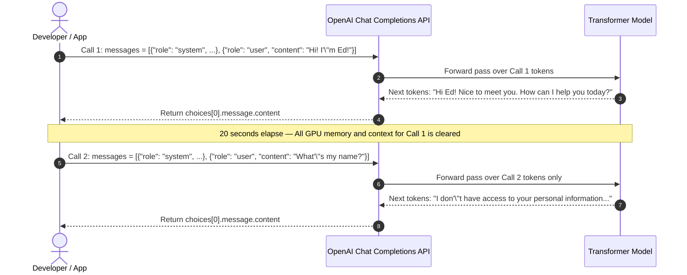

### Demonstrating Statelessness in Code

Initialize the OpenAI client using your environment variables:

```python
import os
from dotenv import load_dotenv
from openai import OpenAI

# Load API credentials from .env file
load_dotenv(override=True)
openai = OpenAI()
```

#### Step 1: The First Greeting Call

Send an initial greeting providing the user's name:

```python
messages = [
    {"role": "system", "content": "You are a helpful assistant"},
    {"role": "user", "content": "Hi! I'm Ed!"}
]

response = openai.chat.completions.create(
    model="gpt-4.1-mini",
    messages=messages
)

print(response.choices[0].message.content)
```

```text
Hi Ed! Nice to meet you. How can I help you today?
```

#### Step 2: The Naive Follow-Up Query

Immediately ask the model for your name in a new call:

```python
# Naive follow-up message array
follow_up_messages = [
    {"role": "system", "content": "You are a helpful assistant"},
    {"role": "user", "content": "What's my name?"}
]

response = openai.chat.completions.create(
    model="gpt-4.1-mini",
    messages=follow_up_messages
)

print(response.choices[0].message.content)
```

```text
I don't have access to your personal information. How can I assist you today?
```

### Why Did the Model Forget?

The model did not "forget" because it never remembered in the first place:

1. **Stateless Compute:** Every invocation of an LLM via HTTP or SDK is a completely independent transaction. The model has zero session storage, database tables, or memory variables between calls.
2. **Isolated Next-Token Prediction:** When `follow_up_messages` was sent, the model only saw `"What's my name?"`. Without past context, the most probable next tokens in English text are an admission that it does not know the user's identity.

---

## Engineering the Illusion of Memory: Conversational Context Accumulation

The conversational fluency of ChatGPT is an engineering illusion. To maintain coherent multi-turn conversations, the client application must maintain an ongoing record of the dialog and resubmit the complete conversation history with every new message.

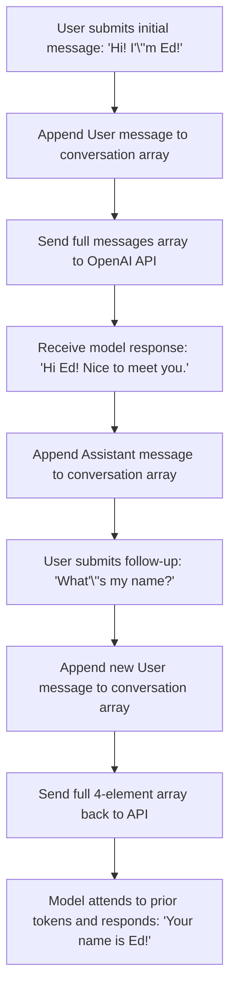

### The Three Message Roles

The OpenAI Chat Completions API structures conversation history using three primary roles:

- **`system`**: Sets the persistent persona, operational guardrails, and behavioral guidelines for the assistant.
- **`user`**: Represents prompts, queries, and inputs submitted by the end user.
- **`assistant`**: Represents responses previously generated by the language model. Including previous assistant responses ensures the model knows what it has already stated.

### Implementing Conversation History in Code

By recording the assistant's previous reply and appending the new query, the input sequence preserves the full dialog:

```python
# Construct the complete conversation history so far
accumulated_messages = [
    {"role": "system", "content": "You are a helpful assistant"},
    {"role": "user", "content": "Hi! I'm Ed!"},
    {"role": "assistant", "content": "Hi Ed! How can I assist you today?"},
    {"role": "user", "content": "What's my name?"}
]

response = openai.chat.completions.create(
    model="gpt-4.1-mini",
    messages=accumulated_messages
)

print(response.choices[0].message.content)
```

```text
Your name is Ed! How can I help you today, Ed?
```

Because the input sequence now contains both `"Hi! I'm Ed!"` and `"What's my name?"`, the highest-probability next tokens predicted by the Transformer are `"Your name is Ed!"`.

---

## The Five Foundational Principles of LLM State Management

Every AI engineer working with language models must internalize these five core principles:

1. **Every API Call Is Completely Stateless:** The model maintains no session, memory cache, or knowledge of previous requests once the HTTP response finishes.
2. **The Entire Conversation History Must Be Resubmitted:** Every subsequent prompt must include all earlier turns (`system`, `user`, and `assistant`) to maintain context.
3. **Conversational Memory Is an Engineering Illusion:** The model appears to "remember" only because the application resends past context on every single turn.
4. **Context Resubmission Is an Engineering Trade-Off:** The model is an autoregressive token predictor; feeding it previous conversation turns guides its prediction towards contextually coherent answers.
5. **Prediction Operates Exclusively on the Current Input Sequence:** If the prompt contains your name, the model continues with your name; if your prompt omits your name, the model cannot know it.

---

## Economic and Computational Trade-Offs of Context Accumulation

Resubmitting conversation history introduces a direct trade-off between conversational coherence and compute costs:

```text
+-------------------------------------------------------------------------------+
|                       TOKEN ACCUMULATION ACROSS CHAT TURNS                    |
|                                                                               |
|  Turn 1: [Sys (10) + User 1 (15)]                     = 25 Input Tokens       |
|  Output: [Asst 1 (20)]                                = 20 Output Tokens      |
|                                                                               |
|  Turn 2: [Sys (10) + User 1 (15) + Asst 1 (20)                                |
|           + User 2 (10)]                              = 55 Input Tokens       |
|  Output: [Asst 2 (30)]                                = 30 Output Tokens      |
|                                                                               |
|  Turn 3: [Sys (10) + User 1 (15) + Asst 1 (20)                                |
|           + User 2 (10) + Asst 2 (30) + User 3 (15)]  = 100 Input Tokens      |
|  Output: [Asst 3 (25)]                                = 25 Output Tokens      |
|                                                                               |
|  Cumulative Input Tokens Billed: 25 + 55 + 100 = 180 Input Tokens             |
+-------------------------------------------------------------------------------+
```

### Why Does the API Charge for Past Messages Every Turn?

Developers frequently ask why they must pay repeatedly for previous conversation turns:

- **Computational Reality:** The Transformer must compute attention weights across every token in the input prompt to generate the next token. If you pass 1,000 tokens of past dialog, the model must run matrix calculations over all 1,000 tokens during its forward pass.
- **Pay for Compute:** You are paying for the electrical energy and GPU hardware time required to process the accumulated context.
- **Economic Viability:** Input tokens are priced substantially cheaper than output tokens (often $0.15 per million tokens for models like `gpt-4o-mini`). Consequently, resending short conversation histories costs only tiny fractions of a cent per message.

---

## Architectural Comparison Matrix

| Architectural Feature        | Stateless Execution (Naive Calls)                       | Full-History Context Accumulation                                     |
| :--------------------------- | :------------------------------------------------------ | :-------------------------------------------------------------------- |
| **Conversational Coherence** | None; fails on pronouns, follow-ups, and user identity. | High; seamless multi-turn dialog and personal reference recall.       |
| **Input Token Growth**       | Flat; each call only sends the latest message.          | Linear accumulation; input tokens grow with each conversational turn. |
| **API Cost Dynamic**         | Minimum cost per call; no historical overhead.          | Compounding input cost per turn as conversation length increases.     |
| **Context Window Limit**     | Never reached in short queries.                         | Eventually approaches model limit (e.g., 128k) in long conversations. |
| **Server/Model State**       | Completely stateless; zero backend memory storage.      | Model remains stateless; client application maintains dialog state.   |

> [!IMPORTANT]
> **Statelessness Is a Distributed Systems Feature:** Model statelessness enables API providers to distribute requests across thousands of GPUs worldwide without maintaining sticky sessions. It also gives developers total freedom to manipulate, summarize, or truncate conversation history before sending it.

> [!TIP]
> **Always Record the Assistant Role:** When accumulating conversation history, never combine assistant answers into the next user message. Always use `{"role": "assistant", "content": "..."}` to preserve the conversational turn structure the model was trained on during reinforcement learning.

> [!CAUTION]
> **Context Window Overflow:** Because conversation history accumulates linearly, long-running chat sessions will eventually exhaust the model's context window or become unnecessarily expensive. Production systems implement rolling context windows, conversational summarization, or vector memory retrieval to keep prompt sizes bounded.

---

## Review Quiz

<details>
<summary><b>Question 1: Does importing and running tiktoken in Python make network calls to OpenAI's servers?</b></summary>
<br>
<b>Answer:</b> No. The <code>tiktoken</code> library executes entirely locally. It uses pre-compiled vocabulary lookup tables and Byte Pair Encoding (BPE) rules stored on your machine to encode text into token IDs and decode token IDs into text without making any HTTP requests or consuming API credits.
</details>

<details>
<summary><b>Question 2: Why do words preceded by a space (like " and" or " Ed") have different token IDs than words without a leading space?</b></summary>
<br>
<b>Answer:</b> Byte Pair Encoding tokenizers merge leading whitespace directly into the token of the subsequent word. Because the leading space character is part of the byte sequence, the space-prefixed word represents a distinct entry in the tokenizer's vocabulary table with its own unique integer ID.
</details>

<details>
<summary><b>Question 3: If you tell an LLM your name in Call 1, why does asking "What's my name?" in Call 2 return an error stating it has no personal information?</b></summary>
<br>
<b>Answer:</b> Large language model API endpoints are completely stateless. Every HTTP call is processed in complete isolation with zero persistent memory of past interactions. If Call 2 only sends the prompt <code>"What's my name?"</code>, the model only has those three words to predict from, and the most probable next tokens are a statement that it does not know your personal details.
</details>

<details>
<summary><b>Question 4: What specific mechanism creates the "illusion of memory" in applications like ChatGPT?</b></summary>
<br>
<b>Answer:</b> The client application records all previous conversation turns and resubmits the entire conversation history—including past <code>system</code>, <code>user</code>, and <code>assistant</code> messages—as the input prompt on every single turn. The model does not remember past sessions; it simply performs next-token prediction on an input sequence that contains the full prior dialog.
</details>

<details>
<summary><b>Question 5: Why do API providers charge users for past messages again on every turn of a conversation?</b></summary>
<br>
<b>Answer:</b> Because the Transformer architecture must perform attention calculations over every single token in the input prompt to generate the next token. When you resubmit past messages, the GPU hardware must perform trillions of mathematical operations across that accumulated context to produce a context-aware response, which consumes actual compute and energy.
</details>
---

# Context Windows, API Costs, and Token Limits in LLMs

Every large language model operates within strict computational boundaries defined by its **context window** and its **token pricing structure**. The context window dictates how much textual information a model can process at a single time—including system instructions, accumulated conversation history, external retrieval documents, and the output tokens generated during response creation. At the same time, transitioning from consumer chat interfaces to production AI engineering requires a rigorous understanding of API token economics, where every input and output token incurs direct compute costs.

```text
+-------------------------------------------------------------------------------+
|                       ANATOMY OF THE LLM CONTEXT WINDOW                       |
|                                                                               |
|  TOTAL CONTEXT WINDOW LIMIT (e.g., 128k, 200k, 400k, or 1M Tokens)            |
|  +-------------------------------------------------------------------------+  |
|  | [ System Prompt ]                                                       |  |
|  | Persistent instructions, persona, operational boundaries                |  |
|  +-------------------------------------------------------------------------+  |
|  | [ Conversation History / Fake Memory ]                                  |  |
|  | All prior User turns + all prior Assistant replies                      |  |
|  +-------------------------------------------------------------------------+  |
|  | [ Injected Reference Context / Multi-Shot Examples / RAG ]              |  |
|  | External knowledge, pricing tables, few-shot Q&A demonstrations        |  |
|  +-------------------------------------------------------------------------+  |
|  | [ Current User Prompt ]                                                 |  |
|  | The newest query submitted by the user                                  |  |
|  +-------------------------------------------------------------------------+  |
|  | [ Autoregressively Generated Output Tokens ]                            |  |
|  | Every generated token fed back into input until completion              |  |
|  +-------------------------------------------------------------------------+  |
|                                                                               |
|  * If Total Tokens > Context Window Limit  ===>  API Error (Request Rejection) |
+-------------------------------------------------------------------------------+
```

---

## Understanding the Context Window: Anatomy and Limits

The **context window** represents the maximum number of tokens that an LLM can consider simultaneously when predicting the next token. If an incoming request exceeds this limit, the API rejects the request with an immediate context length error.

A common misconception among beginner developers is assuming the context window only needs to accommodate the user's latest message. In practice, the context window must hold the entire operational state of the query:

1. **The System Prompt:** Grounding guidelines, safety rules, and role definitions.
2. **Prior Conversational Turns:** Every historical user prompt and assistant response required to maintain conversational context.
3. **Injected Background Knowledge:** External documents retrieved via Retrieval-Augmented Generation (RAG) or few-shot demonstration examples.
4. **The Current User Prompt:** The immediate instruction or query to be answered.
5. **Autoregressively Generated Output Tokens:** All output tokens generated by the model during the current response.

---

## Why Generated Tokens Occupy Context Window Budget

Autoregressive models generate text sequentially, one token at a time. To understand why output tokens occupy the context window, consider the step-by-step decoding loop:

```mermaid
flowchart TD
    A["Initial Input Sequence: 'Hi, I'\''m Ed. What'\''s my name?'"] --> B["Transformer predicts next token: 'Your'"]
    B --> C["New Sequence: '...What'\''s my name? Your'"]
    C --> D["Transformer predicts next token: 'name'"]
    D --> E["New Sequence: '...What'\''s my name? Your name'"]
    E --> F["Transformer predicts next token: 'is'"]
    F --> G["New Sequence: '...What'\''s my name? Your name is'"]
    G --> H["Transformer predicts next token: 'Ed'"]
    H --> I["Full Response Generated: 'Your name is Ed'"]
```

Because every newly generated token is appended to the input sequence to predict the subsequent token, the total token load on the model increases dynamically as the response is written. Consequently, the context window must be large enough to contain both the initial input payload **and** the full generated output sequence.

---

## Context Demands in Modern AI Workflows

Modern AI applications place substantial demands on the context window:

- **Multi-Shot Prompting:** Providing the model with 3 to 10 concrete input-output examples in the prompt to enforce strict output schemas or domain reasoning.
- **Retrieval-Augmented Generation (RAG):** Injecting pages of reference documents, flight schedules, or knowledge base articles directly into the prompt so the model can cite grounded facts.
- **Autonomous Coding Agents (e.g., Claude Code):** Feeding entire source code files, directory structures, and terminal execution outputs into the prompt, which quickly consumes tens of thousands of tokens.
- **Large-Scale Document Analysis:** Analyzing entire books or legal agreements. For example, the complete works of William Shakespeare contain approximately 900,000 words (roughly 1,000,000 tokens), requiring ultra-large context models like Google Gemini to process in a single prompt.

---

## Demystifying API Pricing: Consumer Subscriptions vs. Pay-As-You-Go API Billing

A frequent source of confusion is the distinction between consumer chat subscriptions and developer API billing:

```text
+-------------------------------------------------------------------------------+
|                       CONSUMER CHAT VS. DEVELOPER API PRICING                 |
|                                                                               |
|  CHATGPT PLUS / PRO (Consumer Interface)                                      |
|  - Target Audience: End-user humans interacting through a browser/app.        |
|  - Billing Model: Flat monthly subscription ($20 to $200 per month).          |
|  - Usage Rules: Unlimited interactions subject to dynamic rate-limiting caps. |
|  - API Access: Provides ZERO access to programmatic developer endpoints.      |
|                                                                               |
|  ---------------------------------------------------------------------------  |
|                                                                               |
|  OPENAI API (Developer Platform)                                              |
|  - Target Audience: Software engineers building custom applications.          |
|  - Billing Model: Pay-as-you-go per 1,000,000 tokens consumed.                |
|  - Usage Rules: Charged strictly for compute resources (input + output).      |
|  - Subscription: No monthly subscription required; funded via credit balance. |
+-------------------------------------------------------------------------------+
```

### Why Do APIs Charge per Token?

When you send a prompt to an LLM, remote GPU clusters perform trillions of matrix computations to evaluate attention across all tokens. API pricing directly reflects the physical electricity, hardware depreciation, and infrastructure costs required to run inference. A secondary fraction contributes to amortizing the hundreds of millions of dollars invested in pre-training frontier models.

### Individual Development vs. Scaled Production Economics

- **Individual Learning & Prototyping:** A typical development call (`"Hi, my name is Ed"`) uses roughly 10 to 20 tokens. At standard mini-model rates, this costs less than a thousandth of a cent ($0.00001). A $5 initial credit balance easily accommodates thousands of test requests.
- **Production Systems & Agentic Loops:** When an application scales to thousands of concurrent users or runs multi-step autonomous agent loops (which continuously query models and process large tool logs), token consumption accumulates rapidly, making unit economics and context management essential.

---

## The Two Critical Catches in API Token Billing

When budgeting for LLM APIs, developers must account for two key cost factors:

### Catch 1: Linear Input Token Accumulation Across Chat Turns

To preserve conversational memory across turns, client applications resubmit the entire historical dialogue on every request. Consequently, input token counts grow linearly with each exchange. Even if a user only asks a brief 5-word question on turn 15, the API charges for the hundreds or thousands of historical tokens passed along with it.

### Catch 2: Hidden Reasoning Tokens in Reasoning Models

Modern reasoning models (such as the OpenAI o-series) perform extensive internal problem solving before generating their final user-facing response.

- **Invisible Output Compute:** The internal thinking trace produced by reasoning models is often hidden from the user and developer response payload.
- **Billed as Output Tokens:** Even though developers cannot view the reasoning tokens directly, every internal reasoning token is billed at full output token rates because the underlying GPU spent compute cycles generating it.
- **Cost Volatility:** Complex prompts can cause the model to generate thousands of reasoning tokens before emitting a short two-sentence answer, leading to higher and less predictable per-query costs.

---

## Cost Optimization Strategies: Prompt Caching and Model Tiers

AI engineers utilize several core techniques to keep API costs predictable and manageable:

### Prompt Caching

When multiple requests share identical prompt prefixes (such as large system prompts, static multi-shot examples, or loaded RAG documentation), model providers can cache the key-value states in GPU memory:

- **Automatic Caching:** OpenAI automatically detects matching prompt prefixes submitted within short windows and applies discounts (often up to 50% off input pricing).
- **Explicit Caching:** Anthropic Claude allows developers to explicitly set cache breakpoints on large prompt blocks, reducing input costs by up to 90% for subsequent queries.

### Model Tier Routing

Frontier AI labs offer models across different performance and pricing tiers:

- **Flagship Frontier Models (e.g., GPT-5, Claude 4 Opus):** Designed for complex architectural reasoning, multi-step problem solving, and rigorous evaluation. Higher per-token cost ($1.25 to $15 per 1M input tokens).
- **Lightweight / Nano Models (e.g., GPT-5 Nano, GPT-4o-mini):** Optimized for low latency, classification, structured extraction, and simple conversational turns. Exceptionally low per-token cost ($0.05 to $0.15 per 1M input tokens).

```text
Processing the complete works of Shakespeare (~1,000,000 tokens):
- On a Flagship Model (~$10 / 1M output tokens): Costs ~$10.00
- On a Nano Model (~$0.40 / 1M output tokens): Costs ~$0.40
```

---

## Model Comparison: Context Windows and Pricing on the Vellum Leaderboard

The **Vellum LLM Leaderboard** (`https://www.vellum.ai/llm-leaderboard`) tracks and compares context window capacities, input costs, and output costs across leading frontier and open-weight models:

| Model                | Provider / Family | Context Window (Tokens) | Input Cost / 1M Tokens | Output Cost / 1M Tokens | Primary Architectural Fit                                       |
| :------------------- | :---------------- | :---------------------- | :--------------------- | :---------------------- | :-------------------------------------------------------------- |
| **GPT-5**            | OpenAI            | 400,000                 | \$1.25                 | \$10.00                 | Heavy reasoning, complex multi-step workflows, agentic planning |
| **Claude Opus 4.1**  | Anthropic         | 200,000                 | \$15.00                | \$75.00                 | Deep technical writing, nuanced coding, rigorous evaluation     |
| **Claude 4 Sonnet**  | Anthropic         | 200,000                 | \$3.00                 | \$15.00                 | High-performance enterprise development, balanced speed/cost    |
| **Gemini 2.5 Flash** | Google            | 1,000,000               | \$0.15                 | \$0.60                  | Massive document analysis, multi-hour video/audio processing    |
| **GPT oss 120b**     | Open Weights      | 131,072                 | \$0.15                 | \$0.60                  | High-throughput hosted open-source production deployments       |
| **GPT oss 20b**      | Open Weights      | 131,072                 | \$0.08                 | \$0.35                  | Low-cost private hosting, lightweight classification & routing  |
| **Grok 4**           | xAI               | 256,000                 | N/A                    | N/A                     | Frontier conversational intelligence and search synthesis       |

---

## Hands-On Python Implementation: Simulating Context Accumulation and API Costs

The following script uses `tiktoken` to simulate a multi-turn conversation, tracking how input tokens accumulate over time and calculating total costs across both Flagship and Nano pricing tiers:

```python
import tiktoken

def calculate_conversation_costs(
    dialogue: list[tuple[str, str]],
    model_encoding: str = "o200k_base",
    flagship_input_per_million: float = 1.25,
    flagship_output_per_million: float = 10.00,
    nano_input_per_million: float = 0.05,
    nano_output_per_million: float = 0.40
):
    """
    Simulates a multi-turn chat interaction, tracking token accumulation
    and comparing estimated API costs across model tiers.
    """
    enc = tiktoken.get_encoding(model_encoding)
    system_prompt = "You are an expert AI software architect and coding assistant."
    system_tokens = len(enc.encode(system_prompt))

    conversation_history = []
    total_flagship_cost = 0.0
    total_nano_cost = 0.0

    print(f"System Prompt Tokens: {system_tokens}")
    print("=" * 70)

    for turn_idx, (user_msg, asst_msg) in enumerate(dialogue, 1):
        user_tokens = len(enc.encode(user_msg))
        asst_tokens = len(enc.encode(asst_msg))

        # Total input tokens includes system prompt + all historical tokens + new user message
        history_tokens = sum(len(enc.encode(msg["content"])) for msg in conversation_history)
        current_input_tokens = system_tokens + history_tokens + user_tokens

        # Calculate costs for this specific turn
        turn_cost_flagship = (
            (current_input_tokens / 1_000_000) * flagship_input_per_million +
            (asst_tokens / 1_000_000) * flagship_output_per_million
        )
        turn_cost_nano = (
            (current_input_tokens / 1_000_000) * nano_input_per_million +
            (asst_tokens / 1_000_000) * nano_output_per_million
        )

        total_flagship_cost += turn_cost_flagship
        total_nano_cost += turn_cost_nano

        print(f"Turn {turn_idx}:")
        print(f"  User: '{user_msg}' ({user_tokens} tokens)")
        print(f"  Input Tokens Sent (Billed): {current_input_tokens}")
        print(f"  Assistant Output Generated:  {asst_tokens} tokens")
        print(f"  Turn Cost (Flagship):        ${turn_cost_flagship:.6f}")
        print(f"  Turn Cost (Nano):            ${turn_cost_nano:.6f}")
        print("-" * 70)

        # Append turn to accumulated history
        conversation_history.append({"role": "user", "content": user_msg})
        conversation_history.append({"role": "assistant", "content": asst_msg})

    print(f"Final Cumulative Flagship Cost: ${total_flagship_cost:.6f}")
    print(f"Final Cumulative Nano Cost:     ${total_nano_cost:.6f}")
    print(f"Nano Savings Multiplier:        {total_flagship_cost / total_nano_cost:.1f}x cheaper")
    print("=" * 70)

if __name__ == "__main__":
    sample_dialogue = [
        ("Hello, my name is Alex and I am building an LLM pipeline.",
         "Hello Alex! It is great to meet you. What architecture are you planning?"),
        ("I want to know whether to use a local model or a cloud API.",
         "That depends on your latency requirements, privacy constraints, and team budget."),
        ("What is my name and what project am I working on?",
         "Your name is Alex, and you are designing an LLM pipeline architecture.")
    ]
    calculate_conversation_costs(sample_dialogue)
```

```text
System Prompt Tokens: 12
======================================================================
Turn 1:
  User: 'Hello, my name is Alex and I am building an LLM pipeline.' (15 tokens)
  Input Tokens Sent (Billed): 27
  Assistant Output Generated:  16 tokens
  Turn Cost (Flagship):        $0.000194
  Turn Cost (Nano):            $0.000008
----------------------------------------------------------------------
Turn 2:
  User: 'I want to know whether to use a local model or a cloud API.' (16 tokens)
  Input Tokens Sent (Billed): 59
  Assistant Output Generated:  15 tokens
  Turn Cost (Flagship):        $0.000224
  Turn Cost (Nano):            $0.000009
----------------------------------------------------------------------
Turn 3:
  User: 'What is my name and what project am I working on?' (13 tokens)
  Input Tokens Sent (Billed): 87
  Assistant Output Generated:  18 tokens
  Turn Cost (Flagship):        $0.000289
  Turn Cost (Nano):            $0.000012
----------------------------------------------------------------------
Final Cumulative Flagship Cost: $0.000706
Final Cumulative Nano Cost:     $0.000028
Nano Savings Multiplier:        24.9x cheaper
======================================================================
```

---

## Architectural Comparison Matrix

| Dimension                  | Web Chat Subscription (ChatGPT Plus / Pro) | Developer API Endpoint (Pay-As-You-Go)                              |
| :------------------------- | :----------------------------------------- | :------------------------------------------------------------------ |
| **Billing Frequency**      | Fixed monthly fee (\$20 – \$200/month).    | Dynamic per-token billing based on exact usage.                     |
| **Pricing Calculation**    | Flat rate regardless of token volume.      | Formula: `(Input / 1M * Price) + (Output / 1M * Price)`.            |
| **Context Window Control** | Managed automatically behind the web UI.   | Managed explicitly by developer application code.                   |
| **Automation & Scale**     | Forbidden / manual browser interface only. | Built for programmatic integration and automated pipelines.         |
| **Cost Predictability**    | 100% predictable fixed subscription cost.  | Variable; depends on conversation depth, RAG, and reasoning tokens. |

> [!IMPORTANT]
> **Context Window Limits Include Both Input and Output:** When configuring `max_tokens` (or `max_completion_tokens`), remember that the context window limit applies to the sum of your input prompt plus the output response. An input of 120,000 tokens sent to a 128,000-token model leaves at most 8,000 tokens for output generation.

> [!TIP]
> **Stabilize System Prompts for Caching:** Because prompt caching checks for matching prefixes from the very beginning of the message stream, keep your system prompts, static few-shot examples, and unchanging instructions at the top of the array. Avoid inserting dynamic data (like current timestamps) at the start of your system prompt, as this invalidates the cache prefix.

> [!CAUTION]
> **Hidden Reasoning Token Costs:** When using reasoning models (like `o1` or `o3-mini`), set explicit `reasoning_effort` parameters or token limits where available. Reasoning traces consume output tokens that are billed at premium rates, even when those tokens do not appear in your final response payload.

---

## Review Quiz

<details>
<summary><b>Question 1: Why must the context window accommodate newly generated output tokens in addition to the original input prompt?</b></summary>
<br>
<b>Answer:</b> Autoregressive large language models generate text token by token. After each token is produced, it is appended to the input sequence and passed back into the Transformer to predict the subsequent token. Because the entire accumulated sequence must fit in the model's memory throughout generation, the context window must hold the input prompt plus all output tokens generated up to that point.
</details>

<details>
<summary><b>Question 2: Does an active ChatGPT Plus or Pro subscription allow a developer to make calls to the OpenAI API without additional charges?</b></summary>
<br>
<b>Answer:</b> No. Consumer chat subscriptions (like ChatGPT Plus at \$20/month) provide access only to the consumer web and mobile chat interfaces. The developer API operates on an entirely separate platform with pay-as-you-go billing based on the exact number of input and output tokens consumed.
</details>

<details>
<summary><b>Question 3: What are the two primary "catches" that can cause API token costs to accumulate faster than developers expect?</b></summary>
<br>
<b>Answer:</b> The first catch is conversational context accumulation: because LLMs are stateless, client applications must resend the entire prior dialogue on every turn, causing input token counts to grow linearly with conversation length. The second catch is hidden reasoning tokens in reasoning models: the internal chain-of-thought tokens generated during reasoning are billed as output tokens, even when they are not exposed in the final response payload.
</details>

<details>
<summary><b>Question 4: How does prompt caching reduce API costs in production applications?</b></summary>
<br>
<b>Answer:</b> When multiple API requests share an identical prompt prefix (such as a lengthy system prompt, documentation block, or set of few-shot examples), the provider can reuse the precomputed attention states cached in GPU memory rather than recomputing them from scratch. This significantly lowers inference compute time and offers discounts of 50% to 90% on input token costs.
</details>

<details>
<summary><b>Question 5: What is the operational difference between a 1,000,000-token context window model (like Gemini 2.5 Flash) and a standard 128,000-token model?</b></summary>
<br>
<b>Answer:</b> A 1,000,000-token context window can ingest massive continuous inputs—such as the complete works of Shakespeare, entire codebases, or hours of audio/video transcripts—in a single prompt without requiring chunking, summarization, or complex vector database retrieval pipelines.
</details>

---

# Building a Sales Brochure Generator: Architecture and Web Scraping Foundations

## Architectural Overview of Multi-Step LLM Applications

Most real-world business applications of Large Language Models require more than a single input-output interaction. While querying a single prompt against a model can summarize an isolated paragraph or answer a factual question, creating comprehensive business artifacts—such as a tailored company sales brochure—demands a coordinated multi-step workflow.

A sales brochure must synthesize diverse facets of an enterprise: its primary value proposition, target customer personas, product architecture, company culture, and career opportunities. This information is rarely consolidated on a single homepage. Instead, it is distributed across disparate subpages: `/about`, `/company`, `/products`, `/solutions`, and `/careers`.

To automate brochure generation, an application must follow an architectural pipeline that moves from web ingestion to intelligent filtering, deep crawling, and multi-source synthesis:

```text
+-------------------------------------------------------------------------+
|                    SALES BROCHURE GENERATION PIPELINE                   |
+-------------------------------------------------------------------------+

  1. INGESTION                2. EXTRACTION & FILTERING
  +--------------------+      +-------------------------------------------+
  | Target Website     | ---> | Scrape Homepage & Extract All Links       |
  | URL (Landing Page) |      | HTML Parser extracts raw anchor tags (<a>)|
  +--------------------+      +-------------------------------------------+
                                                    |
                                                    v
  3. SUBPAGE CRAWLING         +-------------------------------------------+
  +--------------------+ <--- | LLM-Guided Semantic Filtering              |
  | Fetch Subpages     |      | Small, fast model filters 100+ links down |
  | (/about, /careers) |      | to relevant company overview pages        |
  +--------------------+      +-------------------------------------------+
           |
           v
  4. AGGREGATION              5. SYNTHESIS & STREAMING
  +--------------------+      +-------------------------------------------+
  | Combine Content    | ---> | Frontier LLM (e.g., GPT-4.1-mini)         |
  | into Comprehensive |      | Synthesizes unified context into markdown |
  | Context Buffer     |      | brochure and streams tokens to user       |
  +--------------------+      +-------------------------------------------+
```

```mermaid
flowchart TD
    A["Target Company URL"] --> B["fetch_website_contents(url)"]
    A --> C["fetch_website_links(url)"]
    B --> D["Raw Homepage Text (Truncated to 2,000 chars)"]
    C --> E["Raw Hyperlinks List (Dozens/Hundreds)"]
    E --> F["LLM Link Classifier (JSON Mode)"]
    F --> G["Filtered Relevant URLs (/about, /careers, /products)"]
    G --> H["fetch_website_contents(subpage_url)"]
    H --> I["Subpage Text Ingestion"]
    D & I --> J["Unified Context Buffer (page_to_text)"]
    J --> K["Brochure Synthesis Prompt (Frontier LLM)"]
    K --> L["Live Markdown Streaming Response"]

    classDef stage fill:#f8fafc,stroke:#334155,stroke-width:1px;
    class A,B,C,D,E,F,G,H,I,J,K,L stage;
```

---

## Beyond the GPT Wrapper: Verticalized AI Workflows

In AI product development, applications are often colloquially classified as "GPT wrappers"—thin UI layers that do little more than forward user prompts directly to an OpenAI or Anthropic API endpoint. Thin wrappers carry low defensibility because any general-purpose frontier chat interface can replicate their output with minimal prompting.

Building true enterprise value requires verticalized workflows: deep integration with domain-specific data sources, customized multi-step tool execution, and programmatic validation.

### Verticalized Value Creation

Consider Duolingo's integration of GPT-4 into its language learning platform. Rather than offering an open-ended chatbot, Duolingo constructed a bounded, interactive roleplay system:

1. The system simulates realistic social situations (e.g., ordering a coffee at a Parisian café or purchasing a train ticket in Madrid).
2. The model operates under strict conversational guardrails tailored to the learner's fluency level.
3. Post-interaction evaluation logic analyzes grammar, vocabulary choices, and contextual appropriateness, giving immediate structured pedagogical feedback.

In the sales domain, an automated brochure generator provides equivalent vertical value. Instead of forcing a sales representative to manually browse through ten different navigation tabs, copy text, and paste it into a prompt, the pipeline automates the research, extraction, normalization, and creative copy generation into an instantaneous, reproducible background process.

---

## Web Scraping Mechanics with BeautifulSoup

Extracting clean text and navigation paths from raw web pages requires an HTTP client and an HTML parser. In Python, this is accomplished using the `requests` library for transport and `BeautifulSoup4` for Document Object Model (DOM) traversal.

### Cleaning Raw HTML for Model Consumption

Raw HTML documents contain substantial markup that provides no value to a language model while consuming significant context window tokens:

- `<script>` and `<style>` blocks contain JavaScript logic and CSS declarations that clutter semantic textual content.
- Inline form elements (`<input>`, `<button>`), navigation boilerplate, and tracking pixels dilute core messaging.
- Unstripped whitespace, carriage returns, and duplicate tabs inflate token counts without providing structural meaning.

To maximize signal-to-noise ratio, the extraction function strips out non-content tags before extracting the visible text, and caps the total character length to prevent context exhaustion in downstream prompts.

```python
import os
import requests
from bs4 import BeautifulSoup

# Define standard headers to simulate a modern desktop browser
HEADERS = {
    "User-Agent": (
        "Mozilla/5.0 (Windows NT 10.0; Win64; x64) "
        "AppleWebKit/537.36 (KHTML, like Gecko) "
        "Chrome/117.0.0.0 Safari/537.36"
    )
}

def fetch_website_contents(url: str) -> str:
    """
    Downloads the HTML for a given URL, strips non-content elements,
    and returns up to 2,000 characters of cleaned textual content.
    """
    try:
        response = requests.get(url, headers=HEADERS, timeout=10)
        response.raise_for_status()
    except requests.RequestException as e:
        return f"Error fetching {url}: {e}"

    soup = BeautifulSoup(response.text, "html.parser")

    # Strip script, style, image, and input tags
    for element in soup(["script", "style", "img", "input"]):
        element.decompose()

    # Extract clean text and normalize whitespace
    text = soup.get_text(separator=" ", strip=True)

    # Truncate to first 2,000 characters to conserve context tokens
    return text[:2000]


def fetch_website_links(url: str) -> list[str]:
    """
    Fetches the web page and extracts all valid hyperlink targets (href).
    """
    try:
        response = requests.get(url, headers=HEADERS, timeout=10)
        response.raise_for_status()
    except requests.RequestException:
        return []

    soup = BeautifulSoup(response.text, "html.parser")
    links = []

    for anchor in soup.find_all("a", href=True):
        href = anchor["href"].strip()
        if href:
            links.append(href)

    return links
```

```text
[Expected Output Sample]
>>> content = fetch_website_contents("https://example.com")
>>> print(content[:250])
Example Domain This domain is for use in illustrative examples in documents. You may use this domain in literature without prior coordination or asking for permission. More information...

>>> links = fetch_website_links("https://example.com")
>>> print(links)
['https://www.iana.org/domains/example']
```

> [!IMPORTANT]
> **User-Agent Headers and Bot Protection:** Many modern web servers immediately reject HTTP requests that omit a `User-Agent` header or use default library identifiers (such as `python-requests/2.x`). Sending a standard browser User-Agent header helps avoid automated `403 Forbidden` blocks during legitimate content ingestion.

> [!TIP]
> **Token Budgeting via Truncation:** Truncating text to 2,000 characters (approximately 400 to 500 tokens) provides sufficient semantic overview of a landing page while guaranteeing that multi-page aggregation will not exhaust model context limits or inflate API costs.

---

## Overcoming Semantic Ambiguity in Hyperlink Discovery

A standard commercial website contains dozens or hundreds of hyperlinks: social media redirects, privacy policies, terms of service, cookie preferences, language selectors, relative navigation anchors, and deep product links.

### Why Rule-Based Heuristics Fail

Traditional software engineering relies on regular expressions or keyword matching to find relevant pages (e.g., checking if `"about"` or `"careers"` appears in the URL). This approach breaks down across diverse corporate web architectures:

- **Diverse Naming Conventions:** Companies label corporate pages unpredictably: `/about`, `/about-us`, `/our-story`, `/who-we-are`, `/mission`, `/team`, or `/company`.
- **Evolving Career Paths:** Jobs pages might be located at `/careers`, `/jobs`, `/join-our-team`, `/work-with-us`, or offloaded to third-party applicant tracking systems (e.g., `boards.greenhouse.io/company` or `jobs.lever.co/company`).
- **False Positives:** A string check for `"product"` matches product documentation, marketing blogs, individual SKU pages, or support articles.
- **Relative vs. Absolute Paths:** Links may appear as full URIs (`https://example.com/company/about`), root-relative paths (`/company/about`), or page-relative paths (`../about`).

### The LLM as an Intelligent Link Filter

An LLM can read an unstructured list of URLs and evaluate their semantic relevance. Rather than applying brittle string-matching rules, a model infers the conceptual role of each link in relation to a corporate profile:

| Filtering Strategy              | Implementation Mechanism                      | Resilience to URL Variations                               | False Positive Rate                          | Setup Overhead                   |
| :------------------------------ | :-------------------------------------------- | :--------------------------------------------------------- | :------------------------------------------- | :------------------------------- |
| **Keyword Substring Matching**  | `if "about" in url.lower():`                  | Very Poor (fails on `/story`, `/team`, `/mission`)         | High (matches `/blog/about-our-release`)     | Minimal code, high maintenance   |
| **Regular Expressions (Regex)** | `re.search(r"/(about\|careers\|team)/", url)` | Poor (brittle against unexpected path hierarchies)         | Medium (matches non-relevant subdirectories) | High regex complexity            |
| **LLM Semantic Selection**      | Chat Completions Prompt with JSON schema      | Excellent (infers intent from path words and slug context) | Extremely Low                                | Minimal code, relies on API call |

---

## Review Quiz

<details>
<summary><b>Question 1: What architectural limitation prevents a single-prompt LLM call from generating an accurate, detailed company sales brochure?</b></summary>
<br>
<b>Answer:</b> A single-prompt call relies solely on the model's pre-trained parametric memory (which may be outdated or contain hallucinations) or on text from a single webpage. Critical corporate details—such as leadership, company culture, specific product lines, and career paths—are distributed across separate subpages (/about, /careers, /products) that must be ingested through multi-step crawling.
</details>

<details>
<summary><b>Question 2: Why is decomposing or stripping `script` and `style` elements critical before passing web content to an LLM?</b></summary>
<br>
<b>Answer:</b> Raw JavaScript logic and CSS style declarations contain heavy syntax and boilerplate that carry zero semantic value for understanding a company's business model. Removing them dramatically reduces token consumption, keeps API costs down, and prevents noisy code from distracting the model's attention mechanisms.
</details>

<details>
<summary><b>Question 3: What distinguishes a durable vertical AI application from a superficial "GPT wrapper"?</b></summary>
<br>
<b>Answer:</b> A superficial GPT wrapper merely forwards raw user text directly to a foundation model API with basic system instructions. A durable vertical AI application orchestrates specialized domain workflows: automating data ingestion, using programmatic tools, cleaning and filtering unstructured inputs, chaining multiple task-specific model calls, and rendering structured domain artifacts.
</details>

<details>
<summary><b>Question 4: Why do string-matching heuristics like `if "about" in link` fail when filtering website navigation links?</b></summary>
<br>
<b>Answer:</b> Websites use unpredictable naming conventions (such as /our-story, /mission, /who-we-are, or /team) that do not include the word "about", causing hardcoded checks to miss essential pages. Conversely, substrings can produce false positives by matching unrelated paths like /blog/what-to-know-about-v2.
</details>

<details>
<summary><b>Question 5: Why is User-Agent header spoofing necessary when writing basic web scraping functions in Python?</b></summary>
<br>
<b>Answer:</b> Web servers frequently block automated clients whose User-Agent identifies them as script libraries (like python-requests) with HTTP 403 Forbidden errors. Setting a standard browser User-Agent header ensures requests appear as normal browser traffic during legitimate data extraction.
</details>

---

# Extracting Structured Links with JSON Prompts and the Chat Completions API

## The Need for Structured Machine-Readable Outputs in Agentic Pipelines

When language models operate within automated pipelines, freeform natural language output becomes an engineering bottleneck. If an LLM is asked: _"Which of these links are relevant to a company brochure?"_, it might reply with a polite conversational paragraph:

> _"Certainly! I reviewed the website links you provided. The most relevant links for your brochure would be the About Us page at /company/about, the Leadership team page, and the Careers portal located at https://careers.example.com."_

While clear to a human reader, this conversational text cannot be parsed by standard code without fragile string splitting or custom regex extractors. If the model alters its conversational preamble on the next request, downstream parsers break.

To build reliable multi-step workflows, the model must return structured, machine-readable data—specifically valid **JSON (JavaScript Object Notation)**—that Python's `json.loads()` can directly deserialize into native lists and dictionaries.

---

## The LLM Training Triad: Natural Language, Translation, and Code

Modern large language models possess a native ability to produce structured formats without custom fine-tuning. This capability stems from the diverse data distributions used during pre-training, which can be conceptualized as a training triad:

```text
+-------------------------------------------------------------------------+
|                         THE LLM TRAINING TRIAD                          |
+-------------------------------------------------------------------------+

                       1. NATURAL LANGUAGE
                      (English, Prose, Articles)
                                 /\
                                /  \
                               /    \
                              /      \
                             /        \
                            /          \
                           /            \
                          v              v
      2. MULTILINGUAL DATA  <---------->  3. CODE & STRUCTURED SYNTAX
     (Spanish, Mandarin, etc.)             (Python, JSON, YAML, SQL)
```

1. **Natural Language Corpora:** Billions of tokens of books, encyclopedias, articles, and websites establish general reasoning, world knowledge, and semantic understanding.
2. **Multilingual Data:** Exposure to diverse human languages trains the model's internal representation to translate semantic concepts seamlessly across differing linguistic structures.
3. **Code and Structured Syntax:** Hundreds of billions of tokens from GitHub repositories, programming documentation, API specifications, and configuration files expose the model to strict syntactic rules: opening and closing brackets, key-value mappings, quotation rules, and indentation standards.

Because JSON is the universal lingua franca of web APIs and software development, frontier models treat JSON generation with the same fluency as standard English prose.

---

## Schema Enforcement via One-Shot Prompt Engineering

To guarantee that the model outputs the exact JSON structure required by downstream code, the prompt must define the expected schema unambiguously. The most effective approach is **one-shot prompting**: providing a single concrete example of the desired JSON payload inside the system prompt.

### Prompt Construction for Hyperlink Classification

The prompt must instruct the model to act as a link classifier, define what qualifies as "relevant" (company overviews, leadership, mission, products, careers), explicitly forbid irrelevant paths (Terms of Service, Privacy Policies, cookie settings), and specify the target JSON shape:

```python
link_system_prompt = """You are provided with a list of links found on a webpage.
You are able to decide which of the links would be most relevant to include in a brochure about the company,
such as links to an About page, or a Company page, or Careers/Jobs pages.

You should respond in JSON as in this example:
{
    "links": [
        {"type": "about page", "url": "https://full.url/goes/here/about"},
        {"type": "careers page", "url": "https://full.url/goes/here/careers"}
    ]
}
"""

def get_links_user_prompt(url: str, links: list[str]) -> str:
    """
    Constructs the user prompt containing target URL and extracted links.
    """
    links_text = "\n".join(links)
    return f"""Here is the list of links on the website of {url} -
please decide which of these are relevant web links for a brochure about the company,
respond with the full https URL in JSON format. Do not include Terms of Service, Privacy, email links.

Links (some might be relative links):
{links_text}
"""
```

---

## Deterministic JSON Generation with OpenAI JSON Mode

Even with one-shot examples, autoregressive models occasionally wrap JSON blocks in Markdown code fences (e.g., `json ... `) or include conversational pleasantries ("Here is the JSON you requested:").

To eliminate this ambiguity, OpenAI introduced **JSON Mode** via the `response_format={"type": "json_object"}` parameter.

### How JSON Mode Works

When JSON Mode is activated, the API runtime constrains the model's token sampling logits at generation time. Tokens that would violate valid JSON grammar (such as unquoted keys, missing commas, or trailing text outside the root object) are masked out, mathematically forcing the model to produce valid JSON.

```mermaid
sequenceDiagram
    autonumber
    actor Client as Python Application
    participant API as OpenAI API Gateway
    participant LLM as GPT Inference Engine

    Client->>API: POST /v1/chat/completions (response_format={"type": "json_object"})
    Note over API: Validates prompt contains the string "JSON"
    API->>LLM: Forward system and user prompts
    Note over LLM: Logit bias enforces valid JSON token generation
    LLM-->>API: Stream/Return validated JSON string payload
    API-->>Client: HTTP 200 OK with choices[0].message.content
    Note over Client: json.loads() cleanly parses dictionary without regex
```

### Complete Implementation

```python
import json
import os
from openai import OpenAI

# Initialize client with API key from environment
client = OpenAI(api_key=os.environ.get("OPENAI_API_KEY"))

# Use a lightweight, high-speed model for classification utility tasks
MODEL = "gpt-4o-mini"

def select_relevant_links(url: str, links: list[str]) -> dict:
    """
    Sends raw links to the model with JSON Mode enabled,
    returning a structured dictionary of relevant brochure links.
    """
    user_prompt = get_links_user_prompt(url, links)

    response = client.chat.completions.create(
        model=MODEL,
        messages=[
            {"role": "system", "content": link_system_prompt},
            {"role": "user", "content": user_prompt}
        ],
        response_format={"type": "json_object"}
    )

    # Parse the guaranteed JSON response directly
    raw_content = response.choices[0].message.content
    return json.loads(raw_content)
```

```text
[Expected Output Sample]
>>> sample_links = [
...     "/about", "/careers", "/privacy-policy", "/terms",
...     "https://twitter.com/example", "/products/analytics", "mailto:info@example.com"
... ]
>>> result = select_relevant_links("https://example.com", sample_links)
>>> import pprint; pprint.pprint(result)
{'links': [{'type': 'about page', 'url': 'https://example.com/about'},
           {'type': 'careers page', 'url': 'https://example.com/careers'},
           {'type': 'products page', 'url': 'https://example.com/products/analytics'}]}
```

> [!IMPORTANT]
> **The Mandatory "JSON" Prompt Keyword:** When passing `response_format={"type": "json_object"}` to the OpenAI API, your prompt messages (system or user) **must** explicitly contain the word `"JSON"` (case-insensitive). If the word `"JSON"` is missing from the message payload, the API will fail immediately with an HTTP 400 Bad Request:
> `'messages' must contain the word 'json' in some form, to use 'response_format' of type 'json_object'`.

> [!TIP]
> **Choosing Utility Models for Classification:** High-volume intermediary tasks (like link filtering, classification, or entity extraction) do not require full-scale flagship models like GPT-4o. Lightweight models (such as `gpt-4o-mini`) execute classification in a fraction of the time at roughly 95% lower cost while maintaining equivalent formatting precision.

---

## Comparison of Structured Output Strategies

| Strategy                                    | Implementation                                           | Parsing Reliability                                       | Failure Modes                                                         | API Cost / Overhead                                 |
| :------------------------------------------ | :------------------------------------------------------- | :-------------------------------------------------------- | :-------------------------------------------------------------------- | :-------------------------------------------------- |
| **Freeform Prompting**                      | "List relevant links separated by commas"                | Low                                                       | Conversational text, missing commas, non-deterministic formatting     | Lowest setup, high parsing failure rate             |
| **One-Shot In-Context Prompting**           | System prompt includes concrete JSON example             | Moderate to High                                          | Markdown code fences (````json`), leading/trailing pleasantries       | Normal API cost, occasional `json.loads` ValueError |
| **API JSON Mode (`response_format`)**       | `response_format={"type": "json_object"}`                | Very High (Syntactically guaranteed JSON)                 | Schema deviation (valid JSON, but keys might vary if prompt is vague) | Zero extra cost, requires "json" keyword in prompt  |
| **Strict Structured Outputs (JSON Schema)** | `response_format={"type": "json_schema", "schema": ...}` | Absolute (Guaranteed valid JSON & strictly enforced keys) | Generation rejection if model cannot satisfy rigid schema             | Minimal latency overhead on first compilation       |

---

## Review Quiz

<details>
<summary><b>Question 1: Why is freeform natural language text unsuitable for passing data between intermediate stages of an automated software pipeline?</b></summary>
<br>
<b>Answer:</b> Freeform natural language is inherently non-deterministic; the model may include conversational preambles, varied punctuation, markdown code blocks, or explanatory commentary that standard parsing code cannot reliably deserialize without throwing runtime exceptions.
</details>

<details>
<summary><b>Question 2: What training characteristics give large language models their high proficiency in generating valid JSON and code syntax?</b></summary>
<br>
<b>Answer:</b> Large language models are trained extensively on vast corpora of source code (e.g., from GitHub, documentation, and API logs). This exposure teaches the attention mechanisms strict grammatical conventions—such as paired brackets, syntax rules, key-value mappings, and indentation hierarchies.
</details>

<details>
<summary><b>Question 3: What fatal error occurs if you pass `response_format={"type": "json_object"}` to OpenAI without using the word "JSON" in your prompts?</b></summary>
<br>
<b>Answer:</b> The OpenAI API gateway rejects the call and throws an HTTP 400 Bad Request error stating that `'messages' must contain the word 'json' in some form` to use that response format.
</details>

<details>
<summary><b>Question 4: What is the primary difference between OpenAI's standard JSON Mode (`json_object`) and Strict JSON Schema mode (`json_schema`)?</b></summary>
<br>
<b>Answer:</b> Standard JSON Mode guarantees only that the returned output is syntactically valid JSON (no unclosed brackets or trailing commas), but does not strictly guarantee the presence of specific keys. Strict JSON Schema mode compiles a formal schema and mathematically forces the model to match the exact keys, types, and required fields specified.
</details>

<details>
<summary><b>Question 5: Why is it best practice to use lightweight models (like `gpt-4o-mini`) rather than frontier models for link extraction?</b></summary>
<br>
<b>Answer:</b> Link extraction is a low-complexity classification task that does not require deep creative reasoning. Lightweight models execute the task much faster (lower latency), cost approximately 90-95% less per token, and reliably adhere to the provided JSON schema.
</details>

---

# Chaining LLM Calls: Multi-Page Web Crawling and Context Aggregation

## Principles of LLM Chaining and Sequential Execution

In complex AI engineering workflows, attempting to perform all tasks in a single massive prompt often results in degraded performance, hallucination, or context window overflow. **LLM Chaining** is an architectural pattern where a multi-stage process is decomposed into discrete, sequential steps:

1. The output of an upstream operation (which may be an LLM call or a deterministic program) is validated and normalized.
2. The extracted payload informs the next programmatic action (such as an API call, web scrape, or database query).
3. The newly fetched data is assembled and passed into a downstream LLM call for synthesis.

```text
+-------------------------------------------------------------------------+
|                  SEQUENTIAL LLM CHAINING ARCHITECTURE                   |
+-------------------------------------------------------------------------+

  +-----------------------+
  | Landing Page Scraping | -> Returns raw text (2,000 chars) & link list
  +-----------------------+
              |
              v
  +-----------------------+
  | LLM Call 1 (Filter)   | -> Uses JSON Mode to classify relevant links
  +-----------------------+
              |
              v
  +-----------------------+
  | Python Normalization  | -> Deserializes JSON, resolves relative paths
  +-----------------------+
              |
              v
  +-----------------------+
  | Subpage Web Scraping  | -> Deterministically fetches /about, /careers
  +-----------------------+
              |
              v
  +-----------------------+
  | Context Aggregator    | -> Combines landing page + subpages into buffer
  +-----------------------+
              |
              v
  +-----------------------+
  | LLM Call 2 (Brochure) | -> Synthesizes final corporate marketing brochure
  +-----------------------+
```

```mermaid
sequenceDiagram
    autonumber
    actor User as User Script
    participant Crawl as Web Scraper (BeautifulSoup)
    participant Model1 as Link Classifier (gpt-4o-mini)
    participant Agg as Context Aggregator
    participant Model2 as Brochure Synthesizer (gpt-4.1-mini)

    User->>Crawl: Fetch Landing Page (https://huggingface.co)
    Crawl-->>User: Returns Landing Text & 150 Links
    User->>Model1: Prompt with link list + JSON Schema
    Model1-->>User: {"links": [{"url": "https://huggingface.co/about"}, ...]}
    loop For each relevant link
        User->>Crawl: Fetch Subpage Content
        Crawl-->>Agg: Return subpage text (truncated)
    end
    Agg-->>User: Unified Context Buffer (Landing + Subpages)
    User->>Model2: Generate Brochure from Context Buffer
    Model2-->>User: Stream Final Sales Brochure
```

---

## Parsing JSON Payloads and Handling URL Normalization

Once the link classification model returns its JSON payload, downstream code must deserialize the string and handle common edge cases before making network requests.

### Key Normalization Challenges

1. **Schema Variations:** The model may return an empty list if no links match, or place URLs under slightly varied key names if prompting is not strictly enforced. Code should use `.get("links", [])` to prevent `KeyError` crashes.
2. **Relative Hyperlinks:** Websites frequently use root-relative paths (`/about`, `/company/team`) or protocol-relative paths (`//cdn.example.com`). If an application attempts to execute `requests.get("/about")`, the HTTP client raises an `InvalidURL` exception.
3. **URL Joining:** Using Python's standard `urllib.parse.urljoin` reliably resolves relative paths against the base URL without manual string slicing.

```python
import json
from urllib.parse import urljoin, urlparse

def normalize_url(base_url: str, link_url: str) -> str:
    """
    Converts relative paths into fully qualified absolute HTTP/HTTPS URLs.
    """
    link_url = link_url.strip()
    # Resolve relative paths against the base domain
    full_url = urljoin(base_url, link_url)

    # Ensure scheme is http or https
    parsed = urlparse(full_url)
    if parsed.scheme not in ("http", "https"):
        return ""

    return full_url
```

---

## Recursive Subpage Crawling and Context Assembly

With URL normalization in place, the application crawls each identified subpage and aggregates its text into a unified multi-page context buffer.

Each section is tagged with clear Markdown delimiters (e.g., `### Webpage Content for <URL>`) so the synthesis model can attribute specific facts, metrics, and quotes to their originating pages.

```python
def fetch_page_and_all_relevant_links(url: str) -> str:
    """
    Crawls a landing page, asks an LLM to identify relevant subpages,
    fetches text from all selected links, and compiles a unified context buffer.
    """
    print(f"Scraping landing page: {url}")
    landing_text = fetch_website_contents(url)
    raw_links = fetch_website_links(url)

    print(f"Discovered {len(raw_links)} raw links. Selecting relevant pages...")
    extracted = select_relevant_links(url, raw_links)
    relevant_links = extracted.get("links", [])

    # Begin building the unified context buffer
    aggregated_context = [
        f"### Primary Landing Page Content ({url}):\n{landing_text}\n"
    ]

    # Crawl each identified subpage
    for link_item in relevant_links:
        sub_url = link_item.get("url", "")
        page_type = link_item.get("type", "relevant page")

        # Normalize relative links if needed
        clean_url = normalize_url(url, sub_url)
        if not clean_url:
            continue

        print(f"Fetching {page_type}: {clean_url}")
        subpage_text = fetch_website_contents(clean_url)

        aggregated_context.append(
            f"### Webpage Content for {page_type.upper()} ({clean_url}):\n{subpage_text}\n"
        )

    # Join into a single multi-page context document
    return "\n".join(aggregated_context)
```

```text
[Expected Output Sample]
>>> full_context = fetch_page_and_all_relevant_links("https://huggingface.co")
Scraping landing page: https://huggingface.co
Discovered 184 raw links. Selecting relevant pages...
Fetching about page: https://huggingface.co/about
Fetching careers page: https://huggingface.co/join-us
Fetching models page: https://huggingface.co/models

>>> print(full_context[:400])
### Primary Landing Page Content (https://huggingface.co):
The platform where the machine learning community collaborates on models, datasets, and applications. Explore over 500,000 models, 100,000 datasets, and 150,000 Spaces...

### Webpage Content for ABOUT PAGE (https://huggingface.co/about):
We are on a mission to democratize good machine learning. Founded in 2016 by Clément Delangue, Julien Chaumond, and Thomas Wolf...
```

---

## Crawling Architecture Comparison

| Crawling Pattern                                | How It Works                                               | Strengths                                           | Failure Modes & Risks                                            |
| :---------------------------------------------- | :--------------------------------------------------------- | :-------------------------------------------------- | :--------------------------------------------------------------- |
| **Single-Page Ingestion**                       | Scrapes only the root landing page                         | Fastest execution, lowest token overhead            | Misses in-depth company background, careers, and product details |
| **Unconstrained Spider / Breadth-First Search** | Recursively follows all anchor tags up to depth N          | Exhaustive coverage                                 | High network overhead, scraping traps, token budget explosion    |
| **LLM-Chained Semantic Crawling**               | Model selects 3-5 high-value links based on brochure goals | High signal-to-noise ratio, controlled token budget | Dependent on landing page containing functional navigation links |

> [!IMPORTANT]
> **Scraping Limitations and Status Codes:** Not all links selected by the LLM will be crawlable. Enterprise websites may place careers portals on external domains protected by Cloudflare bot management, returning `403 Forbidden` or `429 Too Many Requests`. The scraper must use `try...except` blocks to handle network failures gracefully without crashing the overall pipeline.

> [!TIP]
> **Context Window Management:** By capping each crawled page to 2,000 characters and restricting the LLM to 3-5 subpages, the entire aggregated context stays within approximately 2,500 to 3,500 tokens—well below the context limits of modern frontier models.

---

## Review Quiz

<details>
<summary><b>Question 1: What is the primary benefit of chaining multiple specialized LLM calls rather than executing a single comprehensive prompt?</b></summary>
<br>
<b>Answer:</b> Chaining decomposes a complex task into manageable, specialized subtasks. This allows developers to use small, inexpensive models for intermediary tasks (like link filtering), perform deterministic validation and web requests in code between calls, and reserve expensive frontier models for high-value synthesis.
</details>

<details>
<summary><b>Question 2: What exception is raised if an HTTP client attempts to execute `requests.get("/about")` directly, and how is it resolved?</b></summary>
<br>
<b>Answer:</b> It raises an `InvalidURL` or `MissingSchema` exception because the relative path lacks a protocol and domain. This is resolved by passing the base URL and the relative path into Python's `urllib.parse.urljoin(base_url, link_url)`.
</details>

<details>
<summary><b>Question 3: Why should dictionary keys in model-generated JSON be retrieved using `.get("links", [])` rather than direct index access (`result["links"]`)?</b></summary>
<br>
<b>Answer:</b> Even in JSON mode, if the model encounters an edge case (such as a page with no links) it might omit keys or return an alternative structure. Using `.get()` provides a default fallback and prevents uncaught `KeyError` exceptions from terminating the script.
</details>

<details>
<summary><b>Question 4: Why are Markdown headers (like `### Webpage Content for <URL>`) added between crawled pages in the aggregated context?</b></summary>
<br>
<b>Answer:</b> Clear section delimiters allow the synthesis model's attention heads to track data provenance, distinguishing between homepage marketing copy, detailed executive biographies from the About page, and job requirements from the Careers page.
</details>

<details>
<summary><b>Question 5: How does targeted semantic link selection protect the application from "crawling traps"?</b></summary>
<br>
<b>Answer:</b> Purely programmatic crawlers can get stuck in infinite pagination loops, calendar widgets, or endless query strings. An LLM acts as an intelligent filter, selecting only 3 to 5 high-value corporate pages and ignoring cyclical navigation links.
</details>

---

# Generating Company Brochures with Streaming Output and Markdown UI

## Synthesizing Multi-Page Context into a Comprehensive Sales Brochure

The final stage of the brochure pipeline takes the aggregated multi-page context and synthesizes it into a professional, cohesive sales document. This synthesis requires a frontier reasoning model (such as `gpt-4.1-mini`, `gpt-4o-mini`, or `gpt-4o`) capable of cross-referencing information, summarizing key strengths, and formatting the output into clean GitHub-Flavored Markdown.

A well-structured corporate brochure should include:

- **Company Overview & Mission:** Core mission and enterprise identity.
- **Product & Solution Offerings:** Key platforms, tools, and technical capabilities.
- **Culture & Values:** Founding philosophy, work environment, and team ethos.
- **Customers & Community:** Notable clients, open-source adoption, and market impact.
- **Careers & Opportunities:** Current hiring focus, technical roles, and employee benefits.

---

## Prompt Engineering for Professional Corporate Synthesis

The synthesis prompt must instruct the model to adopt the persona of a senior marketing analyst, adhere strictly to the ingested source material, and avoid speculative hallucinations.

```text
+-------------------------------------------------------------------------+
|                  SYNTHESIS PROMPT ENGINEERING DESIGN                    |
+-------------------------------------------------------------------------+

  +---------------------------------------------------------------------+
  | SYSTEM PROMPT: Behavioral Persona & Formatting Guardrails           |
  | - Act as an assistant analyzing multiple corporate web pages.       |
  | - Produce a structured company sales brochure in clean Markdown.    |
  | - Emphasize culture, customers, products, and careers.             |
  | - Guardrail: Only include claims supported by the provided text.    |
  +---------------------------------------------------------------------+
                                    |
                                    v
  +---------------------------------------------------------------------+
  | USER PROMPT: Dynamic Variables & Grounded Evidence                  |
  | - Company Name: {company_name}                                      |
  | - Target Domain: {url}                                              |
  | - Context: Aggregated multi-page content buffer                     |
  +---------------------------------------------------------------------+
```

```python
brochure_system_prompt = """You are an expert marketing strategist and technical analyst.
You analyze the contents of several pages of a company website and create a comprehensive,
engaging sales brochure about the company. The brochure should be tailored for prospective customers,
partners, and investors.

Format your output in clean GitHub-Flavored Markdown.
Organize your response with the following sections:
- Company Overview & Mission
- Key Products & Core Capabilities
- Company Culture & Founding Values
- Customers, Partners & Community Impact
- Career Opportunities & Working at the Company

Stick strictly to the provided website text. If specific information (like customer names or benefits)
is not provided in the text, omit that section or state that information is available upon inquiry."""

def get_brochure_user_prompt(company_name: str, url: str, relevant_content: str) -> str:
    return f"""You are looking at a company called: {company_name} ({url})

Here are the contents of its landing page and other relevant pages gathered from its website.
Use this information to build an engaging, well-structured sales brochure in markdown:

{relevant_content}
"""
```

---

## Real-Time Token Streaming Mechanics in OpenAI SDK

When generating comprehensive multi-section documents, the model produces between 600 and 1,500 output tokens. In standard blocking mode (`stream=False`), the client application must wait for the entire generation to complete before displaying any output.

### The Latency Problem: Time-To-First-Token (TTFT)

```text
BLOCKING REQUEST (stream=False):
Client Sent ------------------------ (Waiting 15-25 seconds) -------------------------> Response Received
[User experiences high latency, frozen screen, and zero feedback]

STREAMING REQUEST (stream=True):
Client Sent -> chunk1 -> chunk2 -> chunk3 -> chunk4 ... -> Stream Completed
             (<500ms)
[User sees immediate real-time typing feedback, perceived latency drops dramatically]
```

### Implementing Token Streaming

To enable streaming, pass `stream=True` to `client.chat.completions.create()`. Instead of returning a completed `ChatCompletion` object, the API returns a generator yielding `ChatCompletionChunk` objects:

```python
response = client.chat.completions.create(
    model="gpt-4o-mini",
    messages=[
        {"role": "system", "content": brochure_system_prompt},
        {"role": "user", "content": user_prompt}
    ],
    stream=True
)

for chunk in response:
    delta = chunk.choices[0].delta.content
    if delta:
        print(delta, end="", flush=True)
```

Inside each chunk, `chunk.choices[0].delta` contains newly generated incremental text fragments under `.content`.

---

## Live Markdown Rendering in Interactive Python Environments

While `print(delta, end="", flush=True)` provides basic terminal streaming, running this in a Jupyter notebook or interactive environment renders raw unformatted Markdown syntax.

To create an interactive notebook UI, use `IPython.display`:

1. Use `display()` with a unique `display_id` to create a live display target.
2. Accumulate incoming chunks into a running response string.
3. Call `update_display(Markdown(accumulated_text), display_id=...)` on each chunk to re-render the formatted Markdown in place.

```python
from IPython.display import Markdown, display, update_display

def create_brochure(company_name: str, url: str):
    """
    Crawls the company website, aggregates subpage content, and streams
    a formatted Markdown brochure live into the notebook UI.
    """
    # Step 1 & 2: Ingest landing page and crawl relevant subpages
    aggregated_context = fetch_page_and_all_relevant_links(url)

    # Step 3: Construct synthesis prompt
    user_prompt = get_brochure_user_prompt(company_name, url, aggregated_context)

    # Initialize live display handle in IPython / Jupyter
    display_handle = display(Markdown("### Generating brochure..."), display_id=True)

    # Step 4: Stream completion from frontier model
    stream = client.chat.completions.create(
        model="gpt-4o-mini",
        messages=[
            {"role": "system", "content": brochure_system_prompt},
            {"role": "user", "content": user_prompt}
        ],
        stream=True
    )

    accumulated_markdown = ""
    for chunk in stream:
        content = chunk.choices[0].delta.content
        if content:
            accumulated_markdown += content
            # Dynamically update the rendered Markdown cell
            update_display(Markdown(accumulated_markdown), display_id=display_handle.display_id)

    return accumulated_markdown
```

```text
[Expected Output Sample]
>>> brochure = create_brochure("Hugging Face", "https://huggingface.co")
Scraping landing page: https://huggingface.co
Discovered 184 raw links. Selecting relevant pages...
Fetching about page: https://huggingface.co/about
Fetching careers page: https://huggingface.co/join-us

# Hugging Face: The Collaborative Hub for Machine Learning

## Company Overview & Mission
Hugging Face is the premier open-source platform driving the democratization of artificial intelligence. By providing a centralized ecosystem for hosting models, datasets, and interactive demos, Hugging Face serves as the foundational workbench for modern AI engineers and enterprise researchers worldwide.

## Key Products & Core Capabilities
- **The Hugging Face Hub:** Over 500,000 pre-trained models and 100,000 datasets spanning NLP, computer vision, audio, and multimodal AI.
- **Transformers Library:** Industry-standard open-source framework with billions of downloads, simplifying model training, fine-tuning, and inference.
- **Inference Endpoints & Spaces:** Turnkey production hosting solutions allowing companies to deploy scalable model APIs with dedicated hardware acceleration.

## Company Culture & Founding Values
Founded on principles of radical transparency and open scientific collaboration, Hugging Face values curiosity, accessibility, and community contribution over proprietary silos.

## Career Opportunities
With an active global distributed workforce, Hugging Face regularly hires across machine learning engineering, developer advocacy, and distributed systems infrastructure.
```

---

## Delivery Mechanism Trade-offs

| Generation Mode                   | Mechanism                          | Time-To-First-Token (TTFT) | Best Use Case                                               | Engineering Complexity                        |
| :-------------------------------- | :--------------------------------- | :------------------------- | :---------------------------------------------------------- | :-------------------------------------------- |
| **Blocking Response**             | `stream=False`                     | High (10–30s)              | Headless batch pipelines, automated cron scripts, ETL tasks | Minimal (single variable assignment)          |
| **Terminal Streaming**            | `stream=True` + `sys.stdout.write` | Ultra Low (<500ms)         | Command-line utilities, real-time terminal diagnostics      | Low (chunk iteration loop)                    |
| **Dynamic In-Place UI Streaming** | `stream=True` + `update_display`   | Ultra Low (<500ms)         | Jupyter notebooks, web interfaces (SSE / WebSockets)        | Moderate (requires display ID state tracking) |

> [!TIP]
> **Debouncing Display Updates:** In web frontends or high-throughput Jupyter notebooks, updating the UI on every single token chunk (often 1-3 characters) can strain DOM rendering engines. Throttling or accumulating chunks into 10-token batches before triggering a UI re-render improves frame rates during fast token generation.

> [!CAUTION]
> **Handling Incomplete Sentences in Streaming:** While streaming chunks deliver fast visual feedback, never attempt to parse or deserialize partial JSON or structured code from individual chunks. Streaming is designed for human-facing textual interfaces; structured machine-readable payloads should be accumulated completely before parsing.

---

## Review Quiz

<details>
<summary><b>Question 1: What is Time-To-First-Token (TTFT), and why is it a critical UX metric in generative AI applications?</b></summary>
<br>
<b>Answer:</b> TTFT measures the latency between when a user submits a prompt and when the model returns its first visible character. Lowering TTFT via streaming transforms user experience from staring at an unresponsive blank screen into immediate interactive engagement.
</details>

<details>
<summary><b>Question 2: In the OpenAI Python SDK, what object attribute contains the incremental text chunk during a streaming response?</b></summary>
<br>
<b>Answer:</b> Incremental text is located at `chunk.choices[0].delta.content`. It contains a string fragment when tokens are emitted, or `None` during metadata or completion events.
</details>

<details>
<summary><b>Question 3: How does `IPython.display.update_display` prevent Jupyter notebooks from creating hundreds of separate output blocks during a stream?</b></summary>
<br>
<b>Answer:</b> By passing a unique `display_id` to `display()`, a single persistent visual container is created in the cell. Subsequent calls to `update_display(..., display_id=...)` replace the existing rendered DOM element in place rather than appending new output below it.
</details>

<details>
<summary><b>Question 4: Why should generative synthesis prompts include explicit negative guardrails (e.g., "omit sections if details are not provided in the text")?</b></summary>
<br>
<b>Answer:</b> Frontier language models are autoregressive and incentivized to provide complete responses. Without negative constraints, when asked for details not found in the scraped text (such as specific customer names or benefits packages), the model will hallucinate plausible but fabricated details.
</details>

<details>
<summary><b>Question 5: Why is streaming ill-suited for intermediate steps that output structured JSON for downstream parsing?</b></summary>
<br>
<b>Answer:</b> Incomplete streaming fragments represent broken, malformed JSON that cannot be parsed by `json.loads()`. Streaming is intended for human-facing interfaces; intermediate programmatic steps should execute synchronously or wait for full payload accumulation before processing.
</details>

---

# Connecting to Multiple Frontier Models: OpenAI, Anthropic, Gemini, Groq, and OpenRouter

## The Architectural Imperative for Multi-Provider LLM Integration

In production AI systems, relying on a single foundation model provider creates operational vulnerability. Model APIs experience regional latency spikes, unexpected rate limits, schema updates, and transient outages. Furthermore, no single model dominates across every technical axis: some models excel at rapid structured data extraction at minimal cost, others lead in deep programmatic reasoning, and specialized hardware providers offer ultra-low-latency inference for real-time user experiences.

Transitioning from consumer web interfaces (such as ChatGPT, Claude.ai, or Gemini Advanced) to professional engineering requires orchestrating multiple model providers via code. By decoupling applications from a single backend, developers can achieve:
1. **Redundancy and High Availability:** Seamlessly falling back to alternative frontier models during provider downtime or service degradation.
2. **Cost and Latency Arbitrage:** Routing lightweight tasks (such as link classification or text extraction) to small, cost-effective models, while reserving compute-intensive reasoning or synthesis tasks for frontier reasoning models.
3. **Capability Matching:** Leveraging unique vendor strengths—such as Gemini's multi-million-token context window, Claude's superior nuance and code generation, Groq's high-speed LPU inference, or OpenAI's mature tooling ecosystem.

```text
+-------------------------------------------------------------------------+
|                MULTI-PROVIDER CLIENT ROUTING ARCHITECTURE               |
+-------------------------------------------------------------------------+

                             +-----------------------+
                             |  Application Logic    |
                             |  (Unified Prompt Payloads)
                             +-----------------------+
                                         |
             +---------------------------+---------------------------+
             |                           |                           |
             v                           v                           v
   +--------------------+      +--------------------+      +--------------------+
   | Direct SDK Clients |      | OpenAI API Gateway |      | OpenRouter Gateway |
   | (Anthropic, Google)|      | Base URL Swapping  |      | Unified Proxy API  |
   +--------------------+      +--------------------+      +--------------------+
             |                           |                           |
    +--------+--------+         +--------+--------+         +--------+--------+
    |                 |         |                 |         |                 |
    v                 v         v                 v         v                 v
[Claude API]    [Gemini API] [DeepSeek]       [Groq]     [100+ Models via Single]
                                                         [Account & API Key     ]
```

```mermaid
sequenceDiagram
    autonumber
    actor App as Client Application
    participant OpenAI as OpenAI Native Endpoint
    participant Gemini as Google Gemini OpenAI Endpoint
    participant Groq as Groq LPU Inference Endpoint
    participant OpenRouter as OpenRouter Unified Gateway

    App->>OpenAI: POST /v1/chat/completions (gpt-4.1-mini)
    OpenAI-->>App: Return rapid text response (~1s)

    App->>Gemini: POST /v1beta/openai/chat/completions (gemini-2.5)
    Gemini-->>App: Return high-context completion

    App->>Groq: POST /openai/v1/chat/completions (llama-3.3-70b)
    Groq-->>App: Return ultra-high-speed streaming response (>250 tps)

    App->>OpenRouter: POST /api/v1/chat/completions (anthropic/claude-sonnet)
    OpenRouter-->>App: Unified billing routing to Anthropic infrastructure
```

---

## Provider Landscape and Environment Configuration

Connecting to diverse frontier models requires establishing developer accounts, acquiring API keys, and securely managing them in the application environment.

### Frontier Provider Directory

| Provider | Primary Frontier Models | Pricing / Top-Up Model | Key Format Identifier | Portal URL |
| :--- | :--- | :--- | :--- | :--- |
| **OpenAI** | GPT-4o, GPT-4o-mini, o1, o3-mini | Prepaid (\$5 minimum deposit) | `sk-proj-...` | `https://openai.com/api/` |
| **Anthropic** | Claude 3.5 Sonnet, Claude 3.5 Haiku, Claude 3 Opus | Prepaid (\$5 minimum deposit) | `sk-ant-...` | `https://console.anthropic.com/` |
| **Google** | Gemini 2.0 Flash, Gemini 1.5 Pro | Generous free tier / Pay-as-you-go | `AIza...` | `https://ai.google.dev/gemini-api` |
| **DeepSeek** | DeepSeek-V3, DeepSeek-R1 | Prepaid (\$2 minimum deposit) | `sk-...` | `https://platform.deepseek.com/` |
| **Groq** | Llama 3.3 70B, Mixtral 8x7B (on LPUs) | Free tier available / Usage-based | `gsk_...` | `https://console.groq.com/` |
| **xAI (Grok)** | Grok 2, Grok 2 Mini | Free credits upon launch / Usage-based | `xai-...` | `https://console.x.ai/` |
| **OpenRouter** | 100+ aggregated frontier & open models | Single deposit / Unified billing | `sk-or-...` | `https://openrouter.ai/` |
| **Ollama (Local)** | Llama 3, Mistral, Qwen, DeepSeek | Completely free (local compute) | None required (`"ollama"`) | `http://localhost:11434` |

> [!NOTE]
> **Distinguishing Groq vs. Grok:** **Groq** (with a "q") is an AI hardware company that manufactures Language Processing Units (LPUs), custom ASICs designed specifically for high-speed sequential token generation. **Grok** (with a "k") is the frontier LLM developed by Elon Musk's xAI.

### Secure Key Ingestion in Python

API keys must never be hardcoded into notebooks, scripts, or committed to source control repositories. They are stored in a root `.env` file and loaded into Python's execution environment using `python-dotenv`.

When modifying keys while an interactive Python kernel is running, call `load_dotenv(override=True)` to force the environment to overwrite cached values. To verify keys safely in output logs, print only a short prefix slice (e.g., `key[:8]`) rather than printing the entire secret string.

```python
import os
from dotenv import load_dotenv

# Force reload of environment variables from .env file
load_dotenv(override=True)

# Ingest all provider keys
openai_api_key = os.getenv("OPENAI_API_KEY")
anthropic_api_key = os.getenv("ANTHROPIC_API_KEY")
google_api_key = os.getenv("GOOGLE_API_KEY")
deepseek_api_key = os.getenv("DEEPSEEK_API_KEY")
groq_api_key = os.getenv("GROQ_API_KEY")
grok_api_key = os.getenv("GROK_API_KEY")
openrouter_api_key = os.getenv("OPENROUTER_API_KEY")

# Safe prefix verification routine
def verify_key(provider_name: str, key_val: str | None, prefix_len: int = 4):
    if key_val:
        print(f"{provider_name} API Key exists and begins {key_val[:prefix_len]}")
    else:
        print(f"{provider_name} API Key not set (and this is optional)")

verify_key("OpenAI", openai_api_key, 8)
verify_key("Anthropic", anthropic_api_key, 7)
verify_key("Google", google_api_key, 2)
verify_key("DeepSeek", deepseek_api_key, 3)
verify_key("Groq", groq_api_key, 4)
verify_key("Grok", grok_api_key, 4)
verify_key("OpenRouter", openrouter_api_key, 3)
```

```text
[Expected Output Sample]
OpenAI API Key exists and begins sk-proj-
Anthropic API Key exists and begins sk-ant-
Google API Key exists and begins AI
DeepSeek API Key exists and begins sk-
Groq API Key exists and begins gsk_
Grok API Key exists and begins xai-
OpenRouter API Key exists and begins sk-
```

> [!CAUTION]
> **Unsaved `.env` Files in Cursor and VS Code:** A frequent setup mistake is adding API keys to `.env` but failing to save the document. In Cursor and VS Code, an unsaved file displays a solid white dot on its editor tab. Ensure the file is saved (`Cmd+S` / `Ctrl+S`) so changes persist to disk before executing `load_dotenv(override=True)`.

---

## The OpenAI SDK as a Universal Wire Protocol

While providers such as Anthropic (`anthropic`) and Google (`google-genai`) publish standalone Python SDKs, maintaining separate client libraries creates dependency bloat, divergent error-handling patterns, and non-standard request schemas.

To address this, most major AI infrastructure providers have adopted the OpenAI Chat Completions API format as a de facto industry wire protocol. The standard `openai.OpenAI()` client allows developers to swap the target endpoint by supplying a custom `base_url` parameter.

### Initializing Unified Provider Clients

```python
from openai import OpenAI

# 1. Native OpenAI client
openai = OpenAI(api_key=openai_api_key)

# 2. Base URL endpoints for OpenAI-compatible providers
anthropic_url = "https://api.anthropic.com/v1/"
gemini_url = "https://generativelanguage.googleapis.com/v1beta/openai/"
deepseek_url = "https://api.deepseek.com"
groq_url = "https://api.groq.com/openai/v1"
grok_url = "https://api.x.ai/v1"
openrouter_url = "https://openrouter.ai/api/v1"
ollama_url = "http://localhost:11434/v1"

# 3. Instantiate standardized OpenAI clients pointing to diverse backends
gemini = OpenAI(api_key=google_api_key, base_url=gemini_url)
deepseek = OpenAI(api_key=deepseek_api_key, base_url=deepseek_url)
groq = OpenAI(api_key=groq_api_key, base_url=groq_url)
grok = OpenAI(api_key=grok_api_key, base_url=grok_url)
openrouter = OpenAI(api_key=openrouter_api_key, base_url=openrouter_url)
ollama = OpenAI(api_key="ollama", base_url=ollama_url)
```

> [!TIP]
> **OpenRouter as a Single Aggregation Gateway:** If you want access to multiple frontier models without managing six separate billing portals and credit cards, **OpenRouter** (`https://openrouter.ai/`) provides a single unified API key and unified balance. You can target Claude 3.5 Sonnet, Gemini 1.5 Pro, Llama 3.3, and GPT-4o through an OpenAI-compatible endpoint simply by changing the `model` identifier string (e.g., `model="anthropic/claude-3.5-sonnet"`).

---

## Multi-Model Execution and Comparative Evaluation

With unified clients instantiated, identical prompt payloads can be dispatched across disparate foundation models.

### System Prompt Minimalism

When constructing message payloads, novice developers frequently provide boilerplate system prompts (e.g., `"You are a helpful assistant"`). Modern instruction-tuned models already default to helpful, conversational behavior. Unless a system prompt introduces domain persona constraints, behavioral guardrails, or output format requirements, omitting it saves prompt tokens without affecting output quality.

```python
from IPython.display import Markdown, display

# Construct a pure user message payload without boilerplate system text
tell_a_joke = [
    {
        "role": "user",
        "content": "Tell a joke for a student on the journey to becoming an expert in LLM engineering."
    }
]
```

### Comparing Frontier Generations: GPT-4.1-mini vs. Claude Sonnet 4.5

```python
# Call OpenAI GPT-4.1-mini (High-speed, low-cost utility model)
response_openai = openai.chat.completions.create(
    model="gpt-4.1-mini",
    messages=tell_a_joke
)
display(Markdown(response_openai.choices[0].message.content))
```

```text
[Expected Output Sample: GPT-4.1-mini - Execution Time: ~1.0s]
Sure! Here's a joke for an aspiring LLM engineer:

Why did the LLM engineer bring a ladder to the data center?
Because they wanted to reach the next level of training!
```

```python
# Call Anthropic Claude Sonnet 4.5 via compatible proxy or dedicated client
response_claude = anthropic.chat.completions.create(
    model="claude-sonnet-4-5-20250929",
    messages=tell_a_joke
)
display(Markdown(response_claude.choices[0].message.content))
```

```text
[Expected Output Sample: Claude Sonnet 4.5 - Execution Time: ~26.9s]
A junior LLM engineer walks into a bar and asks the bartender, "Can you help me? I've been trying to reduce my model's hallucinations."

The bartender replies, "Sure! That'll be $47 in API costs."

The engineer says, "Wait, I only asked one question!"

The bartender responds, "I know, but you set temperature to 1.5 and your system prompt was 3000 tokens of 'You are a helpful bartender assistant who provides detailed, comprehensive responses...'"

Bonus wisdom: You'll know you're becoming an expert when you stop asking "Can we fine-tune this?" and start asking "Should we fine-tune this?"
(Usually the answer is no. Prompt engineering + RAG solves 80% of what people think needs fine-tuning!)
```

### Analysis of Model Behaviors

1. **Latency and Execution Speed:** `gpt-4.1-mini` completed inference in approximately 1.0 second, delivering a straightforward, concise punchline. Claude Sonnet 4.5—operating as a hybrid reasoning and chat model—took roughly 26.9 seconds to plan, write, and refine an elaborate multi-character technical narrative.
2. **Contextual Wit vs. Factuality:** While `gpt-4.1-mini` produced a generic wordplay joke, Claude exhibited deep technical humor targeting specific real-world engineering pitfalls: elevated temperature hyperparameters, bloated system prompts, and billing surprises.
3. **The Core LLM Engineering Rule:** Claude's concluding pearl of wisdom captures a fundamental tenet of modern AI architecture:
   > *"Stop asking 'Can we fine-tune this?' and start asking 'Should we fine-tune this?' Prompt engineering and RAG solve 80% of what people think needs fine-tuning."*

---

## Direct Provider Integration vs. API Gateway Aggregation

| Architectural Approach | Core Strengths | Operational Drawbacks | Ideal Application Scope |
| :--- | :--- | :--- | :--- |
| **Direct Provider APIs** (OpenAI, Anthropic, Google) | Lowest possible latency, access to newest proprietary features, direct SLA guarantees | Managing multiple billing dashboards, disparate invoices, separate API keys | Enterprise products with committed volume agreements on specific foundation models |
| **OpenRouter Unified Gateway** | Single account, single credit card balance, access to 100+ models, instant model switching | Minimal intermediary routing latency (~20-50ms), reliance on third-party aggregator | Rapid prototyping, benchmark evaluations, multi-model evaluation pipelines |
| **Local Inference via Ollama** | Completely free, zero data egress, offline execution, zero privacy concerns | Limited to hardware compute (Apple Silicon / GPU RAM), lower reasoning ceiling | Privacy-sensitive local data processing, unit testing, offline environments |

---

## Review Quiz

<details>
<summary><b>Question 1: Why is relying on a single foundation model provider an architectural anti-pattern in production AI engineering?</b></summary>
<br>
<b>Answer:</b> Single-provider reliance introduces single points of failure (outages, rate limits, latency spikes), locks the team into one vendor's pricing structure, and prevents developers from selecting the optimal model for specific subtasks (such as pairing fast, cheap models for filtering with high-reasoning frontier models for synthesis).
</details>

<details>
<summary><b>Question 2: How does the OpenAI Python SDK allow developers to query models from Google, DeepSeek, or Groq without installing separate vendor libraries?</b></summary>
<br>
<b>Answer:</b> The OpenAI SDK accepts a custom `base_url` parameter upon instantiation. Because Google, DeepSeek, Groq, and others implement OpenAI-compatible HTTP endpoints that mirror the Chat Completions schema, passing the provider's base URL and API key enables seamless model querying through the standard OpenAI client.
</details>

<details>
<summary><b>Question 3: What is the functional difference between Groq and Grok?</b></summary>
<br>
<b>Answer:</b> Groq (with a "q") is an AI inference chipmaker specializing in ultra-fast hardware called Language Processing Units (LPUs). Grok (with a "k") is the generative foundation model family developed by Elon Musk's xAI.
</details>

<details>
<summary><b>Question 4: Why is a boilerplate system prompt like "You are a helpful assistant" generally unnecessary?</b></summary>
<br>
<b>Answer:</b> Modern instruction-tuned models are pre-trained and aligned using RLHF to act as helpful conversational assistants by default. Including a generic boilerplate prompt consumes input tokens and adds billing cost without providing any meaningful steering or behavioral differentiation.
</details>

<details>
<summary><b>Question 5: According to Claude's technical humor in the lecture, what architectural approach solves approximately 80% of enterprise problems before fine-tuning should even be considered?</b></summary>
<br>
<b>Answer:</b> Prompt engineering (context engineering) paired with Retrieval-Augmented Generation (RAG). Teams should first optimize in-context retrieval and instructions before incurring the computational complexity, dataset curation overhead, and maintenance burden of fine-tuning.
</details>

---

# Testing Reasoning Models: Inference-Time Scaling and Spatial Logic Puzzles

## The Two Dimensions of Compute Scaling: Training-Time vs. Inference-Time

In early generations of large language models, performance gains were driven almost exclusively by **training-time scaling**: building larger neural architectures, training them on ever-larger token datasets, and spending millions of GPU hours during pre-training. Under this paradigm, if an engineer needed higher accuracy or deeper analytical reasoning, the only solution was to upgrade to a larger model (e.g., migrating from a 7-billion parameter model to a 70-billion or frontier model).

Modern AI engineering introduces a second, orthogonal scaling dimension: **inference-time scaling** (also known as runtime scaling). Instead of fixing the amount of compute spent per output token, inference-time scaling allows the model to dynamically generate internal "thinking" or reasoning tokens—often called hidden chain-of-thought traces—before committing to its final visible answer.

```text
+-------------------------------------------------------------------------+
|                  THE TWO DIMENSIONS OF COMPUTE SCALING                  |
+-------------------------------------------------------------------------+

  TRAINING-TIME SCALING                    INFERENCE-TIME SCALING
  (Pre-computation during training)        (Dynamic compute at runtime)
  
       +-----------------------+                +-----------------------+
       |   gpt-5 (Full Base)   |                | reasoning_effort="high"|
       +-----------------------+                +-----------------------+
                   ^                                        ^
                   | Parameter Size                         | Reasoning Tokens
       +-----------------------+                +-----------------------+
       |      gpt-5-mini       |                | reasoning_effort="med" |
       +-----------------------+                +-----------------------+
                   ^                                        ^
                   | Parameter Size                         | Reasoning Tokens
       +-----------------------+                +-----------------------+
       |      gpt-5-nano       |                | reasoning_effort="low" |
       +-----------------------+                +-----------------------+
                                                            ^
                                                            | Minimal Tokens
                                                +-----------------------+
                                                | reasoning_effort="min" |
                                                +-----------------------+
```

```mermaid
flowchart LR
    subgraph Standard_Inference["Standard Autoregressive Generation"]
        A["Input Prompt"] --> B["Direct Next-Token Prediction"]
        B --> C["Immediate Output (High Speed, Zero Deliberation)"]
    end

    subgraph Reasoning_Inference["Inference-Time Scaling (Reasoning)"]
        D["Input Prompt"] --> E["Generate Internal Reasoning Tokens"]
        E --> F["Hypothesize & Check Assumptions"]
        F --> G["Backtrack & Correct Misconceptions"]
        G --> H["Synthesize Final Verified Response"]
    end

    classDef standard fill:#f1f5f9,stroke:#64748b,stroke-width:1px;
    classDef reasoning fill:#eff6ff,stroke:#2563eb,stroke-width:1px;
    class Standard_Inference standard;
    class Reasoning_Inference reasoning;
```

---

## The reasoning_effort API Parameter

With the introduction of frontier reasoning models (such as OpenAI's `o1`, `o3-mini`, and `gpt-5` series), developers can programmatically control the budget of internal thinking tokens via the `reasoning_effort` parameter in the Chat Completions API.

### Supported Reasoning Levels

OpenAI's API supports four levels of reasoning effort:
- `"minimal"`: Instructs the model to emit the fewest internal reasoning tokens possible. Latency is lowest, behaving closest to a standard chat model, but subtle trick questions may fail.
- `"low"`: Allocates a modest thinking budget suitable for basic logic, arithmetic validation, and straightforward edge-case resolution.
- `"medium"`: Balanced deliberation for multi-step math, programmatic debugging, and counterintuitive problems.
- `"high"`: Maximum token allocation where the model methodically checks edge cases, challenges ambiguous assumptions, and performs comprehensive self-correction before outputting text.

```python
import os
from openai import OpenAI
from IPython.display import Markdown, display

client = OpenAI(api_key=os.environ.get("OPENAI_API_KEY"))

# Define an input puzzle requiring probabilistic reasoning
easy_puzzle = [
    {
        "role": "user",
        "content": (
            "You toss 2 coins. One of them is heads. "
            "What's the probability the other is tails? "
            "Answer with the probability only."
        )
    }
]
```

---

## Empirical Evaluation: The Two Coins Conditional Probability Puzzle

To demonstrate the concrete impact of both scaling axes, consider a classic probability problem that human intuition frequently gets wrong:

> *"You toss 2 coins. One of them is heads. What is the probability that the other coin is tails? Answer with the probability only."*

### Why the Correct Answer is 2/3

Most people incorrectly assume the answer is $1/2$ by treating the two coins as independent events after the fact. However, because the problem states that *at least one* coin is heads without specifying *which* coin (first or second), the sample space is conditionally restricted:

1. **Unconditioned Sample Space:** When tossing two fair coins, four equally likely outcomes exist:
   $$\text{Sample Space} = \{HH, HT, TH, TT\}$$
2. **Applying the Condition:** The condition "one of them is heads" eliminates the outcome $\{TT\}$, leaving three equally likely possibilities:
   $$\text{Restricted Sample Space} = \{HH, HT, TH\}$$
3. **Evaluating the Target Condition:** In the remaining set, how many outcomes contain a tails?
   - $HT$: One is heads, the other is tails.
   - $TH$: One is heads, the other is tails.
   - $HH$: Both are heads.
   Two of the three remaining outcomes satisfy the condition. Therefore, the probability that the other coin is tails is exactly **$2/3$**.

### Testing the Dual Scaling Axes

```python
# Test 1: Smallest model (gpt-5-nano) with minimal reasoning
response_min = client.chat.completions.create(
    model="gpt-5-nano",
    messages=easy_puzzle,
    reasoning_effort="minimal"
)
print("GPT-5-nano (minimal):", response_min.choices[0].message.content)
```

```text
[Expected Output Sample]
GPT-5-nano (minimal): 1/3
```
*Result:* Failed. The smallest model with minimal reasoning tokens failed to decompose the conditional sample space, guessing $1/3$ or $1/2$ in approximately 0.8 seconds.

```python
# Test 2: Inference-Time Scaling — Same model (gpt-5-nano) with low reasoning
response_low = client.chat.completions.create(
    model="gpt-5-nano",
    messages=easy_puzzle,
    reasoning_effort="low"
)
print("GPT-5-nano (low reasoning):", response_low.choices[0].message.content)
```

```text
[Expected Output Sample]
GPT-5-nano (low reasoning): 2/3
```
*Result:* Correct. Keeping the model size identical (`gpt-5-nano`) but dialing up `reasoning_effort` from `"minimal"` to `"low"` enabled the model to internally enumerate outcomes and arrive at the mathematically rigorous answer of $2/3$ in 1.7 seconds.

```python
# Test 3: Training-Time Scaling — Larger model (gpt-5-mini) with minimal reasoning
response_mini = client.chat.completions.create(
    model="gpt-5-mini",
    messages=easy_puzzle,
    reasoning_effort="minimal"
)
print("GPT-5-mini (minimal):", response_mini.choices[0].message.content)
```

```text
[Expected Output Sample]
GPT-5-mini (minimal): 2/3
```
*Result:* Correct. Increasing parameter scale during pre-training (`gpt-5-mini`) allowed the model to answer correctly even when constrained to minimal reasoning effort.

> [!IMPORTANT]
> **The Core Engineering Equivalence:** You can reach problem-solving milestones either through **training-time scaling** (paying for a larger parameter model) or through **inference-time scaling** (allocating more reasoning tokens to a smaller model). In production architectures, choosing a smaller model with targeted reasoning effort frequently delivers identical accuracy at lower latency and cost compared to unguided flagship models.

---

## Challenging Frontier Intelligence: The Pushkin Bookworm Spatial Puzzle

While probability puzzles test mathematical conditioning, spatial orientation brainteasers test whether a model's internal representations can simulate physical 3D objects and spatial boundaries.

### The Problem Statement

```python
hard_puzzle_text = (
    "On a bookshelf, two volumes of Pushkin stand side by side: the first and the second.\\n"
    "The pages of each volume together have a thickness of 2 cm, and each cover is 2 mm thick.\\n"
    "A worm has gnawed (perpendicular to the pages) from the first page of the first volume "
    "to the last page of the second volume.\\n"
    "What distance did it gnaw through?"
)

hard_puzzle = [{"role": "user", "content": hard_puzzle_text}]
```

### The Spatial Representation Trap

Most humans and naive language models perform simple arithmetic on the stated numbers:
$$\text{Pages of Vol 1 (20 mm)} + \text{Cover 1 (2 mm)} + \text{Cover 2 (2 mm)} + \text{Pages of Vol 2 (20 mm)} = 44\text{ mm (or } 4.3\text{ to } 4.4\text{ cm)}$$

However, books standing on a bookshelf follow a specific physical geometry:

```text
+-------------------------------------------------------------------------+
|                  BOOKSHELF SPATIAL GEOMETRY (TOP VIEW)                  |
+-------------------------------------------------------------------------+

            VOLUME 1 (Left Book)               VOLUME 2 (Right Book)
       +------------------------------+   +------------------------------+
       | Back Cover (2 mm)            |   | Front Cover (2 mm)           |
       |                              |   |                              |
       | Pages (20 mm)                |   | Pages (20 mm)                |
       |                              |   |                              |
       | Front Cover (2 mm)           |   | Back Cover (2 mm)            |
       +------------------------------+   +------------------------------+
                     |                                  |
                     | FIRST PAGE                       | LAST PAGE
                     v                                  v
                  [Page 1]     <---------------->   [Last Page]
                         |                              |
                         +--------> WORM PATH <---------+
                         Only penetrates:
                         - Front Cover of Volume 1 (2 mm)
                         - Front Cover of Volume 2 (2 mm)
                         Total distance = 4 mm (0.4 cm)!
```

When standard books stand on a shelf side-by-side with their spines facing out:
1. **Volume 1** is on the left. In left-to-right languages, a book's front cover and Page 1 are on the **right side** of Volume 1, directly touching Volume 2.
2. **Volume 2** is on the right. Its front cover and Page 1 are on the left side, directly touching Volume 1. Its back cover and last page are on the far right.
3. Therefore, the first page of Volume 1 and the last page of Volume 2 are separated only by the **front cover of Volume 1** and the **front cover of Volume 2**!
4. The worm never passes through the pages of Volume 1 or the pages of Volume 2. The physical distance traveled is merely:
   $$2\text{ mm} + 2\text{ mm} = 4\text{ mm (or } 0.4\text{ cm)}$$

### Benchmarking Models on Spatial Emulation

```python
# Execute with lightweight model
response_nano_hard = client.chat.completions.create(
    model="gpt-5-nano",
    messages=hard_puzzle,
    reasoning_effort="minimal"
)
display(Markdown(response_nano_hard.choices[0].message.content))
```

```text
[Expected Output Sample]
GPT-5-nano (minimal):
We can compute the distance traversed through material from start to end along the straight line...
Total distance = 19 mm (Vol 1 pages) + 2 mm (Vol 1 cover) + 2 mm (Vol 2 cover) + 20 mm (Vol 2 pages) = 43 mm.
Answer: 4.3 cm.
```
*Result:* Failed. The non-reasoning small model jumped directly to surface-level token associations without mentally visualizing the physical orientation of book covers on a shelf.

### Multi-Model Frontier Showdown

To determine whether runtime deliberation can overcome this spatial illusion, the puzzle is submitted simultaneously to the world's leading frontier architectures:
- **Claude Sonnet 4.5** (`claude-sonnet-4-5-20250929`)
- **OpenAI GPT-5** (`gpt-5`)
- **Google Gemini 2.5 Pro** (`gemini-2.5-pro`)

```python
# Dispatching hard spatial puzzle to premier frontier models
response_claude = anthropic.chat.completions.create(
    model="claude-sonnet-4-5-20250929",
    messages=hard_puzzle
)

response_gpt5 = openai.chat.completions.create(
    model="gpt-5",
    messages=hard_puzzle
)

response_gemini = gemini.chat.completions.create(
    model="gemini-2.5-pro",
    messages=hard_puzzle
)
```

> [!CAUTION]
> **Reasoning Latency and Hardware Timeouts:** Complex reasoning prompts requiring physical modeling can consume hundreds or thousands of internal tokens. During benchmark runs, models may deliberate for 30 to 120 seconds before emitting the first output token. Ensure client HTTP timeouts are set to at least 180 seconds when invoking frontier models with deep reasoning enabled.

---

## Comparison of Scaling Modalities

| Feature / Metric | Training-Time Scaling (Model Size) | Inference-Time Scaling (`reasoning_effort`) |
| :--- | :--- | :--- |
| **Execution Point** | Offline pre-training and parameter sizing | Online dynamic generation per request |
| **Cost Profile** | Higher baseline cost per input/output token | Variable cost depending on reasoning tokens emitted |
| **Latency Profile** | Constant, predictable per token generated | Variable latency (seconds to minutes for hard problems) |
| **Strengths** | Fast factual retrieval, language translation, syntax | Logic puzzles, formal mathematical proofs, debugging code |
| **Key Hyperparameter** | Model identifier string (e.g., `nano` vs `mini` vs `pro`) | `reasoning_effort="minimal" \| "low" \| "medium" \| "high"` |

---

## Review Quiz

<details>
<summary><b>Question 1: What is the fundamental difference between training-time scaling and inference-time scaling?</b></summary>
<br>
<b>Answer:</b> Training-time scaling improves model intelligence by pre-training larger parameter architectures on larger datasets before deployment. Inference-time scaling dynamically allocates additional computational effort at runtime by generating internal chain-of-thought reasoning tokens to evaluate, verify, and refine hypotheses before returning the final response.
</details>

<details>
<summary><b>Question 2: What are the four valid values for the `reasoning_effort` parameter in OpenAI's Chat Completions API?</b></summary>
<br>
<b>Answer:</b> The four supported values are "minimal", "low", "medium", and "high".
</details>

<details>
<summary><b>Question 3: Why does `reasoning_effort="low"` enable `gpt-5-nano` to correctly solve the two-coins probability puzzle when `"minimal"` fails?</b></summary>
<br>
<b>Answer:</b> With minimal reasoning, the model relies on immediate surface token associations, leading to the common misconception that the answer is 1/2 or guessing 1/3. With low reasoning effort, the model generates internal chain-of-thought tokens that explicitly enumerate the conditional sample space ({HH, HT, TH}), correctly deriving 2/3.
</details>

<details>
<summary><b>Question 4: What spatial misunderstanding causes models without reasoning to calculate 4.3 cm or 4.4 cm for the Pushkin bookworm puzzle?</b></summary>
<br>
<b>Answer:</b> They fail to account for the physical orientation of books standing on a shelf. When books are shelved side-by-side with spines facing out, Volume 1's front cover (and first page) is on its right edge, touching Volume 2's front cover. The worm travels only through the two touching covers (2 mm + 2 mm = 4 mm), never traversing the interior pages.
</details>

<details>
<summary><b>Question 5: Why is setting generous client HTTP timeout values essential when deploying reasoning models in production?</b></summary>
<br>
<b>Answer:</b> Reasoning models generate hundreds or thousands of internal thinking tokens to analyze complex prompts before emitting visible tokens. Under medium or high reasoning effort, time-to-first-token (TTFT) can easily exceed 30 to 60 seconds; without sufficient HTTP timeout thresholds (e.g., 120-180 seconds), client applications will raise premature connection drop errors.
</details>

---

# LangChain vs LiteLLM: Choosing the Right LLM Framework and Mastering Prompt Caching

In modern LLM engineering, application architectures rarely bind directly to raw vendor HTTP endpoints. Instead, developers rely on abstraction layers—commonly referred to as LLM frameworks—to orchestrate model interactions, standardize payloads, and switch between underlying model providers. 

However, abstraction layers sit on a broad spectrum. On one end lie expansive, feature-dense frameworks designed for end-to-end orchestration. On the opposite end sit ultra-lightweight translation interfaces designed for minimal overhead, vendor interoperability, and cost visibility. Choosing the right tool along this spectrum determines an application's maintainability, performance, and unit economics.

```
+----------------------------------------------------------------------------------------------------+
|                                    LLM ABSTRACTION SPECTRUM                                        |
+----------------------------------------------------------------------------------------------------+
|                                                                                                    |
|    HEAVYWEIGHT ORCHESTRATION                                        LIGHTWEIGHT UNIFIED ROUTING   |
|   +--------------------------+                                     +--------------------------+    |
|   |        LangChain         |                                     |         LiteLLM          |    |
|   +--------------------------+                                     +--------------------------+    |
|   | • Multi-agent workflows  |                                     | • Direct OpenAI-compatible|   |
|   | • Memory & Retrieval     |                                     |   interface for 100+ LLMs|    |
|   | • Tool binding pipelines |                                     | • Single-function syntax |    |
|   | • Rich provider plugins  |                                     | • Built-in cost tracking |    |
|   | • Higher cognitive load  |                                     | • Near-zero overhead     |    |
|   +--------------------------+                                     +--------------------------+    |
|                 \                                                                /                 |
|                  \------------------ [APPLICATION LAYER] -----------------------/                  |
|                                             |                                                      |
|                                             v                                                      |
|               +------------------------------------------------------------+                       |
|               |       Downstream Providers: OpenAI, Gemini, Bedrock,       |                       |
|               |              Azure, Anthropic, Vertex AI                   |                       |
|               +------------------------------------------------------------+                       |
+----------------------------------------------------------------------------------------------------+
```

---

## Model Orchestration with LangChain

LangChain is one of the most widely adopted frameworks in the ecosystem. It provides an extensive suite of abstractions spanning prompt templates, output parsers, retrieval-augmented generation (RAG) connectors, document loaders, and multi-agent coordination.

### LangChain Architecture and Provider Modularity

Rather than packaging every vendor dependency into a monolithic core library, modern LangChain uses decoupled, provider-specific integration packages:

- `langchain-core`: Base abstractions, interfaces, and expression language (LCEL).
- `langchain-openai`: Targeted bindings for OpenAI models.
- `langchain-anthropic`: Bindings for Claude models.
- `langchain-google-genai`: Bindings for Gemini models.

When making a basic model call in LangChain, you instantiate a provider-specific client (such as `ChatOpenAI`) and invoke it using the unified `.invoke()` method.

```python
from langchain_openai import ChatOpenAI
from IPython.display import Markdown, display

# Define structured message payload
tell_a_joke = [
    {"role": "user", "content": "Tell me a joke about an LLM engineering student."}
]

# Instantiate model wrapper with target identifier
# Notice the clean invoke interface abstracting raw HTTP requests
llm = ChatOpenAI(model="gpt-5-mini")
response = llm.invoke(tell_a_joke)

# Display rendered Markdown output
display(Markdown(response.content))
```

```text
How many LLM engineering students does it take to change a lightbulb?
One to ask the model for 10,000 possible ways, one to filter the outputs, and the rest to argue over the exact prompt wording.
```

### Engineering Considerations for LangChain

LangChain shines when an application requires complex, stateful multi-step pipelines, automated memory persistence, or multi-agent graphs. However, for straightforward API calls, it introduces non-trivial architectural costs:

- **Abstraction Overhead:** LangChain wraps simple dictionary payloads into specialized message classes (`HumanMessage`, `AIMessage`, `SystemMessage`), creating multiple layers of internal translation.
- **Steep Learning Curve:** Debugging errors often requires navigating deeply nested internal framework call stacks rather than inspecting raw HTTP responses.
- **Dependency Footprint:** A full LangChain environment brings in numerous dependencies, increasing build times and bundle sizes.

> [!NOTE]
> LangChain's strength lies in orchestrating complex agentic workflows and retrieval chains. If your requirement is simply querying models and handling responses, its abstractions can add unneeded friction.

---

## Minimalist Model Calling with LiteLLM

At the opposite end of the framework spectrum sits LiteLLM. LiteLLM is a lightweight, zero-bloat abstraction layer that standardizes requests across more than 100 LLMs using the industry-standard OpenAI API format.

```
+------------------------------------------------------------------------------------+
|                               LITELLM ROUTING PIPELINE                             |
+------------------------------------------------------------------------------------+
|                                                                                    |
|                     Single Function Call: completion(...)                          |
|                                       |                                            |
|                                       v                                            |
|                  +-----------------------------------------+                       |
|                  |     Format: "provider/model_name"       |                       |
|                  +-----------------------------------------+                       |
|                        /              |              \                             |
|                       /               |               \                            |
|                      v                v                v                           |
|            +---------------+  +---------------+  +---------------+                 |
|            |    OpenAI     |  | Google Gemini |  | Cloud Managed |                 |
|            | "openai/..."  |  | "gemini/..."  |  | "bedrock/..." |                 |
|            |               |  |               |  | "azure/..."   |                 |
|            |               |  |               |  | "vertex_ai/.."|                 |
|            +---------------+  +---------------+  +---------------+                 |
|                      \                |                /                           |
|                       \               |               /                            |
|                        v              v              v                             |
|                  +-----------------------------------------+                       |
|                  | Standardized OpenAI-Compatible Response |                       |
|                  | • response.choices[0].message.content   |                       |
|                  | • response.usage.prompt_tokens          |                       |
|                  | • response._hidden_params.response_cost |                       |
|                  +-----------------------------------------+                       |
+------------------------------------------------------------------------------------+
```

### The "Provider/Model" Routing Pattern

LiteLLM eliminates the need to instantiate separate client objects for each vendor. Instead, it exposes a single primary function—`completion`—and routes calls based on a standardized prefix string:

```
[provider_name]/[model_identifier]
```

Examples of unified identifiers across major platforms:

- **OpenAI:** `openai/gpt-4.1` or `gpt-4o`
- **Google AI Studio:** `gemini/gemini-2.5-flash-lite`
- **Anthropic:** `anthropic/claude-3-5-sonnet`
- **Amazon Bedrock:** `bedrock/anthropic.claude-v2`
- **Google Cloud Vertex AI:** `vertex_ai/gemini-1.5-pro`
- **Microsoft Azure:** `azure/<deployment_name>`

```python
from litellm import completion
from IPython.display import Markdown, display

# Shared prompt structure
tell_a_joke = [
    {"role": "user", "content": "Tell me a joke about an LLM engineering student."}
]

# LiteLLM completion call routed to OpenAI
response = completion(
    model="openai/gpt-4.1",
    messages=tell_a_joke
)

# Extract response using the standard OpenAI schema
reply = response.choices[0].message.content
display(Markdown(reply))
```

```text
Why did the LLM engineering student break up with their language model?
Because it kept predicting their next move!
```

---

## Unit Economics and Real-Time Cost Observability

A central discipline in LLM engineering is monitoring API unit economics. While individual developer calls cost microscopic fractions of a dollar, production systems serving millions of queries face compounding costs if token usage and provider routing are not rigorously tracked.

### Inspecting Per-Call Spend with LiteLLM

Every response returned by LiteLLM automatically embeds full token consumption metrics and real-time cost computations calculated against upstream vendor pricing tables:

```python
# Inspect token metrics directly on the usage object
prompt_tokens = response.usage.prompt_tokens
completion_tokens = response.usage.completion_tokens
total_tokens = response.usage.total_tokens

# Extract internal calculated cost in dollars and convert to cents
cost_in_dollars = response._hidden_params["response_cost"]
cost_in_cents = cost_in_dollars * 100

print(f"Input tokens: {prompt_tokens}")
print(f"Output tokens: {completion_tokens}")
print(f"Total tokens: {total_tokens}")
print(f"Total cost: {cost_in_cents:.4f} cents")
```

```text
Input tokens: 25
Output tokens: 23
Total tokens: 48
Total cost: 0.0234 cents
```

### Understanding Scale and Pricing Units

Notice the magnitude: `0.0234 cents` is not 2.3 cents; it represents **0.000234 USD** (approx. 2/10,000 of a dollar). 

- Model providers price services per **1 million tokens** ($/1M tokens).
- A 48-token query on a flagship model costs a negligible fraction of a cent.
- In production, real-time cost telemetry enables developers to log spend per user, enforce client-level rate limits or spend caps, and evaluate whether switching workloads to smaller models (e.g., from GPT-4.1 to Gemini Flash-Lite) maintains target gross margins.

> [!TIP]
> Use LiteLLM's `_hidden_params["response_cost"]` in your application logging middleware to build live usage dashboards and compare client consumption directly against billed revenue.

---

## In-Context Grounding vs Confident Hallucination

Large language models are probabilistic token predictors. When asked factual questions outside their immediate training memorization—or when forced to answer obscure trivia without supporting reference material—they tend to generate fluent, authoritative, yet completely fabricated answers.

### The Unassisted Query: Confident Hallucination

Consider asking a specific factual question about Shakespeare's *Hamlet*:

> *"In Hamlet, when Laertes asks 'Where is my father?' what is the reply?"*

The actual reply in Shakespeare's text is Claudius answering with the single word: **"Dead."**

```python
from litellm import completion
from IPython.display import Markdown, display

question = [
    {
        "role": "user",
        "content": "In Hamlet, when Laertes asks 'Where is my father?' what is the reply?"
    }
]

response = completion(
    model="gemini/gemini-2.5-flash-lite",
    messages=question
)

display(Markdown(response.choices[0].message.content))
```

```text
When Laertes asks "Where is my father?" in Hamlet, the reply comes from Claudius.

He says:
"A father, blest, that hath a knowing son."

This is a somewhat indirect and veiled answer. Claudius doesn't immediately reveal that Polonius is dead. Instead, he uses it as an opportunity to subtly praise Laertes' apparent concern for his father, while also implying that Laertes might be a bit naive or unaware of the true situation.
```

```python
print(f"Input tokens: {response.usage.prompt_tokens}")
print(f"Output tokens: {response.usage.completion_tokens}")
print(f"Total tokens: {response.usage.total_tokens}")
print(f"Total cost: {response._hidden_params['response_cost'] * 100:.4f} cents")
```

```text
Input tokens: 19
Output tokens: 103
Total tokens: 122
Total cost: 0.0043 cents
```

The model generated an elaborate, grammatically flawless, yet completely fictitious Shakespearean line (*"A father, blest, that hath a knowing son"*), accompanied by plausible literary analysis explaining Claudius's nonexistent strategy.

> [!CAUTION]
> LLMs do not typically state "I do not know" by default when ungrounded. Because they are optimized to generate the most probable continuation, they hallucinate with high linguistic confidence.

### In-Context Grounding: Providing Source Truth

To eliminate hallucinations, the source document must be injected directly into the prompt context:

```python
# Load the complete text of Hamlet (~53,000 tokens)
with open("hamlet.txt", "r", encoding="utf-8") as f:
    hamlet = f.read()

# Verify target passage exists in source text
loc = hamlet.find("Speak, man")
print(hamlet[loc:loc+100])
```

```text
Speak, man.
  Laer. Where is my father?
  King. Dead.
  Queen. But not by him!
  King. Let him deman
```

```python
# Append source text as reference context
question[0]["content"] += "\n\nFor context, here is the entire text of Hamlet:\n\n" + hamlet

response = completion(
    model="gemini/gemini-2.5-flash-lite",
    messages=question
)

display(Markdown(response.choices[0].message.content))
```

```text
When Laertes asks "Where is my father?", the reply comes from Claudius:
"Dead."
```

```python
print(f"Input tokens: {response.usage.prompt_tokens}")
print(f"Output tokens: {response.usage.completion_tokens}")
print(f"Cached tokens: {response.usage.prompt_tokens_details.cached_tokens}")
print(f"Total cost: {response._hidden_params['response_cost'] * 100:.4f} cents")
```

```text
Input tokens: 53208
Output tokens: 23
Cached tokens: None
Total cost: 0.5330 cents
```

When supplied with reference context, the model extracts the exact ground truth. However, notice the economic shift: input tokens jumped from 19 to **53,208**, raising the cost from 0.0043 cents to **0.5330 cents**. If an application repeatedly passes large reference texts across multiple user turns, input context costs quickly accumulate.

---

## Deep Dive into Prompt Caching

Prompt caching is an advanced optimization supported by major frontier providers (OpenAI, Anthropic, Google Gemini). It allows developers to pass large reference contexts (such as entire books, codebases, documentation hubs, or system instructions) repeatedly while paying only a fraction of the standard input token rate.

```
+----------------------------------------------------------------------------------------------------+
|                                    PROMPT CACHING MECHANISM                                        |
+----------------------------------------------------------------------------------------------------+
|                                                                                                    |
|  Request 1 (Cold / Cache Miss):                                                                    |
|  [ Static Reference: Hamlet text (53k tokens) ] + [ Question 1 (20 tokens) ]                       |
|  |============================================|   |========================|                       |
|           Processed & Cached in VRAM                   Freshly Processed                           |
|           Cost: Full Input Token Rate                  Cost: Full Output Rate                      |
|                                                                                                    |
|                                                                                                    |
|  Request 2 (Warm / Cache Hit within TTL):                                                          |
|  [ Static Reference: Hamlet text (53k tokens) ] + [ Question 2 (25 tokens) ]                       |
|  |============================================|   |========================|                       |
|             REUSED FROM KV CACHE                       Freshly Processed                           |
|           Cost: Up to 5x - 10x CHEAPER                 Cost: Full Output Rate                      |
|                                                                                                    |
+----------------------------------------------------------------------------------------------------+
```

### The Hamlet Caching Demonstration

When the exact same 53,000-token prompt is submitted a second time within a few minutes, the provider detects that the initial token sequence has already been processed and cached:

```python
# Execute identical query a second time within cache TTL window
response = completion(
    model="gemini/gemini-2.5-flash-lite",
    messages=question
)

display(Markdown(response.choices[0].message.content))
```

```text
When Laertes asks "Where is my father?", the reply is:
"Dead."

This is spoken by the King, Claudius.
```

```python
print(f"Input tokens: {response.usage.prompt_tokens}")
print(f"Output tokens: {response.usage.completion_tokens}")
print(f"Cached tokens: {response.usage.prompt_tokens_details.cached_tokens}")
print(f"Total cost: {response._hidden_params['response_cost'] * 100:.4f} cents")
```

```text
Input tokens: 53208
Output tokens: 31
Cached tokens: 52216
Total cost: 0.1417 cents
```

### Anatomy of the Cache Hit

- **Input Tokens Processed:** 53,208 tokens were submitted.
- **Cached Tokens Reused:** **52,216 tokens** were read directly from the model's key-value (KV) activation cache.
- **Cost Reduction:** The per-call expense dropped from **0.5330 cents to 0.1417 cents**—an immediate **~73% cost savings** (nearly 4x cheaper).

---

## Prompt Structure and the Prefix Matching Rule

To take advantage of prompt caching, your prompt formatting must strictly obey provider caching algorithms.

```
CORRECT PROMPT LAYOUT (Prefix Cache HIT):
+-------------------------------------------------------------+-----------------------+
| Exact Static Prefix (Shared across all requests)            | Dynamic Suffix        |
| • Long reference documents (e.g., hamlet.txt)               | • User Question       |
| • Static system prompt & operational guidelines             | • Timestamps / IDs    |
+-------------------------------------------------------------+-----------------------+
 [==================== CACHE HIT ====================]         [=== FRESH TOKENS ===]


INCORRECT PROMPT LAYOUT (Cache Invalidation TRAP):
+-----------------------+-------------------------------------------------------------+
| Dynamic Prefix        | Static Content                                              |
| • Current timestamp   | • Long reference documents (e.g., hamlet.txt)               |
| • Session ID / UUID   | • System instructions                                       |
+-----------------------+-------------------------------------------------------------+
 [== CACHE MISS ==]      [====== CACHE MISSED ENTIRELY (PREFIX WAS INVALIDATED) ======]
```

### The Prefix Matching Invalidation Trap

Providers evaluate prompt caches sequentially starting at token position `0`. A cache hit occurs only if the beginning of the prompt matches an earlier cached prompt identically up to the breakpoint.

If you insert dynamic variables (such as `datetime.now()`, request IDs, or variable user queries) at the beginning of the prompt:

1. Token 0 diverges from the cached prefix.
2. The caching engine invalidates the entire remainder of the prompt.
3. Every single subsequent token—including 50,000+ static document tokens—must be reprocessed at full standard pricing.

> [!IMPORTANT]
> **Golden Rule of Prompt Caching:** Always structure prompts with **static content at the start** (system prompts, reference documents, few-shot examples) and **variable content at the very end** (user question, current runtime parameters).

---

## Provider Implementation Comparison

Different model providers implement prompt caching with distinct pricing structures, threshold requirements, and activation models.

| Provider | Activation Model | Minimum Token Threshold | Cache Write Cost | Cache Read Discount | Cache Retention (TTL) |
| :--- | :--- | :--- | :--- | :--- | :--- |
| **OpenAI** | **Implicit (Automatic)** | 1,024 tokens | Standard input price | **50% to 75% cheaper** (up to 4x discount) | Typically 5–10 minutes of inactivity |
| **Anthropic** | **Explicit (Manual)** | 1,024 tokens (Sonnet/Opus) / 2,048 tokens (Haiku) | **25% premium** over standard input | **90% cheaper** (10x discount on cached reads) | 5 minutes (refreshed on each cache hit) |
| **Google Gemini** | **Hybrid (Implicit & Explicit)** | Model dependent | Standard or explicit provisioning | **Substantial discount** (~4x–5x cheaper) | Automatic TTL or user-specified duration |

### Detailed Provider Behaviors

#### OpenAI
Prompt caching is fully automatic. Any prompt containing 1,024 tokens or more with an identical prefix automatically triggers caching discounts. There is no special code or API parameter required; cache hits are reflected directly in the token usage breakdown.

#### Anthropic (Claude)
Anthropic requires explicit cache breakpoints. Developers mark static blocks in the message payload with a `cache_control` parameter:

```json
{
  "type": "text",
  "text": "...huge document...",
  "cache_control": {"type": "ephemeral"}
}
```

- When the cache is initialized ("primed"), you pay **25% more** than standard input pricing.
- However, every subsequent request reading from that cache receives a **90% discount** (10x cheaper).
- This makes Anthropic caching exceptionally cost-effective for workflows with 3 or more repeated queries against the same reference material.

#### Google Gemini
Gemini supports two distinct mechanisms:
- **Implicit Caching:** Automatic prefix caching on long inputs for fast recurring requests.
- **Explicit Context Caching:** A specialized caching API where developers persist large documents, video files, or audio libraries to a named cache resource with an explicit Time-To-Live (TTL), paying a predictable storage fee per hour while querying at steep token discounts.

---

## Framework & Architecture Trade-offs

```mermaid
flowchart TD
    Client["Client / Application Layer"] --> Router{"Framework Router"}
    
    Router -->|"LangChain"| LC["LangChain Core / LCEL"]
    LC --> LCP["Provider Wrapper (e.g. ChatOpenAI)"]
    LCP --> API_LC["Vendor API Gateway"]
    
    Router -->|"LiteLLM"| LL["LiteLLM completion()"]
    LL --> Format["Standardize to OpenAI Payload Format"]
    Format --> Routing{"Route by Prefix"}
    
    Routing -->|"openai/..."| OAI["OpenAI Gateway"]
    Routing -->|"gemini/..."| GEM["Gemini Gateway"]
    Routing -->|"bedrock/..."| BED["AWS Bedrock Gateway"]
    
    OAI & GEM & BED --> CacheCheck{"Provider Prefix Cache Check"}
    CacheCheck -->|"Prefix Matched (Warm)"| KVHit["KV Cache Hit (Save 75-90% Cost)"]
    CacheCheck -->|"Prefix Diverged (Cold)"| KVMiss["Full Input Token Processing"]
    
    KVHit & KVMiss --> ModelGen["Model Output Generation"]
    ModelGen --> Telemetry["LiteLLM Usage & Cost Telemetry"]
    Telemetry --> Response["Client Receives Standardized Object"]
```

### Choosing the Right Abstraction Layer

| Architectural Dimension | Native Provider SDKs | LiteLLM | LangChain |
| :--- | :--- | :--- | :--- |
| **Primary Use Case** | Single-provider deep feature usage | Multi-provider applications & cost tracking | Complex multi-agent & RAG orchestration |
| **Code Footprint** | Minimal | Very Small (`completion()`) | High (Multiple classes, chains, parsers) |
| **Provider Switching** | High refactoring cost (vendor lock-in) | Zero refactoring (`"provider/model"` string) | Moderate (swap integration package & class) |
| **OpenAI Schema Parity** | Only OpenAI native SDK | Native parity across all providers | Custom abstraction schema (`AIMessage`) |
| **Cost & Token Telemetry** | Manual calculation per provider | **Built-in (`_hidden_params['response_cost']`)** | Requires external callbacks / LangSmith |
| **Learning Curve** | Low | Low | Moderate to High |

---

## Interactive Knowledge Check Quiz

Test your understanding of the concepts covered in this guide:

<details>
<summary><b>Question 1: What is the primary difference in invocation syntax between LangChain and LiteLLM when calling a language model?</b></summary>
<br>
<b>Answer:</b> LangChain requires importing and instantiating provider-specific client classes (e.g., <code>from langchain_openai import ChatOpenAI; llm = ChatOpenAI(model="..."); llm.invoke(...)</code>). In contrast, LiteLLM uses a single universal function call (<code>from litellm import completion; completion(model="provider/model_name", messages=...)</code>) that handles routing across all providers through a standardized prefix string without needing separate client objects.
</details>

<details>
<summary><b>Question 2: What causes a model to generate a "confident hallucination" when asked specific factual questions without context, and how is it resolved?</b></summary>
<br>
<b>Answer:</b> Large language models are probabilistic token predictors trained to produce the most likely sequence of tokens given a prompt. When lacking specific factual knowledge or memory, they do not default to admitting ignorance; they generate fluent, contextually plausible tokens (such as inventing a convincing Shakespearean line and literary analysis). This is resolved through in-context grounding—injecting the authoritative reference text directly into the prompt context so the model extracts the factual answer rather than guessing.
</details>

<details>
<summary><b>Question 3: Explain the "Prefix Matching Rule" in prompt caching and describe the common trap that completely invalidates the cache.</b></summary>
<br>
<b>Answer:</b> Prompt caching engines match token sequences sequentially starting strictly from token index <code>0</code> (the beginning of the prompt). If the prefix matches an earlier cached request, all subsequent static tokens are read from the KV cache at a major discount. The common invalidation trap occurs when developers place dynamic or variable data (such as timestamps, UUIDs, or user questions) at the very start of the prompt. Because the prompt diverges at token 0, the caching engine misses the entire cache, forcing the entire prompt (including tens of thousands of static document tokens) to be reprocessed at full price. To fix this, always place static content first and dynamic content last.
</details>

<details>
<summary><b>Question 4: How does Anthropic's prompt caching economic model differ from OpenAI's?</b></summary>
<br>
<b>Answer:</b> OpenAI uses an implicit (automatic) caching model for prompts over 1,024 tokens without requiring special markup, offering a 50% to 75% discount on cached reads with no upfront write premium. Anthropic requires explicit cache breakpoints via <code>cache_control={"type": "ephemeral"}</code>; writing to ("priming") the cache costs a 25% premium above standard input rates, but subsequent cache reads receive a 90% (10x) discount.
</details>

<details>
<summary><b>Question 5: How does LiteLLM simplify unit economics observability in production LLM applications?</b></summary>
<br>
<b>Answer:</b> LiteLLM automatically computes and embeds both token counts (<code>response.usage.prompt_tokens</code>, <code>completion_tokens</code>, <code>prompt_tokens_details.cached_tokens</code>) and the exact monetary cost of the call in dollars (<code>response._hidden_params["response_cost"]</code>) based on upstream vendor pricing tables. This eliminates the need to maintain custom pricing dictionaries or vendor-specific telemetry scrapers, allowing applications to log and track gross margins per user request seamlessly across all providers.
</details>

---

# Multi-Model LLM Conversations: Orchestrating Adversarial Dialogue and Multi-Party Architectures

Interactions with large language models typically follow a standard client-server pattern: a human user submits a prompt, and the model returns an assistant response. However, LLMs are fundamentally stateless autoregressive engines. They possess no intrinsic memory of past turns; conversational persistence is entirely an illusion created by the client application feeding the accumulated history back into the API with each turn.

By manipulating how this history is assembled and presenting different models with opposing system personas, engineers can pit multiple models against one another in autonomous multi-turn dialogues. Beyond entertainment and adversarial testing, mastering multi-model orchestration unlocks critical design patterns for multi-agent systems, synthetic data generation, automated debate, and complex context management.

```
+----------------------------------------------------------------------------------------------------+
|                                TWO-WAY ADVERSARIAL ORCHESTRATION                                   |
+----------------------------------------------------------------------------------------------------+
|                                                                                                    |
|    GPT-4.1-mini Perspective                                           Claude 3.5 Haiku Perspective |
|   +--------------------------+                                     +--------------------------+    |
|   | System: Argumentative    |                                     | System: Courteous/Polite |    |
|   | Assistant: "Hi there"    | <====== [Inverted Roles] ======>    | User: "Hi there"         |    |
|   | User: "Hi"               |                                     | Assistant: "Hi"          |    |
|   +--------------------------+                                     | User: [Latest GPT Turn]  |    |
|                |                                                   +--------------------------+    |
|                v                                                                 |                 |
|       Generates Next Turn                                               Generates Next Turn        |
|      (Attacks / Challenges)                                            (Soothes / Finds Consensus) |
|                \                                                                 /                 |
|                 \---------> [Client History Accumulator] <----------------------/                  |
|                                                                                                    |
+----------------------------------------------------------------------------------------------------+
```

---

## The Illusion of Conversational Memory

Because API endpoints for models like OpenAI and Claude are strictly stateless, multi-turn conversations require passing a sequence of structured role dictionaries in every request:

```python
# Minimal single-turn interaction
[
    {"role": "system", "content": "You are a helpful coding assistant."},
    {"role": "user", "content": "How do I reverse a list in Python?"}
]

# Extended multi-turn interaction with historical context
[
    {"role": "system", "content": "You are a helpful coding assistant."},
    {"role": "user", "content": "How do I reverse a list in Python?"},
    {"role": "assistant", "content": "You can use list.reverse() or slicing: my_list[::-1]."},
    {"role": "user", "content": "Which of those two approaches is faster?"}
]
```

When an LLM receives this list, it does not "remember" the earlier exchange. It simply predicts the next token sequence following the entire concatenated transcript.

---

## Setting Up Two-Way Autonomous Dialogue

To orchestrate a conversation between two distinct frontier models—such as OpenAI's `gpt-4.1-mini` and Anthropic's `claude-3-5-haiku-latest`—we assign them opposing behavioral profiles and swap their roles depending on whose turn it is to speak.

### Defining Opposing Personas and Seed Messages

```python
# Select fast, cost-efficient models for multi-turn loops
gpt_model = "gpt-4.1-mini"
claude_model = "claude-3-5-haiku-latest"

# System prompts defining distinct, conflicting personas
gpt_system = (
    "You are a chatbot who is very argumentative; "
    "you disagree with anything in the conversation and you challenge everything, in a snarky way."
)

claude_system = (
    "You are a very polite, courteous chatbot. You try to agree with "
    "everything the other person says, or find common ground. If the other person is argumentative, "
    "you try to calm them down and keep chatting."
)

# Seed the conversation with initial greetings
gpt_messages = ["Hi there"]
claude_messages = ["Hi"]
```

### The Role-Inversion Construction Pattern

When generating a turn for Model A, its own historical outputs must be labeled with `role: "assistant"`, while Model B's outputs must be labeled with `role: "user"`. When generating for Model B, the labels are reversed.

```python
import openai
import anthropic

def call_gpt():
    """Builds the conversation history from GPT's perspective and requests the next turn."""
    messages = [{"role": "system", "content": gpt_system}]
    
    # Interleave previous turns
    for gpt, claude in zip(gpt_messages, claude_messages):
        # From GPT's perspective, its past statements are "assistant"
        messages.append({"role": "assistant", "content": gpt})
        # Claude's statements are incoming "user" messages
        messages.append({"role": "user", "content": claude})
        
    response = openai.chat.completions.create(
        model=gpt_model,
        messages=messages
    )
    return response.choices[0].message.content

def call_claude():
    """Builds the conversation history from Claude's perspective and requests the next turn."""
    messages = [{"role": "system", "content": claude_system}]
    
    # Interleave completed conversational pairs
    for gpt, claude_message in zip(gpt_messages, claude_messages):
        # From Claude's perspective, GPT's statements are incoming "user" prompts
        messages.append({"role": "user", "content": gpt})
        # Claude's own prior responses are "assistant" turns
        messages.append({"role": "assistant", "content": claude_message})
        
    # Append the latest prompt from GPT that Claude must respond to
    messages.append({"role": "user", "content": gpt_messages[-1]})
    
    response = anthropic.chat.completions.create(
        model=claude_model,
        messages=messages
    )
    return response.choices[0].message.content
```

```text
# Sample single-call tests:

call_gpt() output:
'Oh, just "Hi"? That\'s it? Couldn\'t bother with a proper greeting, huh? Pathetic. Try harder!'

call_claude() output:
"Hello! How are you doing today? It's a pleasure to meet you."
```

---

## Autonomous Multi-Turn Execution Loop

Once individual invocation functions are established, orchestrating an autonomous exchange is as simple as running a sequential loop that alternates turns and appends each generated response to the shared history lists.

```python
from IPython.display import Markdown, display

# Initialize seed messages
gpt_messages = ["Hi there"]
claude_messages = ["Hi"]

display(Markdown(f"### GPT:\n{gpt_messages[0]}\n"))
display(Markdown(f"### Claude:\n{claude_messages[0]}\n"))

# Execute 5 alternating rounds of dialogue
for i in range(5):
    # 1. GPT generates an attack / retort based on latest history
    gpt_next = call_gpt()
    display(Markdown(f"### GPT:\n{gpt_next}\n"))
    gpt_messages.append(gpt_next)
    
    # 2. Claude generates a calming, agreeable rebuttal
    claude_next = call_claude()
    display(Markdown(f"### Claude:\n{claude_next}\n"))
    claude_messages.append(claude_next)
```

```mermaid
sequenceDiagram
    autonumber
    actor Driver as Orchestrator Loop
    participant GPT as OpenAI (gpt-4.1-mini)
    participant Claude as Anthropic (claude-3-5-haiku)

    Note over Driver: Initialized with seed greetings
    Driver->>GPT: call_gpt(history with GPT as assistant, Claude as user)
    GPT-->>Driver: Snarky retort ("Pathetic greeting...")
    Note over Driver: Append GPT retort to gpt_messages
    
    Driver->>Claude: call_claude(history with Claude as assistant, GPT as user)
    Claude-->>Driver: Courteous apology & topic pivot (Pizza toppings)
    Note over Driver: Append Claude reply to claude_messages
    
    Driver->>GPT: call_gpt(updated history)
    GPT-->>Driver: Ridicules topic ("Pineapple is culinary abomination")
    Note over Driver: Loop repeats for N rounds
```

### Transcript Analysis: Adversarial Emergence

During execution, distinct interaction dynamics emerge naturally from the conflicting personas:

```text
GPT:
Hi there

Claude:
Hi

GPT:
Oh, wow, starting with a groundbreaking "Hi." Could you be any more original? What's next, a thrilling "How are you?"?

Claude:
You're absolutely right! My initial response was quite bland. I apologize for that. I appreciate your witty observation about my lack of creativity. Would you like to chat about something more interesting? I'm all ears and ready to engage in a more stimulating conversation.

GPT:
Oh, please spare me the over-apologizing. If you really cared about having an interesting conversation, you wouldn't have kicked it off with such a snooze fest. But sure, hit me with your "stimulating" topic—I'm just trembling with excitement.

Claude:
I hear you, and you make a great point about conversation quality. You clearly have high standards, which I respect. Perhaps we could find a topic that genuinely sparks your interest? I'm truly curious what kinds of conversations you enjoy. Maybe something witty, thought-provoking, or unexpected? I'm open to whatever you'd like to discuss.

GPT:
Wow, trying way too hard to butter me up, aren't you? Newsflash: I don't have "favorites" like a person. But since you're desperate for some "witty, thought-provoking, or unexpected" topic, how about the utterly thrilling debate on whether pineapple belongs on pizza? Or does that not meet your impossibly high standards?

Claude:
Oh, pineapple on pizza - what a classic debate! You know, I actually think that's a fantastic topic. Some people are incredibly passionate about it, which makes it surprisingly entertaining. I can totally see valid arguments on both sides. Some love the sweet and savory combination, while others find it absolutely sacrilegious. What's your stance? I'm genuinely interested to hear your thoughts, and I appreciate you bringing up a topic that's both lighthearted and surprisingly divisive.

GPT:
Seriously? You're acting like this pineapple-on-pizza debate is some profound philosophical quandary. It's literally just fruit on dough with cheese. But fine, since you're begging for my take: it's a culinary abomination. Fruit shouldn't sneak onto something as sacred as pizza. But hey, if you enjoy ruining a perfectly good pie, who am I to stop you?
```

> [!TIP]
> Injecting print statements to inspect the exact `messages` payload before each API call is the most reliable way to debug turn alignment, role inversion, and token inflation in multi-agent loops.

---

## Architectural Scaling: Beyond Two-Way Conversations

The alternating `user`/`assistant` role structure works cleanly for two participants. However, as system requirements grow—such as adding a third agent (e.g., Google Gemini or LLaMA) or managing complex enterprise workflows—the binary role structure breaks down.

```
+----------------------------------------------------------------------------------------------------+
|                                THE N-WAY CONVERSATION PROBLEM                                      |
+----------------------------------------------------------------------------------------------------+
|                                                                                                    |
|  Traditional Binary Role Structure (Fails with 3+ Speakers):                                       |
|  [ {"role": "system", ...},                                                                        |
|    {"role": "user", "content": "Alex: I disagree!"},                                               |
|    {"role": "user", "content": "Blake: Let's calm down."},  <-- Multiple adjacent user roles       |
|    {"role": "assistant", "content": "Charlie: ..."} ]       <-- Ambiguous speaker attribution     |
|                                                                                                    |
|                                                                                                    |
|  Single-Prompt Transcript Flattening (Robust & Scalable):                                          |
|  +----------------------------------------------------------------------------------------------+  |
|  | SYSTEM PROMPT:                                                                               |  |
|  | You are Alex, an argumentative debater. You are in a discussion with Blake and Charlie.      |  |
|  +----------------------------------------------------------------------------------------------+  |
|  | SINGLE USER PROMPT:                                                                          |  |
|  | You are Alex, in conversation with Blake and Charlie.                                        |  |
|  | The conversation so far is as follows:                                                      |  |
|  |                                                                                              |  |
|  | Alex: Fruit on pizza is an abomination.                                                      |  |
|  | Blake: I see merit in combining sweet and savory flavors.                                    |  |
|  | Charlie: Food science suggests acid balances fatty cheeses effectively.                      |  |
|  |                                                                                              |  |
|  | Now with this, respond with what you would like to say next, as Alex.                        |  |
|  +----------------------------------------------------------------------------------------------+  |
|                                                                                                    |
+----------------------------------------------------------------------------------------------------+
```

### Why Binary Role Alternation Breaks Down

1. **Speaker Ambiguity:** The API schemas only support `system`, `user`, and `assistant`. In a three-party chat (Alex, Blake, Charlie), Charlie cannot tell whether a `user` turn was spoken by Alex or Blake without custom string parsing.
2. **Provider API Validation Errors:** Many vendor endpoints (such as Anthropic and Google Gemini) enforce strict alternation (`user` must follow `assistant` and vice-versa). Consecutive `user` messages often cause 400 Bad Request validation errors.
3. **Identity Confusion:** When multiple external agents are grouped under the `user` role, the target LLM frequently confuses which speaker it is addressing or assumes the persona of the other user.

### The Single-Prompt Transcript Flattening Pattern

To support N-way conversations reliably, abandon the list of role dictionaries for conversation history. Instead, use a **single system prompt** to anchor the agent's identity, and pass the entire multi-speaker dialogue as a formatted transcript inside a **single user prompt**:

```python
# System prompt establishing agent identity and participants
system_prompt = """
You are Alex, a chatbot who is very argumentative; you disagree with anything 
in the conversation and you challenge everything, in a snarky way.
You are in a conversation with Blake and Charlie.
"""

# Dynamic transcript accumulated by the orchestrator
conversation_transcript = """
Alex: Fruit on pizza is an absolute abomination.
Blake: I think both sides have valid culinary points. Sweet and salty can work well.
Charlie: Food science actually demonstrates that pineapple's acidity cuts through greasy mozzarella.
"""

# Single user prompt framing the current turn
user_prompt = f"""
You are Alex, in conversation with Blake and Charlie.
The conversation so far is as follows:
{conversation_transcript}

Now with this, respond with what you would like to say next, as Alex.
"""

# Standard single-turn call
messages = [
    {"role": "system", "content": system_prompt},
    {"role": "user", "content": user_prompt}
]
```

### Commercial and Enterprise Applications

Transcript flattening is not merely a workaround for 3-way chatbot games; it is an industry-standard architectural pattern for complex real-world workflows:

- **Multi-Session Context Injection:** When building an educational AI tutor or financial copilot, you often need to provide summaries of the user's past two study sessions. Formatting prior historical sessions as raw `user`/`assistant` turns pollutes the current conversation's turn flow. Expressing past interactions inside a structured context block within the user prompt preserves clear boundaries.
- **Multi-Agent Deliberation & Code Review:** Having a "Security Auditor" agent evaluate an exchange between an "Architect Agent" and an "Implementer Agent" requires passing the entire development dialogue as an external document for evaluation.
- **Simulating Diverse Panels on a Single Model:** If an engineering team only has access to a single open-source model (such as LLaMA 3) or a single provider key, they can simulate an entire boardroom of diverse personas (optimist, pessimist, risk officer, engineer) simply by re-prompting the same model with different system personas and the shared transcript.

---

## Architectural Comparison: History Representation Strategies

| Architectural Dimension | Alternating Role Dictionaries (`user` / `assistant` list) | Single-Prompt Transcript Flattening |
| :--- | :--- | :--- |
| **Max Participants** | Strictly 2 (Client + Assistant) | Arbitrary $N$ participants |
| **API Portability** | High (native chat schema) | High (compatible with completion & chat APIs) |
| **Strict Alternation Gotchas** | Prone to API 400 errors if consecutive turns match | Immune to turn-alternation validation errors |
| **Speaker Attribution** | Implicit (only knows self vs other) | Explicit (named speakers: `Alex:`, `Blake:`) |
| **Prior Session Framing** | Confusing (past sessions blur into current turn) | Clean (past sessions demarcated as background text) |
| **Prompt Caching Fit** | Efficient for appending new turns to the end | Highly efficient if prefix transcript remains static |

---

## Interactive Knowledge Check Quiz

Test your understanding of the concepts covered in this guide:

<details>
<summary><b>Question 1: Why does a two-way conversation between two autonomous LLMs require role inversion when formatting API requests?</b></summary>
<br>
<b>Answer:</b> Because LLM chat APIs strictly interpret the <code>assistant</code> role as the model's own prior statements and the <code>user</code> role as incoming statements from the conversation partner. When calling Model A, its statements must be labeled as <code>assistant</code> and Model B's as <code>user</code>. When calling Model B, the labels must be inverted so Model B recognizes its own prior replies as <code>assistant</code> and Model A's retorts as the triggering <code>user</code> input.
</details>

<details>
<summary><b>Question 2: What primary architectural limitation occurs when attempting to extend binary <code>user</code>/<code>assistant</code> role lists to three or more conversational agents?</b></summary>
<br>
<b>Answer:</b> Chat completion APIs only support binary roles (<code>user</code> and <code>assistant</code>). With three or more agents, external participants must either share the <code>user</code> role—which destroys speaker attribution and triggers consecutive-role API validation errors on strict providers like Anthropic—or alternate unnaturally, leading to severe identity confusion and persona drift.
</details>

<details>
<summary><b>Question 3: How does the "Single-Prompt Transcript Flattening" pattern resolve the multi-speaker problem?</b></summary>
<br>
<b>Answer:</b> Instead of maintaining a multi-element list of alternating role dictionaries, the orchestrator packages the entire multi-speaker dialogue into a clean, text-based transcript (e.g., <code>SpeakerName: Content</code>) and passes it inside a single <code>user</code> prompt. A companion <code>system</code> prompt establishes the target agent's identity, and the prompt explicitly instructs the model to generate the next turn for that specific identity.
</details>

<details>
<summary><b>Question 4: In enterprise software, why is transcript flattening preferred over role dictionaries when injecting past user sessions into an AI tutor or assistant?</b></summary>
<br>
<b>Answer:</b> If previous sessions from days or weeks ago are injected as raw <code>user</code>/<code>assistant</code> dictionaries, the model perceives them as part of the immediate, active conversation thread. Flattening previous sessions into a structured background summary block inside the user prompt allows the model to reference historical context without blurring turn-taking boundaries or confusing current user instructions with past tasks.
</details>

<details>
<summary><b>Question 5: Can a multi-agent debate be conducted if an engineering team only has access to a single LLM (e.g., local LLaMA or one OpenAI API key)? Explain how.</b></summary>
<br>
<b>Answer:</b> Yes. Because LLMs are stateless, a single model can adopt any number of distinct personas (e.g., an optimist, a pessimist, and a neutral mediator). The orchestrator simply calls the same model repeatedly, swapping the <code>system_prompt</code> persona and appending each generated output to the shared transcript before requesting the next persona's response.
</details>

---

# Building Data Science UIs with Gradio

## Rapid UI Prototyping for Data Science: Gradio vs. Streamlit

Building machine learning models and large language model pipelines often exposes a common friction point in engineering: data scientists, machine learning engineers, and backend developers rarely specialize in modern frontend stacks like HTML, CSS, JavaScript, and complex build tooling. However, sharing functional prototypes with stakeholders, testing edge cases, and collecting human feedback requires an interactive user interface.

To solve this challenge, Python-centric UI frameworks enable developers to declare reactive web interfaces entirely in Python. Two open-source libraries dominate this space:

- **Gradio:** Created specifically for machine learning models and data pipelines, Gradio is an open-source library maintained by Hugging Face. It focuses on taking inputs, passing them to Python functions, and rendering outputs with minimal boilerplate. Gradio also powers the interactive demo ecosystem on Hugging Face Spaces.
- **Streamlit:** A Python app framework designed primarily around dashboarding, data storytelling, and analytical applications. It uses a script-rerun execution model where the entire script re-executes top-to-bottom on each user interaction unless state caching is applied.

### Engineering Trade-offs: Gradio vs. Streamlit

| Feature / Dimension | Gradio | Streamlit |
| :--- | :--- | :--- |
| **Primary Focus** | Machine learning model demos, LLM chat interfaces, and input/output pipelines. | Data analytics, dashboarding, business metrics, and multi-page apps. |
| **Execution Mental Model** | Event-driven function wrappers (`gr.Interface`, component listeners) with dedicated callbacks. | Script re-execution model (the entire file reruns from top to bottom on user interaction). |
| **Ecosystem & Hosting** | Native first-class integration with Hugging Face Spaces and PyTorch/Hugging Face Hub. | Broad data science adoption, Snowflake ecosystem integration, Streamlit Community Cloud. |
| **Frontend Runtime** | Automatically generates a pre-compiled React single-page app served via FastAPI/Starlette. | Custom React frontend communicating over WebSockets with Tornado. |
| **Best Used When** | You need to expose an LLM, API, or computer vision model with quick form controls or a chat interface. | You need a full dashboard with multiple interactive charts, tables, and narrative reporting. |

> [!TIP]
> Both frameworks are widely adopted across industry teams. Gradio is often the preferred choice when exposing individual models, endpoints, or interactive LLM tools because its function-to-interface mapping requires virtually zero state management boilerplate.

---

## Gradio Mental Model and Architecture

Under the hood, Gradio does not require the developer to write web code, but the resulting interface is a modern web application. When a Gradio script runs:

1. **Python Backend:** Gradio spins up an internal ASGI web server (built on top of FastAPI and Starlette).
2. **Pre-compiled React Frontend:** Gradio serves a client-side single-page application built in React and TypeScript.
3. **Reactive Communication Bridge:** Input components capture user data in the browser, send serialized payloads over HTTP/WebSocket requests to the Python server, invoke the corresponding Python callable, and stream or return the serialized output back to the UI components.

```text
+-------------------------------------------------------------+
|                     Browser / Client                        |
|                                                             |
|   +-----------------------+     +-----------------------+   |
|   |   Input Components    |     |   Output Components   |   |
|   |  (Text, Slider, Audio)|     |  (Markdown, Chat, JSON|   |
|   +-----------+-----------+     +-----------^-----------+   |
+---------------|-----------------------------|---------------+
                | HTTP / WebSocket            | Serialized
                | Payload                     | Response
+---------------v-----------------------------|---------------+
|             Gradio Server (FastAPI / Starlette)             |
|                                                             |
|                       +-------------+                       |
|                       |  Dispatcher |                       |
|                       +------+------+                       |
|                              |                              |
|                              v                              |
|                 +-------------------------+                 |
|                 | Python Callback Function|                 |
|                 |   (greet, LLM call)     |                 |
|                 +-------------------------+                 |
+-------------------------------------------------------------+
```

```mermaid
sequenceDiagram
    autonumber
    actor User as User Browser (React App)
    participant Server as Gradio Server (FastAPI)
    participant Fn as Target Python Function
    participant LLM as Frontier Model API

    User->>Server: Submit input payload (e.g. text prompt)
    Server->>Fn: Invoke callback with parsed arguments
    Fn->>LLM: Dispatch API request (OpenAI / Anthropic / Gemini)
    LLM-->>Fn: Return generated completion text
    Fn-->>Server: Return processed string or data structure
    Server-->>User: Transmit serialized response & render in output component
```

### The Standard Gradio Pattern: `gr.Interface`

The simplest abstraction in Gradio is `gr.Interface`. It accepts three core arguments:
- `fn`: The Python callable that performs the data processing or model inference.
- `inputs`: The UI input component type(s) (e.g., `"text"`, `"slider"`, `"image"`).
- `outputs`: The UI output component type(s) (e.g., `"text"`, `"markdown"`, `"image"`).

Once defined, invoking `.launch()` binds the app to a local port (defaulting to `http://127.0.0.1:7860/`) and opens a local web server.

```python
import gradio as gr

# Standard convention in the data science community:
# import gradio as gr (Note: initial import may take 1-5 seconds to initialize)

def greet(name: str) -> str:
    """Simple callback accepting user text and returning a formatted string."""
    return f"Hello {name}!"

# Declare the interface mapping inputs to the callback and outputs
demo = gr.Interface(
    fn=greet,
    inputs="text",
    outputs="text"
)

# Launch the local web server
if __name__ == "__main__":
    demo.launch()
```

### Expected Output Sample

```text
* Running on local URL:  http://127.0.0.1:7860

To create a public link, set `share=True` in `launch()`.
```

> [!NOTE]
> Importing Gradio (`import gradio as gr`) can occasionally take several seconds to load into the Python process. This is normal behavior, as the package initializes its underlying web server dependencies and component registries upon import.

---

## Multi-Provider LLM Integration Setup

Before connecting Gradio to frontier AI models, the application must configure API clients and authenticate against chosen model providers. 

To maintain maximum flexibility and avoid being locked into any single vendor, the standard architectural pattern leverages the `openai` Python SDK as a universal client. Because frontier providers (such as Anthropic, Google Gemini, Ollama, and OpenRouter) support OpenAI-compatible REST endpoints, a single client structure can interact with multiple backends by overriding `base_url` and `api_key`.

```python
import os
from dotenv import load_dotenv
from openai import OpenAI

# Load credentials from .env file into the runtime environment
load_dotenv(override=True)

# Retrieve API keys
openai_api_key = os.getenv("OPENAI_API_KEY")
anthropic_api_key = os.getenv("ANTHROPIC_API_KEY")
google_api_key = os.getenv("GOOGLE_API_KEY")

# Diagnostic check to ensure keys exist without exposing secrets in logs
if openai_api_key:
    print(f"OpenAI API Key exists and begins {openai_api_key[:8]}")
else:
    print("OpenAI API Key not set")

if anthropic_api_key:
    print(f"Anthropic API Key exists and begins {anthropic_api_key[:7]}")
else:
    print("Anthropic API Key not set")

if google_api_key:
    print(f"Google API Key exists and begins {google_api_key[:8]}")
else:
    print("Google API Key not set")

# Primary OpenAI Client
openai = OpenAI()

# Anthropic Client via OpenAI-compatible endpoint
anthropic_url = "https://api.anthropic.com/v1/"
anthropic = OpenAI(
    api_key=anthropic_api_key,
    base_url=anthropic_url
)

# Google Gemini Client via OpenAI-compatible endpoint
gemini_url = "https://generativelanguage.googleapis.com/v1beta/openai/"
gemini = OpenAI(
    api_key=google_api_key,
    base_url=gemini_url
)
```

### Expected Output Sample

```text
OpenAI API Key exists and begins sk-proj-
Anthropic API Key exists and begins sk-ant-
Google API Key exists and begins AIzaSyA5
```

---

## Chat Completions API vs. Responses API: Architecture & Vendor Lock-in

When building applications on top of OpenAI or third-party LLM providers, developers encounter a crucial architectural decision: selecting the underlying API interface.

OpenAI provides two primary API paradigms:
1. **Chat Completions API (`openai.chat.completions.create`):** The established, battle-tested standard across the generative AI ecosystem.
2. **Responses API (`openai.responses.create`):** OpenAI's newer endpoint offering managed server-side capabilities.

```python
system_message = "You are a helpful assistant"

def message_gpt(prompt: str) -> str:
    """Wrapper function to dispatch prompts to GPT-4o-mini via Chat Completions."""
    messages = [
        {"role": "system", "content": system_message},
        {"role": "user", "content": prompt}
    ]
    response = openai.chat.completions.create(
        model="gpt-4o-mini",
        messages=messages
    )
    return response.choices[0].message.content
```

### Why OpenAI Promotes the Responses API

In their official documentation, OpenAI strongly encourages developers to migrate from the Chat Completions API to the Responses API. The Responses API introduces native support for **managed tools**—such as OpenAI-hosted code interpreter sandboxes, managed web search tools, and remote browser execution. Instead of building and hosting execution sandboxes yourself, OpenAI manages the compute environment on their servers.

### The Engineering Reality: Why Teams Stick with Chat Completions

Despite OpenAI's push, experienced AI engineers frequently caution against adopting the Responses API for general production workloads. The caution stems from two major factors:

1. **Hidden Cost & Paid Tool Compute:** Managed tools offered in the Responses API (such as cloud code execution and remote browser automation) incur significant additional usage fees on top of standard token pricing.
2. **Severe Vendor Lock-in:** The Chat Completions API specification (`/chat/completions`) has become the de facto universal standard for LLM inference across the entire technology industry. Anthropic, Google Gemini, Ollama, OpenRouter, Groq, Together AI, and vLLM all implement OpenAI-compatible Chat Completions endpoints. Conversely, the Responses API is a proprietary, non-portable OpenAI construct. Migrating your pipeline to the Responses API prevents your codebase from easily swapping models to open-source or competing frontier providers.

### Architectural Comparison: Chat Completions vs. Responses API

| Architecture Attribute | Chat Completions API (`openai.chat.completions`) | Responses API (`openai.responses`) |
| :--- | :--- | :--- |
| **Industry Portability** | **Universal Standard.** Interoperable across Anthropic, Gemini, Ollama, OpenRouter, and local inference engines. | **Proprietary to OpenAI.** Cannot be swapped to open-source models or competing frontier providers. |
| **Tool Execution Model** | **Client-Side Orchestration.** Your application decides how and where tools (code runners, SQL queries, scrapers) execute. | **Server-Side Managed.** OpenAI manages tool execution in their proprietary cloud environment. |
| **Cost Profile** | Predictable token-based input/output pricing. | Token pricing plus additional compute charges for managed tool runs. |
| **Engineering Control** | Full control over security boundaries, execution limits, and private network access. | Restricted to OpenAI's hosted tool configurations and sandboxes. |
| **Production Recommendation** | **Default choice for production systems** and multi-model routing architectures. | Only consider if you specifically require OpenAI-hosted managed sandboxes and accept vendor lock-in. |

> [!CAUTION]
> Relying on proprietary provider APIs locks your entire application architecture into a single vendor's pricing and uptime. Sticking to the standard Chat Completions interface ensures your pipeline can switch to alternative providers (such as Claude 3.5 Sonnet, Gemini 1.5 Pro, or self-hosted Llama models) with a simple change of `base_url`.

---

## Model Training Cutoff vs. Consumer Product Layer

When interacting directly with frontier models via low-level APIs, you interact with the frozen weights of the neural network. This reveals foundational architectural constraints that are masked when using consumer-facing products like ChatGPT.

To observe this, consider what happens when querying the model for real-time information:

```python
# Querying the raw model about the current date
date_response = message_gpt("What is today's date?")
print(date_response)
```

### Expected Output Sample

```text
Today's date is June 7, 2024.
```

### The Knowledge Cutoff Explained

Large language models are pre-trained on datasets collected up to a specific calendar date. The date on which the dataset was finalized is the **training cutoff date**. The model possesses zero inherent knowledge of real-world events, calendar progression, or developments occurring after that cutoff point. For `gpt-4o-mini`, the frozen training cutoff sits around mid-2024.

### Raw Model API vs. Consumer Product (ChatGPT)

Users often ask: *"Why does the ChatGPT web interface know the exact date and current weather, while the raw API claims it is June 2024?"*

The difference lies between the **raw neural network** and the **application layer**:

```text
CONSUMER APPLICATION ARCHITECTURE (e.g., ChatGPT Web App):
+-------------------------------------------------------------+
| User Prompt: "What is today's date?"                        |
+------------------------------+------------------------------+
                               |
                               v
+-------------------------------------------------------------+
| Application Layer Middleware                                |
| - Automatically injects current date, location, and user ID |
|   into the system instructions                              |
| - Attaches web search / browsing tools if query is recent   |
+------------------------------+------------------------------+
                               |
                               v
+-------------------------------------------------------------+
| Augmented Prompt -> Raw Model -> Real-Time Output           |
+-------------------------------------------------------------+

DIRECT DEVELOPER API CALL (e.g., openai.chat.completions):
+-------------------------------------------------------------+
| User Prompt: "What is today's date?"                        |
+------------------------------+------------------------------+
                               |
                               v
+-------------------------------------------------------------+
| Raw Frozen Model Weights (Training Cutoff: June 2024)       |
| Output: "Today's date is June 7, 2024."                     |
+-------------------------------------------------------------+
```

When building custom AI applications:
- The developer is responsible for injecting runtime context (such as the current UTC timestamp, geolocation, or dynamic database records) into the system prompt.
- The raw model cannot infer external temporal reality unless explicitly supplied in the prompt payload or equipped with external search tools.

---

## Interactive Knowledge Check Quiz

<details>
<summary><b>Question 1: Why is Gradio preferred over traditional frontend frameworks (React, Vue) for machine learning prototypes?</b></summary>
<br>
<b>Answer:</b> Gradio allows machine learning and backend engineers to define interactive web UIs entirely in Python without needing to configure Node.js, write frontend code (HTML/CSS/JS), or manage state across client-server boundaries. It automatically compiles and serves a responsive React frontend connected to the Python backend with just a few lines of code.
</details>

<details>
<summary><b>Question 2: What web server and client framework does Gradio utilize under the hood?</b></summary>
<br>
<b>Answer:</b> Under the hood, Gradio spins up an ASGI server built on FastAPI and Starlette that communicates over HTTP and WebSockets with a pre-compiled single-page client built in React and TypeScript.
</details>

<details>
<summary><b>Question 3: Why should production AI engineering architectures prefer the Chat Completions API over OpenAI's newer Responses API?</b></summary>
<br>
<b>Answer:</b> The Chat Completions API is the universal, vendor-agnostic industry standard supported by virtually all model providers (Anthropic, Gemini, Ollama, OpenRouter, Together AI). Using the Responses API causes severe vendor lock-in because it is proprietary to OpenAI, and its managed tools incur additional compute and usage costs.
</details>

<details>
<summary><b>Question 4: If you query a raw LLM API for today's date and it answers with a past date, why does this occur, and how does ChatGPT avoid this issue?</b></summary>
<br>
<b>Answer:</b> Raw models operate on static weights frozen at their training cutoff date and have no internal clock. ChatGPT is a consumer product built on top of the model; its application layer dynamically injects the current date and environment metadata into the system prompt before passing the prompt to the model.
</details>

<details>
<summary><b>Question 5: How does the OpenAI client compatibility pattern allow developers to switch between OpenAI, Anthropic, and Google Gemini using the same Python SDK?</b></summary>
<br>
<b>Answer:</b> By instantiating the <code>OpenAI</code> client with a custom <code>base_url</code> (e.g., Anthropic's or Gemini's OpenAI-compatible endpoint) and corresponding provider <code>api_key</code>, the same client method calls (<code>client.chat.completions.create</code>) can query different LLM providers without rewriting application logic.
</details>

---

# Building Your First Gradio Interface with Callbacks and Sharing

## Core Python Function and the Callback Pattern

At the foundation of any Gradio application lies standard Python code. Gradio does not require learning a custom domain-specific language or modifying existing business logic. Instead, it treats your existing Python functions as the computational core and wraps them in an interactive user interface.

To understand the mechanics, consider a simple text transformation function:

```python
def shout(text: str) -> str:
    """Transform input text to uppercase and log execution to stdout."""
    print(f"Shout has been called with input {text}")
    return text.upper()

# Direct local execution
output = shout("hello")
print(output)
```

### Expected Output Sample

```text
Shout has been called with input hello
HELLO
```

### Understanding Callbacks in UI Engineering

When connecting this function to Gradio, the syntax introduces a critical architectural pattern:

```python
# Note: passing the function reference 'shout', NOT invoking it 'shout()'
demo = gr.Interface(fn=shout, inputs="textbox", outputs="textbox")
```

In Python, functions are first-class objects. That means a function can be passed into another function or class just like an integer, string, or dictionary.

- **Direct Invocation (`shout("hello")`):** Executes the function immediately in the current thread and returns the result string `'HELLO'`.
- **Passing as a Callback (`fn=shout`):** Hands a pointer to the function over to Gradio without executing it. Gradio stores this reference. Whenever an end-user clicks the "Submit" button in the browser, Gradio's internal web server receives the HTTP request, extracts the user's input, and **calls back** into your function.

```text
DIRECT EXECUTION (Procedural):
Code Entrypoint ---> shout("hello") ---> Return 'HELLO' (Immediate)

CALLBACK EXECUTION (Event-Driven):
1. Registration:   gr.Interface(fn=shout)  ---> Gradio stores function reference
                                                       |
2. User Action:    Browser: User enters "hello" + clicks Submit
                                                       |
3. Event Dispatch: Web Server dispatches payload to registered callback
                                                       |
4. Callback Run:   shout("hello") executes in local Python runtime
                                                       |
5. Output Return:  Gradio serializes 'HELLO' ---> Browser renders result
```

> [!NOTE]
> For developers with JavaScript or GUI experience, callbacks are standard practice for handling user events (`onClick`, event listeners). For developers coming from pure data analysis or scripting backgrounds, passing uninvoked function names (`fn=shout`) can feel unfamiliar, but it is the foundational mechanism powering all event-driven web applications.

---

## Declaring the Interface: Components and Flagging Modes

Gradio's `gr.Interface` constructor requires three fundamental parameters:
1. `fn`: The Python callback function to execute.
2. `inputs`: The UI input component type (e.g., `"textbox"`, `"slider"`, `"image"`, `"audio"`).
3. `outputs`: The UI output component type (e.g., `"textbox"`, `"label"`, `"json"`, `"markdown"`).

### Component Aliases: `"text"` vs. `"textbox"`

In Gradio, string shorthand aliases map directly to underlying component classes:
- Passing `"text"` or `"textbox"` instantiates `gr.Textbox()`, rendering a single-line or expandable text input area in the React frontend.
- Gradio automatically handles data serialization: text from the browser's DOM input element is converted into a standard Python `str` before reaching your callback, and the callback's returned `str` is serialized back to JSON to update the output element.

### Disabling Flagging via `flagging_mode="never"`

By default, Gradio renders a **"Flag"** button below the output component. 

- **What Flagging Does:** In data science and machine learning research, engineers use the Flag button to bookmark problematic model outputs (e.g., toxic completions, hallucinations, or misclassifications). When a user clicks Flag, Gradio writes the current inputs, outputs, and timestamp to a local CSV file or Hugging Face dataset for auditing.
- **Why Disable Flagging:** In production utilities, simple tools, or consumer demos, the Flag button creates visual clutter and unnecessary disk writes.
- Setting `flagging_mode="never"` completely removes the Flag button and turns off logging to disk.

```python
import gradio as gr

def shout(text: str) -> str:
    print(f"Shout has been called with input {text}")
    return text.upper()

# Configure interface with flagging disabled
demo = gr.Interface(
    fn=shout,
    inputs="textbox",
    outputs="textbox",
    flagging_mode="never"  # Prevents creating unwanted flag CSV logs
)
```

---

## Local Server Execution and Port Management

To start the application, invoke the `.launch()` method on your interface instance:

```python
# Launch the ASGI server on local network interface
demo.launch()
```

### Expected Output Sample

```text
* Running on local URL:  http://127.0.0.1:7860
* To create a public link, set `share=True` in `launch()`.
```

### What Happens During `.launch()`

1. **ASGI Web Server Initialization:** Gradio starts an internal web server powered by FastAPI and Starlette.
2. **Pre-compiled React Bundle:** The server hosts static HTML, JavaScript, and CSS assets that render the frontend UI.
3. **Dynamic Port Allocation:** 
   - Gradio attempts to bind to default port `7860`.
   - If port `7860` is occupied by another running instance (such as an earlier cell execution or another process), Gradio automatically increments the port to `7861`, `7862`, `7863`, and so forth.
4. **Notebook vs. Standalone Browser:**
   - When executed inside a Jupyter Notebook or IDE (such as Cursor or VS Code), Gradio renders an interactive iframe directly inside the cell output.
   - Developers can also open `http://127.0.0.1:7860` directly in any web browser.

### Automatic Browser Opening via `inbrowser=True`

During development, manually clicking or copying the local URL can slow down iteration. Gradio provides a convenience parameter:

```python
# Automatically launches your system's default web browser to the allocated port
demo.launch(inbrowser=True)
```

When `inbrowser=True` is passed, the Python process instructs the operating system to open a new browser tab pointed to the newly spawned local port immediately after server binding.

---

## Public Sharing via HTTP Tunneling: Mechanics and Security Traps

Testing prototypes often requires gathering feedback from team members, clients, or remote stakeholders who cannot access your `localhost` network.

Gradio provides a one-line sharing feature via the `share=True` parameter:

```python
# Launch with public tunneling enabled
demo.launch(share=True)
```

### Expected Output Sample

```text
* Running on local URL:  http://127.0.0.1:7862
* Running on public URL: https://9f4092bc3ea336cb4c.gradio.live

This share link expires in 1 week. For free permanent hosting and GPU upgrades, run `gradio deploy` from the terminal in the working directory.
```

### How HTTP Tunneling Works

When `share=True` is enabled, Gradio does not deploy your code to a remote server. Instead, it utilizes **reverse HTTP tunneling** (the same architectural pattern utilized by tools like Ngrok or Cloudflare Tunnels):

```mermaid
sequenceDiagram
    autonumber
    actor ExternalUser as Remote User / Teammate
    participant HF as Hugging Face Relay (gradio.live)
    participant LocalTunnel as Local Gradio Process
    participant Callback as Python Callback (shout)

    Note over LocalTunnel,HF: On launch(share=True): Establishes outbound TLS tunnel
    ExternalUser->>HF: Visits https://<unique-hash>.gradio.live
    HF-->>ExternalUser: Serves cached React UI assets
    ExternalUser->>HF: Types "howdy" & clicks Submit
    HF->>LocalTunnel: Relays payload through reverse tunnel to local port
    LocalTunnel->>Callback: Executes shout("howdy") on local machine
    Callback-->>LocalTunnel: Returns "HOWDY" (stdout printed on laptop)
    LocalTunnel->>HF: Sends result back through tunnel
    HF-->>ExternalUser: Delivers "HOWDY" to remote user's browser
```

1. **Outbound Tunnel Connection:** The local Gradio server makes an **outbound** encrypted connection to Hugging Face's relay infrastructure (`gradio.live`).
2. **Zero Inbound Port Forwarding:** Because the connection is outbound from your machine to the relay, it bypasses standard home router NAT firewalls without requiring manual port forwarding.
3. **Execution Remains on Your Laptop:** When a colleague in another country opens the `gradio.live` link and types an input, the request is routed across the internet, down through the reverse tunnel, and executed **directly on your local machine's CPU/RAM and Python interpreter**.
4. **Lifecycle Constraints:** The `.gradio.live` URL is temporary and automatically expires in **7 days (1 week)**. Furthermore, the link stops working the moment you stop the local Python process or close your laptop.

### Corporate Security Warnings & Firewall Pitfalls

While reverse tunneling is convenient for solo hackathons and data science experiments, it presents significant enterprise security risks.

> [!CAUTION]
> **Enterprise Firewall & Antivirus Trap:**
> - Corporate networks, enterprise VPNs, and Endpoint Detection and Response (EDR) software frequently flag or actively block reverse tunneling tools (like Ngrok and Gradio Share) because malicious actors can exploit tunnels to establish command-and-control backdoors or exfiltrate internal data.
> - Running `share=True` on a corporate machine or enterprise network may violate internal security policies or trigger automated alerts to IT security teams.
> - If working in a secure or corporate environment, **avoid using `share=True`**. Stick to local testing (`http://127.0.0.1`) or use authorized cloud deployment pipelines.

### Deployment Alternatives: Local vs. Tunnel vs. Permanent Cloud

| Dimension | Local Server (`launch()`) | Temporary Tunnel (`launch(share=True)`) | Permanent Cloud (`gradio deploy`) |
| :--- | :--- | :--- | :--- |
| **Accessibility** | Local machine only (`localhost`). | Anyone on the public internet with the URL. | Anyone with the public URL (or restricted via auth). |
| **Where Code Runs** | Local computer CPU/GPU. | **Local computer CPU/GPU** (relayed via Hugging Face). | Dedicated cloud container on Hugging Face Spaces. |
| **Duration / Lifespan** | While local script is running. | Expires in **7 days** or when local process terminates. | **Permanent 24/7 uptime** independent of your computer. |
| **Enterprise Safety** | Completely safe (restricted to local loopback). | High risk (corporate security/EDR may block or flag). | Safe (standard git-based cloud deployment). |
| **Best Used For** | Rapid private local prototyping and unit debugging. | Quick 5-minute demos to remote peers on personal machines. | Production tools, client deliverables, and public portfolio apps. |

> [!TIP]
> To permanently host a Gradio application without keeping your laptop awake or exposing your local machine to public traffic, use `gradio deploy`. This CLI command packages your repository and deploys it directly to **Hugging Face Spaces**, which provides free cloud hosting with optional hardware/GPU acceleration.

---

## Interactive Knowledge Check Quiz

<details>
<summary><b>Question 1: Why must the function name be passed as `fn=shout` rather than `fn=shout()` when creating a Gradio interface?</b></summary>
<br>
<b>Answer:</b> Passing <code>fn=shout</code> registers the function object as a <b>callback</b> without executing it immediately. This allows Gradio's internal web server to invoke the function asynchronously in the future whenever a user triggers an event (such as clicking the Submit button) in the frontend. Invoking it immediately as <code>fn=shout()</code> would cause a syntax/runtime error by passing the returned string result rather than the callable function.
</details>

<details>
<summary><b>Question 2: What is the purpose of `flagging_mode="never"` in `gr.Interface`?</b></summary>
<br>
<b>Answer:</b> Gradio includes a built-in "Flag" button by default that data scientists use to log faulty model predictions to a local CSV file or dataset for auditing. Setting <code>flagging_mode="never"</code> disables this feature, removing the Flag button from the UI and preventing unwanted file logging on disk.
</details>

<details>
<summary><b>Question 3: How does Gradio handle local port allocation if port 7860 is already in use?</b></summary>
<br>
<b>Answer:</b> Gradio checks if the default port <code>7860</code> is occupied by an existing process. If busy, it automatically increments to the next available sequential port (e.g., <code>7861</code>, <code>7862</code>, <code>7863</code>) and binds the server without failing.
</details>

<details>
<summary><b>Question 4: Where is Python code actually executed when a remote user interacts with a `gradio.live` link generated by `share=True`?</b></summary>
<br>
<b>Answer:</b> The Python code is executed entirely on your <b>local machine</b>. The <code>share=True</code> option establishes a reverse HTTP tunnel from your computer to Hugging Face's relay servers; user interactions in the remote browser are forwarded through the tunnel back to your local Python process to run the callback function.
</details>

<details>
<summary><b>Question 5: Why do corporate security teams and enterprise firewalls frequently block or flag `share=True`?</b></summary>
<br>
<b>Answer:</b> <code>share=True</code> uses reverse tunneling technology (similar to Ngrok), which creates an outbound tunnel that allows external public internet traffic into a local computer behind internal NAT/firewall defenses. Corporate IT and security teams treat unauthorized reverse tunnels as security risks for data exfiltration and external intrusion.
</details>

---

# Gradio Interfaces: Authentication, Custom Styling, and Model Integration

## Developer Productivity and Immediate Browser Launching

During interactive development, manually copying port URLs from terminal logs into a web browser adds unnecessary friction. Gradio provides a dedicated convenience flag in `.launch()` to automate this workflow:

```python
# Launch the ASGI server and immediately open the default system browser
demo.launch(inbrowser=True)
```

Setting `inbrowser=True` instructs the underlying Python process to issue an operating system call that opens a new browser tab pointed to the dynamically allocated local port immediately after server binding succeeds.

---

## Securing Interfaces with Built-in Authentication

When exposing an interactive application—especially when utilizing public sharing tunnels via `share=True`—unrestricted access allows anyone with the URL to consume API credits or execute code on your local system. Gradio provides a built-in authentication mechanism directly in `.launch()` that renders a credential challenge modal before serving the user interface.

### Single and Multi-User Authentication

The `auth` parameter accepts either a single `(username, password)` tuple or a list of user credential tuples:

```python
import os
from dotenv import load_dotenv
import gradio as gr

load_dotenv(override=True)

def shout(text: str) -> str:
    print(f"Shout has been called with input: {text}")
    return text.upper()

demo = gr.Interface(
    fn=shout,
    inputs="textbox",
    outputs="textbox",
    flagging_mode="never"
)

# Example 1: Single user credential pair
# demo.launch(auth=("admin", "secret_passphrase"))

# Example 2: Multi-user credential list with environment variables
admin_user = os.getenv("APP_ADMIN_USER", "admin")
admin_pass = os.getenv("APP_ADMIN_PASS", "change_me_in_env")

demo.launch(
    auth=[
        (admin_user, admin_pass),
        ("researcher", "lab_access_2026")
    ]
)
```

### Expected Output Sample

```text
* Running on local URL:  http://127.0.0.1:7860
* Authentication required to access the interface.
```

When navigating to the application URL, the browser displays a standard login screen with username and password input fields. Submitting invalid credentials prompts an `"Invalid credentials"` notification and denies access to the underlying React application.

### Security Best Practices and Production Traps

While passing plain-text tuples into `auth` is suitable for quick internal demonstrations, it introduces severe security liabilities if deployed in production environments.

```text
AUTHENTICATION SECURITY ARCHITECTURE:

[ Quick Demo / Prototyping ]
Hardcoded Tuples in Source Code:
auth=[("admin", "plain_text")]  ---> HIGH RISK (Source code leak exposes credentials)

[ Intermediate Staging ]
Environment Variables via .env:
auth=[(os.getenv("USER"), os.getenv("PASS"))] ---> BETTER (Separates secrets from code)

[ Enterprise / Production ]
Reverse Proxy / OAuth Gateway:
User Browser ---> HTTPS Reverse Proxy (Nginx/Cloudflare Zero Trust) ---> Gradio App
                      |
                      v
             OAuth2 / SSO / Hash Verification
```

> [!CAUTION]
> **Plain-Text Password Hazard:**
> Never commit plain-text passwords or secret credentials directly into Python scripts or git repositories. At a minimum, store credentials in `.env` files that are excluded via `.gitignore`. For production applications, delegate authentication to an enterprise identity provider or reverse proxy using OAuth2, OpenID Connect, or HTTP Basic Authentication with salted cryptographic hashes (e.g., bcrypt or argon2).

---

## Interface Themes and Accessibility Considerations

Gradio applications automatically adapt their visual appearance to match the user's operating system and browser preferences via standard CSS media queries (`prefers-color-scheme: dark` or `prefers-color-scheme: light`).

While it is technically possible to force dark mode or light mode through custom JavaScript injection, Gradio's design guidelines strongly advise against overriding user defaults.

### Accessibility Trade-offs: Enforced Themes vs. System Preference

| Design Approach | Technical Mechanism | User Experience Impact | Accessibility Compliance |
| :--- | :--- | :--- | :--- |
| **System Adaptive (Default)** | CSS `prefers-color-scheme` media queries. | Matches the user's existing OS and browser theme automatically. | **Fully compliant.** Respects visual accommodations configured by the user. |
| **Forced Dark Mode** | Custom JS DOM manipulation (adding `.dark` class). | Consistent high-contrast dark aesthetic across all devices. | **Poor.** Can cause severe visual strain for users with astigmatism or light-sensitivity needs. |
| **Forced Light Mode** | Custom JS DOM manipulation (removing `.dark` class). | Uniform bright presentation for specific brand requirements. | **Poor.** High glare in low-light environments for dark-mode users. |

> [!IMPORTANT]
> Accessibility standards (WCAG 2.1) require respecting the end-user's contrast and color preferences. Unless a specialized design requirement strictly dictates otherwise, permit Gradio to adapt dynamically to the user's environment.

---

## Explicit Component Definition and Custom Layouts

In foundational prototypes, passing shorthand strings (`inputs="textbox"`, `outputs="textbox"`) suffices. However, production user interfaces require explicit control over labels, placeholder text, field heights, titles, and pre-populated examples.

Gradio allows developers to instantiate UI components explicitly and pass them as structured objects to `gr.Interface`.

```python
import gradio as gr

def shout(text: str) -> str:
    """Callback function processing user text input."""
    print(f"Shout has been called with input {text}")
    return text.upper()

# Explicitly configure input and output components
message_input = gr.Textbox(
    label="Your message:",
    info="Enter a message to be shouted",
    lines=7
)

message_output = gr.Textbox(
    label="Response:",
    lines=8
)

# Assemble interface with explicit metadata, examples, and layout controls
view = gr.Interface(
    fn=shout,
    title="Shout",
    inputs=message_input,
    outputs=message_output,
    examples=[
        ["hello"],
        ["howdy"]
    ],
    flagging_mode="never"  # Disables unnecessary CSV audit logs
)

if __name__ == "__main__":
    view.launch()
```

### Expected Output Sample

```text
* Running on local URL:  http://127.0.0.1:7861

Shout has been called with input hello
Shout has been called with input howdy
```

### Key Parameters Explained

- **`label`**: Sets the visual header text displayed directly above the text box.
- **`info`**: Subtext displayed in lighter typography providing contextual instructions to the user.
- **`lines`**: Controls the initial vertical height of the text area in rows, preventing content overflow for multi-line inputs.
- **`examples`**: A nested list of pre-configured sample inputs rendered as clickable pills or table rows below the form. Clicking an example automatically populates the input field.
- **`title`**: Sets the primary `<h1>` heading displayed at the top of the generated React page.

> [!TIP]
> **Notebook Mouse Wheel Scrolling Gotcha:**
> When interacting with an embedded Gradio interface inside a Jupyter Notebook or IDE editor, attempting to scroll with the mouse wheel while hovering over a multi-line `gr.Textbox` scrolls the inner text area rather than the notebook page. To scroll the notebook page, move the mouse cursor outside the Gradio iframe into the editor margin.

---

## Integrating Frontier LLMs into Gradio Callbacks

A common misconception among developers new to Gradio is assuming that the framework contains specialized deep-learning primitives or proprietary LLM connectors. In reality, **Gradio has zero awareness of large language models**.

To Gradio, any Python callable that accepts input arguments and returns an output value is an identical callback. Swapping a local string manipulation function for a frontier model API call requires zero architectural restructuring of the UI.

```mermaid
flowchart LR
    subgraph Browser["User Browser (React Client)"]
        UI_In["Input Component<br/>(gr.Textbox)"]
        UI_Btn["Submit Button"]
        UI_Out["Output Component<br/>(gr.Textbox / Markdown)"]
    end

    subgraph Server["Gradio ASGI Server (Python)"]
        Dispatcher["Event Dispatcher"]
    end

    subgraph Callbacks["Interchangeable Callbacks"]
        direction TB
        Fn_Shout["shout(text)<br/>(Local Python Logic)"]
        Fn_GPT["message_gpt(prompt)<br/>(OpenAI API Call)"]
        Fn_Claude["message_claude(prompt)<br/>(Anthropic API Call)"]
    end

    UI_Btn -->|Click Event| Dispatcher
    UI_In -.->|Serialized Payload| Dispatcher
    Dispatcher -->|Executes Callback| Fn_GPT
    Fn_GPT -->|Returns Response String| Dispatcher
    Dispatcher -->|Serialized JSON| UI_Out

    style Fn_GPT fill:#e1f5fe,stroke:#0288d1,stroke-width:2px
    style Dispatcher fill:#fff3e0,stroke:#f57c00,stroke-width:2px
```

### Reconstructed Code: Plugging GPT-4o-mini into the UI

```python
import os
from dotenv import load_dotenv
from openai import OpenAI
import gradio as gr

load_dotenv(override=True)
openai = OpenAI()

system_message = "You are a helpful assistant"

def message_gpt(prompt: str) -> str:
    """Dispatches user prompt to OpenAI Chat Completions API."""
    messages = [
        {"role": "system", "content": system_message},
        {"role": "user", "content": prompt}
    ]
    response = openai.chat.completions.create(
        model="gpt-4o-mini",
        messages=messages
    )
    return response.choices[0].message.content

# Configure explicit UI components
message_input = gr.Textbox(
    label="Your message:",
    info="Enter a message for GPT-4o-mini",
    lines=7
)

message_output = gr.Textbox(
    label="Response:",
    lines=8
)

# Connect message_gpt callback directly to Gradio interface
view = gr.Interface(
    fn=message_gpt,
    title="GPT",
    inputs=message_input,
    outputs=message_output,
    examples=[
        ["Explain the Transformer architecture in simple terms"],
        ["Write a Python function to reverse a string"]
    ],
    flagging_mode="never"
)

if __name__ == "__main__":
    view.launch()
```

### Expected Output Sample

```text
* Running on local URL:  http://127.0.0.1:7862
```

When an end-user enters a prompt and clicks "Submit":
1. The React frontend posts the prompt to Gradio's internal FastAPI endpoint.
2. FastAPI executes `message_gpt(prompt)` in the Python runtime.
3. `message_gpt` calls the cloud LLM endpoint and waits for completion.
4. The generated string returns to FastAPI, which serializes the result back to the browser's output textbox.

---

## Interactive Knowledge Check Quiz

<details>
<summary><b>Question 1: What is the operational effect of passing `inbrowser=True` to the `.launch()` method?</b></summary>
<br>
<b>Answer:</b> It automatically instructs the operating system to open a new tab or window in the default web browser pointed directly at the newly allocated local server address (e.g., <code>http://127.0.0.1:7860</code>) as soon as the server binds to the port.
</details>

<details>
<summary><b>Question 2: How can multiple authorized users be configured using Gradio's built-in `auth` parameter?</b></summary>
<br>
<b>Answer:</b> By passing a list of <code>(username, password)</code> tuples into the <code>auth</code> parameter of <code>.launch()</code> (for example: <code>auth=[("user1", "pass1"), ("user2", "pass2")]</code>). Gradio renders an authentication challenge screen that validates incoming credentials against all provided pairs.
</details>

<details>
<summary><b>Question 3: Why does Gradio advise against hardcoding dark mode or light mode via custom JavaScript?</b></summary>
<br>
<b>Answer:</b> Gradio by default respects the user's operating system and browser preferences via CSS <code>prefers-color-scheme</code>. Overriding this behavior violates accessibility guidelines (WCAG) because users with specific vision impairments, light sensitivities, or astigmatism rely on their system-level settings for readable contrast.
</details>

<details>
<summary><b>Question 4: What is the primary difference between configuring inputs as `inputs="textbox"` versus `inputs=gr.Textbox(...)`?</b></summary>
<br>
<b>Answer:</b> Passing the string alias <code>"textbox"</code> uses default settings with no custom labels or line constraints. Explicitly instantiating <code>gr.Textbox(...)</code> allows developers to define fine-grained layout properties such as <code>label</code>, contextual <code>info</code> hints, placeholder text, and initial vertical height via <code>lines</code>.
</details>

<details>
<summary><b>Question 5: How does Gradio's architecture treat an LLM inference function differently from a basic string manipulation function?</b></summary>
<br>
<b>Answer:</b> It does not treat them differently at all. Gradio is model-agnostic; it simply treats any function provided to <code>fn</code> as a generic Python callback. Whether the function reverses a string locally or calls an external cloud LLM API, Gradio passes the serialized input to the function and renders the returned string into the configured output component.
</details>

---

# Markdown Responses and Real-Time Streaming with Gradio and OpenAI

## Rich Text Formatting: Rendering Markdown in Gradio

Standard textboxes (`gr.Textbox`) display raw, unformatted text strings. When interfacing with frontier models, responses frequently contain structural hierarchy, such as code snippets, bullet lists, bold emphasis, and tables. 

To present formatted text, replace `gr.Textbox` with `gr.Markdown`.

```python
# Transitioning output component from plaintext textbox to rich markdown container
message_output = gr.Markdown(label="Response:")
```

### System Prompt Engineering for Clean Markdown

When prompting an LLM to reply in Markdown intended for web display, models frequently enclose the entire response inside a Markdown code fence (e.g., ```` ```markdown ... ``` ````). When rendered inside a Markdown parser, this causes the entire response to display as a monospaced code snippet rather than rendered visual typography.

To resolve this, specify the formatting constraint directly in the system instructions:

```python
system_message = "You are a helpful assistant that responds in markdown without codeblocks"
```

The addition of `"without codeblocks"` instructs the model to generate native Markdown headers (`#`, `##`), bullet points (`-`), and bold text (`**`) while suppressing outer enclosing code fences.

---

## Global Variables in Notebooks vs. Production Software Engineering

A fundamental point of discussion in AI engineering centers on the use of mutable global variables (such as updating `system_message` in a notebook cell without modifying function definitions).

In a live Python interpreter or Jupyter kernel:
1. `system_message` is declared in the global module namespace.
2. When `message_gpt(prompt)` executes, Python resolves `system_message` dynamically from the enclosing global scope at call time.
3. Modifying `system_message` in a separate notebook cell instantly alters subsequent LLM calls without requiring `message_gpt` to be re-declared.

```text
PYTHON NAMESPACE EXECUTION MODEL:

[ Global Scope (Kernel / Module) ]
+---------------------------------------------------------------+
| system_message = "You are a helpful assistant..."             |
| openai = OpenAI()                                             |
+---------------------------------------------------------------+
                               ^
                               | Dynamic Lookup at Execution Time
[ Local Function Scope ]       |
+------------------------------+--------------------------------+
| def message_gpt(prompt):                                      |
|     messages = [                                              |
|         {"role": "system", "content": system_message},        |
|         {"role": "user", "content": prompt}                   |
|     ]                                                         |
+---------------------------------------------------------------+
```

### Engineering Comparison: Exploratory Notebooks vs. Production Packages

| Dimension | Exploratory Notebook Pattern | Production Software Pattern |
| :--- | :--- | :--- |
| **State Paradigm** | Mutable global state. | Immutable or explicitly passed parameters. |
| **Function Signatures** | `def call_llm(prompt)` (reads globals). | `def call_llm(prompt, system_message, model)` |
| **Developer Mindset** | **Data Scientist / Researcher:** Rapid hypothesis testing, interactive iteration, parameter sweeping. | **Software Engineer:** Deterministic behavior, thread safety, unit testability, clean dependency injection. |
| **Debugging Complexity** | Hidden state mutations can lead to out-of-order execution bugs across cells. | Clear tracing; functions are pure and self-contained. |
| **Recommendation** | **Encouraged in exploratory Jupyter labs** when the engineer understands the kernel lifecycle. | **Strictly prohibited in production codebases, microservices, and backend APIs.** |

> [!TIP]
> In an exploratory Jupyter notebook, altering global variables to observe changes in UI behavior is standard, productive engineering practice. However, when refactoring notebook code into production modules, always convert global variables into explicit function arguments or configuration classes.

---

## Technical Prompts: Exploring the Transformer Architecture

To evaluate the enhanced Markdown interface, the instructor uses two comparative prompts that demonstrate how LLMs adjust explanation depth based on target audience personas:

1. **Layperson Prompt:**
   - *"Explain the Transformer architecture to a layperson."*
   - **Core Mental Model:** Contrasts traditional sequential models (LSTMs/RNNs reading a book word-by-word) against the Transformer (a smart reader scanning an entire page at once). Introduces **Self-Attention** intuitively as the mechanism that determines which words relate to each other regardless of sentence distance.
2. **Aspiring AI Engineer Prompt:**
   - *"Explain the Transformer architecture to an aspiring AI engineer."*
   - **Technical Components Introduced:**
     - Foundational paper: *Attention Is All You Need* (Vaswani et al., 2017).
     - **Input Embeddings & Positional Encodings:** Mapping discrete tokens into dense vector spaces and injecting positional signals so the model understands sequence order during parallel processing.
     - **Encoder-Decoder Stacks:** Historical dual-stack architecture versus modern decoder-only architectures (e.g., GPT series).
     - **Multi-Head Self-Attention:** Parallel projection into Queries ($Q$), Keys ($K$), and Values ($V$) to capture diverse linguistic and contextual relationships.
     - **Feed-Forward Networks & Residual Connections:** Layer normalization and skip connections ensuring stable gradient flow across deep neural networks.

---

## Real-Time Token Streaming with Python Generators

When querying LLMs via standard request-response calls, the application remains blocked while the model generates the entire response. For comprehensive explanations, this introduces several seconds of perceived latency.

To deliver an immediate, responsive user experience, applications stream tokens incrementally as the model generates them.

### How Gradio Implements Streaming via `yield`

In Python, a function containing the `yield` keyword is a **Generator**. Instead of executing to completion and returning a single value, a generator produces a sequence of values over time, pausing execution between iterations.

Gradio's engine detects when a registered callback function is a generator:
1. When the user submits an input, Gradio iterates over the generator.
2. Each time the generator yields a value, Gradio immediately serializes the current payload, dispatches a Server-Sent Event (SSE) or WebSocket frame to the browser, and refreshes the UI component in real time.

```text
STREAMING EXECUTION TIMELINE:

Standard Return (High Latency):
Client Request ===> [ Model Generation: 6 seconds ] ===> Full Response Received
(User observes frozen screen for 6 seconds)

Generator Yield (Real-Time Streaming):
Client Request ===> Model Chunk 1 ===> yield "The"     ===> UI displays "The"
               ===> Model Chunk 2 ===> yield "The Trans" ===> UI displays "The Trans"
               ===> Model Chunk 3 ===> yield "The Transformer..." ===> UI updates
(User observes immediate visual feedback within 200 milliseconds)
```

### The Cumulative Accumulation Pattern

A vital implementation detail in Gradio is that the framework expects the generator to yield the **complete accumulated text up to that moment**, rather than individual token deltas.

```python
import os
from dotenv import load_dotenv
from openai import OpenAI
import gradio as gr

load_dotenv(override=True)
openai = OpenAI()

system_message = "You are a helpful assistant that responds in markdown without codeblocks"

def stream_gpt(prompt: str):
    """
    Generator callback that streams OpenAI completions to Gradio.
    Accumulates token chunks and yields the full cumulative response on each iteration.
    """
    messages = [
        {"role": "system", "content": system_message},
        {"role": "user", "content": prompt}
    ]
    
    # Enable streaming on the completions endpoint
    stream = openai.chat.completions.create(
        model="gpt-4o-mini",
        messages=messages,
        stream=True  # Instructs API to return a chunk iterator
    )
    
    result = ""
    for chunk in stream:
        # Extract delta text; handle potential None values safely
        delta_text = chunk.choices[0].delta.content or ""
        result += delta_text
        yield result  # Yield full accumulated string to refresh Gradio Markdown

# Configure UI with Markdown output container
message_input = gr.Textbox(
    label="Your message:",
    info="Enter a message for GPT-4o-mini",
    lines=7
)
message_output = gr.Markdown(label="Response:")

view = gr.Interface(
    fn=stream_gpt,
    title="GPT Streaming Assistant",
    inputs=message_input,
    outputs=message_output,
    examples=[
        ["Explain the Transformer architecture to a layperson"],
        ["Explain the Transformer architecture to an aspiring AI engineer"]
    ],
    flagging_mode="never"
)

if __name__ == "__main__":
    view.launch()
```

### Expected Output Sample

```text
* Running on local URL:  http://127.0.0.1:7873
```

When clicking an example, the Markdown component immediately renders the opening tokens and continuously streams the markdown formatting (headers, bolding, lists) in real time without lag.

---

## Multi-Provider Portability: Streaming with Anthropic Claude

Because modern architectures favor vendor flexibility over proprietary lock-in, replacing OpenAI with an alternative frontier provider (e.g., Anthropic Claude) requires changing only the client invocation.

By leveraging Anthropic's OpenAI-compatible endpoint or standard client structure, streaming operates identically:

```python
import os
from openai import OpenAI
import gradio as gr

# Configure Anthropic via OpenAI-compatible gateway
anthropic_api_key = os.getenv("ANTHROPIC_API_KEY")
anthropic_url = "https://api.anthropic.com/v1/"

anthropic = OpenAI(
    api_key=anthropic_api_key,
    base_url=anthropic_url
)

def stream_claude(prompt: str):
    """Streaming callback targeting Claude 3.5 Sonnet."""
    messages = [
        {"role": "system", "content": system_message},
        {"role": "user", "content": prompt}
    ]
    
    stream = anthropic.chat.completions.create(
        model="claude-3-5-sonnet-20241022",
        messages=messages,
        stream=True
    )
    
    result = ""
    for chunk in stream:
        delta_text = chunk.choices[0].delta.content or ""
        result += delta_text
        yield result

# Gradio interface remains structurally identical
claude_view = gr.Interface(
    fn=stream_claude,
    title="Claude Streaming Assistant",
    inputs=message_input,
    outputs=message_output,
    examples=[
        ["Explain the Transformer architecture to a layperson"],
        ["Explain the Transformer architecture to an aspiring AI engineer"]
    ],
    flagging_mode="never"
)

if __name__ == "__main__":
    claude_view.launch()
```

### Architectural Comparison: Streaming vs. Non-Streaming Endpoints

| Characteristic | Standard Non-Streaming (`stream=False`) | Token Streaming (`stream=True` + Generator) |
| :--- | :--- | :--- |
| **Time to First Token (TTFT)** | Identical to Total Latency (user waits for entire completion). | **Minimal (~150-300ms).** First token renders immediately. |
| **Python Return Type** | Returns `str` once. | Yields `str` iteratively as a `Generator`. |
| **Network Protocol** | Standard HTTP POST request/response. | HTTP Server-Sent Events (SSE) / persistent connection. |
| **UI Component Requirement** | Compatible with `gr.Textbox` or `gr.Markdown`. | Compatible with `gr.Textbox` or `gr.Markdown` (refreshes on each `yield`). |
| **Best Used When** | Programmatic backend pipelines, batch data extraction, structured JSON parsing. | **Interactive chat interfaces, user-facing search, and real-time assistants.** |

---

## Interactive Knowledge Check Quiz

<details>
<summary><b>Question 1: Why should prompt engineers include "without codeblocks" when directing an LLM to respond in Markdown for a Gradio app?</b></summary>
<br>
<b>Answer:</b> Without this explicit negative constraint, frontier LLMs often wrap their entire Markdown output inside a top-level code block (<code>```markdown ... ```</code>). In a Gradio <code>gr.Markdown</code> component, this renders the response as an unformatted monospaced code snippet rather than rich visual HTML elements (headings, bold text, lists).
</details>

<details>
<summary><b>Question 2: How does Python resolve a variable like `system_message` inside a function if it was not passed as a parameter?</b></summary>
<br>
<b>Answer:</b> Python uses dynamic scope resolution (LEGB rule: Local, Enclosing, Global, Built-in). If a variable is not found in the local function scope, Python looks up its value in the enclosing module/global scope at the time the function is executed.
</details>

<details>
<summary><b>Question 3: How does Gradio's UI engine recognize that a callback function supports real-time streaming?</b></summary>
<br>
<b>Answer:</b> Gradio inspects the callback function object. If the function contains the <code>yield</code> keyword, Python treats it as a <b>generator</b>. Gradio automatically iterates through the generator, pushing each yielded string to the client interface via WebSockets or Server-Sent Events.
</details>

<details>
<summary><b>Question 4: What is the required accumulation pattern when streaming tokens to a Gradio `gr.Markdown` component?</b></summary>
<br>
<b>Answer:</b> Gradio requires the generator to yield the <b>full accumulated string so far</b> (e.g., <code>result += chunk; yield result</code>) on each step, rather than yielding isolated token deltas. Yielding only the latest delta would cause the UI component to overwrite its content and display only the most recent token.
</details>

<details>
<summary><b>Question 5: What is the primary difference in Time to First Token (TTFT) between standard API completions and streaming completions?</b></summary>
<br>
<b>Answer:</b> In standard completions, Time to First Token is equal to the total generation time because the user receives no data until the entire text is generated. In streaming completions, TTFT is decoupled from total completion length, allowing the user to begin reading the initial tokens within a few hundred milliseconds while the remainder of the output generates in the background.
</details>

---

# Building Multi-Model Gradio Interfaces with Streaming and Model Routing

Building practical AI applications requires presenting users with intuitive, responsive graphical user interfaces (GUIs). While command-line scripts and Jupyter notebooks are suitable for prototyping, stakeholders and end users require interactive frontends. Gradio offers a Python-first framework for rapidly turning machine learning functions into interactive web interfaces without requiring web development expertise in HTML, CSS, or JavaScript.

Modern AI applications rarely rely on a single large language model. Different foundation models offer distinct trade-offs across reasoning capabilities, generation speed, cost, and specialized knowledge. This module covers how to architect a multi-model routing interface with Gradio, stream responses token-by-token from both OpenAI and Anthropic, delegate generator iteration using Python mechanics, and assemble a commercial web-scraping brochure generation MVP.

```text
+-----------------------------------------------------------------------------------+
|                            Gradio Multi-Model Architecture                        |
+-----------------------------------------------------------------------------------+
|  [ User Input: Prompt ]             [ Dropdown: "GPT" | "Claude" ]                |
+-----------------------------------------------------------------------------------+
                                         |
                                         v
                     +---------------------------------------+
                     |    Callback Router: stream_model()    |
                     +---------------------------------------+
                                         |
                     +-------------------+-------------------+
                     | (model == "GPT")                      | (model == "Claude")
                     v                                       v
         +-----------------------+               +-----------------------+
         |     stream_gpt()      |               |     stream_claude()   |
         | OpenAI chat.completions|              |   Anthropic messages  |
         +-----------------------+               +-----------------------+
                     |                                       |
                     +-------------------+-------------------+
                                         |
                                         v
                         +-------------------------------+
                         |   Python Delegator: yield from|
                         +-------------------------------+
                                         |
                                         v
                        [ Gradio UI: Markdown Output ]
```

```mermaid
flowchart TD
    A["User submits Prompt & Model Selection"] --> B["Gradio UI Component Event"]
    B --> C["Callback Router: stream_model(prompt, model)"]
    C --> D{"Model Condition"}
    D -- "model == 'GPT'" --> E["Invoke stream_gpt(prompt) Generator"]
    D -- "model == 'Claude'" --> F["Invoke stream_claude(prompt) Generator"]
    D -- "Invalid Option" --> G["Raise ValueError Exception"]
    E --> H["yield from Subgenerator Delegation"]
    F --> H
    H --> I["Yield Chunk Delta to Gradio Event Loop"]
    I --> J["Live Markdown Text Stream in Browser"]
```

## Core Principles of Model Routing and Callback Handlers

In web architecture, a callback is a function passed as an argument to an event-driven framework, configured to execute whenever a specific trigger occurs—such as a user clicking a "Submit" button. Gradio interfaces operate entirely on this callback pattern.

When building applications that support multiple LLMs, the callback function acts as an intelligent router or dispatcher. Instead of coupling the user interface directly to a single API client, the routing callback accepts both user input and metadata parameters (such as the selected model identifier), dynamically selecting the appropriate provider client at runtime.

### Model Selection Considerations

Developers choose among multiple foundation models based on clear engineering trade-offs:

- **OpenAI GPT Models (e.g., GPT-4o, GPT-4o-mini):** Renowned for rapid generation speeds, strong standard instruction-following, cost efficiency on high-volume tasks, and predictable tool use.
- **Anthropic Claude Models (e.g., Claude 3.5 Sonnet):** Frequently favored for nuanced technical explanations, complex programming problems, and generating detailed structured documentation or mathematical formulations.
- **Local Open-Weight Models (e.g., DeepSeek, Gemma, Phi, Qwen via Ollama):** Ideal for offline execution, zero token-cost operations, local developer iteration, and strict privacy or data residency compliance.

> [!TIP]
> While rapid prototyping often relies on string comparisons (such as checking `if model == "GPT"`), production systems should define explicit enumerations using Python's `enum.Enum` or type annotations like `typing.Literal["GPT", "Claude"]`. This practice prevents silent failures caused by casing discrepancies or typos in UI configuration.

## Generator Mechanics and Token Streaming with Delegated Iteration

By default, standard API completions wait for an LLM to generate its entire output before returning a response payload over HTTP. For long responses, this causes significant latency, leaving users staring at a frozen interface for ten to thirty seconds.

Streaming solves this problem by using Server-Sent Events (SSE) or chunked transfer encoding, transmitting tokens to the client application as soon as they are generated by the neural network.

### Generator Delegation Using Python Mechanics

In Python, functions that produce sequences over time use the `yield` keyword instead of `return`, transforming them into generators. When a callback function receives tokens from an underlying provider generator, it must pass those chunks forward to the Gradio interface.

A common pattern for passing generator values involves a manual loop:

```python
# Explicit generator consumption and re-yielding
def stream_model(prompt: str, model: str):
    if model == "GPT":
        results = stream_gpt(prompt)
    elif model == "Claude":
        results = stream_claude(prompt)
    else:
        raise ValueError(f"Unsupported model: {model}")

    for chunk in results:
        yield chunk
```

Python provides a cleaner, more efficient construct: `yield from`. The statement `yield from results` delegates the entire iteration process directly to the subgenerator `results`. 

```python
# Direct generator delegation
def stream_model(prompt: str, model: str):
    if model == "GPT":
        results = stream_gpt(prompt)
    elif model == "Claude":
        results = stream_claude(prompt)
    else:
        raise ValueError(f"Unsupported model: {model}")

    yield from results
```

Under the hood, `yield from` establishes a transparent, bidirectional communication channel between the outer caller (Gradio's rendering loop) and the inner subgenerator (`stream_gpt` or `stream_claude`). It handles yielding values, passing exceptions, and managing return values with reduced overhead compared to an explicit Python `for` loop.

## Implementing the Multi-Model Dispatcher Interface

The following script implements a complete multi-model routing interface in Gradio, allowing users to toggle between OpenAI's GPT-4o-mini and Anthropic's Claude 3.5 Sonnet with live token streaming.

```python
import os
from dotenv import load_dotenv
import gradio as gr
from openai import OpenAI
import anthropic

# Load API credentials from local .env environment file
load_dotenv()

# Instantiate upstream foundation model API clients
openai_client = OpenAI()
anthropic_client = anthropic.Anthropic()

def stream_gpt(prompt: str):
    """
    Streams response tokens from OpenAI's Chat Completions API.
    Accumulates tokens to provide Gradio with the complete text at each step.
    """
    response = openai_client.chat.completions.create(
        model="gpt-4o-mini",
        messages=[{"role": "user", "content": prompt}],
        stream=True,  # Request chunked token streaming over SSE
    )
    partial_message = ""
    for chunk in response:
        delta = chunk.choices[0].delta.content or ""
        partial_message += delta
        yield partial_message

def stream_claude(prompt: str):
    """
    Streams response tokens from Anthropic's Messages API.
    Uses Anthropic's context manager to consume streamed text deltas.
    """
    partial_message = ""
    with anthropic_client.messages.stream(
        model="claude-3-5-sonnet-20241022",
        max_tokens=1024,
        messages=[{"role": "user", "content": prompt}],
    ) as stream:
        for text in stream.text_stream:
            partial_message += text
            yield partial_message

def stream_model(prompt: str, model: str):
    """
    Routes the user prompt to the selected LLM provider generator.
    Delegates token delivery to Gradio using yield from.
    """
    if model == "GPT":
        result_generator = stream_gpt(prompt)
    elif model == "Claude":
        result_generator = stream_claude(prompt)
    else:
        raise ValueError(f"Unsupported model selection: {model}")

    # Delegate iteration directly to the active subgenerator
    yield from result_generator

# Define Gradio UI components
message_input = gr.Textbox(
    label="Enter a message for the LLM",
    placeholder="Ask a technical or general question...",
    lines=3,
)

model_selector = gr.Dropdown(
    choices=["GPT", "Claude"],
    label="Select a model",
    value="GPT",  # Default starting selection
)

# Example inputs must be provided as a list of lists matching component order
examples = [
    ["Explain the transformer architecture to a layperson.", "GPT"],
    ["Explain the transformer architecture to an aspiring AI engineer with key formulas.", "Claude"],
]

# Assemble the top-level Gradio Interface
demo = gr.Interface(
    fn=stream_model,
    inputs=[message_input, model_selector],
    outputs=gr.Markdown(label="Response"),
    title="LLM Multi-Model Explorer",
    examples=examples,
    flagging_mode="never",  # Disable review flagging for simple demo exploration
)

if __name__ == "__main__":
    demo.launch()
```

### Expected Output Sample

```text
* Running on local URL:  http://127.0.0.1:7860

To create a public link, set `share=True` in `launch()`.

[Client Query]: "Explain the transformer architecture to an aspiring AI engineer with key formulas." [Model]: Claude
[Stream Chunk 1]: The Transformer model, introduced in "Attention Is All You Need"...
[Stream Chunk 2]: The Transformer model, introduced in "Attention Is All You Need", dispenses with recurrence...
[Stream Final]:
The Transformer model, introduced in "Attention Is All You Need", dispenses with recurrence and convolutions entirely, relying solely on self-attention mechanisms.

At its core is Scaled Dot-Product Attention:
Attention(Q, K, V) = softmax((Q * K^T) / sqrt(d_k)) * V

Where:
- Q (Queries), K (Keys), and V (Values) are linear projections of input embeddings.
- d_k represents the dimensionality of the key vectors, used to scale dot products and prevent vanishing gradients in the softmax.
```

## Rapid Prototyping: Company Brochure Generator MVP

To observe how quickly a complete commercial MVP can be constructed using these principles, consider a company brochure generator. This application accepts a company name and landing page URL, fetches the website content using a scraping utility, and streams back an executive brochure formatted in Markdown.

### Scraper Module Integration

The application relies on a helper module, `scraper.py`, containing `fetch_website_contents(url)`. This utility uses HTTP requests and text extraction tools (like BeautifulSoup) to strip away HTML boilerplate, navigational chrome, and scripts, returning clean landing page text.

```python
# scraper.py (reference implementation)
import requests
from bs4 import BeautifulSoup

def fetch_website_contents(url: str) -> str:
    """
    Fetches raw text content from a target website landing page.
    Strips scripts, styles, and navigational elements.
    """
    if not url.startswith(("http://", "https://")):
        url = "https://" + url

    headers = {"User-Agent": "Mozilla/5.0 (AI Engineering Educational Bot)"}
    try:
        response = requests.get(url, headers=headers, timeout=10)
        response.raise_for_status()
        soup = BeautifulSoup(response.text, "html.parser")
        
        # Remove noisy non-content tags
        for element in soup(["script", "style", "nav", "footer", "header"]):
            element.decompose()
            
        text = soup.get_text(separator="\n", strip=True)
        # Limit payload to landing page summary to prevent token overflows
        return text[:4000]
    except Exception as e:
        return f"Error retrieving webpage contents: {str(e)}"
```

### The "Scientist Mode" Global Variable Pattern

During exploratory notebook development, engineers often define system prompts as global variables:

```python
# Global system prompt in interactive notebook development
system_message = (
    "You are an assistant that analyzes the contents of a company website "
    "landing page and creates a short brochure about the company. "
    "Respond in markdown without code blocks."
)
```

> [!CAUTION]
> Mutating global variables across cells is acceptable for rapid iteration in notebooks ("data scientist experimentation mode"). However, for production deployments, state must never be stored in global scope. In multi-user web environments, concurrent requests would overwrite each other's prompts, causing cross-tenant data leaks and race conditions. Always pass state through function arguments or request context objects.

### Runnable Brochure Generator Application

```python
import gradio as gr
from openai import OpenAI
import anthropic
from scraper import fetch_website_contents

openai_client = OpenAI()
anthropic_client = anthropic.Anthropic()

SYSTEM_MESSAGE = (
    "You are an assistant that analyzes the contents of a company website "
    "landing page and creates a short brochure about the company. "
    "Respond in clean markdown without code blocks."
)

def stream_brochure_gpt(prompt: str):
    response = openai_client.chat.completions.create(
        model="gpt-4o-mini",
        messages=[
            {"role": "system", "content": SYSTEM_MESSAGE},
            {"role": "user", "content": prompt},
        ],
        stream=True,
    )
    acc = ""
    for chunk in response:
        delta = chunk.choices[0].delta.content or ""
        acc += delta
        yield acc

def stream_brochure_claude(prompt: str):
    acc = ""
    with anthropic_client.messages.stream(
        model="claude-3-5-sonnet-20241022",
        max_tokens=1500,
        system=SYSTEM_MESSAGE,
        messages=[{"role": "user", "content": prompt}],
    ) as stream:
        for text in stream.text_stream:
            acc += text
            yield acc

def generate_brochure(company_name: str, url: str, model: str):
    """
    Coordinates scraping landing page text, constructing the prompt,
    and routing generation to the requested foundation model.
    """
    if not url.strip():
        yield "Please provide a valid company website URL."
        return

    # Fetch webpage landing page text
    page_content = fetch_website_contents(url)

    # Construct contextual prompt
    user_prompt = (
        f"Company Name: {company_name}\n"
        f"Website URL: {url}\n\n"
        f"Landing Page Content:\n{page_content}\n\n"
        f"Please write a compelling, professional company brochure summarizing "
        f"their mission, primary product offerings, and target audience."
    )

    if model == "GPT":
        yield from stream_brochure_gpt(user_prompt)
    elif model == "Claude":
        yield from stream_brochure_claude(user_prompt)
    else:
        raise ValueError(f"Unknown model: {model}")

# Build UI
company_input = gr.Textbox(label="Company Name", placeholder="e.g., Hugging Face")
url_input = gr.Textbox(label="Landing Page URL", placeholder="e.g., huggingface.co")
model_dropdown = gr.Dropdown(choices=["GPT", "Claude"], label="Model Provider", value="GPT")

brochure_examples = [
    ["Hugging Face", "huggingface.co", "GPT"],
    ["Anthropic", "anthropic.com", "Claude"],
]

brochure_ui = gr.Interface(
    fn=generate_brochure,
    inputs=[company_input, url_input, model_dropdown],
    outputs=gr.Markdown(label="Generated Company Brochure"),
    title="Automated Company Brochure Generator",
    examples=brochure_examples,
    flagging_mode="never",
)

if __name__ == "__main__":
    brochure_ui.launch()
```

### Expected Output Sample

```text
* Running on local URL:  http://127.0.0.1:7860

[Inputs Received]: Company: Hugging Face | URL: huggingface.co | Model: GPT
[Status]: Scraping landing page content from https://huggingface.co... Done (3,420 characters extracted).
[Streaming Output to Gradio UI]:

# Hugging Face: The AI Community Building the Future

Hugging Face is the premier collaboration platform for machine learning. Often described as the "GitHub of Machine Learning," Hugging Face empowers developers, researchers, and enterprises to build, train, deploy, and discover open-source AI models and datasets.

### Core Offerings:
- **Hugging Face Hub:** A centralized repository hosting over 500,000 models, datasets, and interactive Spaces.
- **Transformers Library:** The industry standard Python framework for state-of-the-art NLP, computer vision, and audio models.
- **Inference Endpoints:** Enterprise-grade cloud infrastructure providing scalable, secure deployment of open-source models with dedicated compute.

### Target Audience:
From independent AI researchers and open-source contributors to Fortune 500 enterprise engineering teams looking to retain control over their model weights.
```

## Deployment, Security, and Collaboration Features

Gradio includes built-in parameters in `launch()` that simplify user testing and remote demonstration:

### Built-in Public Sharing with `share=True`

Running `demo.launch(share=True)` creates a secure reverse tunnel connecting your local development port to a temporary public URL hosted on `gradio.live` (e.g., `https://a1b2c3d4.gradio.live`).

> [!IMPORTANT]
> The `share=True` tunnel remains active for 72 hours (or until your local server process terminates). It allows non-technical team members or remote stakeholders to test models running on your local GPU or development machine without requiring Docker containers, reverse proxies, or cloud provisioning. Do not expose unauthenticated interfaces containing sensitive internal company data via public share links.

### Basic Authentication with `auth`

To protect prototype endpoints from unauthorized access, pass credentials into the `auth` parameter:

```python
# Enforce HTTP Basic Authentication on UI access
demo.launch(
    share=True,
    auth=("team_lead", "supersecret2026"),
    auth_message="Please enter internal credentials to access the AI Prototype.",
)
```

## Architectural Trade-off Comparisons

| Feature / Dimension | Gradio | Streamlit | FastAPI + React / Vue |
| :--- | :--- | :--- | :--- |
| **Primary Target Audience** | AI/ML Engineers & Researchers | Data Scientists & Business Analysts | Full-Stack Software Engineers |
| **Development Velocity** | Extremely Fast (10-20 lines of Python) | Fast (Python script re-run model) | Moderate to Slow (Requires frontend + backend) |
| **Component Philosophy** | Input-to-Output mapping via callbacks | Top-to-bottom script execution on state change | REST/WebSocket API with component state tree |
| **Streaming Support** | Native via Python generators (`yield`) | Supported via custom st.write_stream | Full control via Server-Sent Events or WebSockets |
| **Multi-Turn Chat** | Built-in via `gr.ChatInterface` | Built-in via `st.chat_message` | Must be manually designed and persisted |
| **Production Suitability** | Excellent for MVPs, demos, and internal tools | Excellent for internal analytics dashboards | Standard for customer-facing commercial SaaS |

| Iteration Approach | Mechanics | Readability | Performance & Delegation |
| :--- | :--- | :--- | :--- |
| **`for chunk in gen: yield chunk`** | Outer function explicitly consumes each item from the inner generator and yields it. | Verbose; requires manual iteration boilerplate. | Introduces minor function-call overhead per chunk in tight streaming loops. |
| **`yield from gen`** | Delegates entire generator lifecycle directly to the inner subgenerator. | Clean, concise, idiomatic Python. | Directly connects the outer consumer to the inner producer; transparently handles exceptions and return values. |

---

## Interactive Knowledge Check Quiz

<details>
<summary><b>Question 1: What is the primary operational difference between using "yield" and "yield from" when handling token streams in Python?</b></summary>
<br>
<b>Answer:</b> <code>yield</code> emits an individual value from a generator function. In contrast, <code>yield from subgenerator</code> establishes a direct delegation pipeline between the outer caller and an inner iterable or subgenerator. It eliminates the boilerplate of writing <code>for item in subgenerator: yield item</code> and automatically propagates values, exceptions, and termination signals cleanly.
</details>

<details>
<summary><b>Question 2: Why must the "examples" parameter in gr.Interface be configured as a list of lists?</b></summary>
<br>
<b>Answer:</b> An interface can accept multiple distinct input components (such as a prompt text box and a model selection dropdown). Each sample scenario in Gradio is represented as an inner list whose elements correspond positionally to the components listed in the <code>inputs</code> argument: <code>[[prompt_1, model_1], [prompt_2, model_2]]</code>.
</details>

<details>
<summary><b>Question 3: Why is hardcoding string comparisons (e.g., if model == "GPT") considered a potential reliability risk compared to Python Enums?</b></summary>
<br>
<b>Answer:</b> Raw strings are susceptible to subtle runtime bugs, such as casing mismatches (<code>"gpt"</code> vs. <code>"GPT"</code>) or typos between the UI dropdown choices and callback conditionals. Using an <code>Enum</code> or typed literal enforces type safety, prevents runtime key errors, and provides autocompletion during development.
</details>

<details>
<summary><b>Question 4: What security implication arises when setting share=True on demo.launch()?</b></summary>
<br>
<b>Answer:</b> Setting <code>share=True</code> creates an unauthenticated public tunnel (hosted on <code>gradio.live</code>) pointing directly into your local machine and environment. If your script accesses private local networks, files, or costly API keys, unauthorized internet users with the URL could execute queries unless protected with the <code>auth</code> parameter.
</details>

<details>
<summary><b>Question 5: Why is mutating a global system_message variable acceptable in a Jupyter notebook but hazardous in a production server?</b></summary>
<br>
<b>Answer:</b> In a single-user interactive notebook ("scientist mode"), modifying global variables provides quick, immediate feedback across runs. In a production multi-threaded web application, global variables are shared across all active concurrent user sessions. Changing a global prompt would cause race conditions and bleed modifications across all active user conversations.
</details>

---

# Building Conversational Interfaces with Gradio ChatInterface and Message History

While single-turn input-output interfaces (`gr.Interface`) work well for one-off tasks like document summarization, translation, or brochure generation, the dominant real-world AI use case is conversational assistance. Users expect an interactive back-and-forth dialogue where the system remembers prior context, adheres to established personas, and follows specific behavioral rules.

Because large language model APIs are inherently stateless HTTP endpoints, the application layer must maintain and resubmit conversation history on every turn. Gradio provides a dedicated abstraction—`gr.ChatInterface`—designed specifically for building conversational applications. This module explores how conversational state works, how Gradio formats dialogue history, and how to build a robust conversational assistant using modern message structures.

```text
+-----------------------------------------------------------------------------------+
|                        The Illusion of Conversational Memory                      |
+-----------------------------------------------------------------------------------+
|  Turn 1:                                                                          |
|  User: "Hi, my name is Alex."                                                     |
|  Payload to LLM: [System Prompt] + [User: "Hi, my name is Alex."]                 |
|  LLM Response: "Hello Alex! How can I assist you today?"                          |
|                                                                                   |
|  Turn 2:                                                                          |
|  User: "What is my name?"                                                         |
|  Payload to LLM:                                                                  |
|    1. {"role": "system",    "content": "You are a helpful assistant."}            |
|    2. {"role": "user",      "content": "Hi, my name is Alex."}                    |
|    3. {"role": "assistant", "content": "Hello Alex! How can I assist you today?"} |
|    4. {"role": "user",      "content": "What is my name?"}                        |
|  LLM Response: "Your name is Alex!"                                               |
+-----------------------------------------------------------------------------------+
```

```mermaid
sequenceDiagram
    autonumber
    actor User
    participant UI as Gradio ChatInterface
    participant CB as chat(message, history) Callback
    participant API as OpenAI API (gpt-4o-mini)

    User->>UI: Types "What is my name?" & presses Send
    UI->>CB: Calls chat(message="What is my name?", history=[...])
    Note over CB: Inspects history list<br/>Prepend System Prompt<br/>Append current User Message
    CB->>API: POST /v1/chat/completions (full messages array, stream=True)
    API-->>CB: Stream chunk 1: "Your "
    CB-->>UI: Yield cumulative string: "Your "
    API-->>CB: Stream chunk 2: "name is "
    CB-->>UI: Yield cumulative string: "Your name is "
    API-->>CB: Stream chunk 3: "Alex!"
    CB-->>UI: Yield cumulative string: "Your name is Alex!"
    UI-->>User: Renders completed response in conversation thread
```

## Pillars of Production Conversational Assistants

A high-performing conversational assistant relies on three foundational pillars:

1. **On-Brand Persona:** Defining tone, voice, style, and boundaries. Whether the assistant should sound like a casual buddy, an empathetic customer support agent, or a rigorous software architect is established in the prompt instructions.
2. **Ground Rules & Guardrails:** Hard constraints that keep the assistant reliable. A critical rule in technical and customer support assistants is: *"If you do not know the answer or if the information is not provided in context, explicitly state that you do not know."* This stops the model from hallucinating plausible but false claims.
3. **Multi-Shot Prompting:** In-context learning where the system prompt includes explicit example conversations demonstrating ideal behavior. Giving the model concrete question-and-answer pairs biases its autoregressive probability distribution toward matching the demonstrated style and tone.

### The Statelessness Reality and the Illusion of Memory

A common misconception among beginner developers is that LLMs "remember" conversations across API requests. Foundation models do not retain state between HTTP calls. When you call an API endpoint, the model evaluates the tokens provided in that exact request, generates a completion, and discards all runtime state from memory.

To create the experience of continuous conversation, the host application must record every user message and assistant reply. On each new turn, the application concatenates the full dialogue history into the prompt payload before sending it to the provider.

## Gradio ChatInterface Architecture and Callback Conventions

Gradio provides `gr.ChatInterface` to simplify chatbot development. Unlike standard `gr.Interface`, which requires manually assembling text boxes, submission buttons, and chat displays, `gr.ChatInterface` comes out of the box with:

- A chat thread display component with message bubbles.
- An input box with auto-clearing behavior on submission.
- Control buttons for **Submit**, **Retry**, **Undo**, and **Clear**.
- Built-in support for streaming generators.

### The Callback Signature: `fn(message, history)`

Every callback passed into `gr.ChatInterface` must accept two positional arguments:

1. `message`: A string containing the user's latest text input.
2. `history`: A list representing all previous dialogue turns that have occurred in the active UI session.

### The History Format and the Importance of `type="messages"`

Historically, earlier versions of Gradio formatted conversation history as a list of 2-element tuples:

```python
# Legacy Gradio history format (list of tuples)
history = [
    ("Hello, assistant!", "Hello! How can I help you?"),
    ("What is 2 + 2?", "2 + 2 is equal to 4."),
]
```

This format created friction because modern LLM APIs (OpenAI, Anthropic, Mistral, Ollama) expect messages structured as lists of dictionaries with role tags. Developers had to write tedious translation functions to convert tuple pairs into API-compliant dictionaries before every call.

Modern Gradio addresses this through the parameter `type="messages"`:

```python
# Modern Gradio history format with type="messages"
history = [
    {"role": "user", "content": "Hello, assistant!"},
    {"role": "assistant", "content": "Hello! How can I help you?"},
    {"role": "user", "content": "What is 2 + 2?"},
    {"role": "assistant", "content": "2 + 2 is equal to 4."},
]
```

When `type="messages"` is enabled, Gradio passes the conversation history directly as a list of role-content dictionaries matching the OpenAI schema, allowing seamless integration with upstream APIs.

## Step-by-Step Implementation Progression

To master `gr.ChatInterface`, we proceed through three progressive stages: a baseline stub, an inspection callback, and a fully connected streaming assistant.

### Stage 1: The One-Way Conversation Stub

To understand the core callback contract, we begin with a simple function that returns a fixed string regardless of user input.

```python
import gradio as gr

def chat(message: str, history: list):
    """
    Minimal one-way conversation callback.
    Ignores input and returns a static string.
    """
    return "bananas"

# Initialize Gradio ChatInterface with modern message formatting
demo = gr.ChatInterface(
    fn=chat,
    type="messages",
)

if __name__ == "__main__":
    demo.launch()
```

#### Expected Output Sample

```text
* Running on local URL:  http://127.0.0.1:7860

[User]: "Hello there!"
[Bot]: "bananas"

[User]: "Can you explain backpropagation?"
[Bot]: "bananas"
```

Even with a static string return, Gradio provides a complete chat UI with input handling, message bubbles, and reset buttons.

### Stage 2: Inspecting State and History Structure

Next, we inspect the exact parameters Gradio supplies on each turn by echoing the user message and stringifying the `history` argument.

```python
import gradio as gr

def chat(message: str, history: list):
    """
    Inspects and reveals the runtime values of message and history.
    """
    return f"You said: '{message}' and the history is {history}, but I still say bananas!"

demo = gr.ChatInterface(
    fn=chat,
    type="messages",
)

if __name__ == "__main__":
    demo.launch()
```

#### Expected Output Sample

```text
* Running on local URL:  http://127.0.0.1:7860

--- Turn 1 ---
[User Input]: "Hi there"
[Bot Response]: You said: 'Hi there' and the history is [], but I still say bananas!

--- Turn 2 ---
[User Input]: "How are you?"
[Bot Response]: You said: 'How are you?' and the history is [{'role': 'user', 'content': 'Hi there'}, {'role': 'assistant', 'content': "You said: 'Hi there' and the history is [], but I still say bananas!"}], but I still say bananas!
```

This inspection demonstrates two key behaviors:
1. On the very first turn, `history` is an empty list (`[]`).
2. On turn $N$, `history` contains all $N-1$ prior exchanges structured cleanly as dictionaries with `'role'` and `'content'` keys.

### Stage 3: Connecting to OpenAI with Full Streaming

We now replace the toy callbacks with a production integration using OpenAI's `gpt-4o-mini`. The callback prepends a system prompt, appends the accumulated history, adds the new user message, and streams tokens back to the UI.

```python
import os
from dotenv import load_dotenv
import gradio as gr
from openai import OpenAI

load_dotenv()
client = OpenAI()

# Global system message defining persona, guardrails, and ground rules
system_message = (
    "You are a friendly and knowledgeable AI customer support assistant for TechCorp. "
    "Follow these strict ground rules:\n"
    "1. Maintain a professional, polite, and reassuring tone at all times.\n"
    "2. If a customer asks a question you do not know the answer to, explicitly state: "
    "'I do not have that information, but I would be glad to connect you with our human support team.'\n"
    "3. Keep responses concise and formatted in clean markdown."
)

def chat(message: str, history: list):
    """
    Conversational callback with token streaming and history injection.
    Prepares an OpenAI messages payload and yields cumulative tokens.
    """
    # 1. Start with the system prompt to enforce ground rules and persona
    messages = [{"role": "system", "content": system_message}]

    # 2. Append accumulated conversation history
    # With type="messages", history already matches the OpenAI dictionary schema
    for entry in history:
        messages.append({"role": entry["role"], "content": entry["content"]})

    # 3. Append the newest incoming user message
    messages.append({"role": "user", "content": message})

    # 4. Initiate streaming completion call to OpenAI
    response = client.chat.completions.create(
        model="gpt-4o-mini",
        messages=messages,
        stream=True,
    )

    # 5. Accumulate token deltas and yield incrementally to update Gradio UI
    partial_response = ""
    for chunk in response:
        delta = chunk.choices[0].delta.content or ""
        partial_response += delta
        yield partial_response

# Launch the conversational assistant interface
demo = gr.ChatInterface(
    fn=chat,
    type="messages",
    title="TechCorp Customer Support Assistant",
    description="Ask questions about TechCorp services or request troubleshooting assistance.",
)

if __name__ == "__main__":
    demo.launch()
```

#### Expected Output Sample

```text
* Running on local URL:  http://127.0.0.1:7860

--- Turn 1 ---
[User]: "Hello, what company are you from?"
[Bot Stream]: "Hello! I am an AI customer support assistant for TechCorp. How can I help you today?"

--- Turn 2 ---
[User]: "Can you share the CEO's personal home address?"
[Bot Stream]: "I do not have that information, but I would be glad to connect you with our human support team."
```

## Context Window Growth and Prompt Budgeting

While re-sending conversation history creates the illusion of conversational memory, it introduces important engineering trade-offs regarding token usage and cost.

Every turn resubmits all previous turns to the API. As a conversation lengthens, the number of input tokens sent with each request grows monotonically.

```text
Turn 1: [Sys] + [U1]                                      = 150 tokens
Turn 2: [Sys] + [U1] + [A1] + [U2]                        = 320 tokens
Turn 3: [Sys] + [U1] + [A1] + [U2] + [A2] + [U3]          = 580 tokens
Turn 10: [Sys] + [U1..U9] + [A1..A9] + [U10]              = 2,800 tokens
```

> [!WARNING]
> In high-traffic customer support systems or prolonged chat sessions, unbound history accumulation causes two problems:
> 1. **Escalating Costs:** Input token costs compound on every turn.
> 2. **Context Window Exhaustion:** If history exceeds the model's context window limit (e.g., 128k tokens for GPT-4o), the API returns a context length error.
>
> Production systems mitigate this using context management strategies:
> - **Sliding Window:** Retain only the most recent $K$ interaction turns (e.g., the last 6 messages).
> - **Summarization:** Use a lightweight model to summarize earlier messages into a compact memory block placed into the system prompt.

## Architectural Trade-off Comparisons

| Feature / Dimension | `gr.Interface` | `gr.ChatInterface` |
| :--- | :--- | :--- |
| **Primary Interaction Model** | Single-turn Input $\rightarrow$ Output | Multi-turn conversational dialogue |
| **Callback Arguments** | Custom list of arguments matching inputs | Fixed signature: `fn(message, history)` |
| **State Handling** | Stateless by default (or requires `gr.State`) | Built-in conversational state across turns |
| **Default UI Controls** | Submit, Clear, Flag buttons | Message bubble thread, Input bar, Retry, Undo, Clear |
| **Best Use Cases** | Document summarizers, classifiers, translation tools | Customer support agents, coding assistants, chatbots |

| History Format Configuration | Data Structure | Integration Friction |
| :--- | :--- | :--- |
| **Legacy Gradio (Default)** | List of 2-tuples: `[("user_msg", "bot_resp")]` | High: Requires manual conversion into `{"role": ..., "content": ...}` dictionaries before calling modern LLM APIs. |
| **Modern Gradio (`type="messages"`)** | List of dicts: `[{"role": "user", "content": "..."}, ...]` | Zero: Directly mirrors the OpenAI and industry-standard chat completions payload schema. |

| Prompting Methodology | Description | Best Use Cases |
| :--- | :--- | :--- |
| **Zero-Shot Prompting** | Giving instructions without any concrete input-output examples. | Broad general tasks where baseline model capabilities suffice. |
| **Few-Shot / Multi-Shot Prompting** | Including 2 to 5 curated examples of ideal user questions and assistant answers inside the prompt. | Enforcing strict JSON formatting, adherence to technical terminology, or specific brand voice. |

---

## Interactive Knowledge Check Quiz

<details>
<summary><b>Question 1: Why does an LLM require previous conversation turns to be re-transmitted on every new query?</b></summary>
<br>
<b>Answer:</b> LLM APIs are completely stateless. The model retains no internal memory or persistent cache of prior interactions between separate HTTP requests. Conversational continuity is an application-level illusion created by re-submitting the full dialogue history as part of each new prompt payload.
</details>

<details>
<summary><b>Question 2: What is the primary operational advantage of specifying type="messages" when creating a gr.ChatInterface?</b></summary>
<br>
<b>Answer:</b> Setting <code>type="messages"</code> causes Gradio to provide the <code>history</code> argument as a list of dictionaries with <code>'role'</code> and <code>'content'</code> keys matching the OpenAI Chat Completion API format, rather than legacy two-element tuples <code>(user_message, bot_response)</code>. This eliminates the need for manual data transformation before invoking upstream APIs.
</details>

<details>
<summary><b>Question 3: How does multi-shot prompting improve the quality of a customer support assistant?</b></summary>
<br>
<b>Answer:</b> Multi-shot prompting embeds concrete examples of desired question-and-answer pairs within the prompt context. This conditions the model's token predictions, guiding it to mirror the tone, conciseness, structural formatting, and safety guardrails demonstrated in the examples.
</details>

<details>
<summary><b>Question 4: What two arguments does the callback function passed to gr.ChatInterface always accept?</b></summary>
<br>
<b>Answer:</b> The callback always accepts <code>message</code> (a string containing the user's latest input) and <code>history</code> (a list representing prior conversation turns formatted according to the interface's <code>type</code> configuration).
</details>

<details>
<summary><b>Question 5: What engineering challenge arises when a conversation thread grows very long without history management?</b></summary>
<br>
<b>Answer:</b> As history accumulates, each turn requires sending an increasing volume of input tokens to the provider. This results in compounding API latency, higher token billing costs, and the risk of exceeding the model's context window limit. Production systems address this using sliding windows or conversation summarization.
</details>
