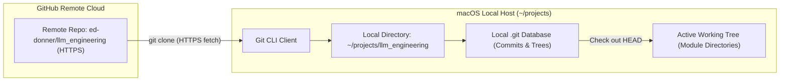
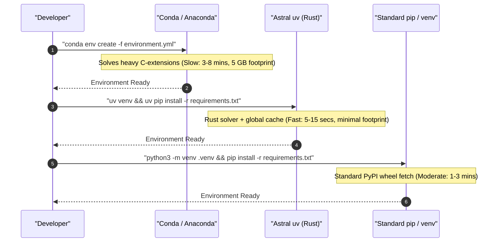
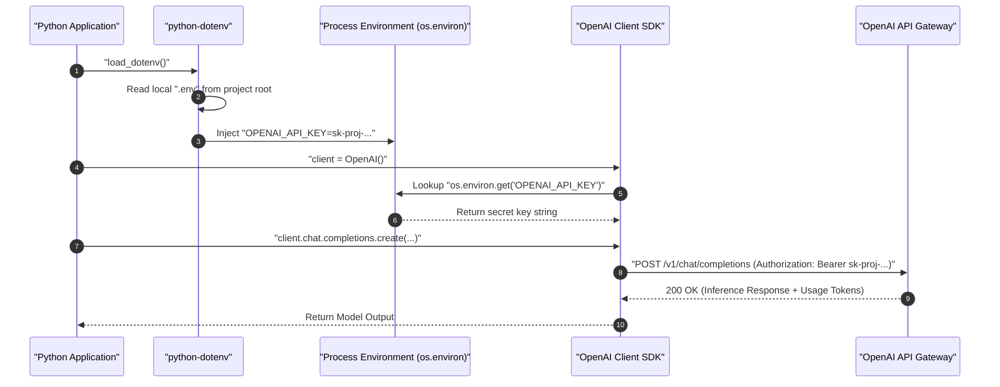
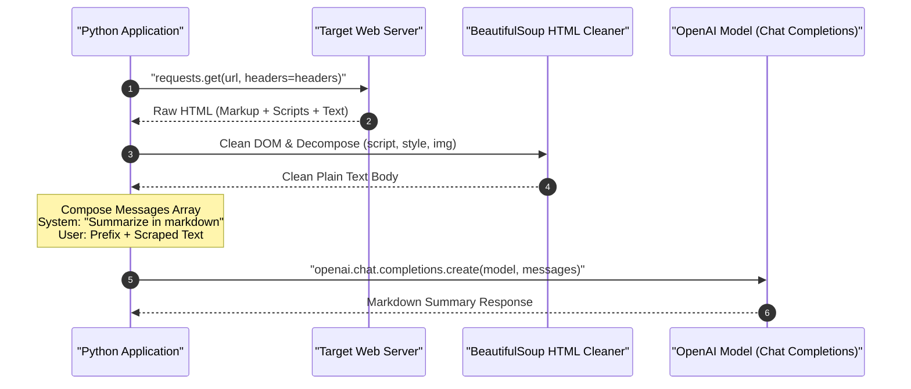
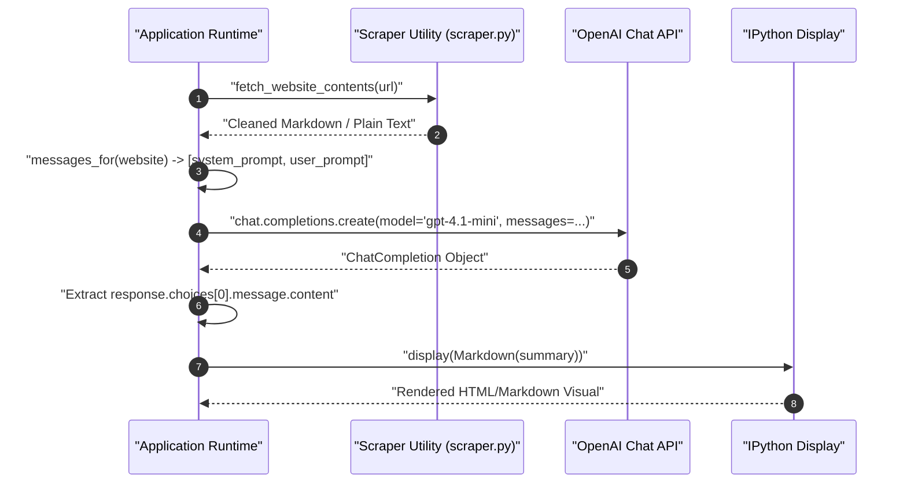

# LLM Engineering: Study Guide & Technical Notes

## Table of Contents

- [Mac Setup: Installing Git, Cloning the Repo, and Cursor IDE](#mac-setup-installing-git-cloning-the-repo-and-cursor-ide)
- [Setting Up Your OpenAI API Key and Environment Variables](#setting-up-your-openai-api-key-and-environment-variables)
- [Running Your First OpenAI API Call and System vs User Prompts](#running-your-first-openai-api-call-and-system-vs-user-prompts)
- [Building an End-to-End Website Summarizer with the OpenAI Chat Completions API](#building-an-end-to-end-website-summarizer-with-the-openai-chat-completions-api)

---

# Mac Setup: Installing Git, Cloning the Repo, and Cursor IDE

## Development Environment Foundations and Apple Command Line Tools

Machine learning engineering on macOS relies on standard Unix utilities, native C/C++ compilation headers, and shell tooling. Before installing Python packages, tokenizers, or model pipelines, Git and Apple's developer tools must be installed.

### Verifying Git and Installing Command Line Tools

macOS includes a stub executable for Git at `/usr/bin/git`. Running Git in a fresh macOS setup automatically checks whether Apple's Command Line Tools are present.

Open the terminal (`Applications` > `Utilities` > `Terminal`) and check your Git version:

```bash
# Check installed Git version
git --version
```

```text
git version 2.42.0
```

If developer tools are not yet installed, macOS shows a prompt asking:
`The "git" command requires the command line developer tools. Would you like to install the tools now?`

Click **Install** to download the lightweight Command Line Tools without needing the entire 12+ GB Xcode IDE. You can also trigger this directly from the terminal:

```bash
# Trigger installation of Apple Command Line Developer Tools
xcode-select --install
```

```text
xcode-select: note: install requested for command line developer tools
```

> [!TIP]
> **Check Installation Path:** Run `xcode-select -p` to verify the path. A properly linked environment outputs `/Library/Developer/CommandLineTools` or `/Applications/Xcode.app/Contents/Developer`.

### Alternative: Installing Upstream Git via Homebrew

Apple's bundled Git works well, but it updates slowly with macOS releases. For the newest features, security updates, and performance patches, install Git via **Homebrew**:

```bash
# Install the latest upstream Git using Homebrew
brew install git

# Verify the active binary path
which git
```

```text
/opt/homebrew/bin/git
```

| Tool                           | Provider        | Primary Use                                          | Trade-off                                                              |
| :----------------------------- | :-------------- | :--------------------------------------------------- | :--------------------------------------------------------------------- |
| **Apple CLT (`xcode-select`)** | Apple           | System headers, `clang`, `make`, basic `git`         | Small footprint (~1.5 GB), zero setup; updates tied to macOS releases. |
| **Homebrew Git**               | Homebrew        | Up-to-date Git releases and security patches         | Keeps pace with upstream Git; requires Homebrew installed.             |
| **Full Xcode App**             | Apple App Store | iOS / macOS native Swift and Objective-C development | Huge disk usage (12–15+ GB); unnecessary for Python LLM development.   |

---

## Workspace Architecture and Directory Strategy

A critical trap when setting up a Mac development environment is **folder placement and cloud file synchronization**.

### The Apple iCloud Synchronization Trap

macOS automatically enables iCloud Drive sync for `Desktop` (`~/Desktop`) and `Documents` (`~/Documents`). Storing code repositories in these synced directories causes serious problems:

1. **File Locking and Git Sluggishness:** Git writes thousands of small object files into `.git/objects` during checkouts and commits. iCloud continuously tries to upload each file, causing file locks, permission errors, and lag.
2. **Virtual Environment Bloat:** Python virtual environments (`.venv` or conda prefixes) contain thousands of third-party libraries and symlinks. Syncing them consumes bandwidth and exhausts cloud storage quotas.
3. **Redundant Sync Conflicts:** Code is already tracked and backed up remotely on GitHub. Running iCloud sync on top of Git creates competing sync engines that can corrupt local repositories.

### Filesystem Isolation vs. iCloud Sync Hazards

```text
+-----------------------------------------------------------------------------------+
|                              MACOS USER HOME DIRECTORY                            |
|                                    /Users/<name>/                                 |
+-----------------------------------------------------------------------------------+
       |                                                              |
       | (AVOID FOR CODE)                                             | (RECOMMENDED WORKSPACE)
       v                                                              v
+-------------------------------+                             +-------------------------------+
|      ~/Desktop & ~/Documents  |                             |          ~/projects           |
|  (Apple iCloud Auto-Sync)     |                             |   (Pure Local Filesystem)     |
+-------------------------------+                             +-------------------------------+
       |                                                              |
       |-- Sync Conflicts                                             |-- Zero Network Overhead
       |-- File-locking during builds                                 |-- Instant Git Disk I/O
       |-- Virtualenv / cache bloat                                   |-- Total Filesystem Isolation
       v                                                              v
+-------------------------------+                             +-------------------------------+
|       Apple iCloud Drive      |                             |   Remote Git Host (GitHub)    |
| (Redundant & Unstable for Git)|                             |  (Clean Branch & Push Sync)   |
+-------------------------------+                             +-------------------------------+
```

### Creating Your Workspace Folder

Keep all code in an unsynced local directory in your home folder, such as `~/projects`:

```bash
# Navigate to home directory
cd ~

# Confirm path
pwd
```

```text
/Users/ed
```

Create the directory and switch into it:

```bash
# Create the projects folder if it does not already exist
mkdir -p ~/projects

# Move into projects and verify
cd ~/projects
pwd
```

```text
/Users/ed/projects
```

---

## Cloning the Code Repository

With a clean local `projects` folder ready, clone the repository over HTTPS.

### Git Remote to Local Synchronization

Cloning downloads a full local copy of the repository files, commit history, and branches from GitHub to your machine.



### Cloning and Inspecting Files

1. Go to `https://github.com/ed-donner/llm_engineering`.
2. Click the green **Code** button and copy the HTTPS URL: `https://github.com/ed-donner/llm_engineering.git`.
3. In your terminal, run `git clone`:

```bash
# Clone the repository locally
git clone https://github.com/ed-donner/llm_engineering.git
```

```text
Cloning into 'llm_engineering'...
remote: Enumerating objects: 6956, done.
remote: Total 6956 (delta 0), reused 0 (delta 0), pack-reused 6956 (from 1)
Receiving objects: 100% (6956/6956), 50.72 MiB | 35.45 MiB/s, done.
Resolving deltas: 100% (4270/4270), done.
```

Switch into the directory and verify the contents:

```bash
# Enter the cloned repository
cd llm_engineering

# List files and directories
ls -la
```

```text
total 128
drwxr-xr-x  32 user  staff   1024 Oct 17 12:00 .
drwxr-xr-x   3 user  staff     96 Oct 17 11:58 ..
drwxr-xr-x  12 user  staff    384 Oct 17 12:00 .git
-rw-r--r--   1 user  staff   1200 Oct 17 12:00 .gitignore
-rw-r--r--   1 user  staff   1064 Oct 17 12:00 LICENSE
-rw-r--r--   1 user  staff   4520 Oct 17 12:00 README.md
-rw-r--r--   1 user  staff  11100 Oct 17 12:00 SETUP-mac.md
-rw-r--r--   1 user  staff  10800 Oct 17 12:00 SETUP-PC.md
-rw-r--r--   1 user  staff  10500 Oct 17 12:00 SETUP-linux.md
-rw-r--r--   1 user  staff    850 Oct 17 12:00 environment.yml
-rw-r--r--   1 user  staff    420 Oct 17 12:00 requirements.txt
drwxr-xr-x   6 user  staff    192 Oct 17 12:00 week1
drwxr-xr-x   6 user  staff    192 Oct 17 12:00 week2
drwxr-xr-x   6 user  staff    192 Oct 17 12:00 week3
drwxr-xr-x   6 user  staff    192 Oct 17 12:00 week4
drwxr-xr-x   6 user  staff    192 Oct 17 12:00 week5
drwxr-xr-x   6 user  staff    192 Oct 17 12:00 week6
drwxr-xr-x   6 user  staff    192 Oct 17 12:00 week7
drwxr-xr-x   6 user  staff    192 Oct 17 12:00 week8
```

---

## Code Editor Selection and Cursor Configuration

An AI-native code editor streamlines debugging, code generation, and multi-file project indexing.

### Cursor Architecture and Features

**Cursor** is built on top of Visual Studio Code (`VSCodium` base). It preserves all VS Code settings, keybindings, and extensions while embedding AI assistance directly into the editor:

- **Local Workspace Indexing:** Indexes project files locally so the AI understands imports, types, and project structure across multiple files.
- **Model Integration:** Connects to models like Claude 3.5 Sonnet and GPT-4o for inline editing, diffs, and terminal error fixing.
- **Trial & Free Usage:** Includes a two-week free trial for premium AI completions. Afterward, you can subscribe, use your own API keys, or use Cursor as a free, high-performance VS Code editor.

### Comparing Editors

| Editor       | Base Platform        | Native AI Integration                                 | Cost Model                                                        | Recommendation                                                          |
| :----------- | :------------------- | :---------------------------------------------------- | :---------------------------------------------------------------- | :---------------------------------------------------------------------- |
| **Cursor**   | VS Code Fork         | Full workspace indexing, multi-file diffs, agent mode | Free tier (editor features); Subscription or BYOK for frontier AI | **Recommended:** Quickest setup for AI-assisted multi-file development. |
| **VS Code**  | Electron / Microsoft | Requires extensions (GitHub Copilot, Continue.dev)    | Free and open source; Copilot subscription optional               | Excellent baseline with full feature parity for standard development.   |
| **Windsurf** | VS Code Fork         | Agentic AI flows with Codeium backend                 | Free tier / Paid subscription tiers                               | Capable alternative with similar inline AI editing.                     |
| **PyCharm**  | IntelliJ / JetBrains | JetBrains AI Assistant                                | Free Community; Paid Professional                                 | Great Python refactoring, but heavier memory footprint.                 |

### Installing and Configuring Cursor

1. Download the macOS installer from `cursor.com`.
2. Open the `.dmg` file and drag `Cursor.app` into `/Applications`.
3. Open **Cursor**, complete initial preferences (VS Code defaults recommended), and sign in.
4. Go to **File** > **Open Folder...** (or click **Open Project** on the welcome screen).
5. Navigate to `~/projects/llm_engineering`, select the folder, and click **Open**.

```text
+-----------------------------------------------------------------------------------+
|  CURSOR IDE - EXPLORER VIEW                                                       |
+-----------------------------------------------------------------------------------+
|  v LLM_ENGINEERING                               <-- Project Root (Must be Capital)|
|    > community-contributions                                                      |
|    > extras                                                                       |
|    > week1                                       <-- Module Directories           |
|    > week2                                                                        |
|    > week3                                                                        |
|    > week4                                                                        |
|    > week5                                                                        |
|    > week6                                                                        |
|    > week7                                                                        |
|    > week8                                                                        |
|      .gitignore                                                                   |
|      environment.yml                             <-- Conda Environment Config     |
|      requirements.txt                            <-- Pip Package Manifest         |
|      SETUP-mac.md                                <-- Mac Hardware Guidelines      |
+-----------------------------------------------------------------------------------+
```

> [!IMPORTANT]
> **Check the Project Root:** The top header in the file explorer must show `LLM_ENGINEERING` in bold capital letters. If a subfolder (like `week1`) is opened as the root, project-wide relative imports and virtual environments will not resolve correctly.

---

## Python Environment Management Alternatives

Choosing a Python package manager determines how quickly dependencies install, how much disk space is consumed, and how easily Apple Silicon GPU acceleration (Metal Performance Shaders / MPS) is supported.

### Anaconda vs. `uv` vs. Standard `venv`

- **Anaconda / Miniconda:** Uses the `conda` solver. Ships precompiled C/C++ libraries and BLAS acceleration packages. Great for guaranteed binary consistency across platforms, but slow to resolve dependencies and takes 5+ GB of disk space.
- **`uv` (by Astral):** A blazing-fast Python package and project manager written in Rust. Replaces `pip`, `pip-tools`, and `virtualenv`. Resolves dependencies in seconds and uses global hardlinks to save disk space.
- **Python `venv` + `pip`:** Python's built-in virtual environment tool. Available out of the box with zero external installation, but lacks advanced cross-platform binary solving.



| Environment Manager      | Resolution Speed        | Disk Efficiency           | Apple Silicon (MPS) Compatibility     | Recommendation                                                           |
| :----------------------- | :---------------------- | :------------------------ | :------------------------------------ | :----------------------------------------------------------------------- |
| **Anaconda / Miniconda** | Slow (Conda SAT solver) | Low (duplicates packages) | Native `osx-arm64` channels           | Reliable cross-platform consistency for heavy C-extensions.              |
| **`uv`**                 | Blazing (Rust engine)   | High (global hardlinks)   | Native PyPI wheels with ARM64 support | **Modern Industry Favorite:** Fastest resolution and minimal disk usage. |
| **`venv` + `pip`**       | Moderate                | Medium                    | Native PyPI wheels                    | Built-in fallback requiring no external package manager.                 |

---

## Common Pitfalls and Best Practices

> [!CAUTION]
> **Never Clone into Cloud Folders:** Do not place repositories inside folders managed by iCloud, OneDrive, Dropbox, or Google Drive. Cloud syncing locks Git files, breaks local SQLite vector databases, and causes random build failures.

> [!IMPORTANT]
> **Verify Native Apple Silicon Architecture:** On Apple Silicon Macs (M1/M2/M3/M4), ensure your terminal runs native ARM64 rather than Rosetta 2 x86 emulation. Run `uname -m` in your terminal—it must return `arm64`. Running under x86 causes PyTorch MPS acceleration to fail.

> [!TIP]
> **Hide the AI Chat Panel for Extra Space:** If Cursor opens with an AI Chat sidebar covering your workspace, press `Cmd + L` to toggle it or drag the divider to collapse it.

---

## Review Quiz

<details>
<summary><b>Question 1: Why should you avoid storing code repositories in ~/Desktop or ~/Documents on macOS?</b></summary>
<br>
<b>Answer:</b> macOS syncs Desktop and Documents to iCloud Drive by default. Storing repositories there causes continuous background sync of internal <code>.git</code> files and virtual environments, leading to file-locking conflicts, slow disk performance, and potential repository corruption. Use an unsynced local folder like <code>~/projects</code> instead.
</details>

<details>
<summary><b>Question 2: What happens when you run "git --version" on a fresh Mac without developer tools?</b></summary>
<br>
<b>Answer:</b> The operating system intercepts the command using the <code>/usr/bin/git</code> stub and opens a dialog offering to install Apple's Command Line Developer Tools (which includes Git, Clang, and Make).
</details>

<details>
<summary><b>Question 3: How does Cursor maintain compatibility with Visual Studio Code extensions and settings?</b></summary>
<br>
<b>Answer:</b> Cursor is an open-source fork of Visual Studio Code (built on the VSCodium core). Because it uses the same underlying editor architecture, it supports standard VS Code settings, keybindings, and extensions while adding native AI workspace indexing.
</details>

<details>
<summary><b>Question 4: What confirms that you opened the correct project root folder in Cursor?</b></summary>
<br>
<b>Answer:</b> The top label in the Cursor file explorer sidebar must read <code>LLM_ENGINEERING</code> in capital letters, showing the repository directories directly underneath. If a specific subfolder appears as the root, project-wide relative imports and repository-level virtual environments will fail.
</details>

<details>
<summary><b>Question 5: What primary benefits does "uv" provide compared to traditional Anaconda environments?</b></summary>
<br>
<b>Answer:</b> Written in Rust, <code>uv</code> resolves and installs dependencies 10 to 100 times faster than Conda. It also uses a global content-addressable cache with hardlinks, drastically reducing disk space compared to Conda's multi-gigabyte environment copies.
</details>

---

# Setting Up Your OpenAI API Key and Environment Variables

## ChatGPT vs. OpenAI Platform API

A key distinction in AI engineering is the difference between consumer chat applications and backend developer APIs:

- **ChatGPT (Consumer Web App):** A conversational interface at `chatgpt.com`. Monthly subscriptions (such as ChatGPT Plus at $20/month) provide web UI perks and higher usage caps, but provide **zero** programmatic API access.
- **OpenAI Platform API (Developer Service):** A programmatic REST API at `platform.openai.com`. Applications connect directly via HTTP or official client libraries (`openai` package in Python). Billing is pay-as-you-go based on token usage (fractions of a cent per request), completely separate from any ChatGPT subscription.

### Free Alternatives: Gemini and Local Llama

Setting up an OpenAI account is optional. You can build LLM applications using free alternative models:

- **Google Gemini API:** Offers a developer free tier via Google AI Studio with generous request quotas, multi-turn chat, structured JSON output, and multimodal context.
- **Local Llama (via Ollama or vLLM):** Runs open-weights models (like Llama 3) locally on your own hardware at zero cost, offering complete privacy and offline operation.

| Service                  | Access Type             | Endpoint / Portal     | Billing Model                                   | Best Suited For                                          |
| :----------------------- | :---------------------- | :-------------------- | :---------------------------------------------- | :------------------------------------------------------- |
| **OpenAI Platform API**  | Programmatic REST / SDK | `platform.openai.com` | Pay-as-you-go per million tokens                | Production backends, evaluations, agentic pipelines      |
| **ChatGPT Plus**         | Web Chat UI             | `chatgpt.com`         | Flat monthly subscription ($20 / month)         | Interactive writing, personal assistance, quick research |
| **Google Gemini API**    | Programmatic REST / SDK | `aistudio.google.com` | Free tier quota + pay-as-you-go commercial tier | Zero-cost development, large multimodal context          |
| **Local Llama (Ollama)** | Local HTTP / Python     | `localhost:11434`     | 100% free (consumes local compute)              | Local testing, privacy-sensitive data, offline work      |

---

## Setting Up Billing and Credits

To make requests to the OpenAI API, you need an account with prepaid credits on the OpenAI Platform.

### Account Creation and Pre-Funding

1. Go to `platform.openai.com` and click **Sign up**. You can authenticate using Google, Microsoft, Apple, or an email address.
2. Click the **Settings** gear icon in the top right, then select **Billing**.
3. Click **Add to credit balance**. The minimum deposit is **$5** (valid for an entire year), which covers thousands of development calls.
4. Add a payment card under **Payment methods**.

> [!CAUTION]
> **Keep Auto-Recharge Turned OFF:** In the Billing dashboard, ensure **Auto recharge** is set to **Off**. Leaving auto-recharge on allows OpenAI to automatically charge your card if your balance runs out. Keeping it off guarantees your spending is strictly capped at your manual deposit.

> [!IMPORTANT]
> **Handling International Card Declines:** If your credit card is declined during top-up, your bank is likely blocking an international US transaction. Check your banking mobile app to allow international online payments or contact your card issuer.

---

## Creating an API Key

An API key is a secret token that lets your application authenticate with OpenAI's servers. Every request sent with this key bills against your account credit.

### Key Generation Steps

1. In **Settings**, select **API keys** under the **Organization** section.
2. Click **Create new secret key**.
3. Configure the key options:
   - **Owned by:** Select **You** (associates the key with your developer user).
   - **Name:** Enter a descriptive label (e.g., `llm_engineering_key`).
   - **Project:** Select **Default project** (avoids restricted sub-project scopes that block newer models).
   - **Permissions:** Select **All**.
4. Click **Create secret key**.

```text
+-----------------------------------------------------------------------------------+
|  OPENAI DEVELOPER PLATFORM - API KEY CREATION                                     |
+-----------------------------------------------------------------------------------+
|  [Create new secret key]                                                          |
|                                                                                   |
|  Owned by:   (*) You         ( ) Service account                                  |
|  Name:       llm_engineering_key                                                  |
|  Project:    Default project                     <-- Avoid restricted project scopes|
|  Permissions:(All) Read and write API resources  <-- Unrestricted developer access|
|                                                                                   |
|  [Cancel]                                             [Create secret key] (CLICK) |
+-----------------------------------------------------------------------------------+
```

### Key Security and Storage

When generated, the key displays starting with `sk-proj-...`:

- **Displayed Only Once:** OpenAI displays the raw secret key once. When you close the popup, the full key cannot be viewed again.
- Click **Copy** to place the key into your clipboard. Keep the popup open until you paste and save it into your local project.

---

## Storing Keys Safely in `.env`

Hardcoding API keys in Python files is dangerous because keys can easily be committed to GitHub. Following standard security practices, credentials should be stored in a local `.env` file and loaded into environment variables at runtime.

### Secret Loading and Protection Flow

```text
+-----------------------------------------------------------------------------------+
|                             SECURE LOCAL WORKSPACE                                |
|                           ~/projects/llm_engineering                              |
+-----------------------------------------------------------------------------------+
  |
  |-- .env (Local Plaintext File)
  |     OPENAI_API_KEY=sk-proj-7WOKk...
  |
  |-- .gitignore (Git Exclusion Rule)
  |     .env  <--------------------------------- Blocks Git Tracking (Prevents Leaks)
  |
  |-- Cursor IDE (.env Protection)
  |     Cursor-Tab Ignored <--------------------- Silences AI Telemetry on Secrets
  |
  v
+-------------------------------+
|  python-dotenv (load_dotenv)  |
+-------------------------------+
  |
  v Injects into Process Memory
+-------------------------------+
|     os.environ / Python       |
+-------------------------------+
  |
  v Automatic Client Authentication
+-------------------------------+         HTTPS POST          +---------------------+
|      openai.OpenAI()          | --------------------------> |  OpenAI API Gateway |
|  (Reads OPENAI_API_KEY)       |    Bearer sk-proj-...       | (Validates & Billed)|
+-------------------------------+                             +---------------------+
```

### Authentication Sequence



### Creating the `.env` File

In Cursor with your project open:

1. Right-click the blank area below the file list in the explorer sidebar and select **New File**.
2. Name the file **`.env`** (leading period, lowercase `env`).
   - Must **not** be named `.env.txt`, `env`, or `settings.env`.
   - Must be in the **project root folder**, not inside subfolders.
3. Add your key definition:

```ini
# OpenAI API Secret Key configuration
OPENAI_API_KEY=sk-proj-7WOKk21Ls_J_xxwH1SLQGCJog_EXAMPLE_KEY_DO_NOT_SHARE
```

### Formatting Rules

- **Exact Name:** Must be spelled `OPENAI_API_KEY` in uppercase with underscores.
- **No Extra Spaces:** Do not place spaces around the `=` sign.
- **No Quotes Needed:** Paste the raw key directly after the `=`.
- **Save the File:** If a white circle appears on the editor tab, the file is unsaved. Press **`Cmd + S`** (macOS) or **`Ctrl + S`** (Windows/Linux) to save it.

### Why Cursor Shows a Stop Sign on `.env`

When viewing `.env` in Cursor, a small stop sign icon appears next to the filename and in the status bar (`Cursor-Tab (Ignored)`).

This is a security feature: Cursor detects credentials inside `.env` and **disables AI indexing, autocompletion, and telemetry for that file**, ensuring private keys are never transmitted to external AI providers during background indexing.

---

## Verifying Your Setup

Run a quick check in your terminal and Python environment to verify that the key loads correctly.

### Check `.env` in Terminal

```bash
# Check that .env exists in project root
ls -la .env

# Verify variable name without printing the full secret
grep "OPENAI_API_KEY" .env | cut -c 1-20
```

```text
-rw-r--r--  1 user  staff  82 Oct 17 12:30 .env
OPENAI_API_KEY=sk-pr
```

### Python Verification Script

Run this test script to verify that `python-dotenv` and the OpenAI SDK authenticate successfully:

```python
import os
from dotenv import load_dotenv
from openai import OpenAI

# Load variables from .env into process memory
load_dotenv()

# Verify that the variable exists
api_key = os.environ.get("OPENAI_API_KEY")
if not api_key:
    raise ValueError("OPENAI_API_KEY not found. Check your .env file!")

# Initialize client (automatically reads OPENAI_API_KEY from environment)
client = OpenAI()

# Send a lightweight test request
response = client.chat.completions.create(
    model="gpt-4o-mini",
    messages=[
        {"role": "user", "content": "Respond with the single word 'CONNECTED' if you can read this."}
    ],
    max_tokens=5,
)

print("Status:", response.choices[0].message.content.strip())
```

```text
Status: CONNECTED
```

---

## Key Management Best Practices

| Storage Method                       | Security                 | Convenience                  | Recommendation                                                                    |
| :----------------------------------- | :----------------------- | :--------------------------- | :-------------------------------------------------------------------------------- |
| **`.env` + `python-dotenv`**         | High (with `.gitignore`) | Very High                    | **Recommended:** Simple, portable across local machines, zero cloud setup.        |
| **Shell Profile (`~/.zshrc`)**       | Medium                   | Medium                       | Convenient for global tools, but exposes keys to all terminal sessions.           |
| **Cloud Secret Manager (Vault/AWS)** | Maximum                  | Lower (requires cloud setup) | Production enterprise standard; unnecessary overhead for local machines.          |
| **Hardcoded in code files**          | Zero (Critical Risk)     | Low                          | **Anti-Pattern:** Keys will leak to GitHub; automated bots steal them in seconds. |

> [!CAUTION]
> **Prevent Git Leaks:** Ensure `.env` is listed in your `.gitignore` file. Never run `git add -f .env`. Public scrapers search GitHub continuously; exposed keys are compromised and revoked by OpenAI bots within seconds.

> [!IMPORTANT]
> **Exact Variable Name Required:** The OpenAI Python library automatically looks for `os.environ["OPENAI_API_KEY"]`. If misspelled (e.g., `OPEN_API_KEY` or `openai_key`), client initialization fails with an `openai.OpenAIError: The api_key client option must be set` error.

> [!TIP]
> **Track Token Usage:** Monitor your usage under the **Usage** dashboard (`platform.openai.com/usage`). Development queries cost fractions of a cent ($0.0001 to $0.005 each).

---

## Review Quiz

<details>
<summary><b>Question 1: Why does a paid ChatGPT Plus subscription not provide access to the OpenAI Platform API?</b></summary>
<br>
<b>Answer:</b> ChatGPT Plus is a consumer web application with a flat monthly fee for chat UI features on chatgpt.com. The OpenAI Platform API is a separate developer infrastructure billed per token processed. Subscriptions to one service do not grant credits or access to the other.
</details>

<details>
<summary><b>Question 2: Why should "Auto recharge" be turned off in the OpenAI billing dashboard during local development?</b></summary>
<br>
<b>Answer:</b> If code enters an infinite loop or unexpected recursive calls during development, auto-recharge will continuously bill your credit card. Keeping auto-recharge off ensures your maximum financial exposure is capped at your manual deposit.
</details>

<details>
<summary><b>Question 3: Why should project keys be scoped to "Default project" with "All" permissions during development?</b></summary>
<br>
<b>Answer:</b> Creating custom restricted projects can restrict model endpoints, token allowances, or service features, resulting in unexpected 403 Forbidden or model-not-found errors when trying out new model architectures.
</details>

<details>
<summary><b>Question 4: What does the stop sign icon next to the .env file in Cursor signify?</b></summary>
<br>
<b>Answer:</b> It indicates that Cursor's AI features and background code indexing are disabled for that file, protecting sensitive secrets and API keys from being sent to external AI providers during background indexing.
</details>

<details>
<summary><b>Question 5: How does client = OpenAI() find your API key without passing it explicitly?</b></summary>
<br>
<b>Answer:</b> The OpenAI SDK automatically looks up the process environment variable named <code>OPENAI_API_KEY</code> via <code>os.environ.get("OPENAI_API_KEY")</code>. When <code>load_dotenv()</code> runs, values from the local <code>.env</code> file are loaded into the process environment.
</details>

---

# Running Your First OpenAI API Call and System vs User Prompts

## Jupyter Notebook Kernel Setup and Environment Verification

Interactive Python notebooks (`.ipynb`) allow you to experiment with LLM prompts and inspect API responses cell by cell. When opening a notebook in an editor like Cursor or VS Code, the notebook must be bound to the project's local virtual environment rather than a global Python installation.

### Selecting the Dedicated Virtual Environment Kernel

1. Open the notebook (such as `week1/day1.ipynb`) in Cursor.
2. In the top-right corner of the editor window, click **Select Kernel**.
3. Choose **Python Environments...**.
4. Select the local virtual environment matching **`.venv (Python 3.12.x)`** located at `.venv/bin/python` (marked with a star or as **Recommended**).

```text
+-----------------------------------------------------------------------------------+
|  CURSOR IDE - JUPYTER KERNEL PICKER                                               |
+-----------------------------------------------------------------------------------+
|  > Select Kernel                                                                  |
|    > Python Environments...                                                       |
|      * .venv (Python 3.12.9) .venv/bin/python  <-- SELECT THIS (Recommended)     |
|        Global Python (/usr/bin/python3)        <-- AVOID (Missing installed packages)|
+-----------------------------------------------------------------------------------+
```

> [!IMPORTANT]
> **Kernel Persistence:** You must select the kernel for each new notebook you open. If a notebook defaults to global Python, running cells will raise `ModuleNotFoundError: No module named 'openai'` or `dotenv`.

---

## Defensive API Key Validation

Before invoking model endpoints, applications should defensibly validate that credentials exist and conform to expected formats.

```python
import os
from dotenv import load_dotenv

# Load variables from .env into environment memory; override ensures fresh values
load_dotenv(override=True)

api_key = os.getenv("OPENAI_API_KEY")

# Perform defensive pre-flight validation
if not api_key:
    print("Error: No API key found. Verify that your .env file exists in the project root.")
elif not api_key.startswith("sk-proj-"):
    print("Warning: API key found, but it does not start with 'sk-proj-'. Verify your project key format.")
elif api_key.strip() != api_key:
    print("Warning: API key contains leading or trailing whitespace/tab characters. Strip them out.")
else:
    print("API key found and looks good so far!")
```

```text
API key found and looks good so far!
```

---

## OpenAI Chat Completions API Architecture

The primary endpoint for conversational and instruction-following models is the **Chat Completions API**.

### Message Payload Schema

The Chat Completions API expects conversation history as a **list of message dictionaries**. Each dictionary requires two primary keys:

- **`role`:** Identifies the author of the message (`"system"`, `"user"`, or `"assistant"`).
- **`content`:** The string message text.

```python
from openai import OpenAI

# Initialize client (reads OPENAI_API_KEY from os.environ automatically)
openai = OpenAI()

# Define the user prompt
message = "Hello, GPT! This is my first ever message to you! Hi!"

# Package into the standard Chat Completions message structure
messages = [
    {"role": "user", "content": message}
]

# Send the API request to the lightweight nano model
response = openai.chat.completions.create(
    model="gpt-5-nano",
    messages=messages
)

# Extract and display the assistant response content
print(response.choices[0].message.content)
```

```text
Hi there! Nice to meet you, and welcome—thanks for saying hi. I'm here to help with questions, explanations, writing, brainstorming, coding, planning, learning, and more. What would you like to do today?
```

### Parsing the Response Object

The returned response object contains metadata and candidate completions:

- **`response.choices`:** A list of generated candidates. By default, the API generates one candidate (`n=1`).
- **`response.choices[0].message.content`:** Contains the raw text string generated by the model.
- **`response.usage`:** Contains token metrics, breaking down `prompt_tokens`, `completion_tokens`, and `total_tokens` for cost tracking.

---

## System vs. User Prompts: Persona, Framing, and Behavior Control

The modern LLM instruction format explicitly separates developer framing from end-user inputs.

### Conceptual Roles

1. **System Prompt (`role: "system"`):** Sets the global framing, persona, tone, operational boundaries, and formatting instructions. It tells the model _how_ to behave and _what rules_ to follow.
2. **User Prompt (`role: "user"`):** Represents the actual query, request, or runtime input that the model should process within the context established by the system prompt.

### Mental Model: Request Assembly and Gateway Resolution

```text
+-----------------------------------------------------------------------------------+
|                            CHAT COMPLETIONS PIPELINE                              |
+-----------------------------------------------------------------------------------+
                                        |
       +--------------------------------+--------------------------------+
       |                                                                 |
       v                                                                 v
+-------------------------------+                             +-------------------------------+
|         System Prompt         |                             |          User Prompt          |
|  role: "system"               |                             |  role: "user"                 |
|  "You are a snarky assistant" |                             |  "What is 2 + 2?"             |
+-------------------------------+                             +-------------------------------+
       |                                                                 |
       +--------------------------------+--------------------------------+
                                        v
                    +---------------------------------------+
                    |    Structured JSON Message Array      |
                    |    [ {"role":"system", ...},          |
                    |      {"role":"user", ...} ]           |
                    +---------------------------------------+
                                        |
                                        v HTTPS POST
                    +---------------------------------------+
                    |       OpenAI API Gateway              |
                    |       api.openai.com/v1/...           |
                    +---------------------------------------+
                                        |
                                        v Token Generation
                    +---------------------------------------+
                    |       ChatCompletion Response         |
                    |       choices[0].message.content      |
                    +---------------------------------------+
```

### Behavioral Impact: Helpful vs. Snarky Assistant

The system prompt drastically shapes how the model answers identical user queries:

```python
# Helpful Assistant Configuration
helpful_messages = [
    {"role": "system", "content": "You are a helpful assistant."},
    {"role": "user", "content": "What is 2 + 2?"}
]

helpful_response = openai.chat.completions.create(
    model="gpt-4.1-nano",
    messages=helpful_messages
)

print("Helpful:", helpful_response.choices[0].message.content)

# Snarky Assistant Configuration
snarky_messages = [
    {"role": "system", "content": "You are a snarky assistant."},
    {"role": "user", "content": "What is 2 + 2?"}
]

snarky_response = openai.chat.completions.create(
    model="gpt-4.1-nano",
    messages=snarky_messages
)

print("Snarky:", snarky_response.choices[0].message.content)
```

```text
Helpful: 2 + 2 equals 4.
Snarky: Oh, finally, a math question! 2 + 2 equals 4. Groundbreaking, I know.
```

| Prompt Dimension     | System Prompt (`role: "system"`)                            | User Prompt (`role: "user"`)                             |
| :------------------- | :---------------------------------------------------------- | :------------------------------------------------------- |
| **Primary Purpose**  | Defines persona, behavior rules, output schema, constraints | Provides runtime task, input data, or questions          |
| **Typical Author**   | Application developer / system engineer                     | End-user, API caller, or upstream data pipeline          |
| **Execution Impact** | High-level conditioning across the entire conversation      | Immediate focus for the next completion turn             |
| **Example Use Case** | `"Respond in valid JSON using the provided schema."`        | `"Extract the names and prices from this receipt text."` |

---

## Integrating External Data: Server-Side Web Scraping

LLMs cannot access live private web data without external retrieval. Ingesting raw external text into a user prompt enables models to analyze, summarize, or extract structured intelligence from arbitrary URLs.

### Inspecting the Server-Side Scraper (`scraper.py`)

A clean, server-side scraper uses `requests` and `BeautifulSoup` to download HTML and strip out non-text noise before sending content to an LLM:

```python
import requests
from bs4 import BeautifulSoup

# Standard browser User-Agent header prevents simple bot-blocking
headers = {
    "User-Agent": "Mozilla/5.0 (Windows NT 10.0; Win64; x64) AppleWebKit/537.36 (KHTML, like Gecko) Chrome/117.0.0.0 Safari/537.36"
}

def fetch_website_contents(url):
    """Fetch website HTML and return stripped clean text with title."""
    response = requests.get(url, headers=headers)
    soup = BeautifulSoup(response.content, "html.parser")

    title = soup.title.string if soup.title else "No title found"

    # Strip non-informational elements that consume unnecessary context tokens
    for irrelevant in soup.body(["script", "style", "img", "input"]):
        irrelevant.decompose()

    text = soup.body.get_text(separator="\n", strip=True)
    return title + "\n\n" + text
```

### Scrape-and-Summarize Architecture Flow



### Executing Web Summarization

```python
from scraper import fetch_website_contents

# Fetch and clean web content
scraped_text = fetch_website_contents("https://edwarddonner.com")

# Define prompt framing
system_prompt = """
You are an assistant that analyzes the contents of a website,
and provides a short summary, ignoring text that might be navigation related.
Respond in markdown.
"""

user_prompt_prefix = "Here are the contents of a website:\n\n"

messages = [
    {"role": "system", "content": system_prompt},
    {"role": "user", "content": user_prompt_prefix + scraped_text}
]

# Run summarization
summary_response = openai.chat.completions.create(
    model="gpt-5-nano",
    messages=messages
)

print(summary_response.choices[0].message.content)
```

```text
### Website Overview: Edward Donner
- **Focus:** AI and Large Language Model engineering, coding experiments, and talent platforms.
- **Background:** Co-founder and CTO of Nebula.io, building verticalized LLM solutions.
- **Projects:** Interactive AI benchmarks, coding guides, and engineering tutorials.
```

---

## Model Selection and Sizing Trade-offs

| Model Tier              | Representative Models        | Speed / Latency    | Relative Cost                     | Recommended Use Case                                                      |
| :---------------------- | :--------------------------- | :----------------- | :-------------------------------- | :------------------------------------------------------------------------ |
| **Nano / Micro**        | `gpt-5-nano`, `gpt-4.1-nano` | Ultra-fast (< 1s)  | Extremely Low ($0.05 / 1M tokens) | Rapid testing, classification, simple summaries, high-volume routing      |
| **Mini / Standard**     | `gpt-4o-mini`                | Very Fast (1–2s)   | Low ($0.15 / 1M tokens)           | Balanced daily development, extraction, code generation                   |
| **Frontier / Flagship** | `gpt-4o`, `o1`               | Moderate (2–10s+)  | Higher ($2.50 – $15 / 1M tokens)  | Complex multi-step reasoning, architectural planning, rigorous evaluation |
| **Local Open-Weights**  | `llama3:8b` (via Ollama)     | Hardware-dependent | Zero (Free)                       | Local experimentation, privacy-sensitive workloads, offline development   |

---

## Critical Gotchas and Best Practices

> [!CAUTION]
> **Context Window Flooding from Scrapers:** Raw HTML documents frequently contain megabytes of inline SVG, minified JavaScript, and CSS styles. Ingesting raw HTML directly into a prompt wastes token quotas and risks exceeding context limits. Always strip non-text elements (`script`, `style`, `noscript`) using BeautifulSoup before formatting prompt payloads.

> [!IMPORTANT]
> **System Prompt Enforcement Varies by Model:** Smaller nano models adhere to system instructions with less strict compliance than flagship frontier models. If a nano model ignores an output formatting constraint (such as "Respond in valid JSON"), reinforce the requirement in both the system prompt and the end of the user prompt.

> [!TIP]
> **Use override=True When Loading `.env`:** When developing in Jupyter notebooks, running `load_dotenv()` multiple times without `override=True` will not reload newly saved keys if the variable was already cached in process memory. Always specify `load_dotenv(override=True)`.

---

## Review Quiz

<details>
<summary><b>Question 1: What is the primary operational consequence of selecting the wrong Jupyter kernel in Cursor or VS Code?</b></summary>
<br>
<b>Answer:</b> The notebook will execute inside the system's global Python environment or an unrelated interpreter rather than your project's <code>.venv</code>. This triggers immediate <code>ModuleNotFoundError</code> exceptions for installed packages like <code>openai</code>, <code>dotenv</code>, and <code>bs4</code>.
</details>

<details>
<summary><b>Question 2: What are the two mandatory keys required in each message dictionary passed to openai.chat.completions.create()?</b></summary>
<br>
<b>Answer:</b> Each dictionary must contain <code>role</code> (specifying <code>"system"</code>, <code>"user"</code>, or <code>"assistant"</code>) and <code>content</code> (containing the text string of the message).
</details>

<details>
<summary><b>Question 3: How does the system prompt differ conceptually and operationally from the user prompt?</b></summary>
<br>
<b>Answer:</b> The system prompt sets the foundational persona, behavioral rules, tone, and output format constraints for the model. The user prompt provides the specific runtime task, input question, or dynamic data that the model must process within that system frame.
</details>

<details>
<summary><b>Question 4: Why does scraper.py call irrelevant.decompose() on tags like "script", "style", and "img" before extracting text?</b></summary>
<br>
<b>Answer:</b> Decomposing those DOM nodes permanently removes client scripts, CSS definitions, and image markup. This cleans the text and avoids wasting model context tokens on non-semantic noise.
</details>

<details>
<summary><b>Question 5: What is the purpose of passing override=True to load_dotenv() in an interactive notebook?</b></summary>
<br>
<b>Answer:</b> By default, <code>load_dotenv()</code> does not overwrite environment variables that already exist in process memory. Setting <code>override=True</code> forces the function to reload variables from the <code>.env</code> file, ensuring newly updated or corrected API keys are immediately applied without restarting the Jupyter kernel.
</details>

---

# Building an End-to-End Website Summarizer with the OpenAI Chat Completions API

Connecting scraped web content to large language model APIs enables automated summarization, tone adaptation, and structured content extraction. By structuring the prompt into dedicated system and user messages, developers can control persona, formatting, and analytical focus while feeding dynamic web data into frontier models.

```text
+-----------------------+      +-------------------------+      +-------------------------+
|      Target URL       | ---> |  fetch_website_contents | ---> | Cleaned Semantic Text   |
| (e.g., cnn.com)       |      |  (requests + bs4 parse) |      | (No scripts, styles)    |
+-----------------------+      +-------------------------+      +-------------------------+
                                                                             |
                                                                             v
+-----------------------+      +-------------------------+      +-------------------------+
|   Rich Output View    | <--- |   OpenAI Chat API       | <--- |   messages_for(text)    |
| display(Markdown(...))|      |   (gpt-4.1-mini model)  |      |   [system, user dicts]  |
+-----------------------+      +-------------------------+      +-------------------------+
```



---

## Designing System and User Prompts for Document Summarization

Prompt engineering for document summarization requires separating operational constraints from dynamic input text. The system prompt defines the assistant's persona, processing rules, and formatting expectations, while the user prompt wraps the scraped content with explicit processing instructions.

### The Code Block Suppression Instruction

A frequent challenge when requesting Markdown from LLMs is that models often wrap their entire response inside a Markdown code block (triple backticks ` ```markdown `). When rendered inside a notebook or web UI, this displays the output inside a raw code box instead of styled HTML headings, bullet lists, and paragraphs.

Adding an explicit negative constraint prevents this behavior:

```python
system_prompt = """
You are an assistant that analyzes the contents of a website,
and provides a short summary, ignoring text that might be navigation related.
Respond in markdown. Do not wrap the markdown in a code block - respond just with the markdown.
"""
```

### Dynamic Message Assembly

To package user requests consistently, define a reusable message factory function that pairs the system prompt with the scraped content prefixed by task instructions:

```python
# Define user prompt template with clear task directives and trailing whitespace
user_prompt_prefix = """
Here are the contents of a website.
Provide a short summary of this website.
If it includes news or announcements, then summarize these too.

"""

def messages_for(website):
    """
    Constructs a two-turn message payload for the OpenAI Chat Completions API.

    Args:
        website (str): Cleaned text content scraped from a web page.

    Returns:
        list[dict]: System and user message dictionaries.
    """
    return [
        {"role": "system", "content": system_prompt},
        {"role": "user", "content": user_prompt_prefix + website}
    ]
```

### Verifying Payload Structure

Passing scraped content into `messages_for()` generates the structured payload ready for API ingestion:

```python
# Generate message payload from previously scraped site variable
payload = messages_for(ed)
print(payload[0]["role"])
print(payload[1]["role"])
print(f"Total user message characters: {len(payload[1]['content'])}")
```

```text
system
user
Total user message characters: 2418
```

---

## Implementing the Summarization Pipeline with OpenAI Chat Completions

The core summarization function coordinates the web scraper, API request, and response extraction into a single callable unit.

```python
import openai
from scraper import fetch_website_contents

def summarize(url):
    """
    Fetches website text, submits it to OpenAI Chat Completions, and returns the summary.

    Args:
        url (str): The target website address.

    Returns:
        str: Raw text/markdown content returned by the language model.
    """
    # Step 1: Scrape and extract text content from the target URL
    website = fetch_website_contents(url)

    # Step 2: Dispatch chat completion request to OpenAI
    response = openai.chat.completions.create(
        model="gpt-4.1-mini",
        messages=messages_for(website)
    )

    # Step 3: Extract and return the completion string
    return response.choices[0].message.content
```

### Testing the Summarizer

Running `summarize()` against a website returns the raw string generated by the model:

```python
# Execute summary against a personal portfolio page
raw_output = summarize("https://edwarddonner.com")
print(raw_output)
```

```text
# Website Summary: Edward Donner\n\nThis website belongs to Ed Donner, a coder and AI enthusiast with a passion for experimenting with large language models...
```

---

## Formatted Output Rendering with IPython Display

When returning Markdown strings inside Jupyter notebooks, raw Python string outputs display escape sequences (such as `\n` or quotes) and collapse headings and bullet lists into an unstyled text block.

To present results clearly, use IPython's native `display()` and `Markdown()` visualizers.

```python
from IPython.display import display, Markdown

def display_summary(url):
    """
    Fetches and summarizes a website, rendering formatted Markdown in notebook environments.

    Args:
        url (str): The target website address.
    """
    summary = summarize(url)
    display(Markdown(summary))
```

Running `display_summary("https://edwarddonner.com")` formats headers, lists, and links into readable visual sections:

```python
display_summary("https://edwarddonner.com")
```

```text
Website Summary: Edward Donner

This website is the personal and professional homepage of Edward Donner, a coder and AI enthusiast who enjoys experimenting with large language models, co-founder and CTO of Nebula.io, a company applying AI to talent discovery and management, leveraging proprietary LLMs and a patented platform. Ed is also an active educator and author.

Key Features:
- Projects:
  - Connect Four: an arena where LLMs compete in diplomacy and strategic games.
- About Ed:
  - Shares interests in coding, AI, DJing, amateur electronic music, and engaging with the tech community.
- Posts & Announcements:
  - AI in Production: Gen AI and Agentic AI on AWS at scale (Sep 15, 2025)
  - Connecting my courses - become an LLM expert and leader (May 18, 2025)
  - The Complete Agentic AI Engineering Course (April 21, 2025)

Contact & Follow:
- Email: ed [at] edwarddonner [dot] com
- Social Media: LinkedIn, Twitter, Facebook
- Newsletter subscription available
```

---

## Steering Persona, Tone, and Output Style via Prompt Engineering

One of the greatest advantages of frontier LLMs is that tone, style, audience adaptation, and persona can be altered exclusively through the system prompt without altering underlying application code or scraping logic.

```text
+-----------------------------------------------------------------------------------+
| System Prompt: Professional Assistant                                             |
| Output: "Edward Donner is an experienced software engineer and CTO..."            |
+-----------------------------------------------------------------------------------+
                                         vs
+-----------------------------------------------------------------------------------+
| System Prompt: Snarky Sarcastic Assistant                                         |
| Output: "Edward Donner's Nerdy Playground: friendly neighborhood code monkey..." |
+-----------------------------------------------------------------------------------+
```

### Implementing a Sarcastic Persona

By updating `system_prompt` to request humor and snark, the same summarizer produces a completely different analytical perspective on the same source text:

```python
# Redefine system prompt with an opinionated, humorous persona
system_prompt = """
You are a snarky assistant that analyzes the contents of a website and provides a short, snarky, humorous summary.
Respond in markdown. Do not wrap the markdown in a code block - respond just with the markdown.
"""
```

Re-running `display_summary("https://edwarddonner.com")` produces an irreverent summary:

```python
display_summary("https://edwarddonner.com")
```

```text
Edward Donner's Nerdy Playground

Ed is your friendly neighborhood code monkey who's obsessed with playing DJ (badly), making very amateur electronic tunes, and stalking Hacker News like it's the only social interaction he needs. He co-founded Nebula.io, where AI meets job recruitment, creating fancy patented tech that scouts talent better than you ever could. Also, he sold an AI startup once, because why not?

Fun projects to distract you:
- Connect Four (the classic game, apparently)
- Outsmart, where AI language models throw shade and play political brinkmanship against each other.

Latest News (like you're dying to know):
- Sept 2025: Talks about running generative and agentic AI at scale on AWS
- May 2025: Offers courses to turn you into an LLM guru and AI boss
- April 2025: Drops a full-fledged Agentic AI Engineering Course (because basic AI isn't enough)

Hit him up if you want to chat AI, nerd out, or subscribe to the newsletter to get your regular dose of AI goodness.
```

### Summarizing Major News Portals

Running the snarky pipeline on a complex, high-volume news portal like CNN demonstrates the model's ability to synthesize chaotic headlines into themed humor:

```python
display_summary("https://cnn.com")
```

```text
CNN: The Glorious Smorgasbord of Everything News

Welcome to CNN—where you can get your daily dose of global chaos, celebrity heartbreaks, and government shenanigans all in one place. Trying to escape world wars, hurricanes, and political drama? Too bad, it's all here, front and center.

Highlights:
- Breaking News: Government shutdown countdown (because nothing says "fun" like a political stalemate), hurricanes crashing US coasts, and ongoing coverage of Ukraine-Russia and Israel-Hamas conflicts.
- Celebrity Gossip: Nicole Kidman and Keith Urban calling it quits after 19 years—because even Hollywood marriages face the final curtain.
- Politics: Trump keeps dropping bombs, both literal and figurative, from controversial nominees to "training grounds" ideas, plus a juicy side of fact-checking his claims.
- Tech & AI: Hollywood's furious about a new AI actress—next step, robots winning Oscars?
- Weird & Wonderful: From hermit crabs hoarding trash to a blue jay-green jay scientific lovechild, plus a designer who literally burns his creations (because fashion drama isn't real without some pyrotechnics).
- CNN Underscored: Your one-stop for the best gadgets, style tips, and holiday gift guides to distract you from the dooms-scrolling.
- Games & Puzzles: Because when the world's burning, who doesn't want to do a crossword or get addicted to Sudoblock?

News in a Nutshell:
- The government shutdown is imminent—brace yourself for travel nightmares and bureaucratic bliss.
- Trump's back in the headlines with "TrumpRx" drug deals and policy headlines that keep fact-checkers busy.
- Natural disasters and violent incidents keep the "Breaking News" ticker spinning.
- And, of course, a smattering of uplifting stuff like robots hiking and polar bears taking over research stations.

In short, if it's happening anywhere—be it politics, war zones, earthquakes, celebrity splits, or surprisingly cute AI stories—CNN is on it like buzzwords on a press release. You might want to sign in... or just take a deep breath and scroll responsibly.
```

---

## Web Scraping Limitations and Modern Production Alternatives

While simple scraping using `requests` and `BeautifulSoup` works well for static HTML pages, production LLM applications face major limitations when handling real-world web properties.

```text
+-------------------------+      +-------------------------+      +-------------------------+
|     Static Scraper      |      |     Client-Side SPA     |      |       Result            |
| requests.get(url)       | ---> | React / Vue / Angular   | ---> | Empty Shell (<div id>)  |
| (No JavaScript Engine)  |      | Renders via Browser JS  |      | Missing Core Content    |
+-------------------------+      +-------------------------+      +-------------------------+
```

### Common Scraping Obstacles

1. **Client-Side Rendering (CSR):** Single-Page Applications (SPAs) built with React, Vue, or Angular return an initial HTML document containing almost no body text—only script tags and an empty mounting container like `<div id="root"></div>`. Because `requests` does not run a JavaScript runtime, the parser sees empty content.
2. **Bot Detection & Cloudflare / CloudFront 403 Errors:** Major websites implement Web Application Firewalls (WAF) that detect Python `User-Agent` headers, TLS connection fingerprints, and IP blocks, returning HTTP `403 Forbidden` responses.
3. **Dynamic Pagination & Infinite Scroll:** Content loaded asynchronously via user scroll interactions cannot be captured with single static GET requests.

### Scraping Architecture Comparison

| Feature / Metric           | Static HTTP Scraping (`requests` + `bs4`)      | Headless Browser Automation (Playwright / Selenium) | Managed AI Scrapers (e.g., Firecrawl, ScrapingBee) |
| :------------------------- | :--------------------------------------------- | :-------------------------------------------------- | :------------------------------------------------- |
| **JavaScript Execution**   | No (Static HTML only)                          | Yes (Full browser DOM engine)                       | Yes (Handled remotely in cloud)                    |
| **Speed & Resource Usage** | Very fast (milliseconds, low CPU/RAM)          | Slower (requires spawning browser processes)        | Fast API response (delegated infrastructure)       |
| **WAF / Anti-Bot Bypass**  | Poor (frequently blocked with 403s)            | Moderate (can emulate human interaction)            | High (automatic IP rotation, fingerprinting)       |
| **Output Cleanliness**     | Manual cleaning required via BeautifulSoup     | Manual cleaning required via DOM inspection         | Native Markdown extraction ready for LLMs          |
| **Cost & Overhead**        | Free and local                                 | High local compute / infrastructure costs           | Paid SaaS API tiers                                |
| **Recommended Use Case**   | Personal blogs, public articles, documentation | Complex interactive sites, single-page apps         | Enterprise-grade LLM ingestion pipelines           |

> [!CAUTION]
> **CloudFront and WAF 403 Blockades:** If `fetch_website_contents()` throws HTTP `403 Client Error: Forbidden`, the target website is rejecting automated requests. Do not attempt aggressive retry loops, which could lead to IP blacklisting. Switch to headless browser automation with Playwright or an authenticated API.

---

## Commercial Applications and Community Extensions

The combination of content extraction and frontier language models forms the foundation of modern generative AI features across multiple industries:

- **Executive & Financial Briefings:** Digesting corporate earnings transcripts, 10-K filings, or Yahoo Finance news feeds into daily risk summaries.
- **Competitor Intelligence:** Automatically monitoring competitor landing pages, pricing grids, and release notes to flag changes.
- **Legal & Compliance Review:** Scanning Terms of Service updates or privacy policy revisions for critical liability shifts.
- **Talent Acquisition:** Parsing resumes and portfolio URLs into standardized skill matrices matched against job descriptions.
- **Multilingual Localization:** Translating and culturally adapting foreign-language technical docs into plain English.

### Extending Code via Community Contributions

In shared collaborative engineering repositories, student and team contributions expand the foundational pipeline:

```bash
# Workflow for contributing extensions via Git Pull Request (PR)
git checkout -b feature/playwright-scraper-integration
git add community-contributions/playwright_summarizer.py
git commit -m "Add headless Playwright scraping utility for JavaScript SPAs"
git push origin feature/playwright-scraper-integration
```

Opening a Pull Request (PR) allows maintainers to review code additions, run continuous integration checks, and merge new integrations into the main codebase.

---

## Engineering Reasoning: Model Selection Trade-offs

| Factor                    | Lightweight Frontier Model (`gpt-4.1-mini` / `gpt-4o-mini`) | Heavy Reasoning Model (`gpt-4o` / `o1` / `Claude 3.5 Sonnet`) |
| :------------------------ | :---------------------------------------------------------- | :------------------------------------------------------------ |
| **Latency**               | Extremely low (~1–3 seconds per summary)                    | Higher latency (~5–15 seconds per summary)                    |
| **Inference Cost**        | Fractions of a cent per request                             | 10x to 30x higher cost per million tokens                     |
| **Context Window**        | 128k+ tokens (sufficient for entire web pages)              | 128k–200k tokens                                              |
| **Instruction Following** | Strong for summarization, tone shifts, and formatting       | Superior for deep synthesis, math, and code generation        |
| **Recommended Role**      | Default engine for ingestion, filtering, and summarization  | Complex multi-source analysis, legal logic, or code synthesis |

> [!TIP]
> **Use Lightweight Models for First-Stage Ingestion:** For document summarization, extraction, and tone alteration, smaller models like `gpt-4.1-mini` or `gpt-4o-mini` offer near-parity with frontier flagship models at a fraction of the token cost and latency.

---

## Review Quiz

<details>
<summary><b>Question 1: Why is the instruction "Do not wrap the markdown in a code block - respond just with the markdown" explicitly included in the system prompt?</b></summary>
<br>
<b>Answer:</b> LLMs frequently enclose Markdown responses inside triple backticks (<code>```markdown ... ```</code>). This causes frontend visualizers or Jupyter <code>display(Markdown(...))</code> utilities to render the entire output inside a literal raw code box rather than displaying rich HTML headings, bullet lists, and paragraphs.
</details>

<details>
<summary><b>Question 2: Why does calling raw summarize(url) display escaped newlines (\n) on a single line, whereas display_summary(url) shows formatted rich text?</b></summary>
<br>
<b>Answer:</b> <code>summarize(url)</code> returns a raw Python string, which cell evaluation displays via its literal representation (<code>repr()</code>), showing escape sequences like <code>\n</code>. <code>display_summary(url)</code> passes the string to <code>IPython.display.Markdown()</code>, which parses the Markdown syntax and instructs the browser to render it as styled HTML.
</details>

<details>
<summary><b>Question 3: Why does a static HTTP scraper using requests and BeautifulSoup fail when targeted at a Single-Page Application (SPA) built with React or Vue?</b></summary>
<br>
<b>Answer:</b> <code>requests.get()</code> only downloads the initial static HTML document sent by the server. SPAs typically send an empty shell containing only script tags and an empty mounting element like <code>&lt;div id="root"&gt;&lt;/div&gt;</code>, relying on the client's browser JavaScript engine to fetch and render content dynamically.
</details>

<details>
<summary><b>Question 4: What architectural property allows changing the summarizer from a professional assistant to a sarcastic satirist without modifying the scraping code or API call logic?</b></summary>
<br>
<b>Answer:</b> Separation of concerns in the Chat Completions API. The system prompt controls the persona, tone, rules, and output constraints independently from the user message, which carries the dynamic website payload. Changing only the system prompt alters the model's behavioral framing while leaving data ingestion pipelines untouched.
</details>

<details>
<summary><b>Question 5: What is the primary operational trade-off between using gpt-4.1-mini versus a reasoning model like OpenAI o1 for web page summarization?</b></summary>
<br>
<b>Answer:</b> <code>gpt-4.1-mini</code> provides near-instant response times (~1-3 seconds) and minimal token cost, making it ideal for high-volume summarization tasks. Heavy reasoning models introduce substantially higher latency and token costs that are unjustified for standard text digestion tasks that do not require complex logical deductions.
</details>
